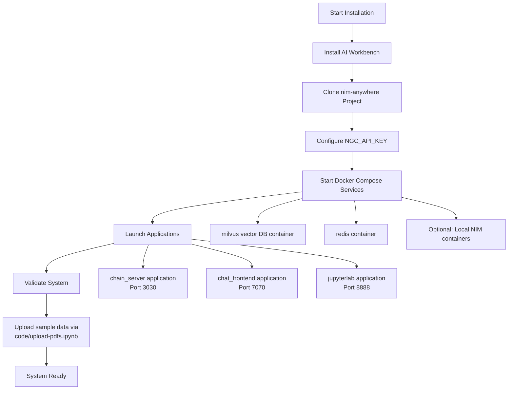
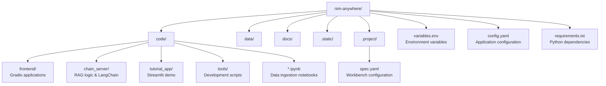
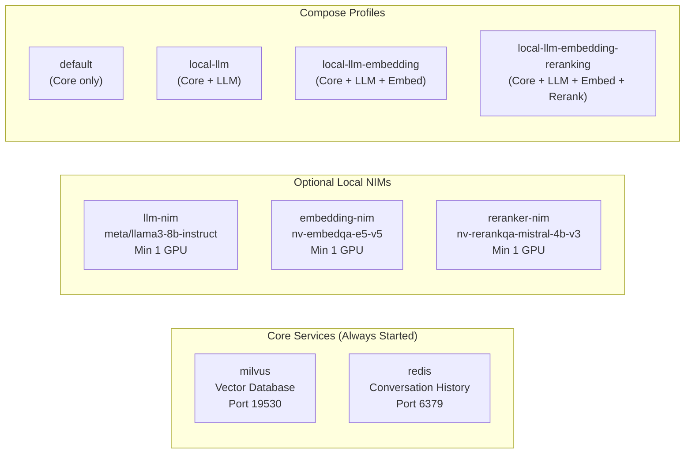
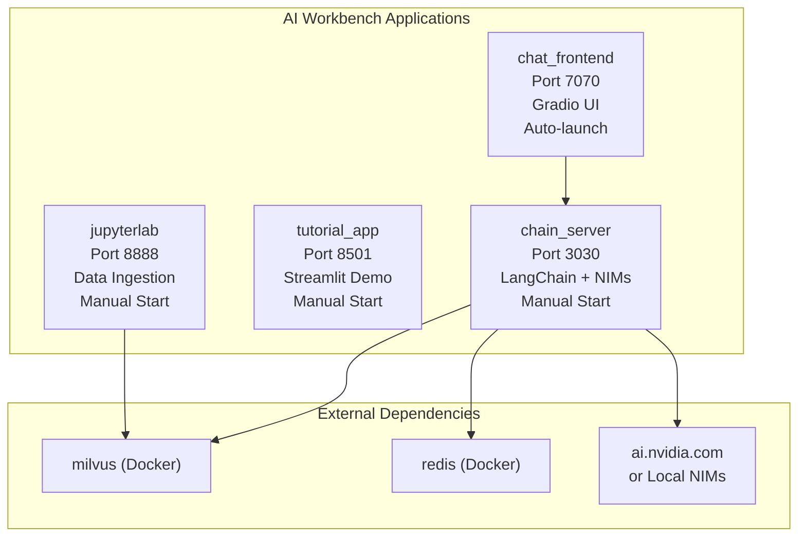
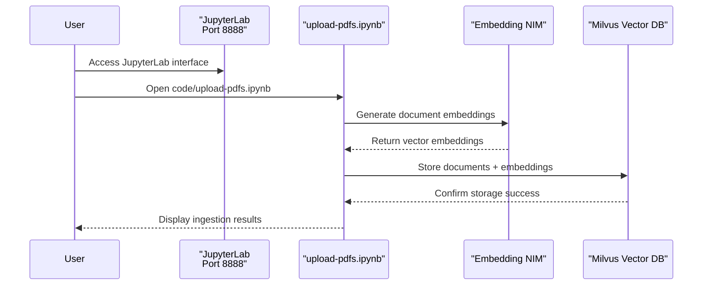

<!-- source: DeepWiki mcp.deepwiki.com · repo NVIDIA/nim-anywhere · page 2.2 Installation and Quick Start · fetched 2026-10-26 -->

# Installation and Quick Start

Relevant source files

The following files were used as context for generating this wiki page:

- [README.md](README.md)
- [code/frontend/__init__.py](code/frontend/__init__.py)
- [docs/0_0_quick_start.md](docs/0_0_quick_start.md)

This document provides step-by-step instructions for installing and running NVIDIA NIM Anywhere for the first time. It covers the complete process from AI Workbench setup through initial system validation.

For prerequisite setup including NGC authentication and Docker configuration, see [Prerequisites and Authentication](#2.1). For detailed system configuration options, see [Configuration](#5). For development environment setup, see [Development Environment](#6.1).

## Installation Process Overview

The installation process involves setting up the AI Workbench orchestration environment, downloading the project, and starting the containerized services that comprise the RAG system.

**Installation Flow Diagram**

Sources: [README.md:143-152](), [README.md:443-512]()

## AI Workbench Installation

NVIDIA AI Workbench orchestrates the entire system including Docker Compose services and application lifecycle management. The installation process varies by operating system.

### Supported Platforms

| Platform | Local Development | Remote Development |
|----------|------------------|-------------------|
| Windows | ✓ (via WSL2) | ✓ (client only) |
| MacOS | ✓ | ✓ (client only) |
| Ubuntu | ✓ | ✓ (server and client) |

### Installation Requirements

**Prerequisites for all platforms:**
- Docker Desktop or compatible container runtime
- Git client with GitHub authentication
- For GPU acceleration: NVIDIA drivers and Docker GPU support

**For remote development:**
- SSH key-based authentication configured
- Ubuntu server with NVIDIA drivers

The detailed installation steps for each platform are provided in the AI Workbench documentation. The key configuration choice is selecting Docker as the container runtime during setup.

Sources: [README.md:127-349]()

## Project Download and Configuration

### Cloning the Repository

The project can be acquired through AI Workbench's clone functionality:

1. **Access AI Workbench**: Open the local or remote AI Workbench instance
2. **Clone Project**: Select "Clone Project" from the projects interface  
3. **Repository URL**: Use `https://github.com/NVIDIA/nim-anywhere.git`
4. **Bootstrap Environment**: AI Workbench automatically downloads dependencies defined in `requirements.txt` and executes `postBuild.bash`

**Project Structure After Clone**

Sources: [README.md:351-398](), [README.md:937-959]()

### Essential Configuration

The primary configuration requirement is setting the NGC API key for accessing NVIDIA AI services:

1. **Navigate to Environment**: Access the "Environment" tab in AI Workbench
2. **Configure Secrets**: Locate the `NGC_API_KEY` entry in the Secrets section
3. **Set API Key**: Enter the NGC Personal Key generated in the prerequisites step

This key enables access to NVIDIA's hosted AI models at `https://integrate.api.nvidia.com/v1` as configured in the default `config.yaml`.

Sources: [README.md:400-419]()

## System Startup Process

The system startup involves two phases: infrastructure services via Docker Compose, followed by application services managed by AI Workbench.

### Phase 1: Infrastructure Services

**Docker Compose Service Profiles**

**Startup Steps:**
1. **Navigate to Environment > Compose**: Access the Docker Compose management interface
2. **Select Profile**: Choose deployment profile based on available GPU resources
3. **Start Services**: Click "Start" to launch the selected service profile

Sources: [README.md:443-497]()

### Phase 2: Application Services  

**Application Architecture**

**Application Startup Sequence:**
1. **Start Chain Server**: Navigate to "Environment > Applications" and start `chain_server`
2. **Start Chat Frontend**: Start `chat_frontend` - this will auto-launch in browser
3. **Optional Services**: Start `jupyterlab` for data ingestion, `tutorial_app` for guided demos

Sources: [README.md:498-512](), [README.md:545-558]()

## Initial Validation and Knowledge Base Setup

### System Health Verification

After startup, verify system components are operational:

| Component | Verification Method | Expected Result |
|-----------|-------------------|-----------------|
| Chat Frontend | Browse to auto-opened browser window | Gradio interface loads |
| Chain Server | Check application logs in AI Workbench | Server running on port 3030 |
| Milvus | Container status in Compose tab | Running state |
| Redis | Container status in Compose tab | Running state |

### Knowledge Base Population

The system includes sample data and ingestion tools for initial testing:

**Data Ingestion Process**

**Setup Steps:**
1. **Launch JupyterLab**: Start the `jupyterlab` application from AI Workbench
2. **Open Ingestion Notebook**: Navigate to `code/upload-pdfs.ipynb`
3. **Run Default Ingestion**: Execute all cells to ingest sample PDF documents from `data/` directory
4. **Verify Success**: Confirm documents are loaded into Milvus collection

For custom datasets, upload documents to the `data/` directory and modify the notebook accordingly.

Sources: [README.md:514-528]()

## Next Steps

After successful installation and validation:

- **Chat Interface**: Use the Chat Frontend to test RAG queries against ingested documents
- **Configuration**: Explore [Configuration](#5) for customizing model endpoints and parameters  
- **Development**: See [Development Environment](#6.1) for extending the system
- **Tutorial**: Launch the `tutorial_app` for guided demonstrations of system capabilities

The system is now ready for production RAG workloads using NVIDIA NIMs with your enterprise data.

Sources: [README.md:529-544]()

---

