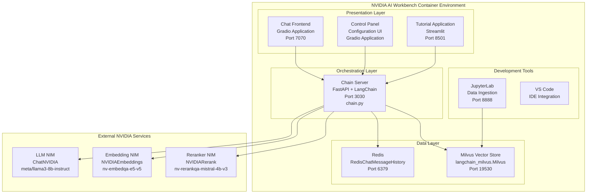
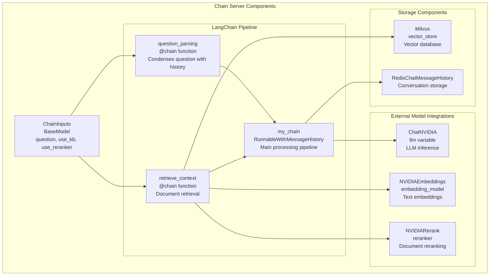
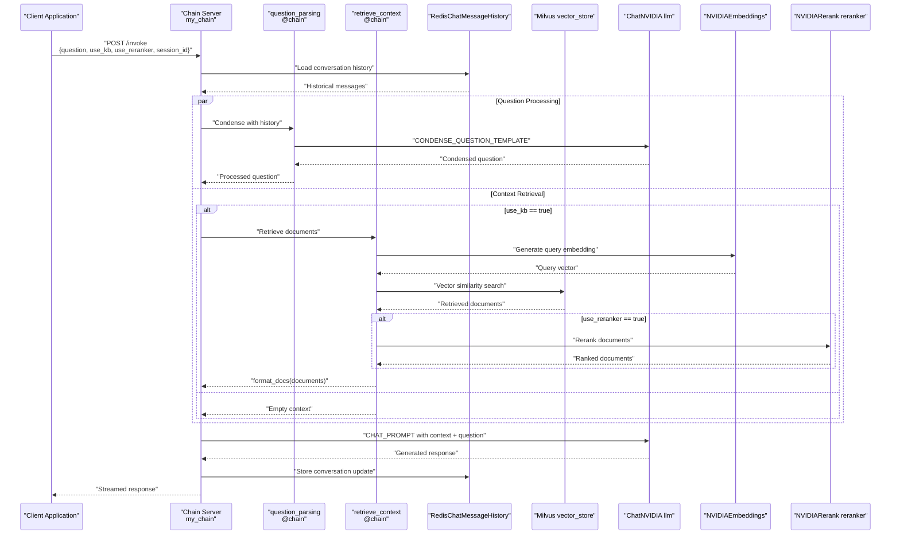
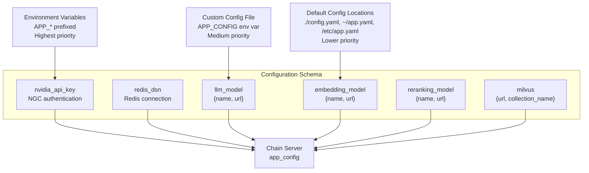

<!-- source: DeepWiki mcp.deepwiki.com · repo NVIDIA/nim-anywhere · page 3 Core Architecture · fetched 2026-10-26 -->

# Core Architecture

<details>
<summary>Relevant source files</summary>

The following files were used as context for generating this wiki page:

- [README.md](README.md)
- [code/chain_server/chain.py](code/chain_server/chain.py)
- [code/frontend/__init__.py](code/frontend/__init__.py)

</details>


## Purpose and Scope

This document describes the core architectural components and design patterns of NVIDIA NIM Anywhere, focusing on how the system orchestrates RAG (Retrieval-Augmented Generation) pipelines using NVIDIA NIMs and LangChain. This covers the overall system design, component relationships, and data flow patterns.

For detailed information about the RAG chain implementation specifics, see [RAG Chain Implementation](#3.1). For AI Workbench integration details, see [AI Workbench Integration](#3.2). For user interface architecture, see [User Interfaces](#4).

## System Overview

NVIDIA NIM Anywhere is architected as a multi-tier system running within the NVIDIA AI Workbench environment. The system follows a microservices pattern with clear separation between presentation, orchestration, and data layers.

### High-Level Architecture



The architecture separates concerns across distinct layers, with the `ChainServer` serving as the central orchestration point for all RAG operations.

**Sources:** [README.md:1-993](), [code/chain_server/chain.py:1-138]()

## Core Components

### Chain Server (`chain.py`)

The `ChainServer` implements the core RAG logic using LangChain components. It exposes a FastAPI-based REST interface and orchestrates the complete RAG pipeline.



**Sources:** [code/chain_server/chain.py:17-138]()

### Frontend Applications

The system provides three distinct user interfaces, each implemented as separate Gradio applications:

| Component | Technology | Purpose | Port |
|-----------|------------|---------|------|
| Chat Frontend | Gradio | Primary RAG interaction interface | 7070 |
| Control Panel | Gradio | System configuration and KB management | Variable |
| Tutorial App | Streamlit | Interactive learning environment | 8501 |

**Sources:** [README.md:43-511]()

### Data Management Components

#### Vector Storage (`Milvus`)
The system uses `langchain_milvus.Milvus` as the vector store, configured with the embedding model and collection settings:

```python
vector_store = Milvus(
    embedding_function=embedding_model,
    connection_args={"uri": app_config.milvus.url},
    collection_name=app_config.milvus.collection_name,
    auto_id=True,
)
```

#### Conversation History (`RedisChatMessageHistory`)
Chat sessions are persisted using Redis through LangChain's `RedisChatMessageHistory`:

```python
RedisChatMessageHistory(session_id, url=str(app_config.redis_dsn))
```

**Sources:** [code/chain_server/chain.py:41-46](), [code/chain_server/chain.py:130]()

## RAG Processing Flow

The system implements a sophisticated RAG pipeline with optional reranking and conversation history management.

### Request Processing Pipeline



**Sources:** [code/chain_server/chain.py:76-113](), [code/chain_server/chain.py:128-134]()

## Configuration Management

The system implements a hierarchical configuration system supporting multiple sources and environment variable overrides.

### Configuration Hierarchy



The configuration is loaded through the `app_config` module and used to initialize all NVIDIA AI service connections.

**Sources:** [README.md:560-685](), [code/chain_server/chain.py:32]()

## Service Integration

### NVIDIA AI Services Integration

The system integrates with three categories of NVIDIA AI services through standardized interfaces:

| Service Type | Class | Configuration | Purpose |
|--------------|-------|---------------|---------|
| LLM | `ChatNVIDIA` | `app_config.llm_model` | Text generation and reasoning |
| Embeddings | `NVIDIAEmbeddings` | `app_config.embedding_model` | Text vectorization for retrieval |
| Reranking | `NVIDIARerank` | `app_config.reranking_model` | Document relevance scoring |

### Retrieval Strategy Implementation

The system implements a flexible retrieval strategy with optional reranking:

```python
# Base retriever
retriever = vector_store.as_retriever()

# Enhanced retriever with reranking
reranking_retriever = ContextualCompressionRetriever(
    base_compressor=reranker, 
    base_retriever=retriever
)
```

The `retrieve_context` function dynamically selects between retrieval strategies based on the `use_reranker` parameter.

**Sources:** [code/chain_server/chain.py:35-55](), [code/chain_server/chain.py:76-89]()

### AI Workbench Orchestration

NVIDIA AI Workbench serves as the container orchestration platform, managing:

- **Application Lifecycle**: Automatic startup/shutdown of frontend applications
- **Service Dependencies**: Docker Compose coordination for Redis and Milvus
- **Environment Management**: Configuration injection and secret management
- **Development Integration**: JupyterLab and VS Code integration

The system is designed to scale from development environments to production deployments while maintaining consistent configuration and service integration patterns.

**Sources:** [README.md:127-512]()

---

