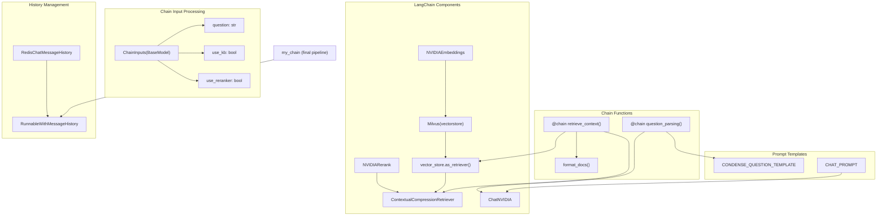
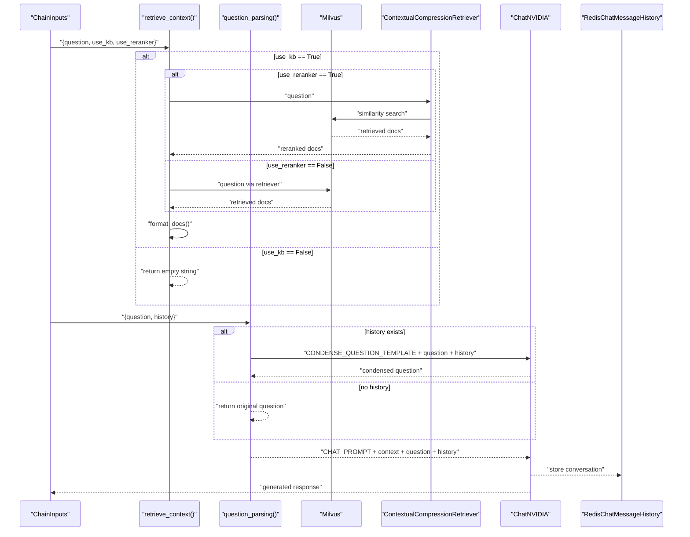
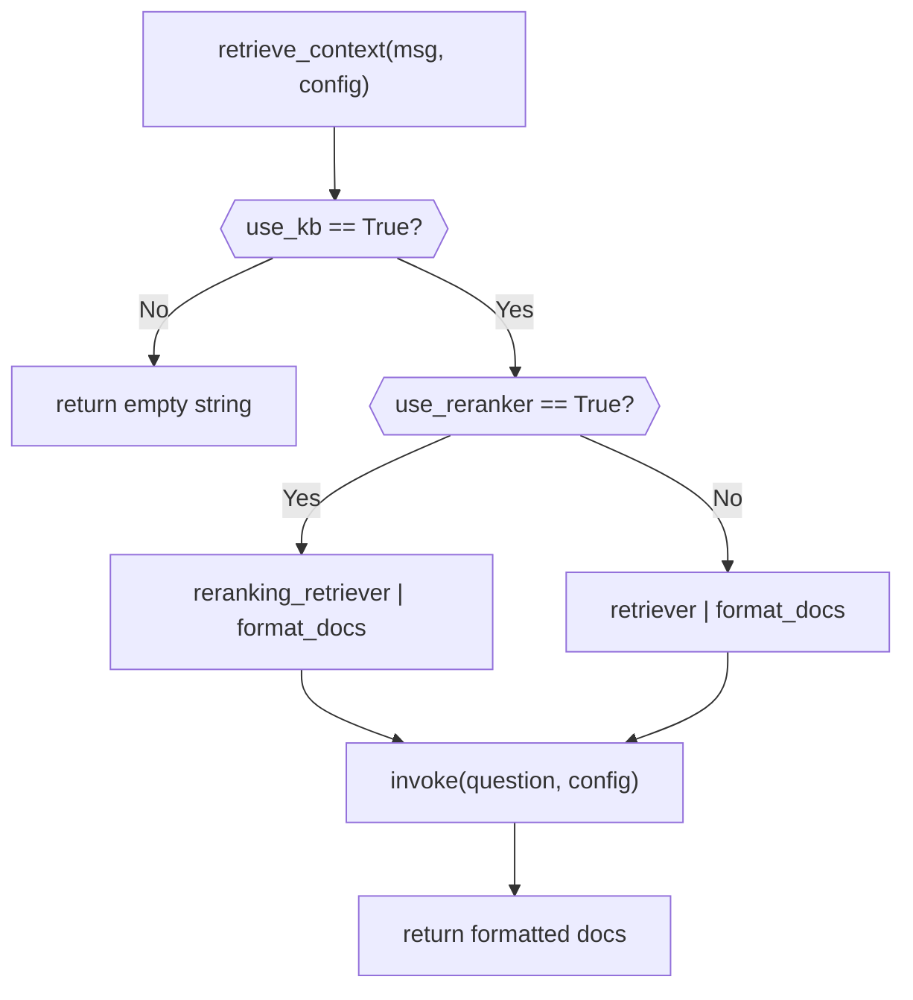

<!-- source: DeepWiki mcp.deepwiki.com · repo NVIDIA/nim-anywhere · page 3.1 RAG Chain Implementation · fetched 2026-10-26 -->

# RAG Chain Implementation

<details>
<summary>Relevant source files</summary>

The following files were used as context for generating this wiki page:

- [code/chain_server/chain.py](code/chain_server/chain.py)
- [code/chain_server/prompts.py](code/chain_server/prompts.py)
- [variables.env](variables.env)

</details>


## Purpose and Scope

This document provides a detailed technical explanation of the RAG (Retrieval-Augmented Generation) chain implementation in NVIDIA NIM Anywhere. It covers the core chain processing logic, LangChain integration, component architecture, and the orchestration of retrieval, reranking, and generation stages.

For information about AI Workbench integration and deployment orchestration, see [AI Workbench Integration](#3.2). For model configuration details, see [Model Configuration](#5.2).

## Core RAG Chain Architecture

The RAG chain implementation is built using LangChain and consists of several interconnected components that process user queries through retrieval, optional reranking, and generation stages.

### RAG Chain Component Architecture



Sources: [code/chain_server/chain.py:17-138]()

### Chain Processing Flow



Sources: [code/chain_server/chain.py:76-135]()

## Chain Components

### Embedding and Vector Store Components

The embedding model and vector store form the foundation of the retrieval system:

| Component | Implementation | Configuration Source |
|-----------|----------------|---------------------|
| `embedding_model` | `NVIDIAEmbeddings` | `app_config.embedding_model.name` |
| `vector_store` | `Milvus` | `app_config.milvus.url` |
| `retriever` | `vector_store.as_retriever()` | Generated from vector store |

The embedding model is configured with truncation set to "END" and connects to NVIDIA's embedding endpoints. The Milvus vector store uses the embedding model as its embedding function and connects to the configured Milvus instance.

Sources: [code/chain_server/chain.py:35-47]()

### Reranking Components

The reranking system provides optional document reordering for improved relevance:

```python
reranker = NVIDIARerank(
    model=app_config.reranking_model.name,
    base_url=str(app_config.reranking_model.url),
    api_key=app_config.nvidia_api_key,
    truncate="END",
)
reranking_retriever = ContextualCompressionRetriever(
    base_compressor=reranker, 
    base_retriever=retriever
)
```

The `ContextualCompressionRetriever` wraps the base retriever with the reranking model to provide contextually compressed and reordered results.

Sources: [code/chain_server/chain.py:49-55]()

### Language Model Component

The LLM component uses NVIDIA's ChatNVIDIA integration:

```python
llm = ChatNVIDIA(
    model=app_config.llm_model.name,
    curr_mode="nim",
    base_url=str(app_config.llm_model.url),
    api_key=app_config.nvidia_api_key,
)
```

The model is configured in NIM mode and connects to the specified LLM endpoint.

Sources: [code/chain_server/chain.py:64-69]()

## Chain Function Implementation

### Document Retrieval Function

The `retrieve_context` function implements the retrieval logic with conditional branching:



The function uses the `@chain` decorator to integrate with LangChain's execution framework and supports both standard retrieval and reranked retrieval based on the input parameters.

Sources: [code/chain_server/chain.py:76-90]()

### Question Processing Function

The `question_parsing` function handles chat history integration:

```python
@chain
async def question_parsing(msg, config) -> str:
    """Condense the question with chat history"""
    
    condense_question_prompt = prompts.CONDENSE_QUESTION_TEMPLATE.with_config(run_name="condense_question_prompt")
    condensed_chain = condense_question_prompt | llm | StrOutputParser().with_config(run_name="condense_question_chain")
    if msg["history"]:
        return condensed_chain.invoke(msg, config)
    return msg["question"]
```

This function creates a standalone question from the current question and chat history using the `CONDENSE_QUESTION_TEMPLATE` prompt.

Sources: [code/chain_server/chain.py:93-102]()

### Document Formatting

The `format_docs` utility function concatenates document content:

```python
def format_docs(docs: list[Document]) -> str:
    """Take in a list of docs and concatenate the content, separating by newlines."""
    return "\n\n".join(doc.page_content for doc in docs)
```

Sources: [code/chain_server/chain.py:58-61]()

## Chain Composition and History Integration

### Main Chain Pipeline

The main chain (`my_chain`) is composed using LangChain's pipeline syntax:

```python
my_chain = (
    {
        "context": retrieve_context,
        "question": question_parsing,
        "history": itemgetter("history"),
    }
    | RunnablePassthrough().with_config(run_name="LLM Prompt Input")
    | prompts.CHAT_PROMPT
    | llm
)
```

This creates a parallel execution of context retrieval and question processing, followed by prompt formatting and LLM generation.

Sources: [code/chain_server/chain.py:104-113]()

### History Management Integration

The final chain integrates Redis-based message history:

```python
my_chain = RunnableWithMessageHistory(
    my_chain,
    lambda session_id: RedisChatMessageHistory(session_id, url=str(app_config.redis_dsn)),
    input_messages_key="question",
    output_messages_key="output",
    history_messages_key="history",
).with_types(input_type=ChainInputs)
```

This wrapper provides automatic conversation history management using Redis as the storage backend.

Sources: [code/chain_server/chain.py:128-135]()

## Input and Output Models

### ChainInputs Schema

The chain uses Pydantic models for type safety and validation:

```python
class ChainInputs(BaseModel):
    """Declaration of the chain's input values."""
    
    question: str
    use_kb: bool = False
    use_reranker: bool = False

ChainOutputs = str
```

The input model defines the expected parameters for chain execution, with optional flags for knowledge base usage and reranking.

Sources: [code/chain_server/chain.py:117-126]()

## Prompt Templates

The chain uses two main prompt templates defined in the prompts module:

| Template | Purpose | Variables |
|----------|---------|-----------|
| `CONDENSE_QUESTION_TEMPLATE` | Question condensation with history | `{history}`, `{question}` |
| `CHAT_PROMPT` | Main conversation prompt | `{context}`, `{history}`, `{question}` |

The `CHAT_PROMPT` uses a `ChatPromptTemplate` with system message, history placeholder, and human message components.

Sources: [code/chain_server/prompts.py:24-47]()

---

