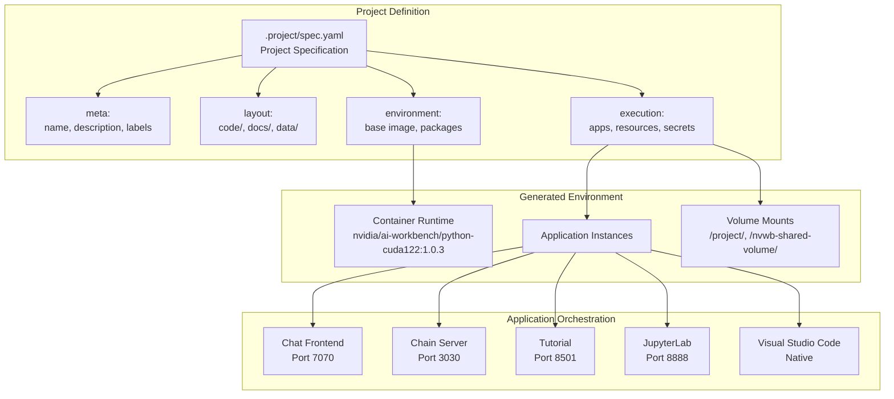
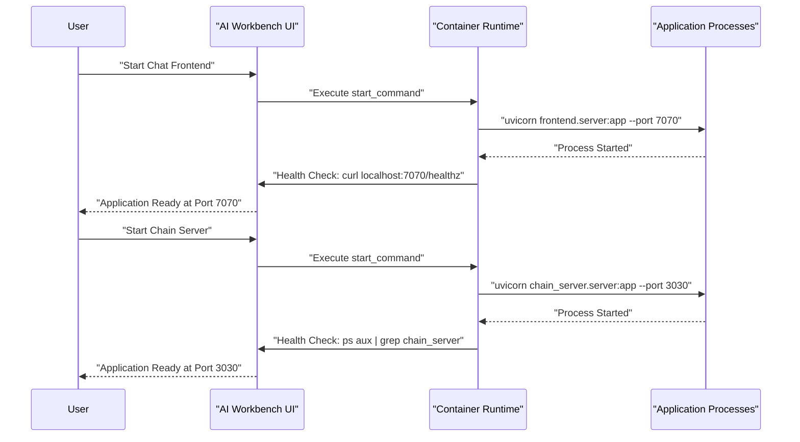
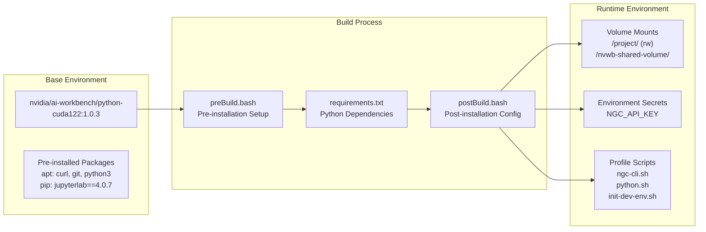
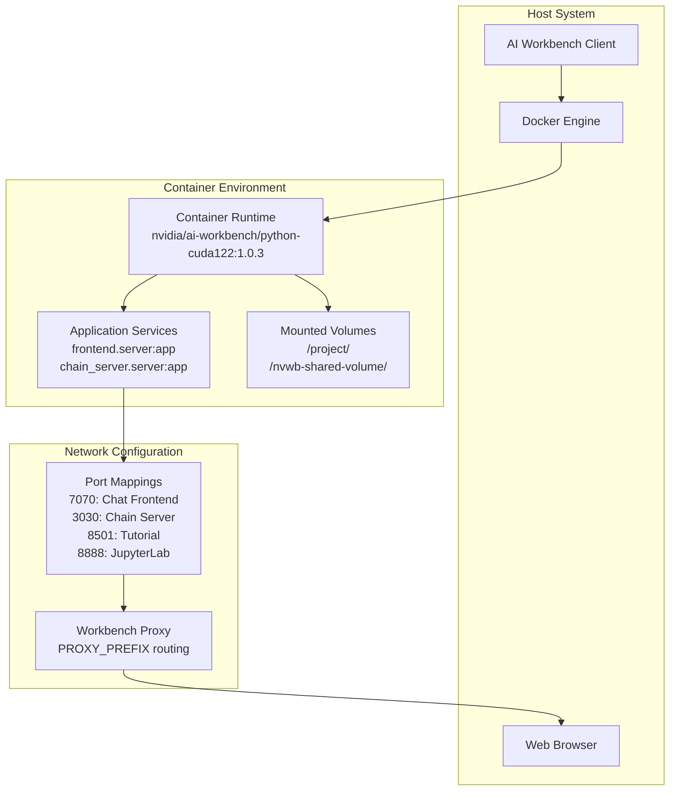
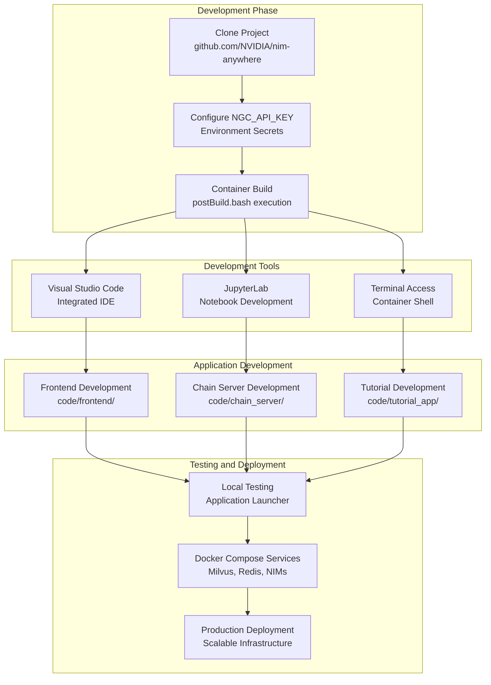

<!-- source: DeepWiki mcp.deepwiki.com · repo NVIDIA/nim-anywhere · page 3.2 AI Workbench Integration · fetched 2026-10-26 -->

# AI Workbench Integration

Relevant source files

The following files were used as context for generating this wiki page:

- [.project/spec.yaml](.project/spec.yaml)
- [README.md](README.md)
- [code/frontend/__init__.py](code/frontend/__init__.py)
- [postBuild.bash](postBuild.bash)

This page covers how NVIDIA NIM Anywhere integrates with NVIDIA AI Workbench for orchestration, deployment, and development environment management. AI Workbench serves as the primary platform that coordinates all system components, manages container environments, and provides the development workflow infrastructure.

For information about the RAG processing pipeline implementation, see [RAG Chain Implementation](#3.1). For details about individual user interface components, see [User Interfaces](#4).

## Project Specification System

The core of AI Workbench integration is the project specification file that defines the entire project structure, environment, and application orchestration.

The project specification defines four main sections that control how AI Workbench manages the system:

**Project Metadata and Layout**: The `meta` section defines the project identity and Docker image name, while `layout` specifies directory mappings for code, documentation, and data storage with appropriate Git and Git LFS handling.

**Environment Configuration**: The `environment.base` section specifies the container foundation, using `nvidia/ai-workbench/python-cuda122:1.0.3` as the base image with pre-installed packages managed through `apt` and `pip` package managers.

**Application Execution**: The `execution.apps` array defines all launchable applications with their start commands, health checks, networking configuration, and UI integration settings.

Sources: [.project/spec.yaml:1-169]()

## Application Orchestration

AI Workbench orchestrates multiple application types through standardized interfaces defined in the project specification.

The application orchestration system manages five distinct application types:

**Web Applications**: `Chat Frontend`, `Chain Server`, and `Tutorial` are configured as webapp class applications with specific port bindings, proxy configurations, and health check commands. Each webapp includes `autolaunch` settings and URL routing through the Workbench proxy system.

**Development Tools**: `JupyterLab` provides an interactive development environment with Jupyter notebook support, while `Visual Studio Code` integrates as a native application for code editing and debugging.

**Process Management**: Each application defines `start_command`, `health_check_command`, and `stop_command` for lifecycle management. Health checks use HTTP endpoints for web services and process monitoring for native applications.

Sources: [.project/spec.yaml:90-152]()

## Environment Management

AI Workbench manages the development environment through container-based isolation with persistent configuration and dependency management.

The environment management system provides three layers of configuration:

**Base Container**: The foundation uses `nvidia/ai-workbench/python-cuda122:1.0.3` with Ubuntu 22.04, CUDA 12.2, and essential development tools pre-installed through package managers.

**Build-time Configuration**: `postBuild.bash` installs the NGC CLI, configures Python paths, sets up profile scripts, and initializes the tutorial environment with a separate Python virtual environment.

**Runtime Configuration**: Volume mounts provide persistent storage for project files and shared data, while the `NGC_API_KEY` secret enables authentication with NVIDIA services. Profile scripts ensure proper PATH configuration and Python environment setup.

Sources: [.project/spec.yaml:25-87](), [postBuild.bash:1-52]()

## Container Runtime Integration

The integration with Docker provides isolated execution environments while maintaining connectivity to external services and development tools.

The container runtime integration provides several key capabilities:

**Process Isolation**: Each application runs as a separate process within the shared container environment, managed by `uvicorn` servers for web applications and direct execution for native tools.

**Network Access**: Port forwarding exposes application services through the Workbench proxy system, which handles URL rewriting and authentication. The `PROXY_PREFIX` environment variable ensures correct routing in multi-tenant environments.

**Volume Persistence**: Project files are mounted read-write to `/project/`, while shared data uses a named volume for persistence across container restarts. Git and Git LFS integration maintains version control for different file types.

Sources: [.project/spec.yaml:160-168](), [README.md:127-141]()

## Development Workflow

AI Workbench integrates development tools and processes to provide a cohesive workflow for RAG system development and deployment.

The development workflow supports multiple development patterns:

**Project Initialization**: Users clone the repository through AI Workbench, which automatically triggers container building and environment setup. The NGC API key configuration enables access to NVIDIA services and container registries.

**Integrated Development**: Visual Studio Code provides full IDE capabilities with container integration, while JupyterLab enables interactive development and data exploration. Terminal access allows direct container manipulation and debugging.

**Application Testing**: The application launcher provides one-click startup for all services, with real-time log monitoring and health checking. Docker Compose integration manages external dependencies like vector databases and caching services.

Sources: [README.md:351-427](), [.project/spec.yaml:90-132]()

---

