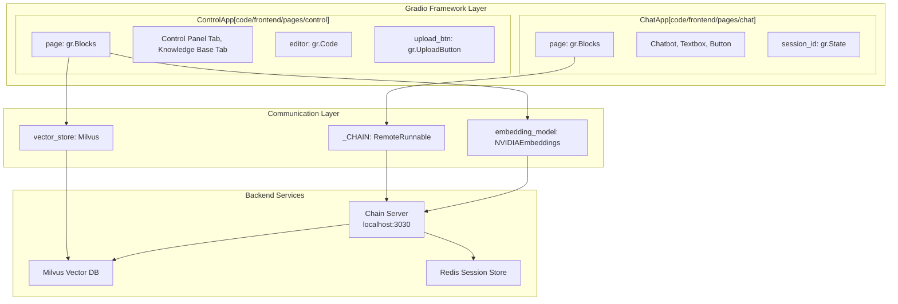
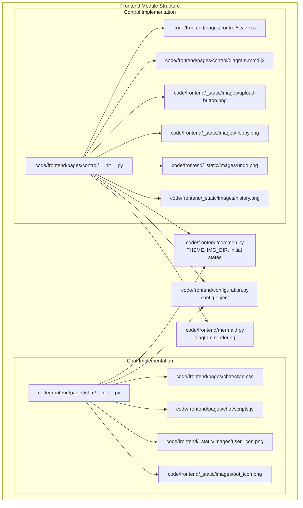
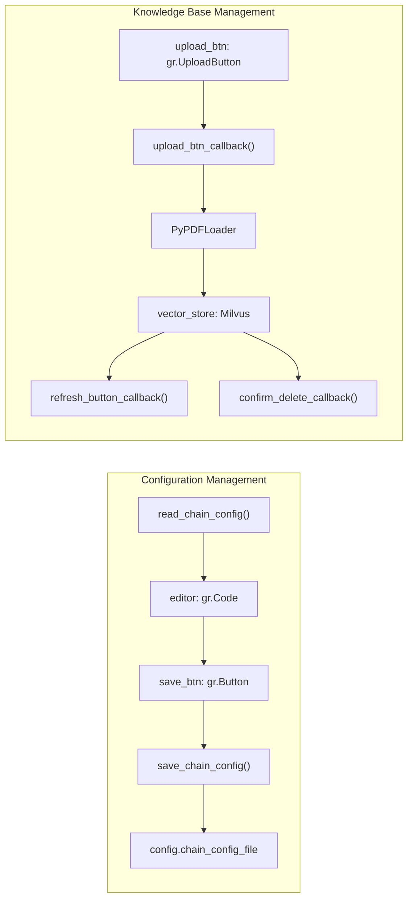

<!-- source: DeepWiki mcp.deepwiki.com · repo NVIDIA/nim-anywhere · page 4 User Interfaces · fetched 2026-10-26 -->

# User Interfaces

<details>
<summary>Relevant source files</summary>

The following files were used as context for generating this wiki page:

- [code/frontend/_static/images/upload-button.png](code/frontend/_static/images/upload-button.png)
- [code/frontend/pages/chat/__init__.py](code/frontend/pages/chat/__init__.py)
- [code/frontend/pages/control/__init__.py](code/frontend/pages/control/__init__.py)
- [code/frontend/pages/control/style.css](code/frontend/pages/control/style.css)
- [requirements.txt](requirements.txt)

</details>


The NVIDIA NIM Anywhere system provides three distinct web-based user interfaces for different aspects of RAG system interaction and management. This page covers the technical implementation and architecture of these frontend applications.

For detailed information about individual interface usage, see [Chat Frontend](#4.1), [Control Panel](#4.2), and [Tutorial Application](#4.3). For backend RAG processing logic, see [RAG Chain Implementation](#3.1).

## Overview

The system implements three Gradio-based web applications that serve different user roles and workflows:

| Interface | Framework | Port | Purpose | Auto-Launch |
|-----------|-----------|------|---------|-------------|
| Chat Frontend | Gradio | 7070 | Primary RAG interaction interface | Yes |
| Control Panel | Gradio | N/A | System configuration and knowledge base management | No |
| Tutorial Application | Streamlit | 8501 | Interactive learning and demonstration | No |

All interfaces run within the NVIDIA AI Workbench container environment and communicate with the chain server backend via HTTP APIs.

## Frontend Architecture



**Sources:** [code/frontend/pages/chat/__init__.py:1-104](), [code/frontend/pages/control/__init__.py:1-342]()

## Component Implementation Structure



**Sources:** [code/frontend/pages/chat/__init__.py:30-40](), [code/frontend/pages/control/__init__.py:37-82]()

## Communication Patterns

### Chat Frontend Communication Flow

The chat interface implements asynchronous streaming communication with the chain server:

```mermaid
sequenceDiagram
    participant User
    participant "gr.Textbox" as MsgBox
    participant "stream_chain()" as StreamFunc
    participant "_CHAIN: RemoteRunnable" as Chain
    participant "Chain Server" as Server
    participant "gr.Chatbot" as ChatBot
    
    User->>MsgBox: "Enter message"
    MsgBox->>StreamFunc: "msg.submit trigger"
    StreamFunc->>Chain: "chain.astream({question, use_kb, use_reranker})"
    Chain->>Server: "HTTP POST /invoke"
    
    loop "Streaming Response"
        Server-->>Chain: "chunk.content"
        Chain-->>StreamFunc: "yield chunk"
        StreamFunc-->>ChatBot: "update chat[-1][1]"
        ChatBot-->>User: "display partial response"
    end
    
    alt "Connection Error"
        Chain-->>StreamFunc: "ConnectError"
        StreamFunc-->>ChatBot: "❌ Can't reach chain server"
    end
    
    alt "Server Error"
        Chain-->>StreamFunc: "HTTPStatusError"
        StreamFunc-->>ChatBot: "❌ Chain server error"
    end
```

**Sources:** [code/frontend/pages/chat/__init__.py:76-104]()

### Control Panel Data Management

The control panel manages both configuration and knowledge base operations:



**Sources:** [code/frontend/pages/control/__init__.py:179-341]()

## Key Frontend Components

### Gradio Component Definitions

The interfaces utilize specific Gradio components with custom configuration:

| Component | Usage | Key Properties |
|-----------|-------|----------------|
| `gr.Chatbot` | Chat display | `bubble_full_width=False`, `avatar_images=_AVATAR_IMAGES` |
| `gr.Textbox` | Message input | `container=False`, `elem_id="msg"` |
| `gr.Code` | YAML editor | `language="yaml"`, `interactive=True` |
| `gr.UploadButton` | File upload | `file_types=[".pdf"]`, `file_count="multiple"` |
| `gr.Checkbox` | Feature toggles | `USE_KB_INITIAL`, `USE_RERANKER_INITIAL` |

### State Management Implementation

Both interfaces implement state management for different purposes:

**Chat Frontend:**
- `session_id = gr.State("")` - Maintains conversation session identity
- `use_kb = gr.Checkbox(USE_KB_INITIAL, visible=False)` - Hidden knowledge base toggle
- `use_reranker = gr.Checkbox(USE_RERANKER_INITIAL, visible=False)` - Hidden reranker toggle

**Control Panel:**
- Dynamic mermaid diagram updates based on checkbox states
- Configuration file change tracking with visual indicators
- Document list refresh after upload/delete operations

**Sources:** [code/frontend/pages/chat/__init__.py:46-48](), [code/frontend/pages/control/__init__.py:112-113]()

## JavaScript Integration

The frontend implements custom JavaScript for enhanced interactivity:

### Message Passing Between Interfaces

```javascript
// Control panel sends configuration updates to chat frontend
window.top.postMessage({"use_kb": val}, '*');
window.top.postMessage({"use_reranker": val}, '*');
```

### Configuration Editor Visual Feedback

```javascript
// Indicates unsaved changes with orange indicator
title.innerHTML = title.innerHTML.slice(0,-2) + "🟠";
// Indicates saved changes with green indicator  
title.innerHTML = title.innerHTML.slice(0,-2) + "🟢";
```

**Sources:** [code/frontend/pages/control/__init__.py:50-77]()

## Error Handling Patterns

The frontend implements comprehensive error handling for different failure modes:

### Chain Server Communication Errors

The chat interface distinguishes between connection and server errors:

```python
except (HTTPStatusError, ConnectError) as exc:
    if isinstance(exc, ConnectError) or 400 <= exc.response.status_code < 500:
        chat[-1][1] = "❌ **Uh oh...**\nI can't seem to reach to the chain server..."
    else:
        chat[-1][1] = "❌ **Uh oh...**\nThere was an error inside the chain server..."
```

### Configuration Validation

The control panel validates both YAML syntax and configuration schema:

```python
# validate yaml
config_data = yaml.safe_load(config_txt)
# validate configuration  
_ = ChainConfiguration.model_validate(config_data)
```

**Sources:** [code/frontend/pages/chat/__init__.py:87-102](), [code/frontend/pages/control/__init__.py:222-231]()

---

