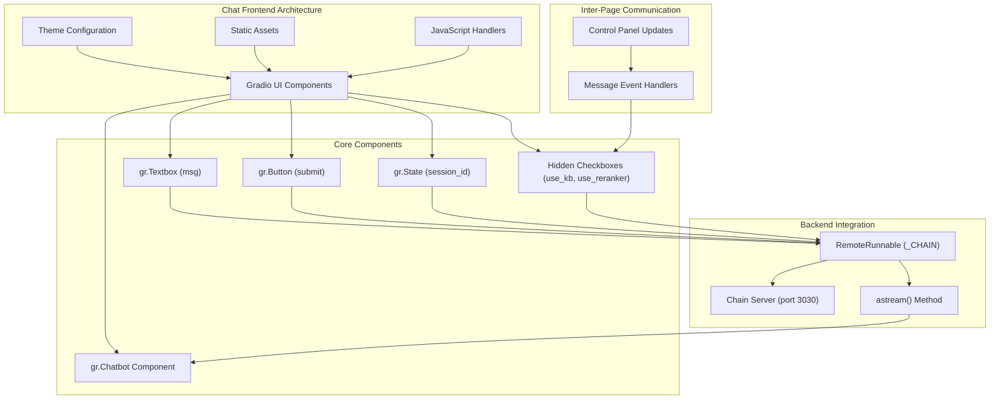
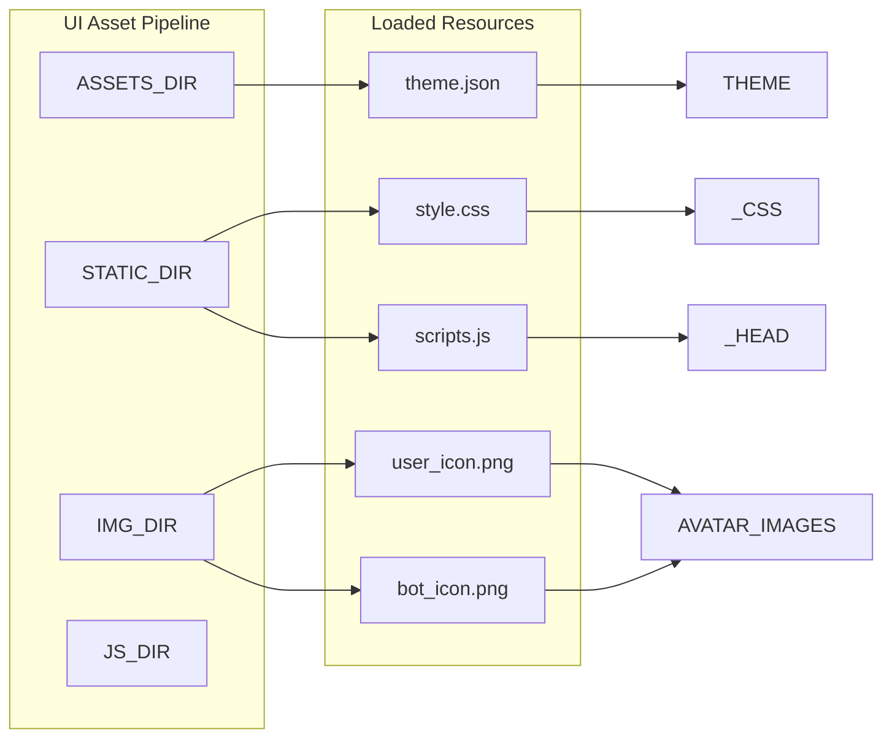
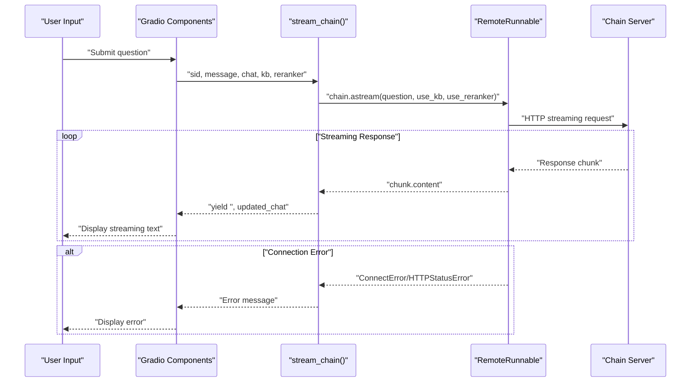

<!-- source: DeepWiki mcp.deepwiki.com · repo NVIDIA/nim-anywhere · page 4.1 Chat Frontend · fetched 2026-10-26 -->

# Chat Frontend

<details>
<summary>Relevant source files</summary>

The following files were used as context for generating this wiki page:

- [code/frontend/_static/js/events.js](code/frontend/_static/js/events.js)
- [code/frontend/common.py](code/frontend/common.py)
- [code/frontend/pages/chat/__init__.py](code/frontend/pages/chat/__init__.py)
- [code/frontend/pages/chat/scripts.js](code/frontend/pages/chat/scripts.js)

</details>


## Purpose and Scope

The Chat Frontend provides the primary user interface for interacting with the NVIDIA NIM Anywhere RAG system. This Gradio-based web application enables users to submit questions and receive AI-generated responses in a conversational chat format. The frontend handles real-time streaming of responses from the chain server and integrates with the control panel for configuration management.

For system configuration and knowledge base management, see [Control Panel](#4.2). For backend RAG processing logic, see [RAG Chain Implementation](#3.1).

## Architecture Overview

The Chat Frontend is implemented as a Gradio application that serves as the main entry point for user interactions with the RAG system. It communicates with the chain server via HTTP streaming and receives configuration updates from the control panel through JavaScript message passing.



**Sources:** [code/frontend/pages/chat/__init__.py:44-104](), [code/frontend/common.py:16-31]()

## User Interface Components

The chat interface consists of several key Gradio components organized in a clean, responsive layout:

### Primary Components

| Component | Element ID | Purpose | Implementation |
|-----------|------------|---------|----------------|
| `gr.Chatbot` | `chat` | Main conversation display | Handles message history and streaming responses |
| `gr.Textbox` | `msg` | User input field | Container-less text input for questions |
| `gr.Button` | `submit` | Submit button | Triggers message submission with "➤" symbol |
| `gr.State` | N/A | Session tracking | Stores UUID for conversation persistence |
| `gr.Checkbox` | `use_kb` | Knowledge base toggle | Hidden, controlled by control panel |
| `gr.Checkbox` | `use_reranker` | Reranker toggle | Hidden, controlled by control panel |

### Visual Configuration

The interface uses customized styling and assets:

- **Theme**: Loaded from `theme.json` via `THEME` configuration
- **Avatars**: User (`user_icon.png`) and bot (`bot_icon.png`) icons 
- **CSS**: Custom styling from `style.css` for layout and appearance
- **JavaScript**: Dynamic resizing and event handling from `scripts.js`



**Sources:** [code/frontend/pages/chat/__init__.py:29-42](), [code/frontend/common.py:22-30]()

## Backend Integration

The chat frontend communicates with the chain server through LangServe's `RemoteRunnable` interface, enabling seamless streaming of AI responses.

### Chain Server Communication

The `_CHAIN` object establishes the connection to the backend:



### Error Handling

The `stream_chain` function implements comprehensive error handling for common failure scenarios:

- **Connection Errors**: When chain server is unreachable
- **HTTP 4xx Errors**: Client-side configuration issues  
- **HTTP 5xx Errors**: Server-side processing errors

**Sources:** [code/frontend/pages/chat/__init__.py:76-103](), [code/frontend/pages/chat/__init__.py:41]()

## Inter-Page Communication

The chat frontend receives configuration updates from the control panel through JavaScript message passing, allowing real-time updates to RAG parameters without page refresh.

### Message Event System

```mermaid
graph TB
    subgraph "Control Panel Page"
        KB_TOGGLE["Knowledge Base Toggle"]
        RERANKER_TOGGLE["Reranker Toggle"]
        POST_MESSAGE["postMessage()"]
    end
    
    subgraph "Chat Page"
        EVENT_LISTENER["window.addEventListener()"]
        USE_KB_UPDATE["use_kb Component Update"]
        USE_RERANKER_UPDATE["use_reranker Component Update"]
    end
    
    subgraph "Event Flow"
        MESSAGE_DATA['"use_kb": true/false, "use_reranker": true/false']
        GRADIO_CONFIG["gradio_config.components"]
        COMPONENT_LOOKUP["elem_id lookup"]
    end
    
    KB_TOGGLE --> POST_MESSAGE
    RERANKER_TOGGLE --> POST_MESSAGE
    POST_MESSAGE --> MESSAGE_DATA
    
    MESSAGE_DATA --> EVENT_LISTENER
    EVENT_LISTENER --> GRADIO_CONFIG
    GRADIO_CONFIG --> COMPONENT_LOOKUP
    COMPONENT_LOOKUP --> USE_KB_UPDATE
    COMPONENT_LOOKUP --> USE_RERANKER_UPDATE
```

### JavaScript Event Handlers

The chat page registers multiple event handlers for optimal user experience:

- **Window resize**: `chatResize()` function adjusts chat height dynamically
- **Message events**: Updates hidden checkboxes based on control panel state
- **Textarea events**: Maintains proper sizing during text input

**Sources:** [code/frontend/pages/chat/scripts.js:16-44](), [code/frontend/_static/js/events.js:17-25]()

## Technical Implementation Details

### Session Management

Each chat session is assigned a unique UUID via the `sid_generator()` function, enabling conversation persistence and context tracking in the chain server.

### Streaming Response Handling

The `stream_chain` async generator function handles real-time response streaming:

1. **Input Processing**: Combines user message with session context
2. **Chain Configuration**: Applies session ID to maintain conversation state  
3. **Streaming Loop**: Processes chunks and updates chat display incrementally
4. **Error Recovery**: Provides user-friendly error messages for various failure modes

### Component Lifecycle

The Gradio application follows this initialization sequence:

1. **Static Loading**: CSS, JavaScript, and theme assets loaded at module import
2. **Component Creation**: UI components instantiated with configuration
3. **Event Registration**: JavaScript handlers registered on page load
4. **Session Initialization**: UUID generated for new conversations

**Sources:** [code/frontend/pages/chat/__init__.py:66-69](), [code/frontend/pages/chat/__init__.py:76-103](), [code/frontend/pages/chat/scripts.js:24-28]()

---

