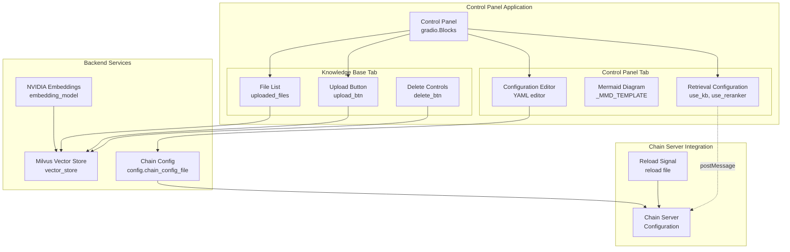
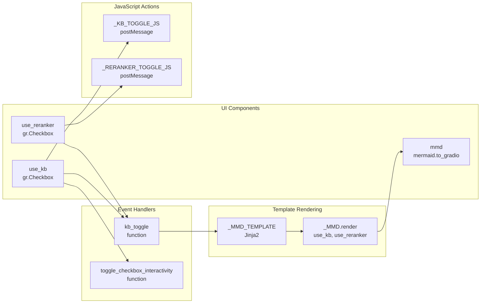
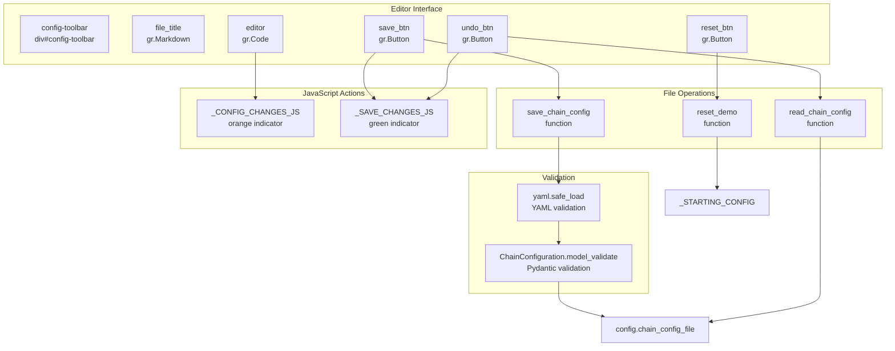
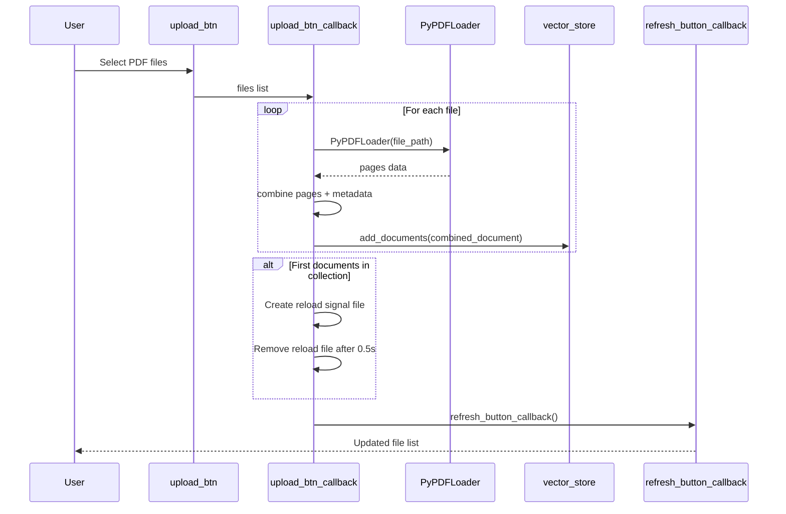
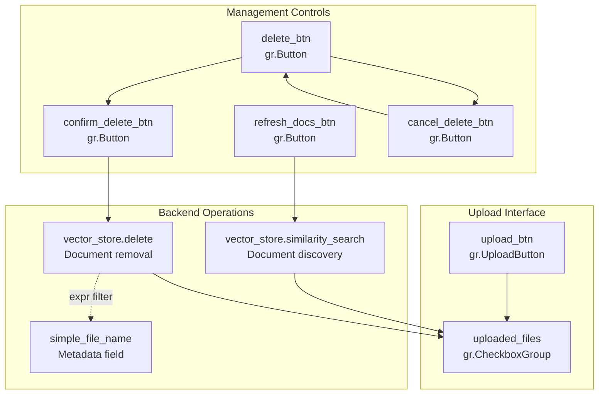
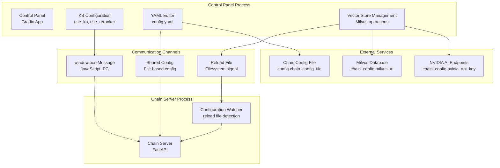

<!-- source: DeepWiki mcp.deepwiki.com · repo NVIDIA/nim-anywhere · page 4.2 Control Panel · fetched 2026-10-26 -->

# Control Panel

Relevant source files

The following files were used as context for generating this wiki page:

- [code/frontend/_static/images/upload-button.png](code/frontend/_static/images/upload-button.png)
- [code/frontend/pages/control/__init__.py](code/frontend/pages/control/__init__.py)
- [code/frontend/pages/control/style.css](code/frontend/pages/control/style.css)
- [requirements.txt](requirements.txt)

The Control Panel is an administrative interface built with Gradio that provides configuration management and knowledge base administration for the NVIDIA NIM Anywhere system. It allows users to configure RAG pipeline settings, manage vector database contents, and edit chain server configurations through a web-based interface.

For information about the main chat interface, see [Chat Frontend](#4.1). For details on system-wide configuration files, see [Configuration System](#5.1).

## Overview and Architecture

The Control Panel is implemented as a Gradio web application that serves as the administrative hub for the RAG system. It provides two primary interfaces: system configuration management and knowledge base administration.

**Sources:** [code/frontend/pages/control/__init__.py:102-341]()

## Control Panel Tab

The Control Panel tab provides two main administrative functions: retrieval configuration and chain server configuration management.

### Retrieval Configuration

The retrieval configuration section allows users to toggle key RAG pipeline features and visualize the resulting data flow.

| Component | Purpose | Implementation |
|-----------|---------|----------------|
| `use_kb` | Toggle knowledge base usage | `gr.Checkbox` with `USE_KB_INITIAL` default |
| `use_reranker` | Toggle reranker usage | `gr.Checkbox` with `USE_RERANKER_INITIAL` default |
| Mermaid visualization | Show current RAG flow | Dynamic template rendering via `_MMD.render()` |

**Sources:** [code/frontend/pages/control/__init__.py:109-117](), [code/frontend/pages/control/__init__.py:194-205]()

### Chain Server Configuration

The configuration editor provides a full-featured YAML editor for modifying chain server settings with validation and persistence.

**Sources:** [code/frontend/pages/control/__init__.py:119-241]()

## Knowledge Base Tab

The Knowledge Base tab provides comprehensive document management capabilities for the Milvus vector database.

### Document Upload Process

| Function | Purpose | Key Operations |
|----------|---------|----------------|
| `upload_btn_callback` | Process uploaded PDFs | File validation, content extraction, vector storage |
| `upload_document` | Convert PDF to vector embeddings | `PyPDFLoader`, page combination, metadata assignment |
| `refresh_button_callback` | Update document list display | Query vector store, extract filenames, update UI |

**Sources:** [code/frontend/pages/control/__init__.py:242-291]()

### Document Management Interface

**Sources:** [code/frontend/pages/control/__init__.py:144-341]()

## Integration Architecture

The Control Panel integrates with multiple system components through various communication mechanisms.

**Sources:** [code/frontend/pages/control/__init__.py:50-78](), [code/frontend/pages/control/__init__.py:87-100](), [code/frontend/pages/control/__init__.py:277-282]()

## Configuration Management

The Control Panel implements a sophisticated configuration management system with validation, persistence, and real-time feedback.

### Configuration Flow

| Stage | Component | Validation | Output |
|-------|-----------|------------|--------|
| Input | `gr.Code` editor | Syntax highlighting | Raw YAML text |
| Syntax Check | `yaml.safe_load()` | YAML parsing | Parsed data structure |
| Schema Validation | `ChainConfiguration.model_validate()` | Pydantic validation | Validated config object |
| Persistence | File write to `config.chain_config_file` | File system | Updated configuration |

### Visual State Indicators

The configuration editor provides real-time visual feedback through JavaScript-driven UI updates:

- **🟢 Green**: Saved state - configuration is persisted and valid
- **🟠 Orange**: Modified state - unsaved changes detected  
- **Default**: Clean state - no modifications since last save/load

**Sources:** [code/frontend/pages/control/__init__.py:67-77](), [code/frontend/pages/control/__init__.py:217-237]()

---

