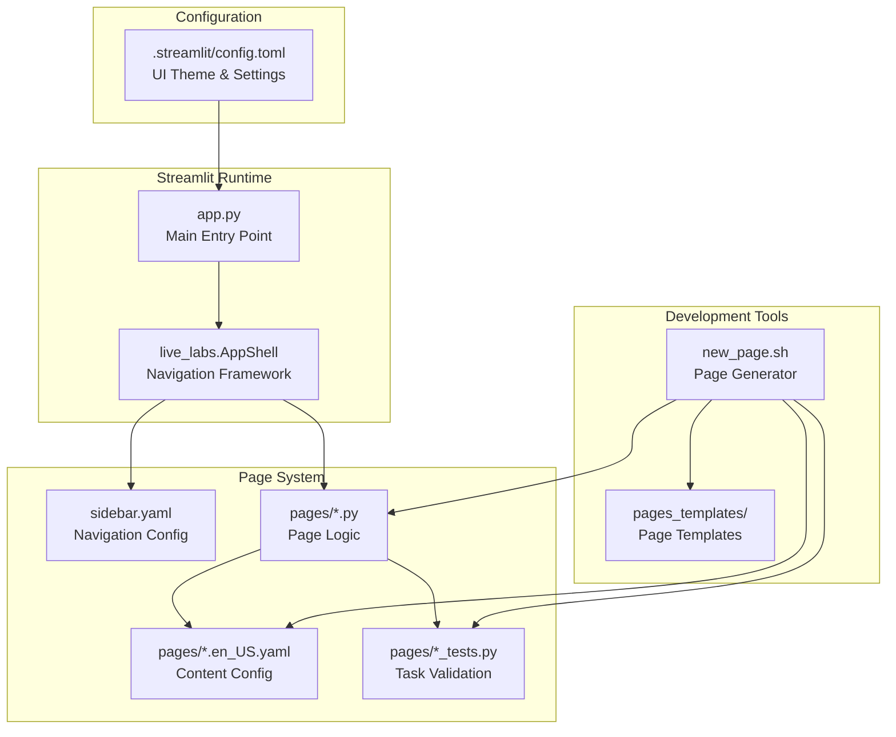
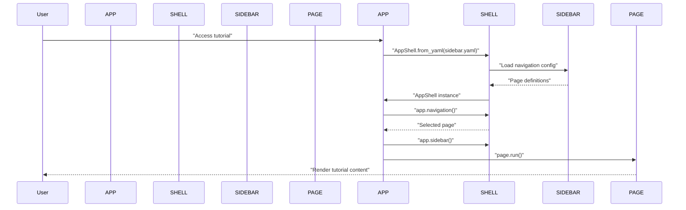
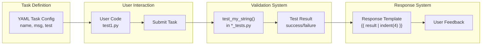
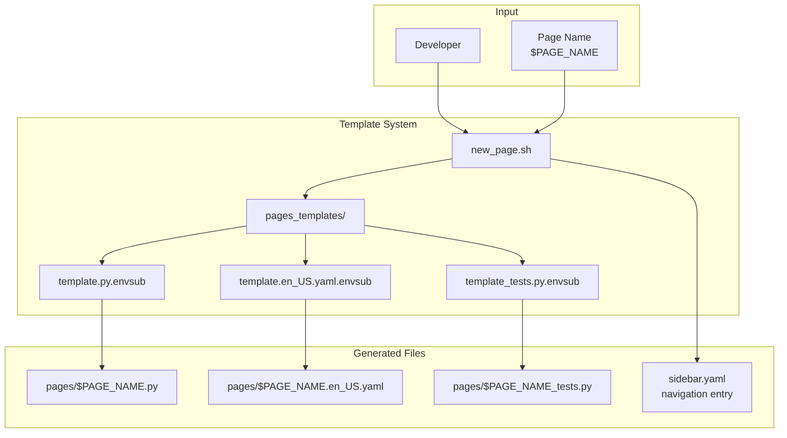

<!-- source: DeepWiki mcp.deepwiki.com · repo NVIDIA/nim-anywhere · page 4.3 Tutorial Application · fetched 2026-10-26 -->

# Tutorial Application

<details>
<summary>Relevant source files</summary>

The following files were used as context for generating this wiki page:

- [code/tutorial_app/.streamlit/config.toml](code/tutorial_app/.streamlit/config.toml)
- [code/tutorial_app/app.py](code/tutorial_app/app.py)
- [code/tutorial_app/new_page.sh](code/tutorial_app/new_page.sh)
- [code/tutorial_app/pages/__init__.py](code/tutorial_app/pages/__init__.py)
- [code/tutorial_app/pages/editor_test.en_US.yaml](code/tutorial_app/pages/editor_test.en_US.yaml)

</details>


## Purpose and Scope

The Tutorial Application is an interactive learning system built with Streamlit that provides guided, hands-on tutorials for working with NVIDIA NIM Anywhere. The application uses a page-based architecture with YAML configuration files to define tutorial content, tasks, and interactive testing capabilities.

This document covers the tutorial system's architecture, page structure, task execution framework, and development workflow. For information about other user interfaces in the system, see the Chat Frontend ([4.1](#4.1)) and Control Panel ([4.2](#4.2)). For development environment setup, see Development Environment ([6.1](#6.1)).

## Architecture Overview

The Tutorial Application is implemented as a Streamlit application that leverages the `live_labs` library for page management and interactive task execution. The system follows a modular design where each tutorial is defined by a set of files including Python page logic, YAML configuration, and test scripts.

### Tutorial Application Architecture



Sources: [code/tutorial_app/app.py:1-15](), [code/tutorial_app/pages/sidebar.yaml](), [code/tutorial_app/new_page.sh:1-17](), [code/tutorial_app/.streamlit/config.toml:1-16]()

## App Shell and Navigation

The tutorial application uses `live_labs.AppShell` as its core navigation framework. The main entry point loads the sidebar configuration and initializes the page routing system.

### Main Application Entry Point

The `app.py` file serves as the Streamlit application entry point:

```python
# Key components from app.py
app_shell_yaml = Path(__file__).parent.joinpath("pages", "sidebar.yaml")
app = live_labs.AppShell.from_yaml(app_shell_yaml)
page = app.navigation()
app.sidebar()
page.run()
```

### Navigation Flow



Sources: [code/tutorial_app/app.py:8-14]()

## Page Structure and Configuration

Each tutorial page consists of three main components: a Python module for page logic, a YAML configuration file for content, and a test module for task validation.

### YAML Configuration Structure

Tutorial pages are configured using YAML files with a standardized structure:

| Section | Purpose | Example Fields |
|---------|---------|----------------|
| Header | Page metadata and introduction | `title`, `welcome_msg`, `header` |
| General | UI strings and messages | `waiting_msg`, `testing_msg`, `next` |
| Tasks | Interactive task definitions | `name`, `msg`, `response`, `test` |
| Footer | Completion messages | `closing_msg` |
| Testing | Error and status messages | `info_test_timeout`, custom messages |

### Example Page Configuration

From the editor test example:

```yaml
# Header section
title: Write some code
welcome_msg: |
  In this example, we are going to write some code.

# Task definition
tasks:
  - name: Make a string
    msg: |
      In test1.py, define a string called `my_string` that equals `five`.
    response: |
      Nicely done! I checked and here is what I saw:
      {{ result | indent(4) }}
    test: test_my_string
```

Sources: [code/tutorial_app/pages/editor_test.en_US.yaml:1-47]()

## Task System and Testing

The tutorial system includes an interactive task framework that allows users to complete coding exercises with automated validation.

### Task Execution Flow



### Task Configuration Elements

- **Task Name**: Identifier for the task (`name: Make a string`)
- **Instructions**: Markdown content with hints (`msg` field with details/summary)
- **Test Function**: Reference to validation function (`test: test_my_string`)
- **Response Template**: Jinja2 template for feedback (`{{ result | indent(4) }}`)

### Error Handling

The system includes predefined error messages for common scenarios:

| Error Type | YAML Key | Purpose |
|------------|----------|---------|
| Execution Error | `info_test_nonzero_exit_code` | Code fails to run |
| Timeout | `info_test_timeout` | Code takes too long |
| Custom Validation | `info_no_my_string` | Task-specific failures |

Sources: [code/tutorial_app/pages/editor_test.en_US.yaml:16-46]()

## Development Workflow

The tutorial system includes tooling for creating new tutorial pages through a templating system.

### Page Generation Process



### Page Creation Script

The `new_page.sh` script automates page creation using environment variable substitution:

```bash
# Key operations from new_page.sh
export PAGE_NAME=$1
envsubst < pages_templates/${TEMPLATE_NAME}.py.envsub > pages/${PAGE_NAME}.py
envsubst < pages_templates/${TEMPLATE_NAME}.en_US.yaml.envsub > pages/${PAGE_NAME}.en_US.yaml
envsubst < pages_templates/${TEMPLATE_NAME}_tests.py.envsub > pages/${PAGE_NAME}_tests.py
```

The script also automatically updates the sidebar navigation configuration.

Sources: [code/tutorial_app/new_page.sh:6-16]()

## Configuration and Theming

The tutorial application uses Streamlit's configuration system for UI customization and behavior settings.

### Streamlit Configuration

The `.streamlit/config.toml` file defines:

| Setting Category | Configuration | Value | Purpose |
|------------------|---------------|-------|---------|
| Client | `showSidebarNavigation` | `false` | Disables default sidebar |
| Server | `enableStaticServing` | `true` | Enables static file serving |
| Runner | `enforceSerializableSessionState` | `true` | Session state validation |
| Theme | `primaryColor` | `"#76B900"` | NVIDIA brand green |
| Theme | `backgroundColor` | `"#FFFFFF"` | White background |
| Theme | `font` | `"sans serif"` | Font family |

### Theme Integration

The color scheme aligns with NVIDIA branding, using the primary green color `#76B900` that appears throughout the NIM Anywhere interface ecosystem.

Sources: [code/tutorial_app/.streamlit/config.toml:1-16]()

---

