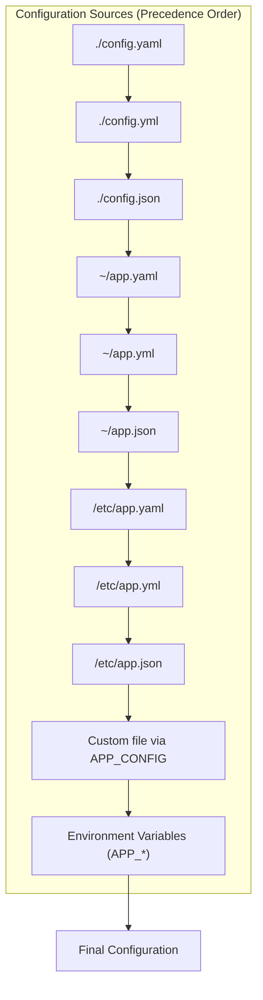
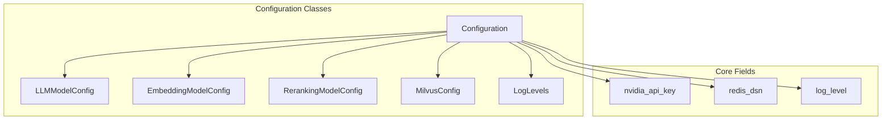

<!-- source: DeepWiki mcp.deepwiki.com · repo NVIDIA/nim-anywhere · page 5 Configuration · fetched 2026-10-26 -->

# Configuration

<details>
<summary>Relevant source files</summary>

The following files were used as context for generating this wiki page:

- [code/chain_server/configuration.py](code/chain_server/configuration.py)
- [code/chain_server/prompts.py](code/chain_server/prompts.py)
- [code/frontend/pages/chat/style.css](code/frontend/pages/chat/style.css)
- [code/frontend/pages/control/diagram.mmd.j2](code/frontend/pages/control/diagram.mmd.j2)
- [variables.env](variables.env)

</details>


This document provides a comprehensive guide to configuring the NVIDIA NIM Anywhere system, including the hierarchical configuration system, model settings, and environment variables. The configuration system supports both file-based and environment variable-based configuration with a clear precedence hierarchy.

For information about setting up the development environment, see [Development Environment](#6.1). For details about model deployment options, see [Model Configuration](#5.2).

## Configuration System Overview

The NVIDIA NIM Anywhere system uses a hierarchical configuration system built on the `confz` library that allows configuration through multiple sources with a clear precedence order. The main configuration is handled by the `Configuration` class in [code/chain_server/configuration.py:148-248]().

### Configuration Hierarchy

The system searches for configuration in the following order, with later sources taking precedence:



**Sources**: [code/chain_server/configuration.py:192-204]()

### Configuration Class Structure

The configuration system is organized into several specialized configuration classes:



**Sources**: [code/chain_server/configuration.py:81-189]()

## Configuration Sources

### File-Based Configuration

The system automatically searches for configuration files in multiple locations using the `FileSource` configurations defined in [code/chain_server/configuration.py:192-202](). Supported formats include YAML, YML, and JSON.

| Location | Purpose | Example |
|----------|---------|---------|
| `./config.yaml` | Project-level configuration | Current directory |
| `~/app.yaml` | User-level configuration | Home directory |
| `/etc/app.yaml` | System-level configuration | System directory |

You can also specify a custom configuration file using the `APP_CONFIG` environment variable:

```bash
export APP_CONFIG=/path/to/custom/config.yaml
```

### Environment Variable Configuration

Environment variables use the prefix `APP_` with double underscores (`__`) for nested fields. The `EnvSource` configuration is defined in [code/chain_server/configuration.py:203]().

Examples:
- `APP_NVIDIA_API_KEY` → `nvidia_api_key`
- `APP_LLM_MODEL__NAME` → `llm_model.name`
- `APP_MILVUS__URL` → `milvus.url`

**Sources**: [code/chain_server/configuration.py:44-49](), [variables.env:1-27]()

## Core Configuration Areas

### API Authentication

The `nvidia_api_key` field configures authentication for NVIDIA AI services. The system validates that API keys start with `nvapi-` as defined in [code/chain_server/configuration.py:220-228]().

```yaml
nvidia_api_key: "nvapi-your-key-here"
```

Alternative environment variables: `NGC_API_KEY`, `NVIDIA_API_KEY`

### Database Connections

#### Redis Configuration
Redis is used for conversation history storage:

```yaml
redis_dsn: "redis://localhost:6379/0"
```

Environment variable: `APP_REDIS_DSN`

#### Milvus Vector Database
The `MilvusConfig` class defines vector database settings:

```yaml
milvus:
  url: "http://localhost:19530"
  collection_name: "collection_1"
```

**Sources**: [code/chain_server/configuration.py:81-89](), [variables.env:6-7]()

## Model Configuration

### LLM Model Configuration

The `LLMModelConfig` class configures the large language model:

```yaml
llm_model:
  name: "meta/llama3-8b-instruct"
  url: "https://integrate.api.nvidia.com/v1"
```

**Sources**: [code/chain_server/configuration.py:91-108]()

### Embedding Model Configuration

The `EmbeddingModelConfig` class configures text embedding models:

```yaml
embedding_model:
  name: "nvidia/nv-embedqa-e5-v5"
  url: "https://integrate.api.nvidia.com/v1"
```

**Sources**: [code/chain_server/configuration.py:129-146]()

### Reranking Model Configuration

The `RerankingModelConfig` class configures document reranking models:

```yaml
reranking_model:
  name: "nv-rerank-qa-mistral-4b:1"
  url: "https://integrate.api.nvidia.com/v1"
```

**Sources**: [code/chain_server/configuration.py:110-127]()

## Environment Variables Reference

### System Configuration

| Variable | Purpose | Default |
|----------|---------|---------|
| `MILVUS_VERSION` | Milvus Docker image version | `v2.4.0` |
| `APP_MILVUS__URL` | Milvus connection URL | `http://milvus:19530` |
| `APP_REDIS_DSN` | Redis connection string | `redis://redis:6379/0` |
| `NGC_CLI_ORG` | NGC organization | `default` |
| `NGC_HOME` | NGC cache directory | `~/.cache/nvidia-nims` |

### NIM Model Configuration

The environment variables follow a pattern for configuring local NIM deployments:

| Variable Pattern | Purpose | Example |
|------------------|---------|---------|
| `{MODEL}_MODEL` | Model identifier | `LLM_NIM_0_MODEL=meta/llama3-8b-instruct` |
| `{MODEL}_NIM_VERSION` | NIM container version | `LLM_NIM_0_NIM_VERSION=1.0.0` |
| `{MODEL}_NIM_GPUS` | GPU allocation | `LLM_NIM_0_NIM_GPUS=all` |

**Sources**: [variables.env:11-25]()

## Configuration Validation and Loading

### Configuration Loading Process

The configuration is loaded automatically when the module is imported through the global `config` object defined in [code/chain_server/configuration.py:248]():

```python
config = Configuration()
```

### Validation Features

The system includes several validation mechanisms:

1. **API Key Validation**: Ensures NVIDIA API keys start with `nvapi-` ([code/chain_server/configuration.py:220-228]())
2. **Environment Variable Fallback**: Checks multiple environment variables for API keys ([code/chain_server/configuration.py:207-217]())
3. **Logging Configuration**: Automatically configures loggers based on the log level ([code/chain_server/configuration.py:231-244]())

### Configuration Usage in Applications

The Control Panel application uses configuration for generating dynamic diagrams based on enabled features, as seen in [code/frontend/pages/control/diagram.mmd.j2:4-12]():

```jinja2
ret <-....-> db[("fa:fa-building\nEnterprise\nData (Milvus)")]
rerank(Reranker):::nvidia -->
```

**Sources**: [code/chain_server/configuration.py:148-248](), [variables.env:1-27](), [code/frontend/pages/control/diagram.mmd.j2:1-25]()

---

