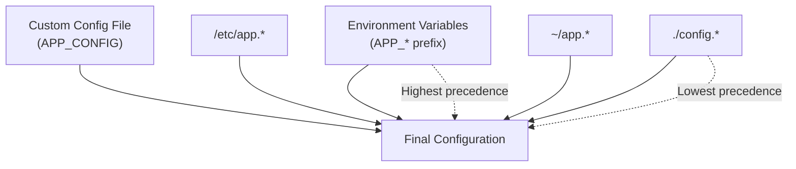
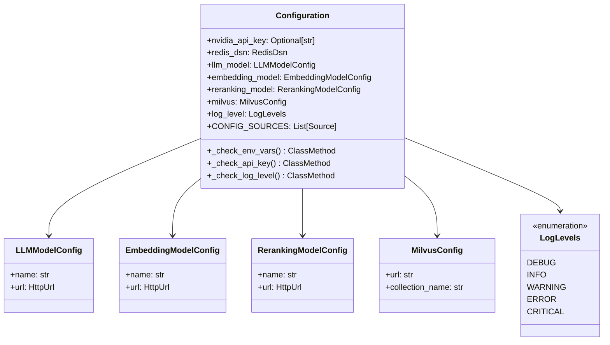
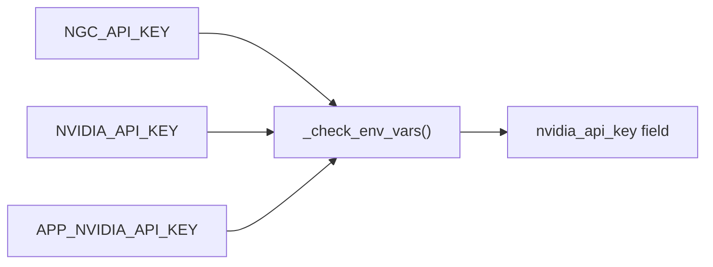

<!-- source: DeepWiki mcp.deepwiki.com · repo NVIDIA/nim-anywhere · page 5.1 Configuration System · fetched 2026-10-26 -->

# Configuration System

<details>
<summary>Relevant source files</summary>

The following files were used as context for generating this wiki page:

- [code/chain_server/configuration.py](code/chain_server/configuration.py)
- [code/frontend/pages/chat/style.css](code/frontend/pages/chat/style.css)
- [code/frontend/pages/control/diagram.mmd.j2](code/frontend/pages/control/diagram.mmd.j2)

</details>


This document covers the hierarchical configuration system used throughout NVIDIA NIM Anywhere. The configuration system manages settings for all components including AI models, databases, logging, and API connections. For specific model configuration details, see [Model Configuration](#5.2). For environment variable reference, see [Environment Variables](#5.3).

## Overview

The configuration system implements a hierarchical approach where settings can be specified through multiple sources with a defined precedence order. The system uses the `confz` library with Pydantic validation to provide type-safe configuration management across all system components.

**Sources: [code/chain_server/configuration.py:16-50]()**

## Configuration Sources and Hierarchy

The configuration system searches for settings in multiple locations with the following precedence (higher precedence sources override lower ones):

### File-Based Configuration

The system automatically searches for configuration files in these locations:

| Priority | Location | Description |
|----------|----------|-------------|
| 1 | `./config.yaml` | Current directory YAML |
| 2 | `./config.yml` | Current directory YAML (alt extension) |
| 3 | `./config.json` | Current directory JSON |
| 4 | `~/app.yaml` | User home directory |
| 5 | `~/app.yml` | User home directory (alt extension) |
| 6 | `~/app.json` | User home directory JSON |
| 7 | `/etc/app.yaml` | System-wide configuration |
| 8 | `/etc/app.yml` | System-wide configuration (alt extension) |
| 9 | `/etc/app.json` | System-wide configuration JSON |

### Custom Configuration File

A custom configuration file can be specified using the `APP_CONFIG` environment variable:

```bash
export APP_CONFIG=/path/to/custom/config.yaml
```

### Environment Variable Override

Environment variables take the highest precedence and use the format: `APP_FIELD__SUB_FIELD` where `__` represents nesting.



**Configuration Source Hierarchy**

**Sources: [code/chain_server/configuration.py:192-204]()**

## Configuration Models

The system defines several configuration model classes that structure and validate different aspects of the system:

### Core Configuration Class

The `Configuration` class serves as the root configuration model, inheriting from `BaseConfig`:



**Configuration Model Relationships**

**Sources: [code/chain_server/configuration.py:81-189]()**

### Model-Specific Configurations

Each AI model type has its own configuration class:

- **LLMModelConfig**: Configures Large Language Model connections with default `meta/llama3-8b-instruct`
- **EmbeddingModelConfig**: Configures embedding model with default `nvidia/nv-embedqa-e5-v5`
- **RerankingModelConfig**: Configures reranking model with default `nv-rerank-qa-mistral-4b:1`

All model configurations include:
- `name`: Model identifier for API requests
- `url`: Service endpoint URL (defaults to `https://integrate.api.nvidia.com/v1`)

**Sources: [code/chain_server/configuration.py:91-146]()**

## Configuration Loading and Validation

The configuration system implements several validation mechanisms to ensure proper setup:

### Environment Variable Processing

The system processes multiple environment variable names for the NVIDIA API key:



**Environment Variable Resolution**

### Validation Pipeline

The configuration undergoes validation through several class methods:

1. **`_check_env_vars()`**: Processes alternative environment variable names for API keys
2. **`_check_api_key()`**: Validates that NVIDIA API keys start with `nvapi-` prefix
3. **`_check_log_level()`**: Automatically configures Python logging based on the specified level

**Sources: [code/chain_server/configuration.py:207-244]()**

## Configuration Instance

The system creates a global configuration instance that is loaded when the module is imported:

```python
# load the runtime configuration
config = Configuration()
```

This singleton pattern ensures consistent configuration access across all chain server components.

**Sources: [code/chain_server/configuration.py:247-248]()**

## Usage Patterns

### Environment Variable Format

Environment variables use double underscores to represent nested configuration:

```bash
# Set LLM model name
export APP_LLM_MODEL__NAME="custom/model-name"

# Set embedding model URL  
export APP_EMBEDDING_MODEL__URL="http://localhost:8080/v1"

# Set Milvus collection name
export APP_MILVUS__COLLECTION_NAME="my_collection"
```

### File Configuration Example

A typical configuration file structure:

```yaml
nvidia_api_key: "nvapi-your-key-here"
redis_dsn: "redis://localhost:6379/0"
log_level: "INFO"

llm_model:
  name: "meta/llama3-8b-instruct"
  url: "https://integrate.api.nvidia.com/v1"

embedding_model:
  name: "nvidia/nv-embedqa-e5-v5"
  url: "https://integrate.api.nvidia.com/v1"

milvus:
  url: "http://localhost:19530"
  collection_name: "collection_1"
```

**Sources: [code/chain_server/configuration.py:67-68](), [code/chain_server/configuration.py:203]()**

---

