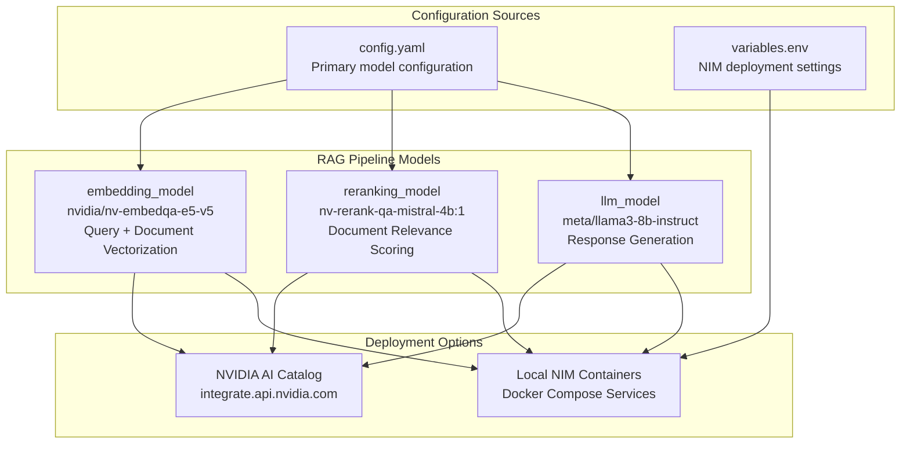
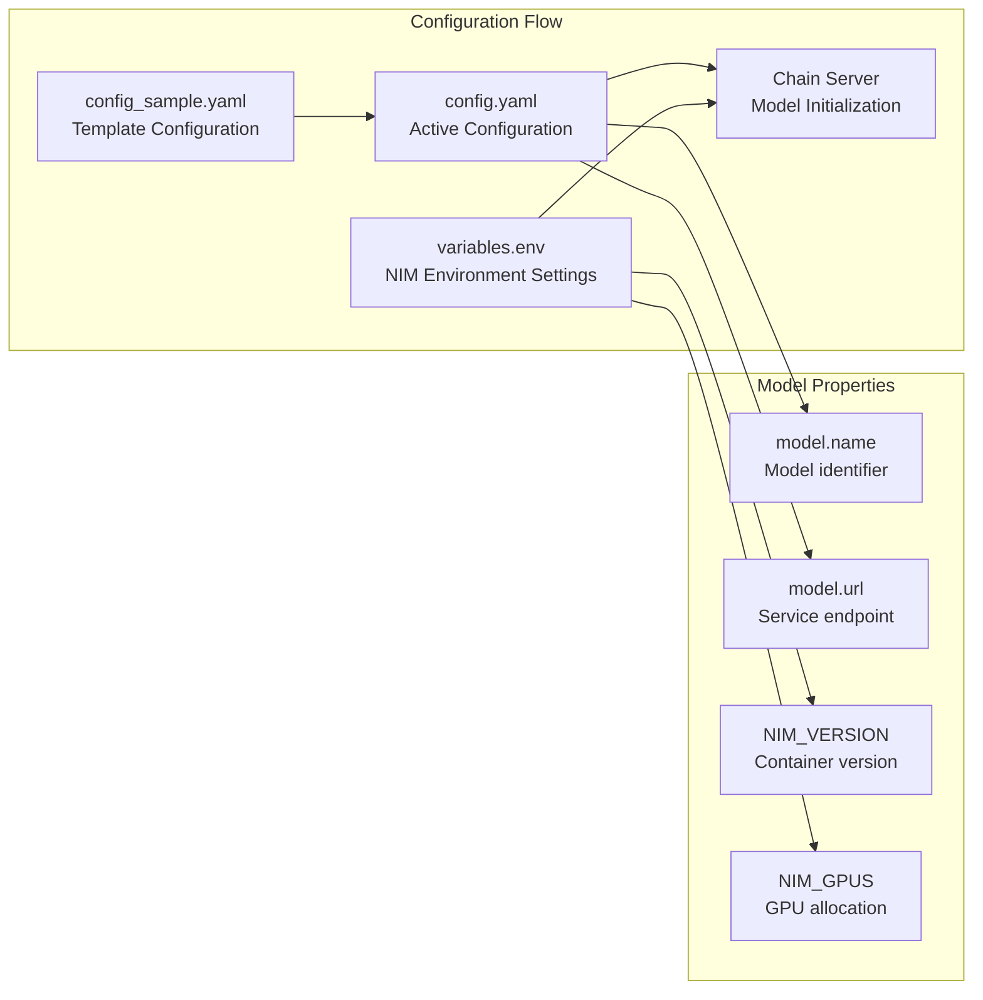
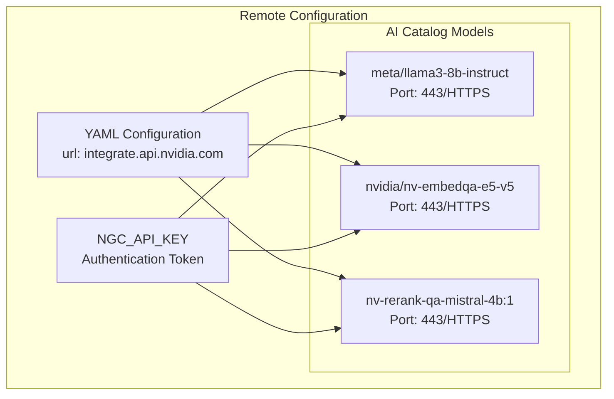
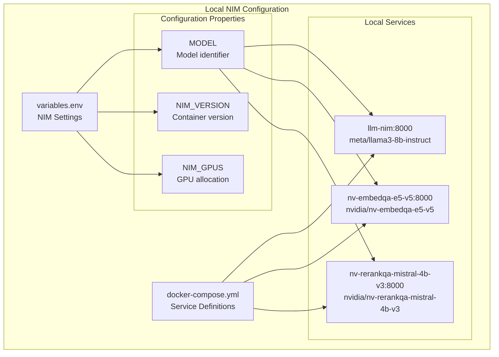
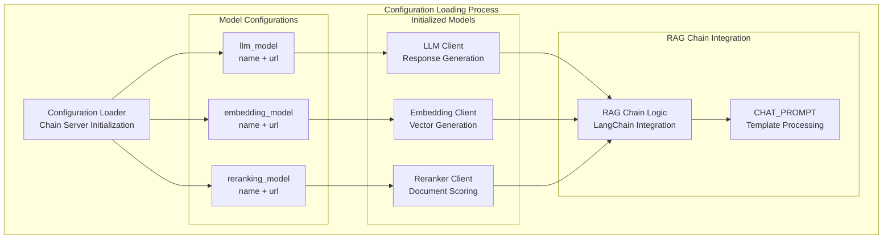

<!-- source: DeepWiki mcp.deepwiki.com · repo NVIDIA/nim-anywhere · page 5.2 Model Configuration · fetched 2026-10-26 -->

# Model Configuration

<details>
<summary>Relevant source files</summary>

The following files were used as context for generating this wiki page:

- [code/chain_server/prompts.py](code/chain_server/prompts.py)
- [code/config_sample.yaml](code/config_sample.yaml)
- [variables.env](variables.env)

</details>


This document covers the configuration of AI models used in the NVIDIA NIM Anywhere RAG system, including LLM, embedding, and reranking models. It explains how to configure models for both remote (NVIDIA AI Catalog) and local (NIM containers) deployment options. For information about the overall configuration system architecture, see [Configuration System](#5.1). For a complete reference of environment variables, see [Environment Variables](#5.3).

## Model Types and Architecture

The NVIDIA NIM Anywhere system utilizes three distinct types of AI models that work together in the RAG pipeline:

### Model Type Overview



**Sources:** [code/config_sample.yaml:1-32](), [variables.env:11-24]()

| Model Type | Purpose | Default Model | Configuration Key |
|------------|---------|---------------|-------------------|
| LLM | Final response generation | `meta/llama3-8b-instruct` | `llm_model` |
| Embedding | Query and document vectorization | `nvidia/nv-embedqa-e5-v5` | `embedding_model` |
| Reranking | Document relevance scoring | `nv-rerank-qa-mistral-4b:1` | `reranking_model` |

## Configuration Sources and Hierarchy

### Primary Configuration Structure

The model configuration follows a two-tier approach using both YAML configuration files and environment variables:



**Sources:** [code/config_sample.yaml:1-32](), [variables.env:11-24]()

### YAML Configuration Format

Each model in the configuration follows a consistent structure with `name` and `url` properties:

```yaml
llm_model:
  name: "meta/llama3-8b-instruct"
  url: "https://integrate.api.nvidia.com/v1"

embedding_model:
  name: "nvidia/nv-embedqa-e5-v5"
  url: "https://integrate.api.nvidia.com/v1"

reranking_model:
  name: "nv-rerank-qa-mistral-4b:1"
  url: "https://integrate.api.nvidia.com/v1"
```

**Sources:** [code/config_sample.yaml:1-30]()

### Environment Variable Naming Convention

Local NIM deployments use environment variables following the pattern `{MODEL_IDENTIFIER}_{PROPERTY}`:

| Variable Pattern | Purpose | Example |
|------------------|---------|---------|
| `{MODEL}_MODEL` | Model name/identifier | `LLM_NIM_0_MODEL=meta/llama3-8b-instruct` |
| `{MODEL}_NIM_VERSION` | NIM container version | `LLM_NIM_0_NIM_VERSION=1.0.0` |
| `{MODEL}_NIM_GPUS` | GPU allocation | `LLM_NIM_0_NIM_GPUS=all` |

**Sources:** [variables.env:11-24]()

## Deployment Configuration Options

### Remote Deployment (NVIDIA AI Catalog)

For remote deployment using NVIDIA AI Catalog services, models are configured to use the centralized API endpoint:



**Sources:** [code/config_sample.yaml:5-6,15-16,23-24]()

### Local Deployment (NIM Containers)

For local deployment, models run as Docker containers with internal network communication:



**Sources:** [variables.env:11-24](), [code/config_sample.yaml:9,19,28-29]()

## Model Selection and Switching

### Configuration Switching Process

To switch between remote and local deployment, you modify the `url` field in the YAML configuration:

| Deployment Type | URL Pattern | Example |
|----------------|-------------|---------|
| Remote (AI Catalog) | `https://integrate.api.nvidia.com/v1` | Default configuration |
| Local LLM | `http://llm-nim:8000/v1` | Local LLM NIM container |
| Local Embedding | `http://nv-embedqa-e5-v5:8000/v1` | Local embedding NIM |
| Local Reranking | `http://nv-rerankqa-mistral-4b-v3:8000/v1/` | Local reranking NIM |

**Sources:** [code/config_sample.yaml:5-6,9,15-16,19,23-24,28-29]()

### Environment Variable Configuration for Local NIMs

Local NIM deployments require corresponding environment variables in `variables.env`:

```
# LLM NIM Configuration
LLM_NIM_0_MODEL=meta/llama3-8b-instruct
LLM_NIM_0_NIM_VERSION=1.0.0
LLM_NIM_0_NIM_GPUS=all

# Embedding NIM Configuration  
NV_EMBEDQA_E5_V5_MODEL=nvidia/nv-embedqa-e5-v5
NV_EMBEDQA_E5_V5_NIM_VERSION=1.0.1
NV_EMBEDQA_E5_V5_NIM_GPUS=all

# Reranking NIM Configuration
NV_RERANKQA_MISTRAL_4B_V3_MODEL=nvidia/nv-rerankqa-mistral-4b-v3
NV_RERANKQA_MISTRAL_4B_V3_NIM_VERSION=1.0.2
NV_RERANKQA_MISTRAL_4B_V3_NIM_GPUS=all
```

**Sources:** [variables.env:11-24]()

## Model Integration in RAG Chain

### Configuration Loading and Model Initialization

The configured models are integrated into the RAG processing chain through the chain server's configuration loading system:



**Sources:** [code/config_sample.yaml:1-32](), [code/chain_server/prompts.py:37-47]()

The chain server uses the `CHAT_PROMPT` template for LLM interaction, which includes system instructions, conversation history, and context from the embedding and reranking models.

**Sources:** [code/chain_server/prompts.py:37-47]()

---

