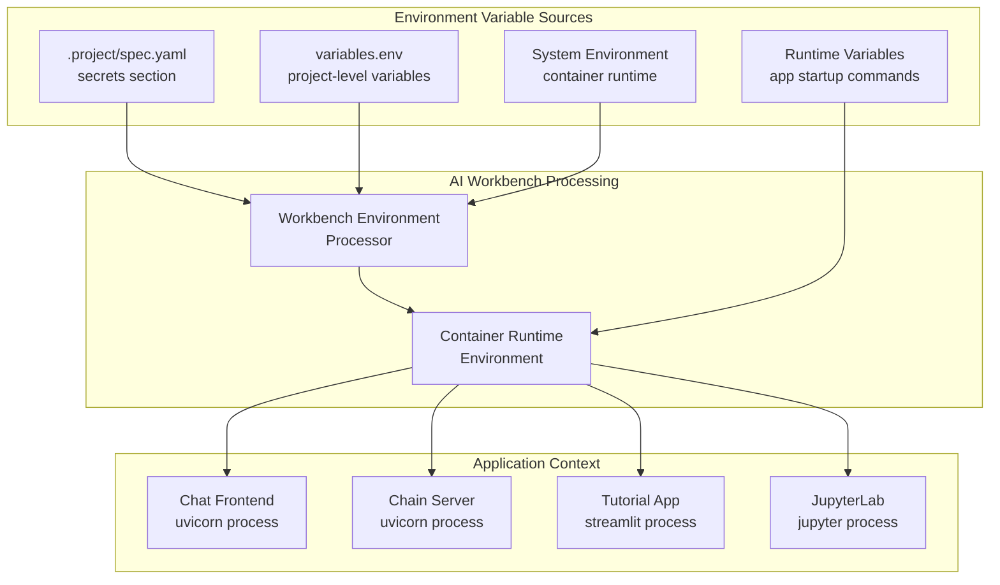
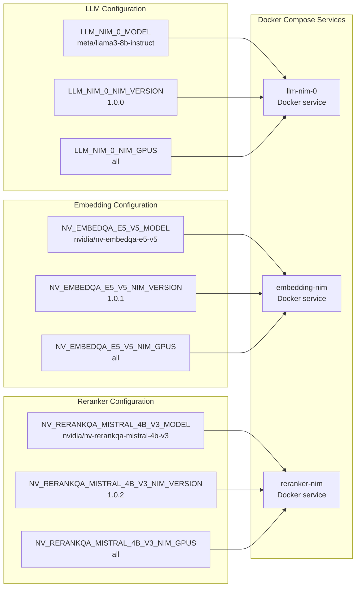
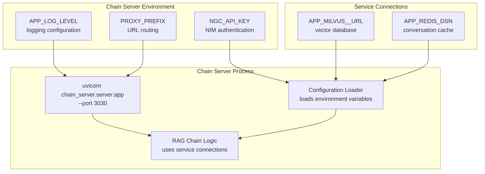
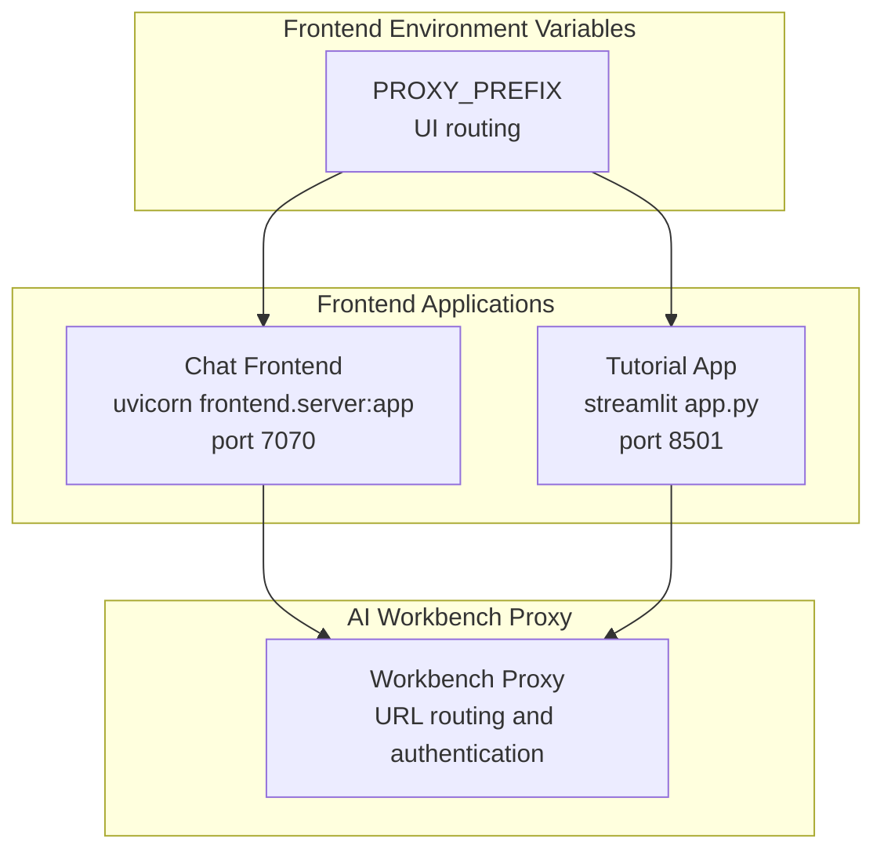
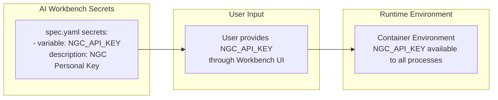
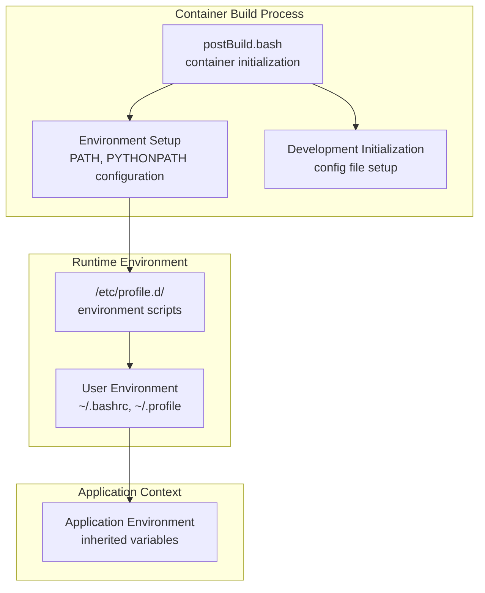

<!-- source: DeepWiki mcp.deepwiki.com · repo NVIDIA/nim-anywhere · page 5.3 Environment Variables · fetched 2026-10-26 -->

# Environment Variables

Relevant source files

The following files were used as context for generating this wiki page:

- [.project/spec.yaml](.project/spec.yaml)
- [code/chain_server/prompts.py](code/chain_server/prompts.py)
- [postBuild.bash](postBuild.bash)
- [variables.env](variables.env)

This document provides a comprehensive reference for environment variables used throughout the NVIDIA NIM Anywhere system. Environment variables control service connections, model configurations, authentication, and application behavior across all system components.

For information about the broader configuration system and file-based configuration, see [Configuration System](#5.1). For specific model parameter configuration, see [Model Configuration](#5.2).

## Environment Variable Sources and Hierarchy

The NVIDIA NIM Anywhere system uses environment variables from multiple sources, processed in a specific hierarchy:

**Sources:** [.project/spec.yaml:157-159](), [variables.env:1-27](), [postBuild.bash:28-41]()

## Core Environment Variables by Category

### Authentication and NGC Configuration

| Variable | Purpose | Example Value | Source |
|----------|---------|---------------|---------|
| `NGC_API_KEY` | NVIDIA NGC Personal API Key for accessing NIMs | `nvapi-***` | AI Workbench Secret |
| `NGC_CLI_ORG` | NGC CLI organization context | `default` | variables.env |
| `NGC_HOME` | NGC CLI cache directory | `~/.cache/nvidia-nims` | variables.env |

### Database and Service Connections

| Variable | Purpose | Example Value | Source |
|----------|---------|---------------|---------|
| `APP_MILVUS__URL` | Milvus vector database connection URL | `http://milvus:19530` | variables.env |
| `APP_REDIS_DSN` | Redis connection string for conversation history | `redis://redis:6379/0` | variables.env |
| `MILVUS_VERSION` | Milvus Docker image version | `v2.4.0` | variables.env |

### Model Configuration Variables

The system uses environment variables to configure NIM models for local deployment:

**Sources:** [variables.env:11-25]()

### Application Runtime Variables

| Variable | Purpose | Usage | Source |
|----------|---------|-------|---------|
| `PROXY_PREFIX` | URL prefix for AI Workbench proxy routing | Used in webapp startup commands | Runtime |
| `APP_LOG_LEVEL` | Chain server logging level | `DEBUG`, `INFO`, `WARNING` | Runtime |
| `PYTHONPATH` | Python module search path | `/project/code:$PYTHONPATH` | postBuild.bash |
| `SHELL` | Default shell for processes | `/bin/bash` | variables.env |

**Sources:** [.project/spec.yaml:104](), [.project/spec.yaml:120](), [postBuild.bash:31](), [variables.env:26]()

## Environment Variable Usage in Applications

### Chain Server Application

The Chain Server uses environment variables for service connections and configuration:

**Sources:** [.project/spec.yaml:118-132]()

### Frontend Applications

Frontend applications use environment variables for proxy configuration and service routing:

**Sources:** [.project/spec.yaml:101-116](), [.project/spec.yaml:133-152]()

## AI Workbench Integration

AI Workbench manages environment variables through its project specification system:

### Secret Management

**Sources:** [.project/spec.yaml:157-159]()

### Application Startup Integration

Environment variables are integrated into application startup commands within the AI Workbench specification:

| Application | Startup Command Pattern | Environment Variables Used |
|-------------|-------------------------|---------------------------|
| Chat Frontend | `export PROXY_PREFIX && cd /project/code && uvicorn...` | `PROXY_PREFIX` |
| Chain Server | `export PROXY_PREFIX && export NGC_API_KEY && cd /project/code && APP_LOG_LEVEL=DEBUG uvicorn...` | `PROXY_PREFIX`, `NGC_API_KEY`, `APP_LOG_LEVEL` |
| Tutorial | `export PROXY_PREFIX && streamlit run app.py --server.baseUrlPath=$PROXY_PREFIX` | `PROXY_PREFIX` |

**Sources:** [.project/spec.yaml:104](), [.project/spec.yaml:120](), [.project/spec.yaml:136-139]()

## Development Environment Setup

Environment variables are configured during container build and initialization:

**Sources:** [postBuild.bash:28-41]()

The key environment scripts created during build:

- `/etc/profile.d/python.sh` - Sets `PYTHONPATH` and Python binary links
- `/etc/profile.d/ngc-cli.sh` - Adds NGC CLI to `PATH`
- `/etc/profile.d/init-dev-env.sh` - Initializes development configuration files

**Sources:** [postBuild.bash:28-41]()

---

