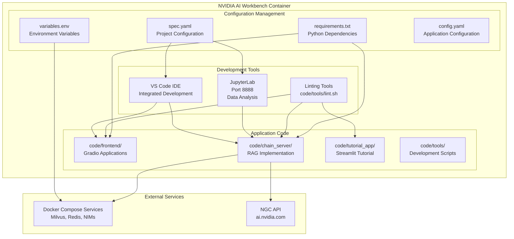
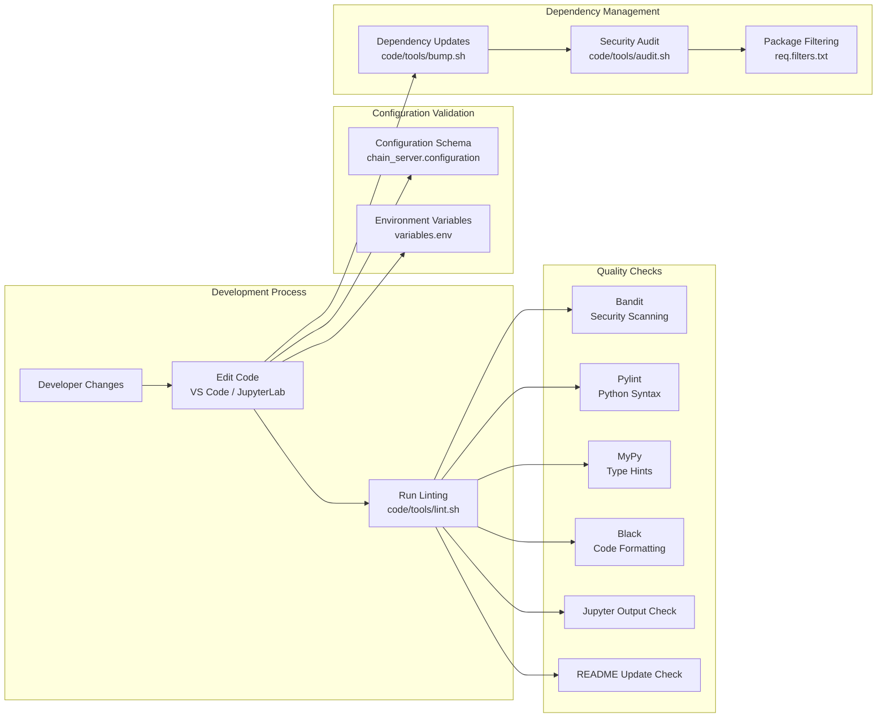

<!-- source: DeepWiki mcp.deepwiki.com · repo NVIDIA/nim-anywhere · page 6 Development · fetched 2026-10-26 -->

# Development

Relevant source files

The following files were used as context for generating this wiki page:

- [docs/1_develop.md](docs/1_develop.md)
- [docs/2_configuration.md.py](docs/2_configuration.md.py)
- [docs/3.0_contributing.md](docs/3.0_contributing.md)
- [docs/3.1_frontend.md](docs/3.1_frontend.md)
- [docs/3.3_environment.md](docs/3.3_environment.md)
- [docs/3.4_bumping_dependencies.md](docs/3.4_bumping_dependencies.md)
- [req.filters.txt](req.filters.txt)

This document provides an overview of the development environment, tools, and processes for extending and contributing to the NVIDIA NIM Anywhere system. It covers the development architecture, workflow, and key areas where developers can customize or extend the system.

For specific details about setting up the development environment, see [Development Environment](#6.1). For frontend-specific development guidance, see [Frontend Development](#6.2). For information about code quality tools and standards, see [Code Quality and Tools](#6.3).

## Development Architecture Overview

The NVIDIA NIM Anywhere development environment is orchestrated by NVIDIA AI Workbench, which manages containerized applications, services, and development tools in a unified environment.

Sources: [docs/1_develop.md:1-21](), [docs/3.3_environment.md:1-14]()

## Development Workflow and Code Quality Pipeline

The development workflow incorporates automated code quality checks, dependency management, and testing processes integrated into the development environment.

Sources: [docs/3.0_contributing.md:1-19](), [docs/3.4_bumping_dependencies.md:1-12](), [req.filters.txt:1-5]()

## Core Development Areas

### Application Development

The system consists of several key application components that developers can extend:

| Component | Location | Purpose | Key Technologies |
|-----------|----------|---------|------------------|
| Chain Server | `code/chain_server/` | RAG orchestration and LangChain integration | LangChain, NVIDIA NIMs |
| Chat Frontend | `code/frontend/` | Interactive user interface | Gradio, HTML/CSS/JS |
| Tutorial App | `code/tutorial_app/` | Interactive learning environment | Streamlit |
| Development Tools | `code/tools/` | Automation and quality scripts | Bash, Python |

Sources: [docs/1_develop.md:5-6]()

### Frontend Architecture

The frontend uses a modular architecture with Gradio components mounted in a custom application shell. The system supports:

- **Page-based architecture**: Each functional area is implemented as a separate Gradio page in `code/frontend/pages/`
- **View composition**: Multiple pages can be combined into views defined in `code/frontend/server.py`
- **Custom branding**: Logo, color schemes, and themes can be customized through `code/frontend/_assets/`
- **Inter-page messaging**: JavaScript `postMessage` API enables communication between pages

Sources: [docs/3.1_frontend.md:1-108]()

### Configuration System

The configuration system uses a hierarchical approach combining multiple sources:

- **Environment variables**: Managed through `variables.env` and AI Workbench UI
- **YAML configuration**: Application-specific settings in `config.yaml`
- **Schema validation**: Pydantic models in `chain_server.configuration` and `frontend.configuration`
- **Dynamic generation**: Configuration documentation generated via `docs/2_configuration.md.py`

Sources: [docs/3.3_environment.md:3-6](), [docs/2_configuration.md.py:1-97]()

## Development Environment Management

### Python Environment

The development environment uses a single Python installation at `/usr/bin/python3` with pip-managed dependencies. Key aspects:

- **Dependency management**: All packages defined in `requirements.txt`
- **Package filtering**: Excluded packages listed in `req.filters.txt`
- **Ephemeral changes**: Runtime package installations are temporary
- **Persistent installation**: Permanent changes require updating `requirements.txt`

### Container Configuration

The AI Workbench environment provides:

- **Base image updates**: Managed through Workbench GUI environment pane
- **System packages**: Permanent additions via `apt.txt` file
- **Environment setup**: Custom scripts in `postBuild.bash` and `preBuild.bash`
- **Service orchestration**: Docker Compose services for Milvus, Redis, and local NIMs

Sources: [docs/3.3_environment.md:7-14]()

## Development Tools and Automation

### Code Quality Pipeline

The system includes comprehensive code quality tools accessible via `code/tools/lint.sh`:

| Tool | Purpose | Command |
|------|---------|---------|
| Bandit | Security vulnerability scanning | `lint.sh bandit` |
| Pylint | Python syntax and style checking | `lint.sh pylint` |
| MyPy | Type hint validation | `lint.sh mypy` |
| Black | Automatic code formatting | `lint.sh black` |
| Custom checks | Jupyter notebook and README validation | `lint.sh docs` |

### Dependency Management

Automated dependency management tools:

- **Update dependencies**: `code/tools/bump.sh` updates Python packages and NIMs
- **Security auditing**: `code/tools/audit.sh` scans for vulnerabilities
- **Automated fixes**: `lint.sh fix` applies automatic corrections

Sources: [docs/3.0_contributing.md:6-19](), [docs/3.4_bumping_dependencies.md:6-11]()

---

