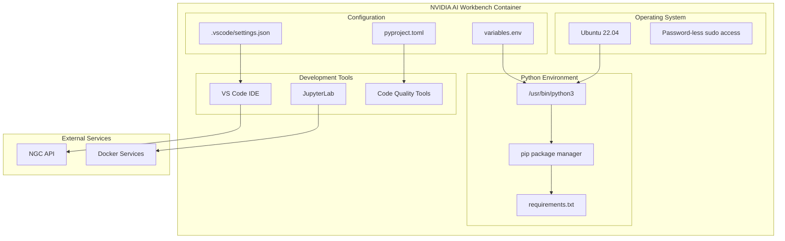
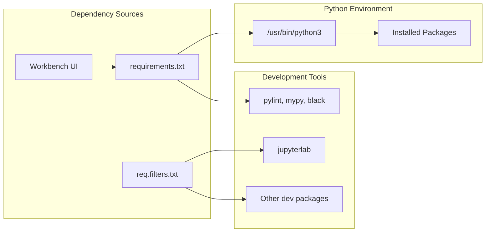
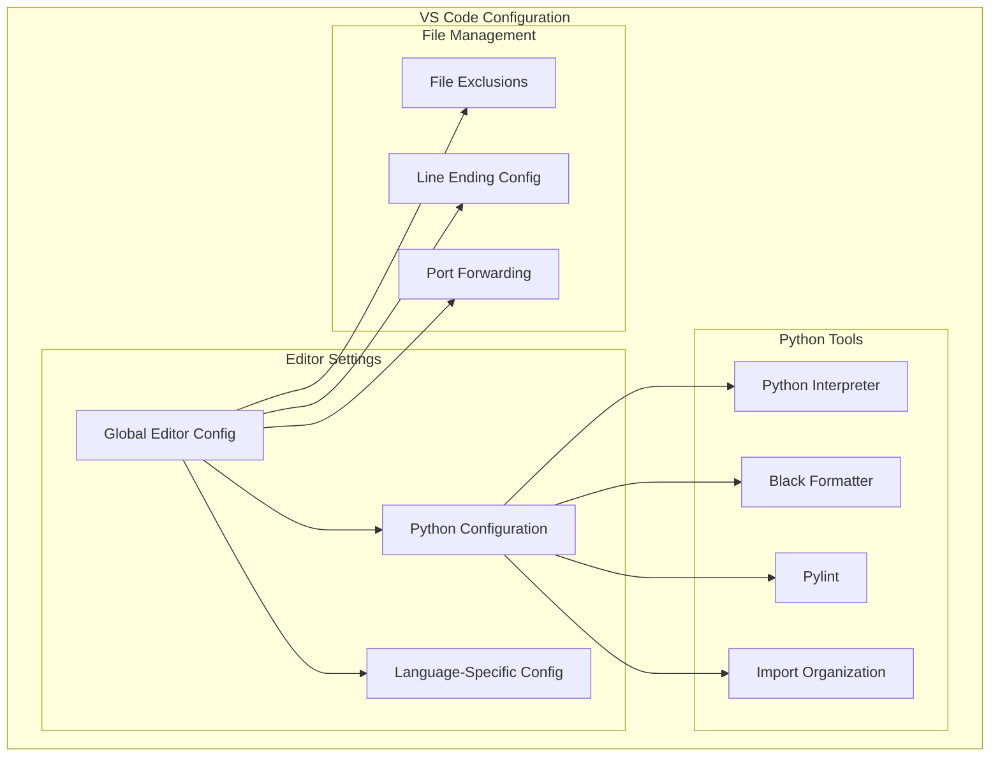
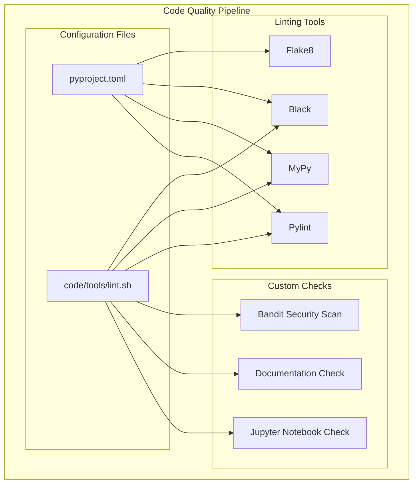
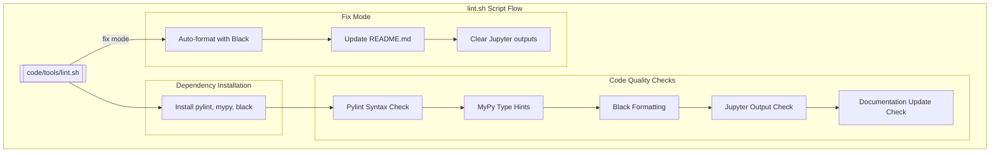
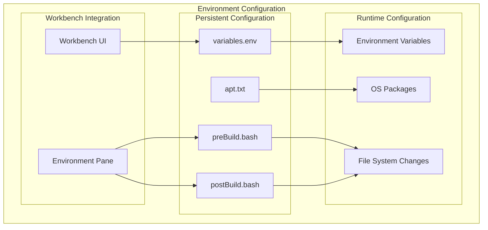

<!-- source: DeepWiki mcp.deepwiki.com · repo NVIDIA/nim-anywhere · page 6.1 Development Environment · fetched 2026-10-26 -->

# Development Environment

<details>
<summary>Relevant source files</summary>

The following files were used as context for generating this wiki page:

- [.vscode/settings.json](.vscode/settings.json)
- [code/tools/lint.sh](code/tools/lint.sh)
- [docs/2_configuration.md.py](docs/2_configuration.md.py)
- [docs/3.0_contributing.md](docs/3.0_contributing.md)
- [docs/3.1_frontend.md](docs/3.1_frontend.md)
- [docs/3.3_environment.md](docs/3.3_environment.md)
- [docs/3.4_bumping_dependencies.md](docs/3.4_bumping_dependencies.md)
- [pyproject.toml](pyproject.toml)
- [req.filters.txt](req.filters.txt)

</details>


This document covers the development environment setup, tools, and workflow for NVIDIA NIM Anywhere. It focuses on the containerized development environment managed by NVIDIA AI Workbench, Python environment configuration, IDE setup, and code quality tools.

For information about configuration management and environment variables, see [Configuration System](#5.1). For details about code quality standards and linting procedures, see [Code Quality and Tools](#6.3).

## Development Environment Overview

NVIDIA NIM Anywhere uses a containerized development environment orchestrated by NVIDIA AI Workbench. The development environment is based on Ubuntu 22.04 and provides a consistent, reproducible setup for all developers.



**Development Environment Characteristics**

The development environment provides ephemeral system changes with persistent configuration through specific files:

- **Ephemeral Changes**: System modifications, Python package installations, and OS configurations are lost when the container restarts
- **Persistent Configuration**: Changes made through `requirements.txt`, `variables.env`, `postBuild.bash`, and `preBuild.bash` files persist across container rebuilds
- **Container-Based**: All development occurs within a controlled container environment managed by AI Workbench

Sources: [docs/3.3_environment.md:11-13]()

## Python Environment Configuration

The development environment uses a single Python installation at `/usr/bin/python3` with pip-based dependency management. All Python packages are installed system-wide within the container.

### Dependencies Management



**Package Installation Process**

| Method | Persistence | Use Case |
|--------|-------------|----------|
| Direct pip install | Ephemeral | Temporary testing |
| requirements.txt | Persistent | Production dependencies |
| Workbench UI | Persistent | Interactive management |

**Filtered Dependencies**

The `req.filters.txt` file excludes certain packages from the built container to optimize the production image:

- `jupyterlab` - Development-only tool
- `grandalf` - Graph visualization dependency  
- `watchfiles` - File watching utility

Sources: [docs/3.3_environment.md:7-9](), [req.filters.txt:1-4]()

## IDE Configuration

The development environment includes comprehensive VS Code configuration optimized for Python development and the specific needs of the NVIDIA NIM Anywhere project.

### VS Code Settings Overview



**Key Configuration Elements**

| Setting Category | Configuration | Purpose |
|------------------|---------------|---------|
| Python Interpreter | `/usr/bin/python3` | Default Python path |
| Code Formatting | Black (120 char limit) | Automatic code formatting |
| Import Organization | isort with black profile | Import statement organization |
| Type Checking | Pylint integration | Real-time syntax checking |
| File Exclusions | Cache/build directories | Clean file explorer |

**Python-Specific Settings**

The VS Code configuration includes specialized Python development features:

- **Auto-formatting**: Black formatter runs on save with 120-character line limit
- **Import organization**: isort automatically organizes imports with black profile compatibility
- **Type checking**: Pylint provides real-time syntax and style checking
- **Environment activation**: Automatic Python environment activation in terminals

Sources: [.vscode/settings.json:48-70]()

### File Exclusions and Organization

The VS Code configuration excludes common build artifacts and temporary files from the file explorer:

```
**/.git, **/.svn, **/.hg, **/CVS
**/.DS_Store, **/Thumbs.db
**/.venv, **/__pycache__
**/.mypy_cache, **/.ipynb_checkpoints
**/.terraform
```

Sources: [.vscode/settings.json:3-15]()

## Code Quality Tools Configuration

The development environment includes comprehensive code quality tools configured through `pyproject.toml` and managed by custom scripts.

### Linting Tool Configuration



**Tool-Specific Configurations**

| Tool | Configuration | Key Settings |
|------|---------------|--------------|
| Pylint | `[tool.pylint]` | Max line length: 120, Max module lines: 500 |
| MyPy | `[tool.mypy]` | Strict: false, Ignore missing imports: true |
| Black | `black-formatter.args` | Line length: 120 |
| Flake8 | `[tool.flake8]` | Max line length: 120, Ignore: E203, W503 |

**Pylint Configuration Details**

The Pylint configuration disables several checks that are not relevant for this project while enabling others:

- **Disabled**: `duplicate-code`, `no-member`, `redefined-builtin`
- **Enabled**: `c-extension-no-member`, `broad-exception-caught`
- **Bad functions**: `print`, `input` (flagged for production code)

Sources: [pyproject.toml:1-43]()

## Development Scripts and Utilities

The development environment includes several utility scripts for maintaining code quality and managing dependencies.

### Linting Script Workflow



**Script Usage Patterns**

| Command | Purpose | Exit Behavior |
|---------|---------|---------------|
| `./lint.sh` | Run all checks | Fails on any error |
| `./lint.sh deps` | Install dependencies only | Continues on success |
| `./lint.sh pylint` | Pylint check only | Fails on syntax errors |
| `./lint.sh fix` | Auto-fix issues | Modifies files in place |

**Jupyter Notebook Validation**

The linting script includes a custom check for Jupyter notebooks to ensure they don't contain cell outputs:

1. Scans all `.ipynb` files tracked by git
2. Uses `jq` to extract cell outputs from JSON structure  
3. Fails if any non-empty outputs are found
4. In fix mode, uses `jupyter nbconvert` to clear outputs

Sources: [code/tools/lint.sh:32-52]()

## Environment Management

The development environment supports multiple methods for managing configuration and customization, with different persistence characteristics.

### Configuration Hierarchy



**Environment Variable Management**

Environment variables are the primary configuration mechanism for the development environment:

- **Primary source**: `variables.env` file in project root
- **UI management**: NVIDIA AI Workbench provides graphical interface
- **Persistence**: Changes to `variables.env` persist across container rebuilds
- **Runtime changes**: Direct environment variable modifications are ephemeral

**System Customization Options**

| Customization Type | File | Persistence | Use Case |
|-------------------|------|-------------|----------|
| Environment Variables | `variables.env` | Persistent | Application configuration |
| Pre-build Scripts | `preBuild.bash` | Persistent | Container setup |
| Post-build Scripts | `postBuild.bash` | Persistent | Environment initialization |
| System Packages | `apt.txt` | Persistent | OS-level dependencies |
| Direct System Changes | N/A | Ephemeral | Temporary testing |

Sources: [docs/3.3_environment.md:3-5](), [docs/3.3_environment.md:11-13]()

---

