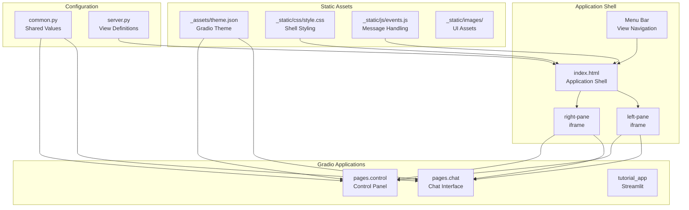
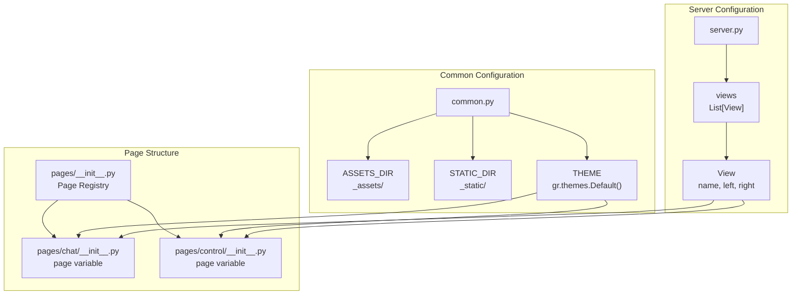
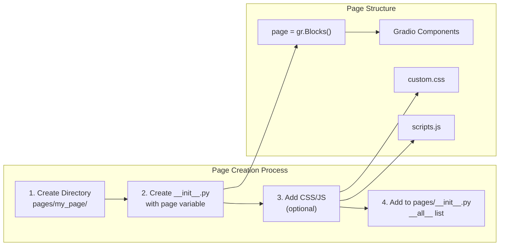
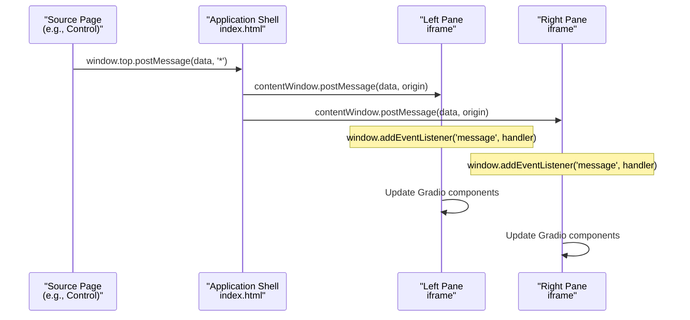
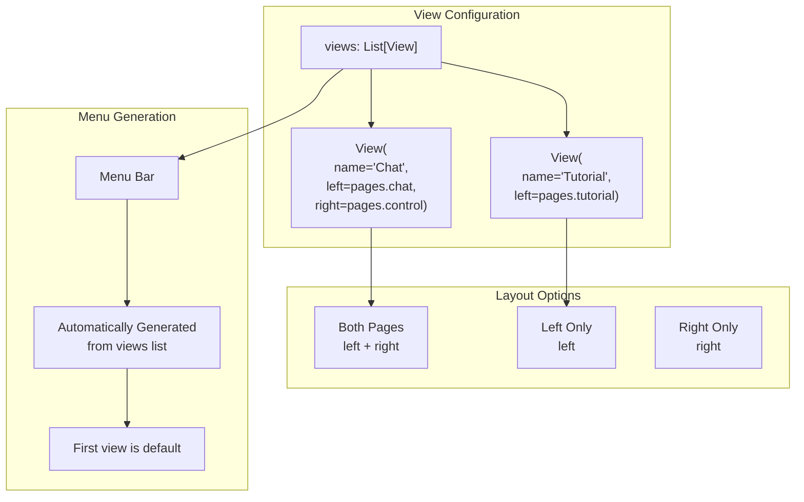
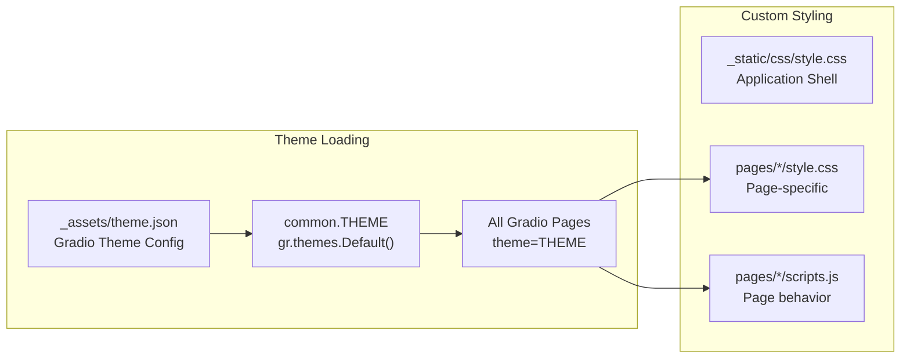
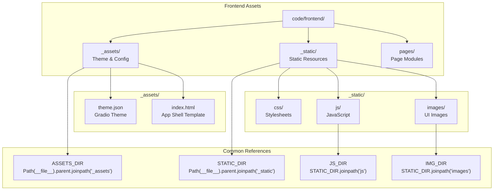

<!-- source: DeepWiki mcp.deepwiki.com · repo NVIDIA/nim-anywhere · page 6.2 Frontend Development · fetched 2026-10-26 -->

# Frontend Development

<details>
<summary>Relevant source files</summary>

The following files were used as context for generating this wiki page:

- [code/frontend/_static/js/events.js](code/frontend/_static/js/events.js)
- [code/frontend/common.py](code/frontend/common.py)
- [code/frontend/pages/chat/scripts.js](code/frontend/pages/chat/scripts.js)
- [docs/2_configuration.md.py](docs/2_configuration.md.py)
- [docs/3.0_contributing.md](docs/3.0_contributing.md)
- [docs/3.1_frontend.md](docs/3.1_frontend.md)
- [docs/3.3_environment.md](docs/3.3_environment.md)
- [docs/3.4_bumping_dependencies.md](docs/3.4_bumping_dependencies.md)
- [req.filters.txt](req.filters.txt)

</details>


This document covers the development of the Gradio-based frontend applications in NVIDIA NIM Anywhere. It explains the architecture, page creation, view management, theming, and inter-page communication patterns used throughout the frontend system.

For information about using the frontend applications, see [User Interfaces](#4). For configuration of frontend components, see [Configuration System](#5.1).

## Frontend Architecture Overview

The NVIDIA NIM Anywhere frontend is built using a hybrid architecture that combines Gradio for interactive components with a custom HTML/CSS/JavaScript application shell for branding and layout management.



The architecture separates concerns between:
- **Application Shell**: Provides branding, layout, and navigation
- **Gradio Pages**: Handle interactive functionality
- **Static Assets**: Manage theming and styling
- **Configuration**: Define shared values and view structures

Sources: [code/frontend/common.py:16-31](), [code/frontend/_static/js/events.js:16-26](), [docs/3.1_frontend.md:1-108]()

## Gradio Application Structure

The frontend uses a modular page-based architecture where each functional area is implemented as a separate Gradio application. The `common.py` module provides shared configuration and theming.



Key configuration constants from `common.py`:

| Constant | Value | Purpose |
|----------|-------|---------|
| `ASSETS_DIR` | `_assets/` | Theme and configuration files |
| `STATIC_DIR` | `_static/` | CSS, JavaScript, and images |
| `USE_KB_INITIAL` | `False` | Default knowledge base setting |
| `USE_RERANKER_INITIAL` | `False` | Default reranker setting |
| `THEME` | Gradio theme object | Loaded from `theme.json` |

Sources: [code/frontend/common.py:22-30](), [docs/3.1_frontend.md:9-16]()

## Page Development

### Creating New Pages

Each page is implemented as a Python module in the `pages/` directory with a `page` variable containing the Gradio `Blocks` layout:



The page module must define a `page` variable as a Gradio `Blocks` object. Custom CSS and JavaScript files can be included in the same directory and loaded within the page definition.

Sources: [docs/3.1_frontend.md:7-16]()

### Page Communication

Pages can communicate using JavaScript's `postMessage` API. The application shell forwards messages between iframes:



Example message handling from the chat page:

```javascript
window.addEventListener("message", (event) => {
    if (event.isTrusted) {
        if ("use_kb" in event.data) {
            use_kb = gradio_config.components.find(
                (element) => element.props.elem_id == "use_kb"
            );
            use_kb.props.value = event.data["use_kb"];
        }
    }
});
```

Sources: [code/frontend/_static/js/events.js:17-25](), [code/frontend/pages/chat/scripts.js:30-44](), [docs/3.1_frontend.md:84-107]()

## View Management

Views are defined in `server.py` and determine the layout and page assignments for the frontend menu system.

### View Definition Structure



The `View` object supports flexible layout configurations:

| Layout | Description | iframe Behavior |
|--------|-------------|-----------------|
| `left` only | Single pane | Right iframe hidden, left expands |
| `right` only | Single pane | Left iframe hidden, right expands |
| Both defined | Dual pane | Both iframes visible |
| Neither defined | Empty view | Both iframes hidden |

Sources: [docs/3.1_frontend.md:18-57]()

## Theming and Branding

### Gradio Theme System

The Gradio theme is defined in `_assets/theme.json` and loaded through the `THEME` constant in `common.py`:



### Branding Customization

| Asset Type | Location | Purpose |
|------------|----------|---------|
| Logo SVG | `_assets/index.html` | Application shell logo |
| Shell Colors | `_static/css/style.css` | Overall color scheme |
| Page Colors | `pages/*/style.css` | Page-specific styling |
| Gradio Theme | `_assets/theme.json` | Component styling |

The logo can be updated by modifying the SVG content in the `<div id="logo">` element within `index.html`.

Sources: [code/frontend/common.py:30](), [docs/3.1_frontend.md:59-82]()

## Static Assets and Resources

### Directory Structure



### Asset Management

The `common.py` module provides path constants for accessing static assets:

```python
ASSETS_DIR = Path(__file__).parent.joinpath("_assets")
STATIC_DIR = Path(__file__).parent.joinpath("_static")
JS_DIR = STATIC_DIR.joinpath("js")
IMG_DIR = STATIC_DIR.joinpath("images")
```

These constants ensure consistent asset loading across all frontend components and can be imported by any page module that needs to reference static resources.

Sources: [code/frontend/common.py:22-25](), [docs/7.3](#7.3)

---

