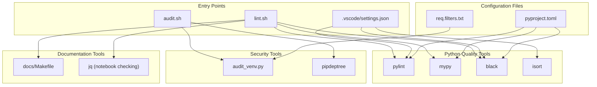
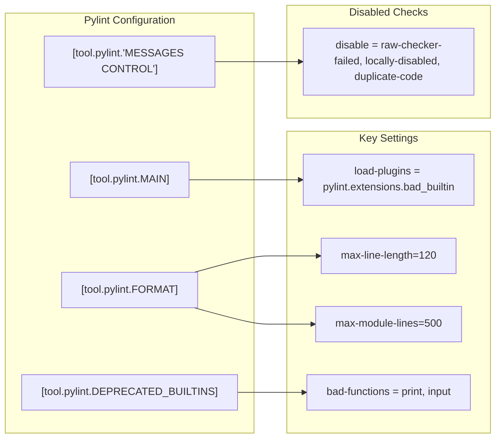
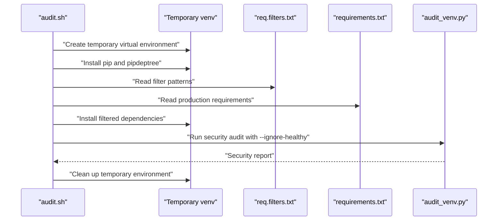
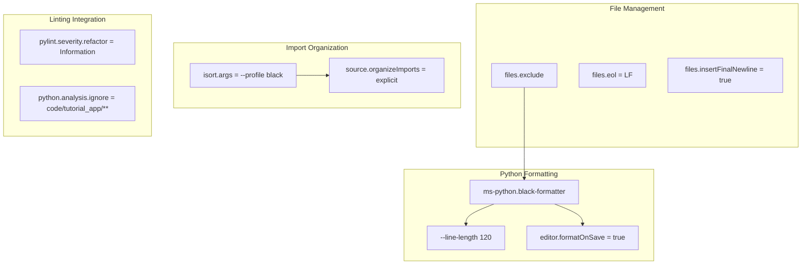
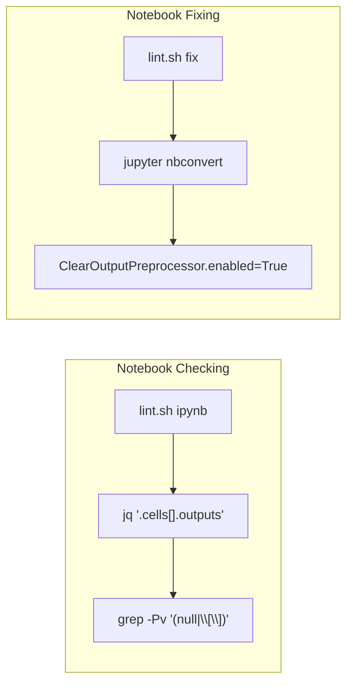

<!-- source: DeepWiki mcp.deepwiki.com · repo NVIDIA/nim-anywhere · page 6.3 Code Quality and Tools · fetched 2026-10-26 -->

# Code Quality and Tools

<details>
<summary>Relevant source files</summary>

The following files were used as context for generating this wiki page:

- [.vscode/settings.json](.vscode/settings.json)
- [code/frontend/server.py](code/frontend/server.py)
- [code/tools/audit.sh](code/tools/audit.sh)
- [code/tools/lint.sh](code/tools/lint.sh)
- [pyproject.toml](pyproject.toml)

</details>


This document covers the code quality framework, development tools, and automated checks used in the NVIDIA NIM Anywhere project. It details the linting system, security auditing, IDE integration, and quality assurance processes that maintain code standards across the codebase.

For information about setting up the development environment, see [Development Environment](#6.1). For frontend-specific development practices, see [Frontend Development](#6.2).

## Code Quality Framework

The NVIDIA NIM Anywhere project implements a comprehensive code quality system built around multiple automated tools and standardized configurations. The framework ensures consistent code style, type safety, security compliance, and documentation quality across all Python code and Jupyter notebooks.

### Quality Tool Architecture



**Sources:** [code/tools/lint.sh:1-90](), [code/tools/audit.sh:1-25](), [pyproject.toml:1-44](), [.vscode/settings.json:1-72]()

## Linting System

The project uses a multi-tool linting system coordinated through the `lint.sh` script. Each tool serves a specific purpose in maintaining code quality standards.

### Pylint Configuration

Pylint provides comprehensive Python code analysis with project-specific rules configured in `pyproject.toml`. The configuration disables certain overly strict checks while enabling important quality controls.



**Key Pylint Rules:**
- Maximum line length: 120 characters
- Maximum module lines: 500
- Maximum function arguments: 8
- Disables duplicate code detection and certain verbose warnings
- Prohibits use of `print` and `input` functions in production code

**Sources:** [pyproject.toml:1-28](), [code/tools/lint.sh:14-18]()

### Type Checking with MyPy

MyPy provides static type checking with a lenient configuration that accommodates the project's gradual typing approach.

| Configuration | Value | Purpose |
|---------------|--------|---------|
| `strict` | `false` | Allows gradual type adoption |
| `implicit_optional` | `true` | Permits optional parameters without explicit typing |
| `follow_imports` | `"silent"` | Processes imported modules without verbose output |
| `ignore_missing_imports` | `true` | Continues analysis when imports lack type stubs |

**Sources:** [pyproject.toml:35-43](), [code/tools/lint.sh:20-24]()

### Code Formatting with Black

Black enforces consistent Python code formatting with a 120-character line length limit. The tool runs in both check mode for validation and fix mode for automatic formatting.

**Sources:** [pyproject.toml:21-22](), [code/tools/lint.sh:26-30](), [code/tools/lint.sh:67-70]()

## Security Auditing

The security auditing system uses a dedicated virtual environment approach to validate production dependencies against known vulnerabilities.

### Audit Process Flow



The `_audit_venv()` function creates an isolated environment to test only production dependencies, filtering out development-only packages using patterns from `req.filters.txt`.

**Sources:** [code/tools/audit.sh:2-18]()

## IDE Integration

VS Code integration provides real-time code quality feedback through configured extensions and automated formatting.

### Python Development Configuration

The `.vscode/settings.json` file configures multiple aspects of the Python development experience:



**Excluded Files and Directories:**
- `**/__pycache__` - Python bytecode cache
- `**/.mypy_cache` - MyPy type checking cache  
- `**/.ipynb_checkpoints` - Jupyter notebook checkpoints
- `**/.venv` - Virtual environment directories

**Sources:** [.vscode/settings.json:3-15](), [.vscode/settings.json:47-71]()

## Jupyter Notebook Quality Control

The linting system includes specialized handling for Jupyter notebooks to ensure they meet quality standards for version control and distribution.

### Notebook Output Management



The notebook quality system:
1. **Detection**: Uses `jq` to parse notebook JSON and identify cells with output
2. **Validation**: Fails if any notebook contains cell outputs 
3. **Remediation**: Automatically clears outputs using `jupyter nbconvert` with `ClearOutputPreprocessor`

**Sources:** [code/tools/lint.sh:32-52](), [code/tools/lint.sh:77-84]()

## Documentation Quality Assurance

The documentation system integrates with the linting framework to ensure documentation stays current with code changes.

### Documentation Build Validation

The `lint.sh` script validates documentation currency by checking if the docs `Makefile` needs to be run:

```bash
# From lint.sh docs check
if ! make -q; then
    make -qd | grep -v '^  ' | grep -v 'is older than'
    echo 'fail: in the docs folder run `make all` to update the readme' >&2
    exit 1
fi
```

This ensures that generated documentation (particularly `README.md`) stays synchronized with source documentation files.

**Sources:** [code/tools/lint.sh:54-65](), [code/tools/lint.sh:72-76]()

## Running Quality Checks

The `lint.sh` script provides multiple execution modes for different development workflows:

| Command | Purpose | Tools Run |
|---------|---------|-----------|
| `./code/tools/lint.sh` | Run all checks | pylint, mypy, black, ipynb, docs |
| `./code/tools/lint.sh pylint` | Python syntax only | pylint |
| `./code/tools/lint.sh mypy` | Type checking only | mypy |
| `./code/tools/lint.sh black` | Formatting check only | black |
| `./code/tools/lint.sh fix` | Auto-fix issues | black (format), jupyter (clear), docs (rebuild) |

**Sources:** [code/tools/lint.sh:6-12](), [code/tools/lint.sh:67-86]()

---

