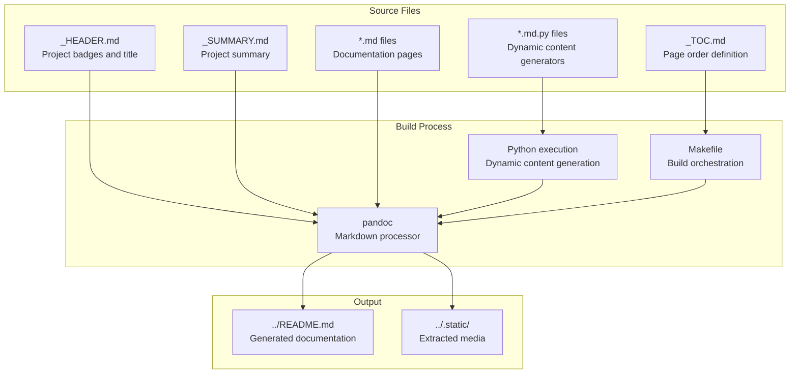
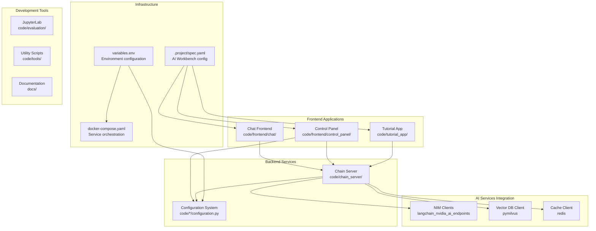
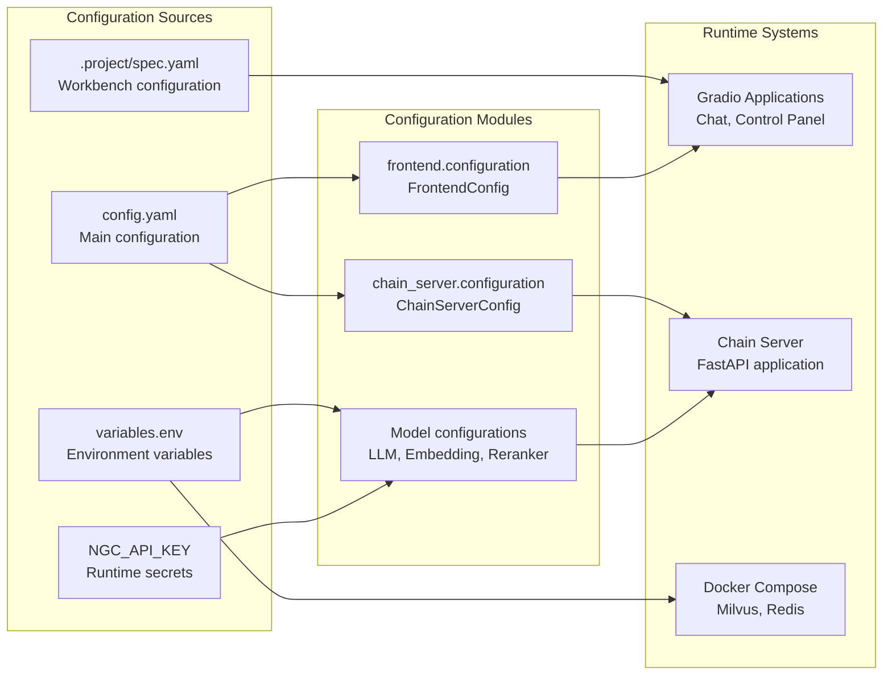

<!-- source: DeepWiki mcp.deepwiki.com · repo NVIDIA/nim-anywhere · page 7 Reference · fetched 2026-10-26 -->

# Reference

Relevant source files

The following files were used as context for generating this wiki page:

- [docs/Makefile](docs/Makefile)
- [docs/_HEADER.md](docs/_HEADER.md)
- [docs/_TOC.md](docs/_TOC.md)

This section provides additional resources, project structure details, and system internals for NVIDIA NIM Anywhere. The reference materials cover technical documentation systems, codebase organization, and supporting assets that enable development and deployment.

For configuration details, see [Configuration](#5). For development setup and workflows, see [Development](#6). For architectural concepts, see [Core Architecture](#3).

## Documentation Generation System

The project uses an automated documentation system that generates the main README.md from modular markdown sources and Python configuration extractors.

### Documentation Build Process

The documentation system operates through a Makefile-driven process that combines static markdown files with dynamically generated content from Python modules.

Sources: [docs/Makefile:24-46](), [docs/_TOC.md:1-20](), [docs/_HEADER.md:1-10]()

### Build Commands and Process

The documentation build process is controlled by the Makefile with specific pandoc configurations:

| Command | Purpose | Key Options |
|---------|---------|-------------|
| `make ../README.md` | Generate complete documentation | Combines all sources |
| `make _render` | Internal render pipeline | Sets mermaid format to PNG |
| `make _markdown` | Process markdown sources | Executes Python generators |
| `make clean` | Remove generated files | Cleans README.md and .static |

The build process uses pandoc with GitHub Flavored Markdown format (`--from gfm --to gfm`) and includes table of contents generation (`--toc --toc-depth=2`).

Sources: [docs/Makefile:15-16](), [docs/Makefile:32-46]()

## System Components to Code Mapping

This diagram maps the high-level system components to their actual implementation locations in the codebase:

Sources: [docs/_TOC.md:13-20]()

## Configuration Architecture

The system employs a hierarchical configuration architecture that spans multiple file types and sources:

Sources: [docs/_TOC.md:14]()

## Project Organization Principles

The codebase follows a modular organization pattern that separates concerns by function and deployment target:

### Directory Structure Pattern

| Directory | Purpose | Key Files |
|-----------|---------|-----------|
| `code/frontend/` | User interface applications | Gradio-based UIs |
| `code/chain_server/` | RAG processing backend | FastAPI server, LangChain |
| `code/tutorial_app/` | Educational interface | Streamlit application |
| `code/tools/` | Development utilities | Scripts, linting tools |
| `code/evaluation/` | Performance testing | Jupyter notebooks |
| `docs/` | Documentation system | Markdown sources, Makefile |
| `.project/` | AI Workbench integration | Project specification |

### Module Naming Conventions

The project uses consistent naming patterns for Python modules:

- `configuration.py` - Configuration classes and validation
- `server.py` - Main application entry points  
- `utils.py` - Utility functions and helpers
- `models.py` - Data models and schemas

### Asset Organization

Static assets and resources are organized by application:

- UI icons and images in application-specific directories
- Shared assets in common resource locations
- Generated documentation assets in `.static/` directory

Sources: [docs/_TOC.md:1-20](), [docs/Makefile:22]()

For detailed information about specific components:
- Documentation system implementation: [Documentation System](#7.1)
- Complete project structure reference: [Project Structure](#7.2) 
- UI assets and resources: [UI Assets and Resources](#7.3)

---

