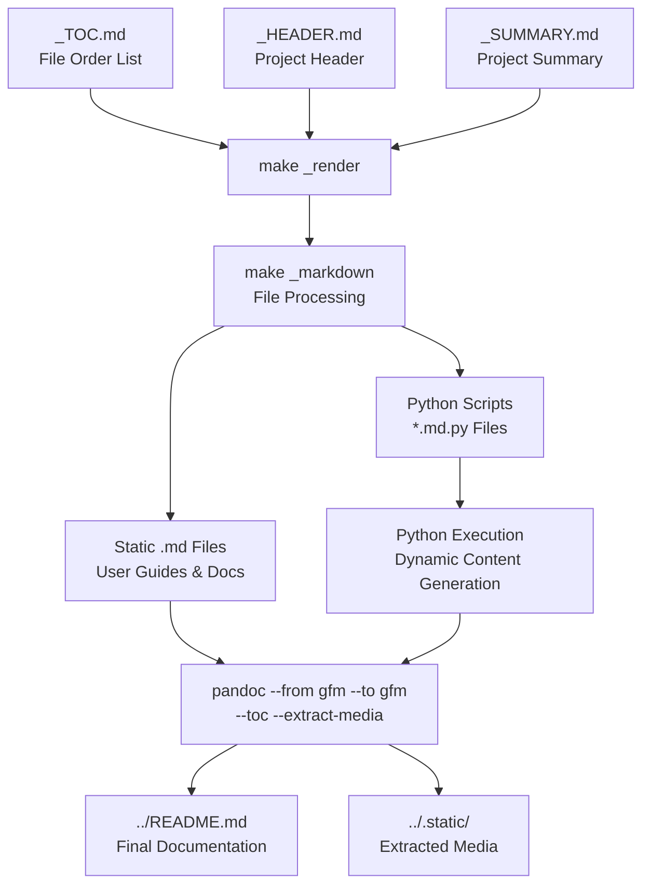
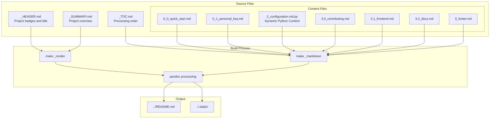
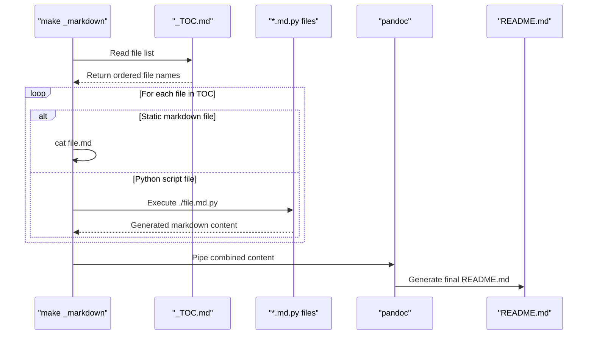
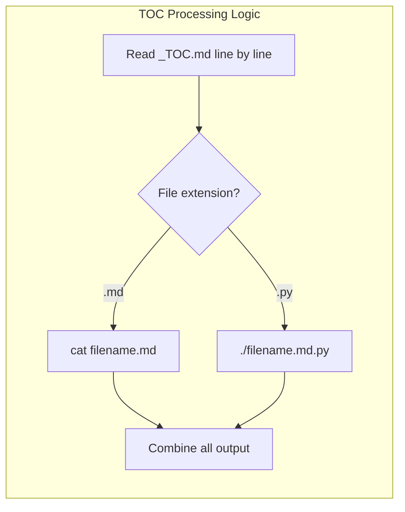

<!-- source: DeepWiki mcp.deepwiki.com · repo NVIDIA/nim-anywhere · page 7.1 Documentation System · fetched 2026-10-26 -->

# Documentation System

<details>
<summary>Relevant source files</summary>

The following files were used as context for generating this wiki page:

- [docs/Makefile](docs/Makefile)
- [docs/_HEADER.md](docs/_HEADER.md)
- [docs/_TOC.md](docs/_TOC.md)

</details>


This document describes the automated documentation generation system used in NVIDIA NIM Anywhere. The system builds the project's main README.md from modular markdown source files using a make-based workflow with pandoc processing.

For information about the overall project structure, see [Project Structure](#7.2). For details about development workflows, see [Development Environment](#6.1).

## Purpose and Architecture

The documentation system serves as a build pipeline that combines multiple markdown source files into a single, comprehensive README.md file. The system supports both static markdown content and dynamically generated content from Python scripts.

### Documentation Build Process



Sources: [docs/Makefile:24-46](), [docs/_TOC.md:1-21]()

### File Organization Structure

The documentation system uses a hierarchical file organization with specific naming conventions and processing rules.



Sources: [docs/_TOC.md:1-21](), [docs/Makefile:38-46]()

## Build System Components

### Make Targets

The documentation build system provides several make targets for different operations:

| Target | Purpose | Command |
|--------|---------|---------|
| `../README.md` | Generate final documentation | Combines header, summary, and content processing |
| `_render` | Main rendering pipeline | Processes header and runs markdown generation |
| `_markdown` | Content file processing | Iterates through TOC files and executes/includes them |
| `clean` | Remove generated files | Deletes `../README.md` and `../.static` |
| `all` | Full rebuild | Runs `clean` then generates documentation |

Sources: [docs/Makefile:24-52]()

### Pandoc Configuration

The system uses two distinct pandoc configurations for different processing stages:

**Header Processing Options:**
```
--from gfm --to gfm --extract-media=.static --embed-resources --standalone
```

**Main Content Processing Options:**
```
--from gfm --to gfm --standalone --toc --toc-depth=2 --extract-media=.static --embed-resources --standalone
```

The main difference is the inclusion of `--toc --toc-depth=2` for automatic table of contents generation in the final output.

Sources: [docs/Makefile:15-16]()

### Dynamic Content Generation

The system supports Python scripts that generate markdown content dynamically. These files follow the `*.md.py` naming convention and are executed during the build process.



Sources: [docs/Makefile:39-46](), [docs/_TOC.md:14]()

## Environment and Dependencies

### Python Path Configuration

The build system sets `PYTHONPATH` to include the project's code directory, enabling Python scripts to import project modules:

```
export PYTHONPATH := $(PYTHONPATH):../code
```

This allows documentation generation scripts to access configuration classes and other code components for dynamic content generation.

Sources: [docs/Makefile:22]()

### Mermaid Diagram Support

The system includes environment variables for mermaid diagram rendering:

| Variable | Value | Purpose |
|----------|-------|---------|
| `MERMAID_FILTER_FORMAT` | `png` | Output format for diagrams |
| `MERMAID_FILTER_WIDTH` | `800` | Diagram width in pixels |

These settings ensure consistent diagram rendering across the documentation.

Sources: [docs/Makefile:32-33]()

## File Processing Workflow

### Table of Contents Processing

The `_TOC.md` file defines the processing order for all documentation components. The system reads this file line by line and processes each entry according to its file extension:



Sources: [docs/Makefile:39-46]()

### Media Asset Handling

The system automatically extracts and processes media assets referenced in markdown files:

- Images and other media are extracted to the `.static` directory during pandoc processing
- The final `.static` directory is moved to the parent directory as `../.static`
- All media references are updated to use the extracted assets

Sources: [docs/Makefile:26]()

### Error Handling

The build system includes error handling for missing files and failed Python script execution:

```bash
./$$page 2> /dev/null || cat $$page || exit 1;
```

This ensures that if a Python script fails to execute, the system falls back to treating it as a static file, and if that also fails, the build process exits with an error code.

Sources: [docs/Makefile:41]()

---

