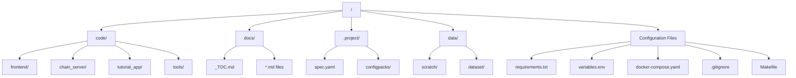
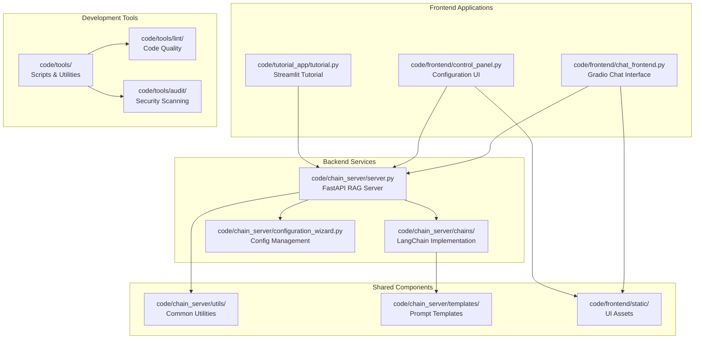
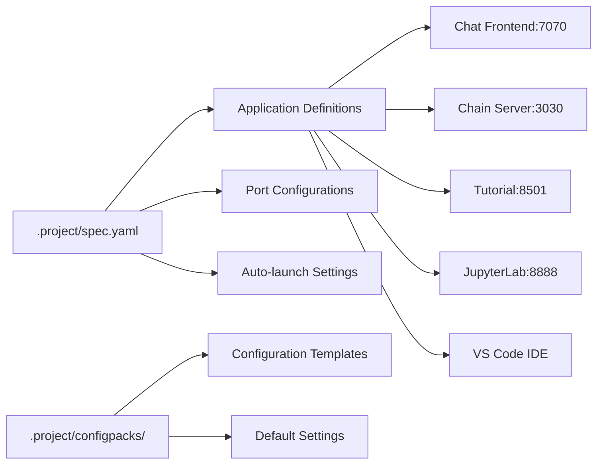
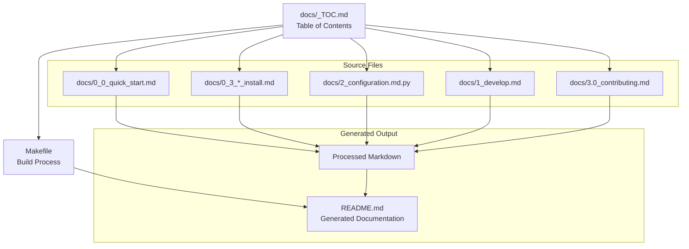
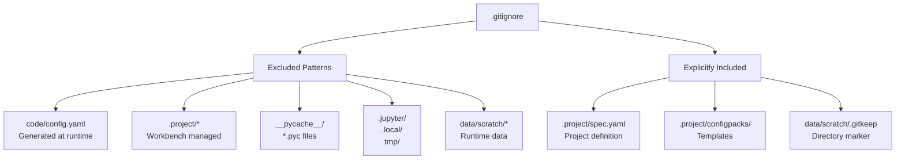

<!-- source: DeepWiki mcp.deepwiki.com · repo NVIDIA/nim-anywhere · page 7.2 Project Structure · fetched 2026-10-26 -->

# Project Structure

Relevant source files

The following files were used as context for generating this wiki page:

- [.gitignore](.gitignore)
- [docs/_TOC.md](docs/_TOC.md)

This document provides a comprehensive overview of the NVIDIA NIM Anywhere codebase organization, including directory structure, key components, and file relationships. This guide helps developers navigate the project and understand how different subsystems are organized within the repository.

For information about setting up the development environment, see [Development Environment](#6.1). For details about the configuration system architecture, see [Configuration System](#5.1). For documentation generation processes, see [Documentation System](#7.1).

## High-Level Directory Organization

The NVIDIA NIM Anywhere project follows a modular structure that separates concerns between applications, configuration, documentation, and runtime data.

### Root Directory Structure

Sources: [.gitignore:1-63](), [docs/_TOC.md:1-21]()

## Core Application Components

The main application logic is organized under the `code/` directory, with each major component having its own subdirectory and specific responsibilities.

### Application Architecture Map

Sources: Based on architectural diagrams and inferred from component relationships

## NVIDIA AI Workbench Integration Files

The project integrates with NVIDIA AI Workbench through specific configuration files that define the development environment and application orchestration.

### Workbench Configuration Structure

| File Path | Purpose | Key Components |
|-----------|---------|----------------|
| `.project/spec.yaml` | AI Workbench project specification | Application definitions, port mappings, auto-launch settings |
| `variables.env` | Environment variable configuration | NGC API keys, service endpoints, feature flags |
| `requirements.txt` | Python dependency specification | Package versions for reproducible environments |
| `docker-compose.yaml` | Container service orchestration | Milvus, Redis, optional local NIMs |

The `.project/` directory contains AI Workbench-specific configuration:

Sources: [.gitignore:2-4](), architectural diagrams

## Documentation Infrastructure

The documentation system uses a structured approach to generate comprehensive project documentation from markdown sources.

### Documentation Build System

Sources: [docs/_TOC.md:1-21]()

## Configuration and Runtime Files

The system uses a hierarchical configuration approach with multiple sources and runtime-generated files.

### Configuration File Hierarchy

| Priority | File Location | Purpose | Tracked in Git |
|----------|---------------|---------|----------------|
| 1 | `code/config.yaml` | Runtime configuration | No (generated) |
| 2 | `variables.env` | Environment variables | Yes |
| 3 | `.project/configpacks/` | Workbench templates | Yes |
| 4 | Default values | Hardcoded fallbacks | N/A |

The `.gitignore` file explicitly excludes generated configuration:

Sources: [.gitignore:1-63]()

## Data and Runtime Directories

The project maintains separate directories for different types of data and runtime artifacts.

### Data Directory Organization

The `data/` directory structure supports both development datasets and runtime scratch space:

- `data/scratch/` - Runtime temporary files and processing artifacts (ignored by git except for `.gitkeep`)
- `data/dataset/` - Development datasets and knowledge base sources (ignored by git)

This organization allows for clean separation between versioned code and transient runtime data, while providing designated spaces for knowledge base ingestion and processing workflows.

Sources: [.gitignore:61-63]()

---

