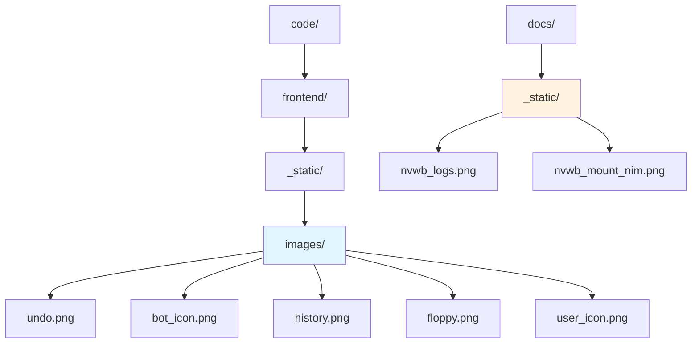
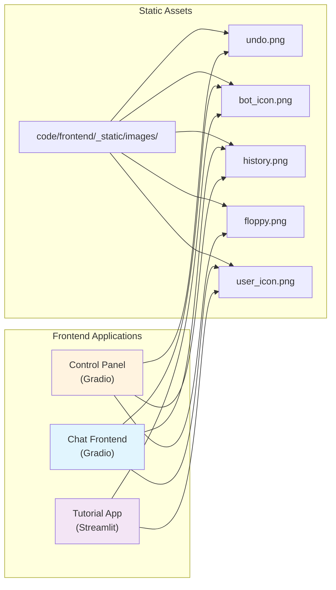
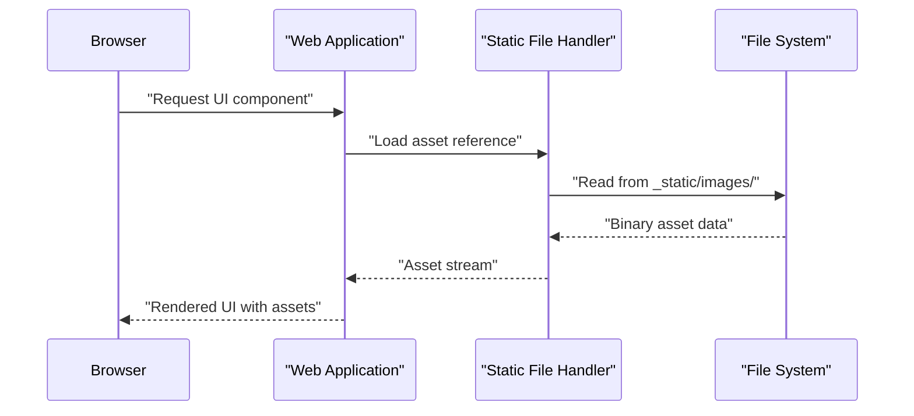

<!-- source: DeepWiki mcp.deepwiki.com · repo NVIDIA/nim-anywhere · page 7.3 UI Assets and Resources · fetched 2026-10-26 -->

# UI Assets and Resources

<details>
<summary>Relevant source files</summary>

The following files were used as context for generating this wiki page:

- [code/frontend/_static/images/bot_icon.png](code/frontend/_static/images/bot_icon.png)
- [code/frontend/_static/images/floppy.png](code/frontend/_static/images/floppy.png)
- [code/frontend/_static/images/history.png](code/frontend/_static/images/history.png)
- [code/frontend/_static/images/undo.png](code/frontend/_static/images/undo.png)
- [code/frontend/_static/images/user_icon.png](code/frontend/_static/images/user_icon.png)
- [docs/_static/nvwb_left_menu.png](docs/_static/nvwb_left_menu.png)
- [docs/_static/nvwb_logs.png](docs/_static/nvwb_logs.png)
- [docs/_static/nvwb_mount_nim.png](docs/_static/nvwb_mount_nim.png)

</details>


This document covers the static assets, icons, and visual resources used across the NVIDIA NIM Anywhere frontend applications, including their organization, usage patterns, and deployment mechanisms.

For information about the frontend applications themselves, see [User Interfaces](#4). For development environment setup, see [Development Environment](#6.1).

## Asset Organization

The UI assets in NVIDIA NIM Anywhere are organized into two primary categories: frontend application assets and documentation resources.

### Directory Structure



**Asset Directory Structure and Storage**

Sources: [code/frontend/_static/images/undo.png:1-4](), [code/frontend/_static/images/bot_icon.png:1-4](), [code/frontend/_static/images/history.png:1-4](), [code/frontend/_static/images/floppy.png:1-4](), [code/frontend/_static/images/user_icon.png:1-4](), [docs/_static/nvwb_logs.png:1-3](), [docs/_static/nvwb_mount_nim.png:1-3]()

## Frontend Application Assets

The frontend application assets are stored in `code/frontend/_static/images/` and are managed using Git LFS (Large File Storage) due to their binary nature.

### Icon Library

| Asset File | Purpose | Usage Context | Size (bytes) |
|------------|---------|---------------|--------------|
| `undo.png` | Undo/revert functionality | Action buttons, toolbars | 467 |
| `bot_icon.png` | AI assistant representation | Chat interface, message attribution | 1,417 |
| `history.png` | Conversation history access | Navigation, sidebar controls | 596 |
| `floppy.png` | Save/persistence operations | Configuration panels, data export | 306 |
| `user_icon.png` | User representation | Chat interface, user profiles | 1,378 |

### Asset Integration with Frontend Applications



**Frontend Asset Usage Patterns**

Sources: [code/frontend/_static/images/bot_icon.png:1-4](), [code/frontend/_static/images/user_icon.png:1-4](), [code/frontend/_static/images/history.png:1-4](), [code/frontend/_static/images/floppy.png:1-4](), [code/frontend/_static/images/undo.png:1-4]()

## Git LFS Asset Management

All UI assets are managed through Git Large File Storage (LFS) to optimize repository performance and handle binary file versioning efficiently.

### LFS Configuration

Each asset file contains Git LFS metadata with the following structure:

```
version https://git-lfs.github.com/spec/v1
oid sha256:<hash>
size <bytes>
```

The LFS system ensures that:
- Binary assets are stored separately from the main Git repository
- File integrity is maintained through SHA-256 checksums
- Large files don't bloat the repository clone size
- Version history is preserved for asset updates

Sources: [code/frontend/_static/images/undo.png:1-4](), [code/frontend/_static/images/bot_icon.png:1-4]()

## Documentation Assets

Documentation assets are stored in `docs/_static/` and provide visual aids for user guides and system documentation.

### Documentation Visual Resources

| Asset | Type | Purpose |
|-------|------|---------|
| `nvwb_logs.png` | Screenshot | NVIDIA AI Workbench logging interface |
| `nvwb_mount_nim.png` | Screenshot | NIM mounting and configuration process |

These assets support the documentation system described in [Documentation System](#7.1) by providing visual context for complex configuration procedures.

Sources: [docs/_static/nvwb_logs.png:1-3](), [docs/_static/nvwb_mount_nim.png:1-3]()

## Asset Deployment and Access

The static assets are served through the web applications' static file serving mechanisms, typically handled by the underlying web frameworks (Gradio for the main applications, Streamlit for tutorials).

### Asset Loading Pipeline



**Asset Loading and Serving Process**

The web applications automatically serve static assets from their respective `_static` directories, making them available to the frontend components through standard HTTP requests.

Sources: [code/frontend/_static/images/]()

## Best Practices

### Asset Optimization
- All images are optimized for web delivery while maintaining visual quality
- PNG format is used for icons to support transparency
- File sizes are kept minimal (306-1,417 bytes) for fast loading

### Naming Conventions
- Descriptive filenames that indicate purpose (`bot_icon.png`, `user_icon.png`)
- Consistent naming scheme across related assets
- Underscore separation for multi-word names

### Version Control
- Git LFS ensures efficient handling of binary assets
- SHA-256 checksums provide integrity verification
- Proper tracking of asset changes through LFS history

Sources: [code/frontend/_static/images/undo.png:1-4](), [code/frontend/_static/images/bot_icon.png:1-4](), [code/frontend/_static/images/history.png:1-4](), [code/frontend/_static/images/floppy.png:1-4](), [code/frontend/_static/images/user_icon.png:1-4]()