# Page: Overview

# Overview

<details>
<summary>Relevant source files</summary>

The following files were used as context for generating this wiki page:

- [README.md](README.md)
- [code/frontend/__init__.py](code/frontend/__init__.py)
- [docs/_SUMMARY.md](docs/_SUMMARY.md)

</details>


This document provides a comprehensive overview of NVIDIA NIM Anywhere, explaining its purpose as an enterprise RAG (Retrieval-Augmented Generation) system and its architectural components. For detailed configuration instructions, see [Configuration](#5). For development guidance, see [Development](#6).

## Purpose and Scope

NVIDIA NIM Anywhere is a complete RAG system designed to enable enterprises to integrate their internal data with AI models using NVIDIA's NIM (NVIDIA Inference Microservices) technology. The system provides all necessary tooling to build production-ready RAG pipelines that can scale from development environments to full production deployments.

The system addresses the enterprise need to leverage AI with proprietary data while maintaining data security and control. Instead of sending sensitive information to external AI services, NIM Anywhere allows organizations to run AI inference locally or through NVIDIA's cloud services while keeping their data within their controlled environment.

Sources: [README.md:14-41](), [docs/_SUMMARY.md:1-13]()

## System Architecture Overview

NIM Anywhere operates as a multi-component system orchestrated by NVIDIA AI Workbench. The architecture follows a modular design with clear separation between frontend interfaces, backend processing, data storage, and AI services.

### Core System Components

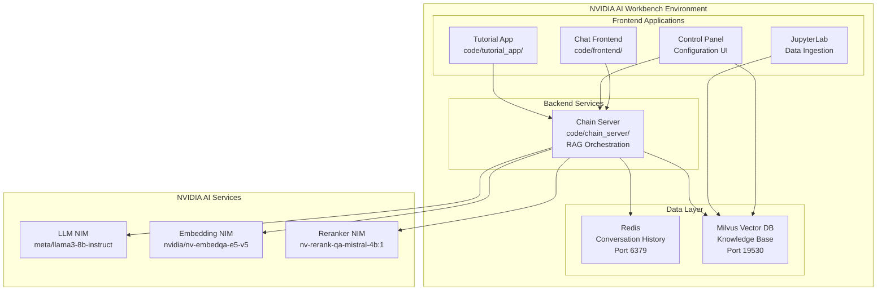

Sources: [README.md:545-558](), [README.md:610-660]()

### Configuration and Runtime Architecture

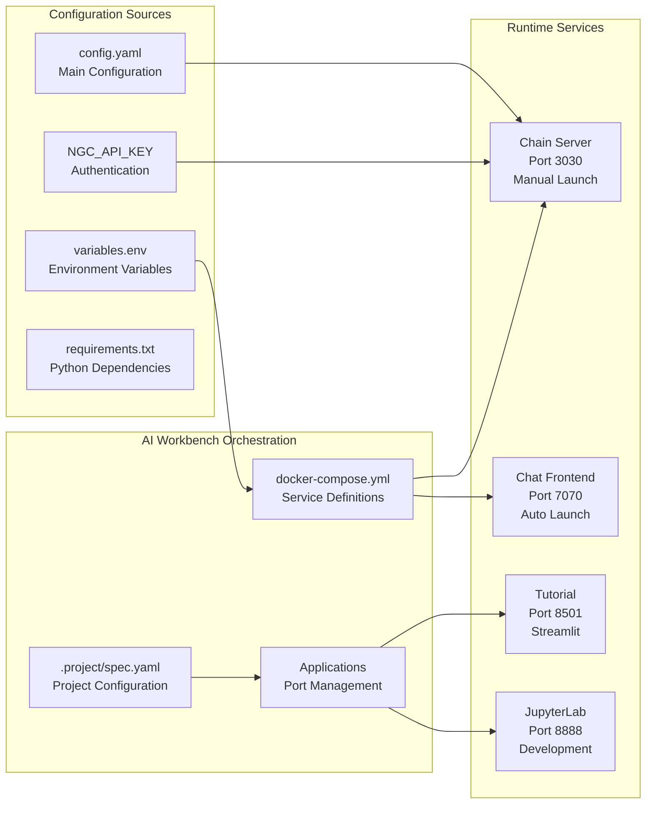

Sources: [README.md:564-589](), [README.md:443-512]()

## Core Components

### Chain Server
The Chain Server serves as the core RAG engine, implementing the LangChain-based processing pipeline. Located in `code/chain_server/`, it orchestrates interactions between user queries, vector databases, and NVIDIA NIMs.

**Key Responsibilities:**
- Query processing and embedding generation
- Vector similarity search coordination
- Document retrieval and reranking
- LLM prompt assembly and response generation
- Conversation history management

### Frontend Applications
The system provides multiple user interfaces built with different frameworks:

| Component | Framework | Port | Purpose |
|-----------|-----------|------|---------|
| Chat Frontend | Gradio | 7070 | Primary user interaction |
| Control Panel | Gradio | - | System configuration |
| Tutorial App | Streamlit | 8501 | Interactive learning |
| JupyterLab | Jupyter | 8888 | Data ingestion |

### Data Storage Layer
Two primary data stores support the RAG pipeline:

- **Milvus Vector Database**: Stores document embeddings for similarity search at `localhost:19530`
- **Redis Cache**: Manages conversation history and session state at `localhost:6379`

Sources: [README.md:443-512](), [README.md:598-660]()

## RAG Processing Pipeline

The system implements a sophisticated RAG pipeline that processes user queries through multiple stages:

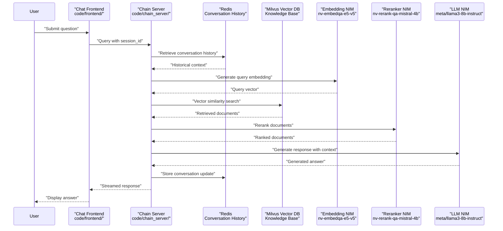

Sources: [README.md:24-38]()

## Technology Stack

### AI Workbench Integration
NVIDIA AI Workbench serves as the orchestration platform, managing:
- Container lifecycle through Docker Compose
- Application routing and port management
- Environment variable configuration
- Development tool integration

### NVIDIA NIMs
The system integrates three types of NVIDIA Inference Microservices:
- **LLM NIM**: `meta/llama3-8b-instruct` for text generation
- **Embedding NIM**: `nvidia/nv-embedqa-e5-v5` for text embeddings
- **Reranker NIM**: `nv-rerank-qa-mistral-4b:1` for document ranking

### Development Framework
Built on Python 3.10+ with key dependencies:
- **LangChain**: RAG pipeline orchestration
- **Gradio**: Frontend UI framework
- **Streamlit**: Tutorial application framework
- **Milvus**: Vector database client
- **Redis**: Caching and session management

Sources: [README.md:598-660](), [README.md:943-949]()

## Deployment Model

### Local Development
For development environments, the system supports running with minimal GPU requirements by utilizing NVIDIA's cloud-hosted NIMs at `ai.nvidia.com`. This allows developers to work without local GPU resources while maintaining full functionality.

### Production Deployment
Production deployments can run NIMs locally with dedicated GPU resources:
- **Minimum 1 GPU**: Local LLM only
- **Minimum 2 GPUs**: LLM + Embedding
- **Minimum 3 GPUs**: Full local stack (LLM + Embedding + Reranker)

### Hybrid Deployment
The system supports hybrid configurations where some NIMs run locally while others use cloud endpoints, providing flexibility for different resource constraints and security requirements.

Sources: [README.md:439-497](), [README.md:459-487]()

---

# Page: Getting Started

# Getting Started

<details>
<summary>Relevant source files</summary>

The following files were used as context for generating this wiki page:

- [.gitattributes](.gitattributes)
- [docs/0_0_quick_start.md](docs/0_0_quick_start.md)
- [docs/0_1_personal_key.md](docs/0_1_personal_key.md)
- [docs/3.2_docs.md](docs/3.2_docs.md)

</details>


This page provides an overview of the initial setup process for NVIDIA NIM Anywhere. It covers the high-level workflow from prerequisites through first deployment, establishing the foundation for using the RAG system in your environment.

For detailed configuration of models and services after initial setup, see [Configuration](#5). For development and extension information, see [Development](#6).

## Setup Process Overview

NVIDIA NIM Anywhere requires a sequence of setup steps that establish authentication, deploy the AI Workbench environment, and configure the RAG components. The process involves three main phases: authentication setup, environment deployment, and system validation.

### Authentication and Prerequisites

The system requires authentication to NVIDIA's cloud services through NGC (NVIDIA GPU Cloud) Personal Keys. These keys enable access to NVIDIA AI models and services used throughout the RAG pipeline.

**Authentication Flow:**
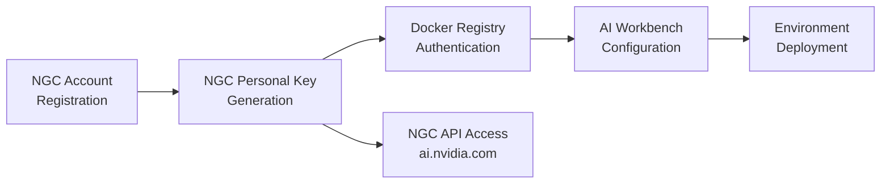

The NGC Personal Key (`nvapi-` prefix) serves as the primary authentication mechanism for accessing NVIDIA's cloud-hosted AI models and container registries.

For complete authentication setup instructions, see [Prerequisites and Authentication](#2.1).

**Sources:** [docs/0_1_personal_key.md:1-27]()

### Environment Architecture

The deployment creates a containerized environment managed by NVIDIA AI Workbench. This environment orchestrates multiple applications and services that comprise the RAG system.

**Workbench Application Structure:**
```mermaid
graph TB
    subgraph WORKBENCH["`.project/spec.yaml` Workbench Project"]
        subgraph APPS["Application Layer"]
            CHAT_FRONTEND["`chat_frontend:7070
            Gradio Chat Interface`"]
            CHAIN_SERVER["`chain_server:3030
            LangChain RAG Engine`"]
            CONTROL_PANEL["`control_panel:7071
            Configuration Management`"]
            TUTORIAL_APP["`tutorial_app:8501
            Streamlit Tutorial`"]
            JUPYTER["`jupyterlab:8888
            Development Environment`"]
        end
        
        subgraph SERVICES["Docker Compose Services"]
            MILVUS_SVC["`milvus-standalone
            Vector Database`"]
            REDIS_SVC["`redis
            Conversation History`"]
            ETCD_SVC["`etcd
            Milvus Metadata`"]
            MINIO_SVC["`minio
            Object Storage`"]
        end
    end
    
    CHAT_FRONTEND --> CHAIN_SERVER
    CONTROL_PANEL --> CHAIN_SERVER
    CHAIN_SERVER --> MILVUS_SVC
    CHAIN_SERVER --> REDIS_SVC
    
    JUPYTER --> MILVUS_SVC
    TUTORIAL_APP --> CHAIN_SERVER
```

**Sources:** Based on system architecture diagrams provided in context

### Core RAG Components

The system implements a RAG pipeline that processes user queries through embedding generation, vector similarity search, optional reranking, and response generation using NVIDIA AI models.

**RAG Processing Chain:**
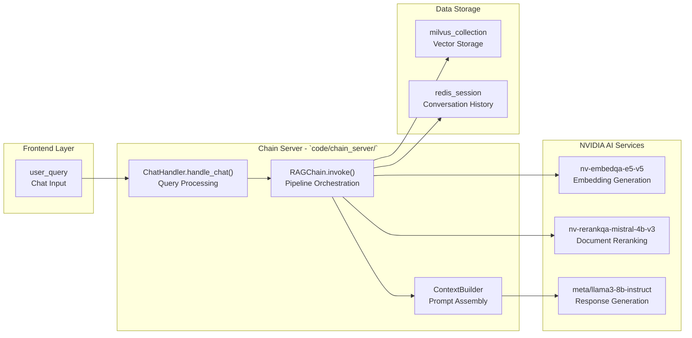

**Sources:** Based on RAG processing flow diagram provided in context

## Initial Deployment Steps

### 1. Prerequisites Setup
- Generate NGC Personal Key for NVIDIA AI service access
- Install NVIDIA AI Workbench platform
- Configure Docker authentication for NVIDIA container registry

### 2. Project Deployment
- Clone or import the NIM Anywhere project into AI Workbench
- Configure environment variables including `NGC_API_KEY`
- Deploy Docker Compose services (Milvus, Redis, supporting infrastructure)

### 3. Application Startup
- Launch Chain Server backend service on port 3030
- Start Chat Frontend application on port 7070 (auto-launches)
- Optional: Start Tutorial application on port 8501
- Optional: Start Control Panel on port 7071

### 4. System Validation
- Verify service connectivity through Chat Frontend
- Test RAG pipeline with sample queries
- Confirm knowledge base integration (if using custom data)

For detailed step-by-step instructions, see [Installation and Quick Start](#2.2).

## Expected Outcomes

Upon completion of the getting started process, you will have:

| Component | Status | Access Point |
|-----------|--------|-------------|
| Chat Frontend | Running | `http://localhost:7070` |
| Chain Server | Running | `http://localhost:3030` |
| Tutorial App | Available | `http://localhost:8501` |
| Control Panel | Available | `http://localhost:7071` |
| JupyterLab | Available | `http://localhost:8888` |
| Milvus Database | Running | Internal service |
| Redis Cache | Running | Internal service |

The system will be configured to use NVIDIA's cloud-hosted AI models by default, with the option to deploy local NIM containers for enhanced security or reduced latency.

## Next Steps

After completing initial setup:

1. **Explore the Tutorial** - Use the Streamlit tutorial application to understand RAG concepts and system capabilities
2. **Configure Models** - Customize LLM, embedding, and reranking model selections via the Control Panel
3. **Add Custom Data** - Ingest your organization's documents through JupyterLab or the Control Panel
4. **Production Configuration** - Review security settings, deploy local NIMs, and configure authentication for production use

**Sources:** Based on overall system architecture and application structure from context diagrams

---

# Page: Prerequisites and Authentication

# Prerequisites and Authentication

<details>
<summary>Relevant source files</summary>

The following files were used as context for generating this wiki page:

- [.gitattributes](.gitattributes)
- [docs/0_1_personal_key.md](docs/0_1_personal_key.md)
- [docs/3.2_docs.md](docs/3.2_docs.md)

</details>


This document covers the system requirements, authentication setup, and prerequisite configuration needed before installing and running NVIDIA NIM Anywhere. This includes obtaining NGC Personal Keys, Docker authentication, and NVIDIA AI Workbench environment preparation.

For information about the installation process itself, see [Installation and Quick Start](#2.2). For detailed configuration of models and services after installation, see [Configuration System](#5.1).

## System Requirements

NVIDIA NIM Anywhere requires the following components to be installed and configured before deployment:

| Component | Requirement | Purpose |
|-----------|-------------|---------|
| NVIDIA AI Workbench | Latest version | Container orchestration and environment management |
| Docker | Compatible with AI Workbench | Container runtime for services |
| NGC Account | Active account with Personal Key | Access to NVIDIA AI services |
| Network Access | HTTPS to `ai.nvidia.com` and `ngc.nvidia.com` | API communication |

## NGC Personal Key Generation

The system requires an NGC Personal Key for authenticating with NVIDIA AI services. This key enables access to hosted models including LLM, embedding, and reranking services.

### Personal Key Creation Process

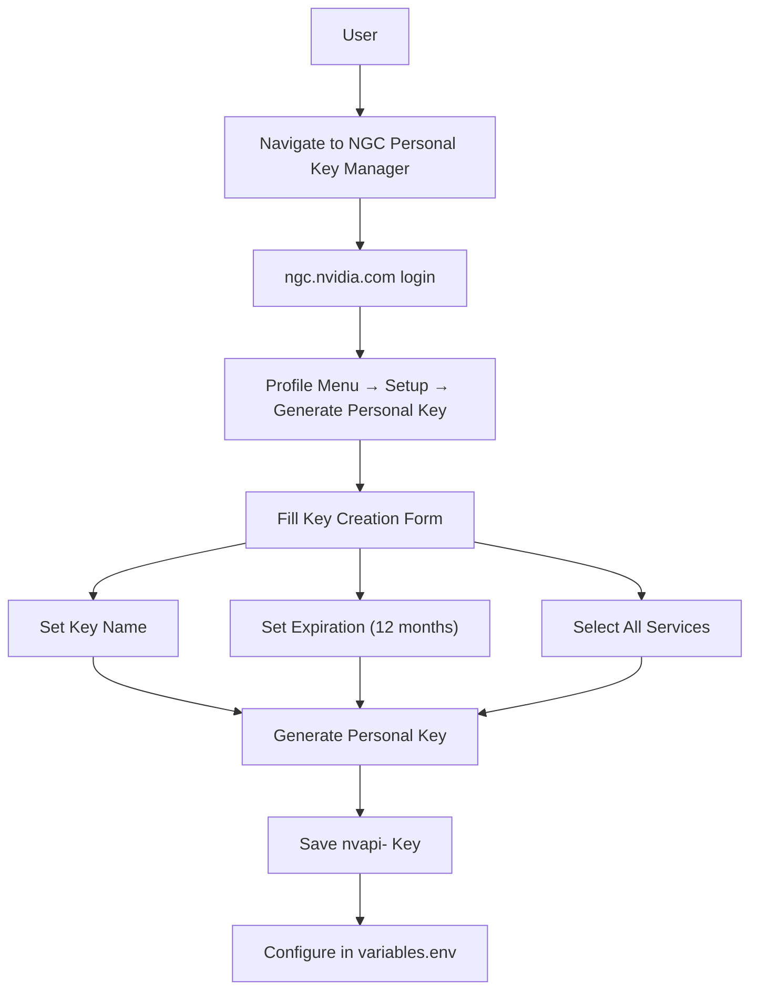

**Personal Key Creation Steps:**

1. Navigate to the [NGC Personal Key Manager](https://org.ngc.nvidia.com/setup/personal-keys)
2. Register or sign in to your NGC account if prompted
3. Select **Generate Personal Key**
4. Configure key parameters:
   - **Key name**: Any descriptive name
   - **Expiration**: 12 months recommended
   - **Services**: Select all available services
5. Click **Generate Personal Key**
6. **Important**: Save the generated key immediately - it cannot be retrieved later

The generated key will begin with `nvapi-` and must be stored securely as it provides access to NVIDIA AI services.

**Sources:** [docs/0_1_personal_key.md:1-27]()

## Authentication Configuration

### Environment Variable Setup

The NGC Personal Key must be configured in the system environment before starting services. The key is stored in the `NGC_API_KEY` environment variable and loaded by the configuration system.

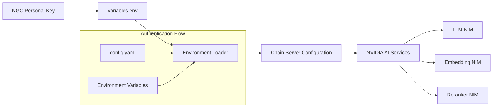

### Docker Authentication

NVIDIA AI Workbench uses Docker for container management. Ensure Docker is properly authenticated and configured:

1. **Docker Installation**: Verify Docker is installed and running
2. **Registry Access**: Ensure access to required container registries
3. **Resource Allocation**: Configure adequate CPU and memory resources

## AI Workbench Environment

### Workbench Project Configuration

The system uses NVIDIA AI Workbench for orchestration, with configuration defined in project specification files:

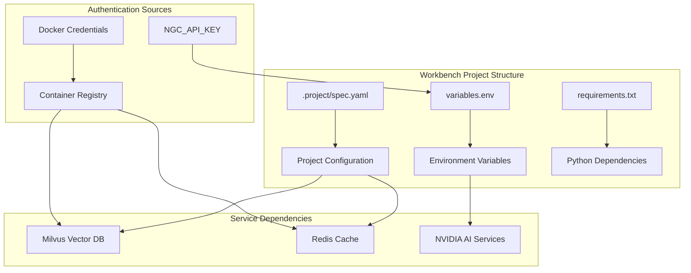

### Required Environment Variables

| Variable | Description | Required | Example |
|----------|-------------|----------|---------|
| `NGC_API_KEY` | NGC Personal Key for AI services | Yes | `nvapi-...` |
| `NVIDIA_API_KEY` | Alternative name for NGC key | Optional | `nvapi-...` |

**Sources:** [docs/0_1_personal_key.md:3-26]()

## Authentication Verification

### Service Connectivity Test

Before proceeding with installation, verify authentication and connectivity:

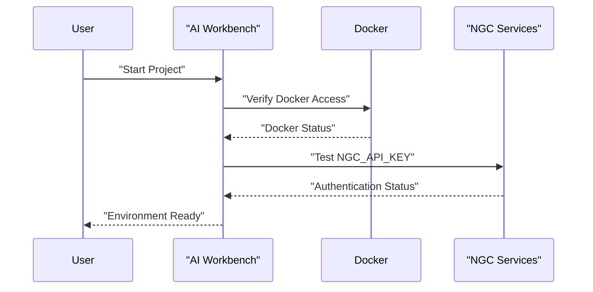

### Prerequisites Checklist

Before installation, ensure the following prerequisites are met:

- [ ] NVIDIA AI Workbench installed and running
- [ ] Docker installed with adequate resources allocated
- [ ] NGC account created with valid Personal Key
- [ ] NGC Personal Key saved securely (begins with `nvapi-`)
- [ ] Network connectivity to `ai.nvidia.com` and `ngc.nvidia.com`
- [ ] `NGC_API_KEY` environment variable configured
- [ ] Project environment variables file (`variables.env`) prepared

**Sources:** [docs/0_1_personal_key.md:10-26]()

---

# Page: Installation and Quick Start

# Installation and Quick Start

<details>
<summary>Relevant source files</summary>

The following files were used as context for generating this wiki page:

- [README.md](README.md)
- [code/frontend/__init__.py](code/frontend/__init__.py)
- [docs/0_0_quick_start.md](docs/0_0_quick_start.md)

</details>


This document provides step-by-step instructions for installing and running NVIDIA NIM Anywhere for the first time. It covers the complete process from AI Workbench setup through initial system validation.

For prerequisite setup including NGC authentication and Docker configuration, see [Prerequisites and Authentication](#2.1). For detailed system configuration options, see [Configuration](#5). For development environment setup, see [Development Environment](#6.1).

## Installation Process Overview

The installation process involves setting up the AI Workbench orchestration environment, downloading the project, and starting the containerized services that comprise the RAG system.

**Installation Flow Diagram**

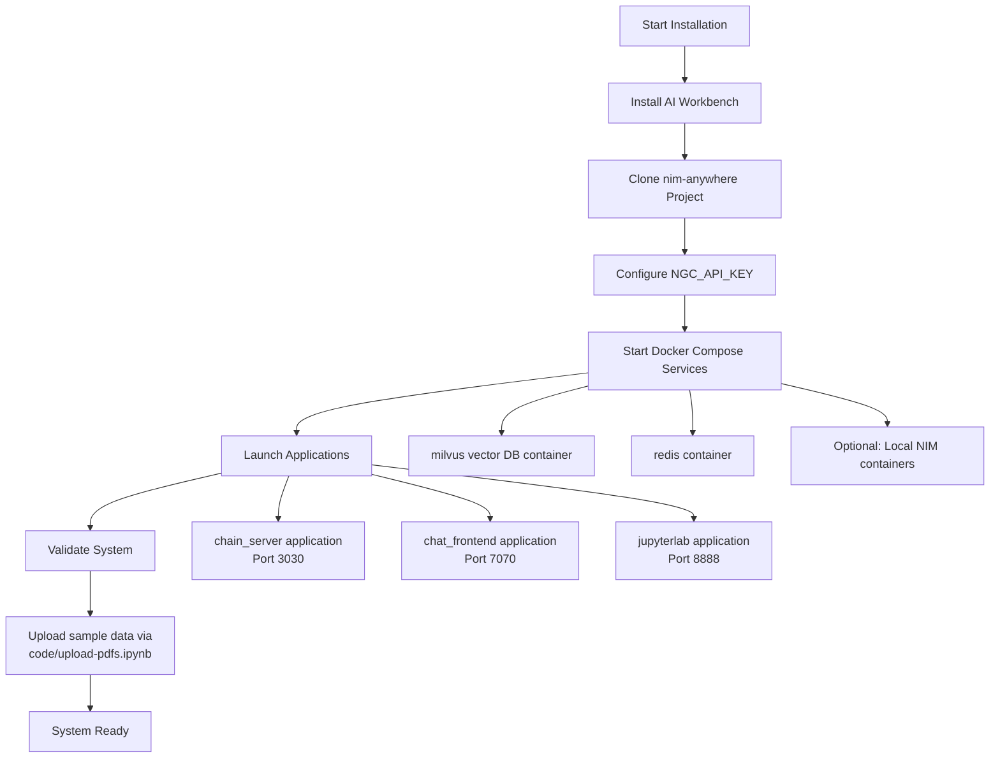

Sources: [README.md:143-152](), [README.md:443-512]()

## AI Workbench Installation

NVIDIA AI Workbench orchestrates the entire system including Docker Compose services and application lifecycle management. The installation process varies by operating system.

### Supported Platforms

| Platform | Local Development | Remote Development |
|----------|------------------|-------------------|
| Windows | ✓ (via WSL2) | ✓ (client only) |
| MacOS | ✓ | ✓ (client only) |
| Ubuntu | ✓ | ✓ (server and client) |

### Installation Requirements

**Prerequisites for all platforms:**
- Docker Desktop or compatible container runtime
- Git client with GitHub authentication
- For GPU acceleration: NVIDIA drivers and Docker GPU support

**For remote development:**
- SSH key-based authentication configured
- Ubuntu server with NVIDIA drivers

The detailed installation steps for each platform are provided in the AI Workbench documentation. The key configuration choice is selecting Docker as the container runtime during setup.

Sources: [README.md:127-349]()

## Project Download and Configuration

### Cloning the Repository

The project can be acquired through AI Workbench's clone functionality:

1. **Access AI Workbench**: Open the local or remote AI Workbench instance
2. **Clone Project**: Select "Clone Project" from the projects interface  
3. **Repository URL**: Use `https://github.com/NVIDIA/nim-anywhere.git`
4. **Bootstrap Environment**: AI Workbench automatically downloads dependencies defined in `requirements.txt` and executes `postBuild.bash`

**Project Structure After Clone**

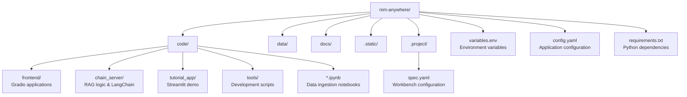

Sources: [README.md:351-398](), [README.md:937-959]()

### Essential Configuration

The primary configuration requirement is setting the NGC API key for accessing NVIDIA AI services:

1. **Navigate to Environment**: Access the "Environment" tab in AI Workbench
2. **Configure Secrets**: Locate the `NGC_API_KEY` entry in the Secrets section
3. **Set API Key**: Enter the NGC Personal Key generated in the prerequisites step

This key enables access to NVIDIA's hosted AI models at `https://integrate.api.nvidia.com/v1` as configured in the default `config.yaml`.

Sources: [README.md:400-419]()

## System Startup Process

The system startup involves two phases: infrastructure services via Docker Compose, followed by application services managed by AI Workbench.

### Phase 1: Infrastructure Services

**Docker Compose Service Profiles**

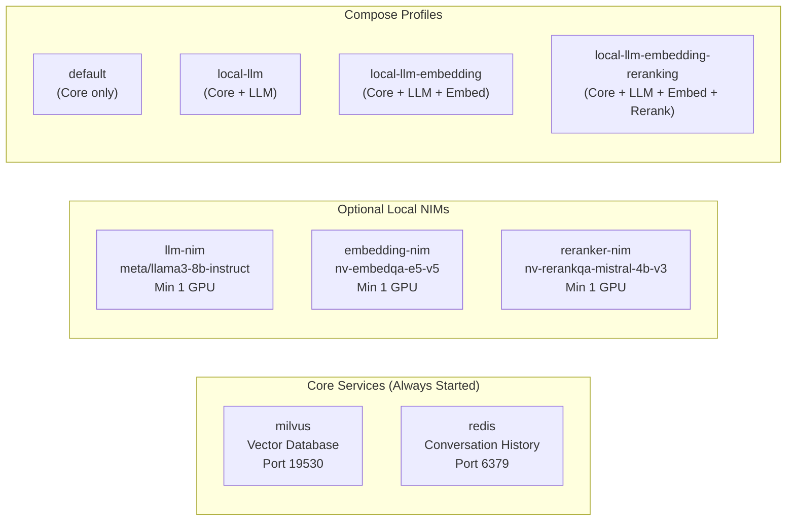

**Startup Steps:**
1. **Navigate to Environment > Compose**: Access the Docker Compose management interface
2. **Select Profile**: Choose deployment profile based on available GPU resources
3. **Start Services**: Click "Start" to launch the selected service profile

Sources: [README.md:443-497]()

### Phase 2: Application Services  

**Application Architecture**

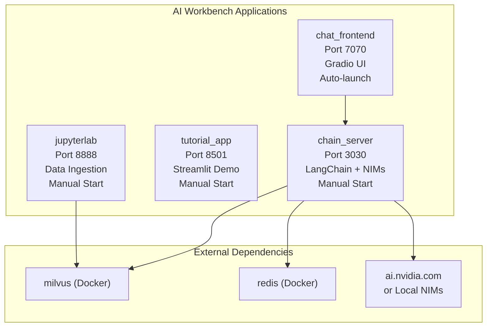

**Application Startup Sequence:**
1. **Start Chain Server**: Navigate to "Environment > Applications" and start `chain_server`
2. **Start Chat Frontend**: Start `chat_frontend` - this will auto-launch in browser
3. **Optional Services**: Start `jupyterlab` for data ingestion, `tutorial_app` for guided demos

Sources: [README.md:498-512](), [README.md:545-558]()

## Initial Validation and Knowledge Base Setup

### System Health Verification

After startup, verify system components are operational:

| Component | Verification Method | Expected Result |
|-----------|-------------------|-----------------|
| Chat Frontend | Browse to auto-opened browser window | Gradio interface loads |
| Chain Server | Check application logs in AI Workbench | Server running on port 3030 |
| Milvus | Container status in Compose tab | Running state |
| Redis | Container status in Compose tab | Running state |

### Knowledge Base Population

The system includes sample data and ingestion tools for initial testing:

**Data Ingestion Process**

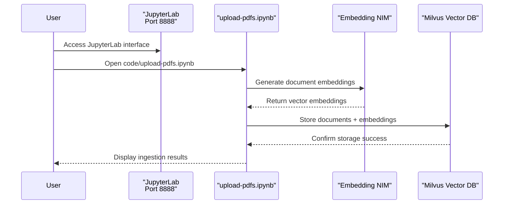

**Setup Steps:**
1. **Launch JupyterLab**: Start the `jupyterlab` application from AI Workbench
2. **Open Ingestion Notebook**: Navigate to `code/upload-pdfs.ipynb`
3. **Run Default Ingestion**: Execute all cells to ingest sample PDF documents from `data/` directory
4. **Verify Success**: Confirm documents are loaded into Milvus collection

For custom datasets, upload documents to the `data/` directory and modify the notebook accordingly.

Sources: [README.md:514-528]()

## Next Steps

After successful installation and validation:

- **Chat Interface**: Use the Chat Frontend to test RAG queries against ingested documents
- **Configuration**: Explore [Configuration](#5) for customizing model endpoints and parameters  
- **Development**: See [Development Environment](#6.1) for extending the system
- **Tutorial**: Launch the `tutorial_app` for guided demonstrations of system capabilities

The system is now ready for production RAG workloads using NVIDIA NIMs with your enterprise data.

Sources: [README.md:529-544]()

---

# Page: Core Architecture

# Core Architecture

<details>
<summary>Relevant source files</summary>

The following files were used as context for generating this wiki page:

- [README.md](README.md)
- [code/chain_server/chain.py](code/chain_server/chain.py)
- [code/frontend/__init__.py](code/frontend/__init__.py)

</details>


## Purpose and Scope

This document describes the core architectural components and design patterns of NVIDIA NIM Anywhere, focusing on how the system orchestrates RAG (Retrieval-Augmented Generation) pipelines using NVIDIA NIMs and LangChain. This covers the overall system design, component relationships, and data flow patterns.

For detailed information about the RAG chain implementation specifics, see [RAG Chain Implementation](#3.1). For AI Workbench integration details, see [AI Workbench Integration](#3.2). For user interface architecture, see [User Interfaces](#4).

## System Overview

NVIDIA NIM Anywhere is architected as a multi-tier system running within the NVIDIA AI Workbench environment. The system follows a microservices pattern with clear separation between presentation, orchestration, and data layers.

### High-Level Architecture

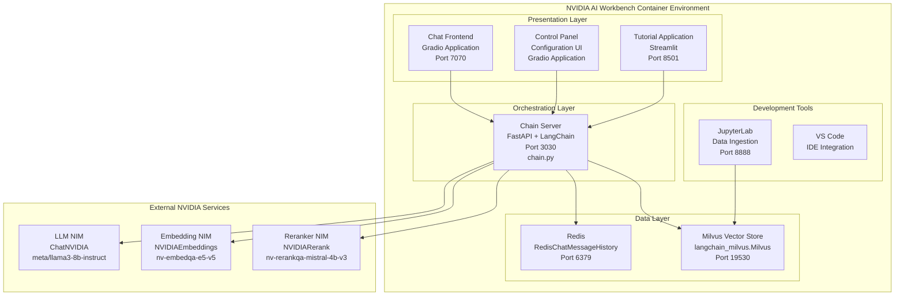

The architecture separates concerns across distinct layers, with the `ChainServer` serving as the central orchestration point for all RAG operations.

**Sources:** [README.md:1-993](), [code/chain_server/chain.py:1-138]()

## Core Components

### Chain Server (`chain.py`)

The `ChainServer` implements the core RAG logic using LangChain components. It exposes a FastAPI-based REST interface and orchestrates the complete RAG pipeline.

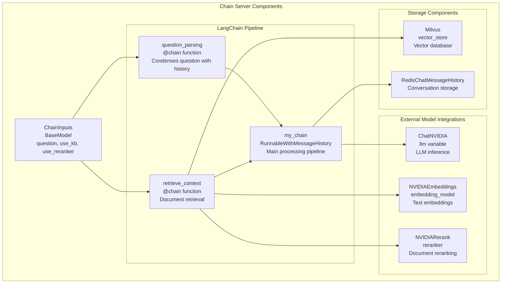

**Sources:** [code/chain_server/chain.py:17-138]()

### Frontend Applications

The system provides three distinct user interfaces, each implemented as separate Gradio applications:

| Component | Technology | Purpose | Port |
|-----------|------------|---------|------|
| Chat Frontend | Gradio | Primary RAG interaction interface | 7070 |
| Control Panel | Gradio | System configuration and KB management | Variable |
| Tutorial App | Streamlit | Interactive learning environment | 8501 |

**Sources:** [README.md:43-511]()

### Data Management Components

#### Vector Storage (`Milvus`)
The system uses `langchain_milvus.Milvus` as the vector store, configured with the embedding model and collection settings:

```python
vector_store = Milvus(
    embedding_function=embedding_model,
    connection_args={"uri": app_config.milvus.url},
    collection_name=app_config.milvus.collection_name,
    auto_id=True,
)
```

#### Conversation History (`RedisChatMessageHistory`)
Chat sessions are persisted using Redis through LangChain's `RedisChatMessageHistory`:

```python
RedisChatMessageHistory(session_id, url=str(app_config.redis_dsn))
```

**Sources:** [code/chain_server/chain.py:41-46](), [code/chain_server/chain.py:130]()

## RAG Processing Flow

The system implements a sophisticated RAG pipeline with optional reranking and conversation history management.

### Request Processing Pipeline

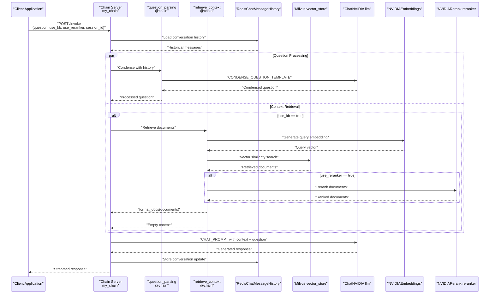

**Sources:** [code/chain_server/chain.py:76-113](), [code/chain_server/chain.py:128-134]()

## Configuration Management

The system implements a hierarchical configuration system supporting multiple sources and environment variable overrides.

### Configuration Hierarchy

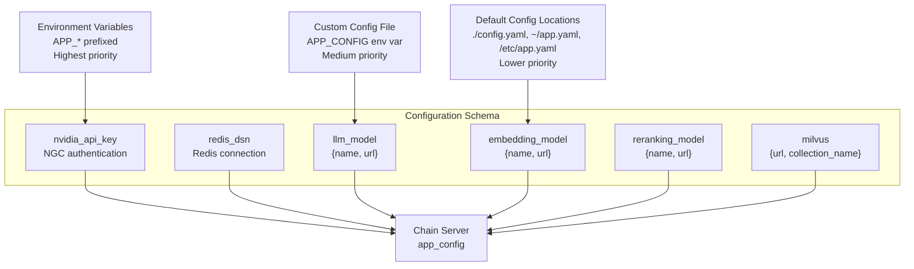

The configuration is loaded through the `app_config` module and used to initialize all NVIDIA AI service connections.

**Sources:** [README.md:560-685](), [code/chain_server/chain.py:32]()

## Service Integration

### NVIDIA AI Services Integration

The system integrates with three categories of NVIDIA AI services through standardized interfaces:

| Service Type | Class | Configuration | Purpose |
|--------------|-------|---------------|---------|
| LLM | `ChatNVIDIA` | `app_config.llm_model` | Text generation and reasoning |
| Embeddings | `NVIDIAEmbeddings` | `app_config.embedding_model` | Text vectorization for retrieval |
| Reranking | `NVIDIARerank` | `app_config.reranking_model` | Document relevance scoring |

### Retrieval Strategy Implementation

The system implements a flexible retrieval strategy with optional reranking:

```python
# Base retriever
retriever = vector_store.as_retriever()

# Enhanced retriever with reranking
reranking_retriever = ContextualCompressionRetriever(
    base_compressor=reranker, 
    base_retriever=retriever
)
```

The `retrieve_context` function dynamically selects between retrieval strategies based on the `use_reranker` parameter.

**Sources:** [code/chain_server/chain.py:35-55](), [code/chain_server/chain.py:76-89]()

### AI Workbench Orchestration

NVIDIA AI Workbench serves as the container orchestration platform, managing:

- **Application Lifecycle**: Automatic startup/shutdown of frontend applications
- **Service Dependencies**: Docker Compose coordination for Redis and Milvus
- **Environment Management**: Configuration injection and secret management
- **Development Integration**: JupyterLab and VS Code integration

The system is designed to scale from development environments to production deployments while maintaining consistent configuration and service integration patterns.

**Sources:** [README.md:127-512]()

---

# Page: RAG Chain Implementation

# RAG Chain Implementation

<details>
<summary>Relevant source files</summary>

The following files were used as context for generating this wiki page:

- [code/chain_server/chain.py](code/chain_server/chain.py)
- [code/chain_server/prompts.py](code/chain_server/prompts.py)
- [variables.env](variables.env)

</details>


## Purpose and Scope

This document provides a detailed technical explanation of the RAG (Retrieval-Augmented Generation) chain implementation in NVIDIA NIM Anywhere. It covers the core chain processing logic, LangChain integration, component architecture, and the orchestration of retrieval, reranking, and generation stages.

For information about AI Workbench integration and deployment orchestration, see [AI Workbench Integration](#3.2). For model configuration details, see [Model Configuration](#5.2).

## Core RAG Chain Architecture

The RAG chain implementation is built using LangChain and consists of several interconnected components that process user queries through retrieval, optional reranking, and generation stages.

### RAG Chain Component Architecture

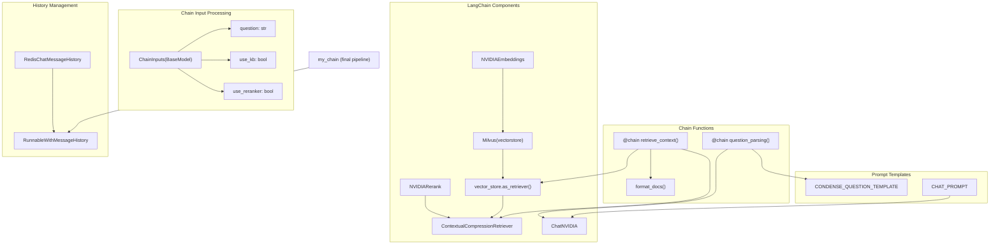

Sources: [code/chain_server/chain.py:17-138]()

### Chain Processing Flow

```mermaid
sequenceDiagram
    participant Input as "ChainInputs"
    participant retrieve_context as "retrieve_context()"
    participant question_parsing as "question_parsing()"
    participant vector_store as "Milvus"
    participant reranking_retriever as "ContextualCompressionRetriever"
    participant llm as "ChatNVIDIA"
    participant RedisChatMessageHistory as "RedisChatMessageHistory"
    
    Input->>retrieve_context: "{question, use_kb, use_reranker}"
    
    alt use_kb == True
        alt use_reranker == True
            retrieve_context->>reranking_retriever: "question"
            reranking_retriever->>vector_store: "similarity search"
            vector_store-->>reranking_retriever: "retrieved docs"
            reranking_retriever-->>retrieve_context: "reranked docs"
        else use_reranker == False
            retrieve_context->>vector_store: "question via retriever"
            vector_store-->>retrieve_context: "retrieved docs"
        end
        retrieve_context->>retrieve_context: "format_docs()"
    else use_kb == False
        retrieve_context-->>retrieve_context: "return empty string"
    end
    
    Input->>question_parsing: "{question, history}"
    
    alt history exists
        question_parsing->>llm: "CONDENSE_QUESTION_TEMPLATE + question + history"
        llm-->>question_parsing: "condensed question"
    else no history
        question_parsing-->>question_parsing: "return original question"
    end
    
    question_parsing-->>llm: "CHAT_PROMPT + context + question + history"
    llm-->>RedisChatMessageHistory: "store conversation"
    llm-->>Input: "generated response"
```

Sources: [code/chain_server/chain.py:76-135]()

## Chain Components

### Embedding and Vector Store Components

The embedding model and vector store form the foundation of the retrieval system:

| Component | Implementation | Configuration Source |
|-----------|----------------|---------------------|
| `embedding_model` | `NVIDIAEmbeddings` | `app_config.embedding_model.name` |
| `vector_store` | `Milvus` | `app_config.milvus.url` |
| `retriever` | `vector_store.as_retriever()` | Generated from vector store |

The embedding model is configured with truncation set to "END" and connects to NVIDIA's embedding endpoints. The Milvus vector store uses the embedding model as its embedding function and connects to the configured Milvus instance.

Sources: [code/chain_server/chain.py:35-47]()

### Reranking Components

The reranking system provides optional document reordering for improved relevance:

```python
reranker = NVIDIARerank(
    model=app_config.reranking_model.name,
    base_url=str(app_config.reranking_model.url),
    api_key=app_config.nvidia_api_key,
    truncate="END",
)
reranking_retriever = ContextualCompressionRetriever(
    base_compressor=reranker, 
    base_retriever=retriever
)
```

The `ContextualCompressionRetriever` wraps the base retriever with the reranking model to provide contextually compressed and reordered results.

Sources: [code/chain_server/chain.py:49-55]()

### Language Model Component

The LLM component uses NVIDIA's ChatNVIDIA integration:

```python
llm = ChatNVIDIA(
    model=app_config.llm_model.name,
    curr_mode="nim",
    base_url=str(app_config.llm_model.url),
    api_key=app_config.nvidia_api_key,
)
```

The model is configured in NIM mode and connects to the specified LLM endpoint.

Sources: [code/chain_server/chain.py:64-69]()

## Chain Function Implementation

### Document Retrieval Function

The `retrieve_context` function implements the retrieval logic with conditional branching:

```mermaid
flowchart TD
    A["retrieve_context(msg, config)"] --> B{{"use_kb == True?"}}
    B -->|No| C["return empty string"]
    B -->|Yes| D{{"use_reranker == True?"}}
    D -->|Yes| E["reranking_retriever | format_docs"]
    D -->|No| F["retriever | format_docs"]
    E --> G["invoke(question, config)"]
    F --> G
    G --> H["return formatted docs"]
```

The function uses the `@chain` decorator to integrate with LangChain's execution framework and supports both standard retrieval and reranked retrieval based on the input parameters.

Sources: [code/chain_server/chain.py:76-90]()

### Question Processing Function

The `question_parsing` function handles chat history integration:

```python
@chain
async def question_parsing(msg, config) -> str:
    """Condense the question with chat history"""
    
    condense_question_prompt = prompts.CONDENSE_QUESTION_TEMPLATE.with_config(run_name="condense_question_prompt")
    condensed_chain = condense_question_prompt | llm | StrOutputParser().with_config(run_name="condense_question_chain")
    if msg["history"]:
        return condensed_chain.invoke(msg, config)
    return msg["question"]
```

This function creates a standalone question from the current question and chat history using the `CONDENSE_QUESTION_TEMPLATE` prompt.

Sources: [code/chain_server/chain.py:93-102]()

### Document Formatting

The `format_docs` utility function concatenates document content:

```python
def format_docs(docs: list[Document]) -> str:
    """Take in a list of docs and concatenate the content, separating by newlines."""
    return "\n\n".join(doc.page_content for doc in docs)
```

Sources: [code/chain_server/chain.py:58-61]()

## Chain Composition and History Integration

### Main Chain Pipeline

The main chain (`my_chain`) is composed using LangChain's pipeline syntax:

```python
my_chain = (
    {
        "context": retrieve_context,
        "question": question_parsing,
        "history": itemgetter("history"),
    }
    | RunnablePassthrough().with_config(run_name="LLM Prompt Input")
    | prompts.CHAT_PROMPT
    | llm
)
```

This creates a parallel execution of context retrieval and question processing, followed by prompt formatting and LLM generation.

Sources: [code/chain_server/chain.py:104-113]()

### History Management Integration

The final chain integrates Redis-based message history:

```python
my_chain = RunnableWithMessageHistory(
    my_chain,
    lambda session_id: RedisChatMessageHistory(session_id, url=str(app_config.redis_dsn)),
    input_messages_key="question",
    output_messages_key="output",
    history_messages_key="history",
).with_types(input_type=ChainInputs)
```

This wrapper provides automatic conversation history management using Redis as the storage backend.

Sources: [code/chain_server/chain.py:128-135]()

## Input and Output Models

### ChainInputs Schema

The chain uses Pydantic models for type safety and validation:

```python
class ChainInputs(BaseModel):
    """Declaration of the chain's input values."""
    
    question: str
    use_kb: bool = False
    use_reranker: bool = False

ChainOutputs = str
```

The input model defines the expected parameters for chain execution, with optional flags for knowledge base usage and reranking.

Sources: [code/chain_server/chain.py:117-126]()

## Prompt Templates

The chain uses two main prompt templates defined in the prompts module:

| Template | Purpose | Variables |
|----------|---------|-----------|
| `CONDENSE_QUESTION_TEMPLATE` | Question condensation with history | `{history}`, `{question}` |
| `CHAT_PROMPT` | Main conversation prompt | `{context}`, `{history}`, `{question}` |

The `CHAT_PROMPT` uses a `ChatPromptTemplate` with system message, history placeholder, and human message components.

Sources: [code/chain_server/prompts.py:24-47]()

---

# Page: AI Workbench Integration

# AI Workbench Integration

<details>
<summary>Relevant source files</summary>

The following files were used as context for generating this wiki page:

- [.project/spec.yaml](.project/spec.yaml)
- [README.md](README.md)
- [code/frontend/__init__.py](code/frontend/__init__.py)
- [postBuild.bash](postBuild.bash)

</details>


This page covers how NVIDIA NIM Anywhere integrates with NVIDIA AI Workbench for orchestration, deployment, and development environment management. AI Workbench serves as the primary platform that coordinates all system components, manages container environments, and provides the development workflow infrastructure.

For information about the RAG processing pipeline implementation, see [RAG Chain Implementation](#3.1). For details about individual user interface components, see [User Interfaces](#4).

## Project Specification System

The core of AI Workbench integration is the project specification file that defines the entire project structure, environment, and application orchestration.

```mermaid
graph TB
    subgraph "Project Definition"
        SPEC[".project/spec.yaml<br/>Project Specification"]
        META["meta:<br/>name, description, labels"]
        LAYOUT["layout:<br/>code/, docs/, data/"]
        ENV["environment:<br/>base image, packages"]
        EXEC["execution:<br/>apps, resources, secrets"]
    end
    
    subgraph "Generated Environment"
        CONTAINER["Container Runtime<br/>nvidia/ai-workbench/python-cuda122:1.0.3"]
        APPS["Application Instances"]
        MOUNTS["Volume Mounts<br/>/project/, /nvwb-shared-volume/"]
    end
    
    subgraph "Application Orchestration"
        FRONTEND["Chat Frontend<br/>Port 7070"]
        CHAINSERVER["Chain Server<br/>Port 3030"]
        TUTORIAL["Tutorial<br/>Port 8501"]
        JUPYTER["JupyterLab<br/>Port 8888"]
        VSCODE["Visual Studio Code<br/>Native"]
    end
    
    SPEC --> META
    SPEC --> LAYOUT
    SPEC --> ENV
    SPEC --> EXEC
    
    ENV --> CONTAINER
    EXEC --> APPS
    EXEC --> MOUNTS
    
    APPS --> FRONTEND
    APPS --> CHAINSERVER
    APPS --> TUTORIAL
    APPS --> JUPYTER
    APPS --> VSCODE
```

The project specification defines four main sections that control how AI Workbench manages the system:

**Project Metadata and Layout**: The `meta` section defines the project identity and Docker image name, while `layout` specifies directory mappings for code, documentation, and data storage with appropriate Git and Git LFS handling.

**Environment Configuration**: The `environment.base` section specifies the container foundation, using `nvidia/ai-workbench/python-cuda122:1.0.3` as the base image with pre-installed packages managed through `apt` and `pip` package managers.

**Application Execution**: The `execution.apps` array defines all launchable applications with their start commands, health checks, networking configuration, and UI integration settings.

Sources: [.project/spec.yaml:1-169]()

## Application Orchestration

AI Workbench orchestrates multiple application types through standardized interfaces defined in the project specification.

```mermaid
sequenceDiagram
    participant User
    participant Workbench as "AI Workbench UI"
    participant Container as "Container Runtime"
    participant Apps as "Application Processes"
    
    User->>Workbench: "Start Chat Frontend"
    Workbench->>Container: "Execute start_command"
    Container->>Apps: "uvicorn frontend.server:app --port 7070"
    Apps-->>Container: "Process Started"
    Container->>Workbench: "Health Check: curl localhost:7070/healthz"
    Workbench-->>User: "Application Ready at Port 7070"
    
    User->>Workbench: "Start Chain Server"
    Workbench->>Container: "Execute start_command"
    Container->>Apps: "uvicorn chain_server.server:app --port 3030"
    Apps-->>Container: "Process Started"
    Container->>Workbench: "Health Check: ps aux | grep chain_server"
    Workbench-->>User: "Application Ready at Port 3030"
```

The application orchestration system manages five distinct application types:

**Web Applications**: `Chat Frontend`, `Chain Server`, and `Tutorial` are configured as webapp class applications with specific port bindings, proxy configurations, and health check commands. Each webapp includes `autolaunch` settings and URL routing through the Workbench proxy system.

**Development Tools**: `JupyterLab` provides an interactive development environment with Jupyter notebook support, while `Visual Studio Code` integrates as a native application for code editing and debugging.

**Process Management**: Each application defines `start_command`, `health_check_command`, and `stop_command` for lifecycle management. Health checks use HTTP endpoints for web services and process monitoring for native applications.

Sources: [.project/spec.yaml:90-152]()

## Environment Management

AI Workbench manages the development environment through container-based isolation with persistent configuration and dependency management.

```mermaid
graph LR
    subgraph "Base Environment"
        BASE["nvidia/ai-workbench/python-cuda122:1.0.3"]
        PACKAGES["Pre-installed Packages<br/>apt: curl, git, python3<br/>pip: jupyterlab==4.0.7"]
    end
    
    subgraph "Build Process"
        PREBUILD["preBuild.bash<br/>Pre-installation Setup"]
        REQUIREMENTS["requirements.txt<br/>Python Dependencies"]
        POSTBUILD["postBuild.bash<br/>Post-installation Config"]
    end
    
    subgraph "Runtime Environment"
        MOUNTS["Volume Mounts<br/>/project/ (rw)<br/>/nvwb-shared-volume/"]
        SECRETS["Environment Secrets<br/>NGC_API_KEY"]
        PROFILE["Profile Scripts<br/>ngc-cli.sh<br/>python.sh<br/>init-dev-env.sh"]
    end
    
    BASE --> PREBUILD
    PREBUILD --> REQUIREMENTS
    REQUIREMENTS --> POSTBUILD
    POSTBUILD --> MOUNTS
    POSTBUILD --> SECRETS
    POSTBUILD --> PROFILE
```

The environment management system provides three layers of configuration:

**Base Container**: The foundation uses `nvidia/ai-workbench/python-cuda122:1.0.3` with Ubuntu 22.04, CUDA 12.2, and essential development tools pre-installed through package managers.

**Build-time Configuration**: `postBuild.bash` installs the NGC CLI, configures Python paths, sets up profile scripts, and initializes the tutorial environment with a separate Python virtual environment.

**Runtime Configuration**: Volume mounts provide persistent storage for project files and shared data, while the `NGC_API_KEY` secret enables authentication with NVIDIA services. Profile scripts ensure proper PATH configuration and Python environment setup.

Sources: [.project/spec.yaml:25-87](), [postBuild.bash:1-52]()

## Container Runtime Integration

The integration with Docker provides isolated execution environments while maintaining connectivity to external services and development tools.

```mermaid
graph TB
    subgraph "Host System"
        DOCKER["Docker Engine"]
        WORKBENCH["AI Workbench Client"]
        BROWSER["Web Browser"]
    end
    
    subgraph "Container Environment"
        RUNTIME["Container Runtime<br/>nvidia/ai-workbench/python-cuda122:1.0.3"]
        SERVICES["Application Services<br/>frontend.server:app<br/>chain_server.server:app"]
        VOLUMES["Mounted Volumes<br/>/project/<br/>/nvwb-shared-volume/"]
    end
    
    subgraph "Network Configuration"
        PORTS["Port Mappings<br/>7070: Chat Frontend<br/>3030: Chain Server<br/>8501: Tutorial<br/>8888: JupyterLab"]
        PROXY["Workbench Proxy<br/>PROXY_PREFIX routing"]
    end
    
    WORKBENCH --> DOCKER
    DOCKER --> RUNTIME
    RUNTIME --> SERVICES
    RUNTIME --> VOLUMES
    SERVICES --> PORTS
    PORTS --> PROXY
    PROXY --> BROWSER
```

The container runtime integration provides several key capabilities:

**Process Isolation**: Each application runs as a separate process within the shared container environment, managed by `uvicorn` servers for web applications and direct execution for native tools.

**Network Access**: Port forwarding exposes application services through the Workbench proxy system, which handles URL rewriting and authentication. The `PROXY_PREFIX` environment variable ensures correct routing in multi-tenant environments.

**Volume Persistence**: Project files are mounted read-write to `/project/`, while shared data uses a named volume for persistence across container restarts. Git and Git LFS integration maintains version control for different file types.

Sources: [.project/spec.yaml:160-168](), [README.md:127-141]()

## Development Workflow

AI Workbench integrates development tools and processes to provide a cohesive workflow for RAG system development and deployment.

```mermaid
flowchart TD
    subgraph "Development Phase"
        CLONE["Clone Project<br/>github.com/NVIDIA/nim-anywhere"]
        CONFIG["Configure NGC_API_KEY<br/>Environment Secrets"]
        BUILD["Container Build<br/>postBuild.bash execution"]
    end
    
    subgraph "Development Tools"
        VSCODE["Visual Studio Code<br/>Integrated IDE"]
        JUPYTER["JupyterLab<br/>Notebook Development"]
        TERMINAL["Terminal Access<br/>Container Shell"]
    end
    
    subgraph "Application Development"
        FRONTEND_DEV["Frontend Development<br/>code/frontend/"]
        BACKEND_DEV["Chain Server Development<br/>code/chain_server/"]
        TUTORIAL_DEV["Tutorial Development<br/>code/tutorial_app/"]
    end
    
    subgraph "Testing and Deployment"
        LOCAL_TEST["Local Testing<br/>Application Launcher"]
        COMPOSE["Docker Compose Services<br/>Milvus, Redis, NIMs"]
        PRODUCTION["Production Deployment<br/>Scalable Infrastructure"]
    end
    
    CLONE --> CONFIG
    CONFIG --> BUILD
    BUILD --> VSCODE
    BUILD --> JUPYTER
    BUILD --> TERMINAL
    
    VSCODE --> FRONTEND_DEV
    JUPYTER --> BACKEND_DEV
    TERMINAL --> TUTORIAL_DEV
    
    FRONTEND_DEV --> LOCAL_TEST
    BACKEND_DEV --> LOCAL_TEST
    TUTORIAL_DEV --> LOCAL_TEST
    
    LOCAL_TEST --> COMPOSE
    COMPOSE --> PRODUCTION
```

The development workflow supports multiple development patterns:

**Project Initialization**: Users clone the repository through AI Workbench, which automatically triggers container building and environment setup. The NGC API key configuration enables access to NVIDIA services and container registries.

**Integrated Development**: Visual Studio Code provides full IDE capabilities with container integration, while JupyterLab enables interactive development and data exploration. Terminal access allows direct container manipulation and debugging.

**Application Testing**: The application launcher provides one-click startup for all services, with real-time log monitoring and health checking. Docker Compose integration manages external dependencies like vector databases and caching services.

Sources: [README.md:351-427](), [.project/spec.yaml:90-132]()

---

# Page: User Interfaces

# User Interfaces

<details>
<summary>Relevant source files</summary>

The following files were used as context for generating this wiki page:

- [code/frontend/_static/images/upload-button.png](code/frontend/_static/images/upload-button.png)
- [code/frontend/pages/chat/__init__.py](code/frontend/pages/chat/__init__.py)
- [code/frontend/pages/control/__init__.py](code/frontend/pages/control/__init__.py)
- [code/frontend/pages/control/style.css](code/frontend/pages/control/style.css)
- [requirements.txt](requirements.txt)

</details>


The NVIDIA NIM Anywhere system provides three distinct web-based user interfaces for different aspects of RAG system interaction and management. This page covers the technical implementation and architecture of these frontend applications.

For detailed information about individual interface usage, see [Chat Frontend](#4.1), [Control Panel](#4.2), and [Tutorial Application](#4.3). For backend RAG processing logic, see [RAG Chain Implementation](#3.1).

## Overview

The system implements three Gradio-based web applications that serve different user roles and workflows:

| Interface | Framework | Port | Purpose | Auto-Launch |
|-----------|-----------|------|---------|-------------|
| Chat Frontend | Gradio | 7070 | Primary RAG interaction interface | Yes |
| Control Panel | Gradio | N/A | System configuration and knowledge base management | No |
| Tutorial Application | Streamlit | 8501 | Interactive learning and demonstration | No |

All interfaces run within the NVIDIA AI Workbench container environment and communicate with the chain server backend via HTTP APIs.

## Frontend Architecture

```mermaid
graph TB
    subgraph "Gradio Framework Layer"
        subgraph "ChatApp[code/frontend/pages/chat]"
            ChatPage["page: gr.Blocks"]
            ChatComponents["Chatbot, Textbox, Button"]
            ChatState["session_id: gr.State"]
        end
        
        subgraph "ControlApp[code/frontend/pages/control]"
            ControlPage["page: gr.Blocks"]
            ControlTabs["Control Panel Tab, Knowledge Base Tab"]
            ConfigEditor["editor: gr.Code"]
            FileUpload["upload_btn: gr.UploadButton"]
        end
    end
    
    subgraph "Communication Layer"
        RemoteRunnable["_CHAIN: RemoteRunnable"]
        VectorStore["vector_store: Milvus"]
        EmbeddingModel["embedding_model: NVIDIAEmbeddings"]
    end
    
    subgraph "Backend Services"
        ChainServer["Chain Server<br/>localhost:3030"]
        MilvusDB["Milvus Vector DB"]
        RedisDB["Redis Session Store"]
    end
    
    ChatPage --> RemoteRunnable
    ControlPage --> VectorStore
    ControlPage --> EmbeddingModel
    
    RemoteRunnable --> ChainServer
    VectorStore --> MilvusDB
    EmbeddingModel --> ChainServer
    
    ChainServer --> RedisDB
    ChainServer --> MilvusDB
```

**Sources:** [code/frontend/pages/chat/__init__.py:1-104](), [code/frontend/pages/control/__init__.py:1-342]()

## Component Implementation Structure

```mermaid
graph TB
    subgraph "Frontend Module Structure"
        CommonModule["code/frontend/common.py<br/>THEME, IMG_DIR, initial states"]
        ConfigModule["code/frontend/configuration.py<br/>config object"]
        MermaidModule["code/frontend/mermaid.py<br/>diagram rendering"]
        
        subgraph "Chat Implementation"
            ChatInit["code/frontend/pages/chat/__init__.py"]
            ChatCSS["code/frontend/pages/chat/style.css"]
            ChatJS["code/frontend/pages/chat/scripts.js"]
            UserIcon["code/frontend/_static/images/user_icon.png"]
            BotIcon["code/frontend/_static/images/bot_icon.png"]
        end
        
        subgraph "Control Implementation"
            ControlInit["code/frontend/pages/control/__init__.py"]
            ControlCSS["code/frontend/pages/control/style.css"]
            DiagramTemplate["code/frontend/pages/control/diagram.mmd.j2"]
            UploadIcon["code/frontend/_static/images/upload-button.png"]
            SaveIcon["code/frontend/_static/images/floppy.png"]
            UndoIcon["code/frontend/_static/images/undo.png"]
            HistoryIcon["code/frontend/_static/images/history.png"]
        end
    end
    
    ChatInit --> CommonModule
    ChatInit --> ConfigModule
    ControlInit --> CommonModule
    ControlInit --> ConfigModule
    ControlInit --> MermaidModule
    
    ChatInit --> ChatCSS
    ChatInit --> ChatJS
    ChatInit --> UserIcon
    ChatInit --> BotIcon
    
    ControlInit --> ControlCSS
    ControlInit --> DiagramTemplate
    ControlInit --> UploadIcon
    ControlInit --> SaveIcon
    ControlInit --> UndoIcon
    ControlInit --> HistoryIcon
```

**Sources:** [code/frontend/pages/chat/__init__.py:30-40](), [code/frontend/pages/control/__init__.py:37-82]()

## Communication Patterns

### Chat Frontend Communication Flow

The chat interface implements asynchronous streaming communication with the chain server:

```mermaid
sequenceDiagram
    participant User
    participant "gr.Textbox" as MsgBox
    participant "stream_chain()" as StreamFunc
    participant "_CHAIN: RemoteRunnable" as Chain
    participant "Chain Server" as Server
    participant "gr.Chatbot" as ChatBot
    
    User->>MsgBox: "Enter message"
    MsgBox->>StreamFunc: "msg.submit trigger"
    StreamFunc->>Chain: "chain.astream({question, use_kb, use_reranker})"
    Chain->>Server: "HTTP POST /invoke"
    
    loop "Streaming Response"
        Server-->>Chain: "chunk.content"
        Chain-->>StreamFunc: "yield chunk"
        StreamFunc-->>ChatBot: "update chat[-1][1]"
        ChatBot-->>User: "display partial response"
    end
    
    alt "Connection Error"
        Chain-->>StreamFunc: "ConnectError"
        StreamFunc-->>ChatBot: "❌ Can't reach chain server"
    end
    
    alt "Server Error"
        Chain-->>StreamFunc: "HTTPStatusError"
        StreamFunc-->>ChatBot: "❌ Chain server error"
    end
```

**Sources:** [code/frontend/pages/chat/__init__.py:76-104]()

### Control Panel Data Management

The control panel manages both configuration and knowledge base operations:

```mermaid
graph LR
    subgraph "Configuration Management"
        ConfigEditor["editor: gr.Code"]
        SaveBtn["save_btn: gr.Button"]
        ReadFunc["read_chain_config()"]
        SaveFunc["save_chain_config()"]
        ConfigFile["config.chain_config_file"]
    end
    
    subgraph "Knowledge Base Management"
        UploadBtn["upload_btn: gr.UploadButton"]
        UploadFunc["upload_btn_callback()"]
        PyPDFLoader["PyPDFLoader"]
        VectorStore["vector_store: Milvus"]
        RefreshFunc["refresh_button_callback()"]
        DeleteFunc["confirm_delete_callback()"]
    end
    
    ConfigEditor --> SaveBtn
    SaveBtn --> SaveFunc
    SaveFunc --> ConfigFile
    ReadFunc --> ConfigEditor
    
    UploadBtn --> UploadFunc
    UploadFunc --> PyPDFLoader
    PyPDFLoader --> VectorStore
    VectorStore --> RefreshFunc
    VectorStore --> DeleteFunc
```

**Sources:** [code/frontend/pages/control/__init__.py:179-341]()

## Key Frontend Components

### Gradio Component Definitions

The interfaces utilize specific Gradio components with custom configuration:

| Component | Usage | Key Properties |
|-----------|-------|----------------|
| `gr.Chatbot` | Chat display | `bubble_full_width=False`, `avatar_images=_AVATAR_IMAGES` |
| `gr.Textbox` | Message input | `container=False`, `elem_id="msg"` |
| `gr.Code` | YAML editor | `language="yaml"`, `interactive=True` |
| `gr.UploadButton` | File upload | `file_types=[".pdf"]`, `file_count="multiple"` |
| `gr.Checkbox` | Feature toggles | `USE_KB_INITIAL`, `USE_RERANKER_INITIAL` |

### State Management Implementation

Both interfaces implement state management for different purposes:

**Chat Frontend:**
- `session_id = gr.State("")` - Maintains conversation session identity
- `use_kb = gr.Checkbox(USE_KB_INITIAL, visible=False)` - Hidden knowledge base toggle
- `use_reranker = gr.Checkbox(USE_RERANKER_INITIAL, visible=False)` - Hidden reranker toggle

**Control Panel:**
- Dynamic mermaid diagram updates based on checkbox states
- Configuration file change tracking with visual indicators
- Document list refresh after upload/delete operations

**Sources:** [code/frontend/pages/chat/__init__.py:46-48](), [code/frontend/pages/control/__init__.py:112-113]()

## JavaScript Integration

The frontend implements custom JavaScript for enhanced interactivity:

### Message Passing Between Interfaces

```javascript
// Control panel sends configuration updates to chat frontend
window.top.postMessage({"use_kb": val}, '*');
window.top.postMessage({"use_reranker": val}, '*');
```

### Configuration Editor Visual Feedback

```javascript
// Indicates unsaved changes with orange indicator
title.innerHTML = title.innerHTML.slice(0,-2) + "🟠";
// Indicates saved changes with green indicator  
title.innerHTML = title.innerHTML.slice(0,-2) + "🟢";
```

**Sources:** [code/frontend/pages/control/__init__.py:50-77]()

## Error Handling Patterns

The frontend implements comprehensive error handling for different failure modes:

### Chain Server Communication Errors

The chat interface distinguishes between connection and server errors:

```python
except (HTTPStatusError, ConnectError) as exc:
    if isinstance(exc, ConnectError) or 400 <= exc.response.status_code < 500:
        chat[-1][1] = "❌ **Uh oh...**\nI can't seem to reach to the chain server..."
    else:
        chat[-1][1] = "❌ **Uh oh...**\nThere was an error inside the chain server..."
```

### Configuration Validation

The control panel validates both YAML syntax and configuration schema:

```python
# validate yaml
config_data = yaml.safe_load(config_txt)
# validate configuration  
_ = ChainConfiguration.model_validate(config_data)
```

**Sources:** [code/frontend/pages/chat/__init__.py:87-102](), [code/frontend/pages/control/__init__.py:222-231]()

---

# Page: Chat Frontend

# Chat Frontend

<details>
<summary>Relevant source files</summary>

The following files were used as context for generating this wiki page:

- [code/frontend/_static/js/events.js](code/frontend/_static/js/events.js)
- [code/frontend/common.py](code/frontend/common.py)
- [code/frontend/pages/chat/__init__.py](code/frontend/pages/chat/__init__.py)
- [code/frontend/pages/chat/scripts.js](code/frontend/pages/chat/scripts.js)

</details>


## Purpose and Scope

The Chat Frontend provides the primary user interface for interacting with the NVIDIA NIM Anywhere RAG system. This Gradio-based web application enables users to submit questions and receive AI-generated responses in a conversational chat format. The frontend handles real-time streaming of responses from the chain server and integrates with the control panel for configuration management.

For system configuration and knowledge base management, see [Control Panel](#4.2). For backend RAG processing logic, see [RAG Chain Implementation](#3.1).

## Architecture Overview

The Chat Frontend is implemented as a Gradio application that serves as the main entry point for user interactions with the RAG system. It communicates with the chain server via HTTP streaming and receives configuration updates from the control panel through JavaScript message passing.

```mermaid
graph TB
    subgraph "Chat Frontend Architecture"
        UI["Gradio UI Components"]
        THEME["Theme Configuration"]
        ASSETS["Static Assets"]
        SCRIPTS["JavaScript Handlers"]
    end
    
    subgraph "Core Components"
        CHATBOT["gr.Chatbot Component"]
        TEXTBOX["gr.Textbox (msg)"]
        BUTTON["gr.Button (submit)"]
        STATE["gr.State (session_id)"]
        CHECKBOXES["Hidden Checkboxes (use_kb, use_reranker)"]
    end
    
    subgraph "Backend Integration"
        REMOTE["RemoteRunnable (_CHAIN)"]
        CHAIN_SERVER["Chain Server (port 3030)"]
        STREAM["astream() Method"]
    end
    
    subgraph "Inter-Page Communication"
        EVENTS["Message Event Handlers"]
        CONTROL_PANEL["Control Panel Updates"]
    end
    
    UI --> CHATBOT
    UI --> TEXTBOX
    UI --> BUTTON
    UI --> STATE
    UI --> CHECKBOXES
    
    THEME --> UI
    ASSETS --> UI
    SCRIPTS --> UI
    
    TEXTBOX --> REMOTE
    BUTTON --> REMOTE
    STATE --> REMOTE
    CHECKBOXES --> REMOTE
    
    REMOTE --> CHAIN_SERVER
    REMOTE --> STREAM
    STREAM --> CHATBOT
    
    EVENTS --> CHECKBOXES
    CONTROL_PANEL --> EVENTS
```

**Sources:** [code/frontend/pages/chat/__init__.py:44-104](), [code/frontend/common.py:16-31]()

## User Interface Components

The chat interface consists of several key Gradio components organized in a clean, responsive layout:

### Primary Components

| Component | Element ID | Purpose | Implementation |
|-----------|------------|---------|----------------|
| `gr.Chatbot` | `chat` | Main conversation display | Handles message history and streaming responses |
| `gr.Textbox` | `msg` | User input field | Container-less text input for questions |
| `gr.Button` | `submit` | Submit button | Triggers message submission with "➤" symbol |
| `gr.State` | N/A | Session tracking | Stores UUID for conversation persistence |
| `gr.Checkbox` | `use_kb` | Knowledge base toggle | Hidden, controlled by control panel |
| `gr.Checkbox` | `use_reranker` | Reranker toggle | Hidden, controlled by control panel |

### Visual Configuration

The interface uses customized styling and assets:

- **Theme**: Loaded from `theme.json` via `THEME` configuration
- **Avatars**: User (`user_icon.png`) and bot (`bot_icon.png`) icons 
- **CSS**: Custom styling from `style.css` for layout and appearance
- **JavaScript**: Dynamic resizing and event handling from `scripts.js`

```mermaid
graph LR
    subgraph "UI Asset Pipeline"
        ASSETS_DIR["ASSETS_DIR"]
        STATIC_DIR["STATIC_DIR"] 
        IMG_DIR["IMG_DIR"]
        JS_DIR["JS_DIR"]
    end
    
    subgraph "Loaded Resources"
        THEME_JSON["theme.json"]
        USER_ICON["user_icon.png"]
        BOT_ICON["bot_icon.png"]
        STYLE_CSS["style.css"]
        SCRIPTS_JS["scripts.js"]
    end
    
    ASSETS_DIR --> THEME_JSON
    IMG_DIR --> USER_ICON
    IMG_DIR --> BOT_ICON
    STATIC_DIR --> STYLE_CSS
    STATIC_DIR --> SCRIPTS_JS
    
    THEME_JSON --> THEME
    USER_ICON --> AVATAR_IMAGES
    BOT_ICON --> AVATAR_IMAGES
    STYLE_CSS --> _CSS
    SCRIPTS_JS --> _HEAD
```

**Sources:** [code/frontend/pages/chat/__init__.py:29-42](), [code/frontend/common.py:22-30]()

## Backend Integration

The chat frontend communicates with the chain server through LangServe's `RemoteRunnable` interface, enabling seamless streaming of AI responses.

### Chain Server Communication

The `_CHAIN` object establishes the connection to the backend:

```mermaid
sequenceDiagram
    participant USER as "User Input"
    participant GRADIO as "Gradio Components"
    participant STREAM as "stream_chain()"
    participant REMOTE as "RemoteRunnable"
    participant CHAIN as "Chain Server"
    
    USER->>GRADIO: "Submit question"
    GRADIO->>STREAM: "sid, message, chat, kb, reranker"
    STREAM->>REMOTE: "chain.astream(question, use_kb, use_reranker)"
    REMOTE->>CHAIN: "HTTP streaming request"
    
    loop "Streaming Response"
        CHAIN-->>REMOTE: "Response chunk"
        REMOTE-->>STREAM: "chunk.content"
        STREAM-->>GRADIO: "yield '', updated_chat"
        GRADIO-->>USER: "Display streaming text"
    end
    
    alt "Connection Error"
        REMOTE-->>STREAM: "ConnectError/HTTPStatusError"
        STREAM-->>GRADIO: "Error message"
        GRADIO-->>USER: "Display error"
    end
```

### Error Handling

The `stream_chain` function implements comprehensive error handling for common failure scenarios:

- **Connection Errors**: When chain server is unreachable
- **HTTP 4xx Errors**: Client-side configuration issues  
- **HTTP 5xx Errors**: Server-side processing errors

**Sources:** [code/frontend/pages/chat/__init__.py:76-103](), [code/frontend/pages/chat/__init__.py:41]()

## Inter-Page Communication

The chat frontend receives configuration updates from the control panel through JavaScript message passing, allowing real-time updates to RAG parameters without page refresh.

### Message Event System

```mermaid
graph TB
    subgraph "Control Panel Page"
        KB_TOGGLE["Knowledge Base Toggle"]
        RERANKER_TOGGLE["Reranker Toggle"]
        POST_MESSAGE["postMessage()"]
    end
    
    subgraph "Chat Page"
        EVENT_LISTENER["window.addEventListener()"]
        USE_KB_UPDATE["use_kb Component Update"]
        USE_RERANKER_UPDATE["use_reranker Component Update"]
    end
    
    subgraph "Event Flow"
        MESSAGE_DATA['"use_kb": true/false, "use_reranker": true/false']
        GRADIO_CONFIG["gradio_config.components"]
        COMPONENT_LOOKUP["elem_id lookup"]
    end
    
    KB_TOGGLE --> POST_MESSAGE
    RERANKER_TOGGLE --> POST_MESSAGE
    POST_MESSAGE --> MESSAGE_DATA
    
    MESSAGE_DATA --> EVENT_LISTENER
    EVENT_LISTENER --> GRADIO_CONFIG
    GRADIO_CONFIG --> COMPONENT_LOOKUP
    COMPONENT_LOOKUP --> USE_KB_UPDATE
    COMPONENT_LOOKUP --> USE_RERANKER_UPDATE
```

### JavaScript Event Handlers

The chat page registers multiple event handlers for optimal user experience:

- **Window resize**: `chatResize()` function adjusts chat height dynamically
- **Message events**: Updates hidden checkboxes based on control panel state
- **Textarea events**: Maintains proper sizing during text input

**Sources:** [code/frontend/pages/chat/scripts.js:16-44](), [code/frontend/_static/js/events.js:17-25]()

## Technical Implementation Details

### Session Management

Each chat session is assigned a unique UUID via the `sid_generator()` function, enabling conversation persistence and context tracking in the chain server.

### Streaming Response Handling

The `stream_chain` async generator function handles real-time response streaming:

1. **Input Processing**: Combines user message with session context
2. **Chain Configuration**: Applies session ID to maintain conversation state  
3. **Streaming Loop**: Processes chunks and updates chat display incrementally
4. **Error Recovery**: Provides user-friendly error messages for various failure modes

### Component Lifecycle

The Gradio application follows this initialization sequence:

1. **Static Loading**: CSS, JavaScript, and theme assets loaded at module import
2. **Component Creation**: UI components instantiated with configuration
3. **Event Registration**: JavaScript handlers registered on page load
4. **Session Initialization**: UUID generated for new conversations

**Sources:** [code/frontend/pages/chat/__init__.py:66-69](), [code/frontend/pages/chat/__init__.py:76-103](), [code/frontend/pages/chat/scripts.js:24-28]()

---

# Page: Control Panel

# Control Panel

<details>
<summary>Relevant source files</summary>

The following files were used as context for generating this wiki page:

- [code/frontend/_static/images/upload-button.png](code/frontend/_static/images/upload-button.png)
- [code/frontend/pages/control/__init__.py](code/frontend/pages/control/__init__.py)
- [code/frontend/pages/control/style.css](code/frontend/pages/control/style.css)
- [requirements.txt](requirements.txt)

</details>


The Control Panel is an administrative interface built with Gradio that provides configuration management and knowledge base administration for the NVIDIA NIM Anywhere system. It allows users to configure RAG pipeline settings, manage vector database contents, and edit chain server configurations through a web-based interface.

For information about the main chat interface, see [Chat Frontend](#4.1). For details on system-wide configuration files, see [Configuration System](#5.1).

## Overview and Architecture

The Control Panel is implemented as a Gradio web application that serves as the administrative hub for the RAG system. It provides two primary interfaces: system configuration management and knowledge base administration.

```mermaid
graph TB
    subgraph "Control Panel Application"
        CP[Control Panel<br/>gradio.Blocks]
        
        subgraph "Control Panel Tab"
            RC[Retrieval Configuration<br/>use_kb, use_reranker]
            MMD[Mermaid Diagram<br/>_MMD_TEMPLATE]
            CE[Configuration Editor<br/>YAML editor]
        end
        
        subgraph "Knowledge Base Tab"
            UB[Upload Button<br/>upload_btn]
            FL[File List<br/>uploaded_files]
            DB[Delete Controls<br/>delete_btn]
        end
    end
    
    subgraph "Backend Services"
        MILVUS[Milvus Vector Store<br/>vector_store]
        CONFIG[Chain Config<br/>config.chain_config_file]
        EMB[NVIDIA Embeddings<br/>embedding_model]
    end
    
    subgraph "Chain Server Integration"
        CS[Chain Server<br/>Configuration]
        RELOAD[Reload Signal<br/>reload file]
    end
    
    CP --> RC
    CP --> CE
    CP --> UB
    CP --> FL
    
    UB --> MILVUS
    FL --> MILVUS
    DB --> MILVUS
    CE --> CONFIG
    EMB --> MILVUS
    
    CONFIG --> CS
    RELOAD --> CS
    
    RC -.->|postMessage| CS
```

**Sources:** [code/frontend/pages/control/__init__.py:102-341]()

## Control Panel Tab

The Control Panel tab provides two main administrative functions: retrieval configuration and chain server configuration management.

### Retrieval Configuration

The retrieval configuration section allows users to toggle key RAG pipeline features and visualize the resulting data flow.

```mermaid
graph LR
    subgraph "UI Components"
        KB_CB[use_kb<br/>gr.Checkbox]
        RR_CB[use_reranker<br/>gr.Checkbox]
        MMD_VIZ[mmd<br/>mermaid.to_gradio]
    end
    
    subgraph "Event Handlers"
        KB_TOGGLE[kb_toggle<br/>function]
        TOGGLE_INTERACT[toggle_checkbox_interactivity<br/>function]
    end
    
    subgraph "JavaScript Actions"
        KB_JS[_KB_TOGGLE_JS<br/>postMessage]
        RR_JS[_RERANKER_TOGGLE_JS<br/>postMessage]
    end
    
    subgraph "Template Rendering"
        MMD_TEMPLATE[_MMD_TEMPLATE<br/>Jinja2]
        MMD_RENDER[_MMD.render<br/>use_kb, use_reranker]
    end
    
    KB_CB --> KB_TOGGLE
    RR_CB --> KB_TOGGLE
    KB_CB --> TOGGLE_INTERACT
    KB_CB --> KB_JS
    RR_CB --> RR_JS
    
    KB_TOGGLE --> MMD_TEMPLATE
    MMD_TEMPLATE --> MMD_RENDER
    MMD_RENDER --> MMD_VIZ
```

| Component | Purpose | Implementation |
|-----------|---------|----------------|
| `use_kb` | Toggle knowledge base usage | `gr.Checkbox` with `USE_KB_INITIAL` default |
| `use_reranker` | Toggle reranker usage | `gr.Checkbox` with `USE_RERANKER_INITIAL` default |
| Mermaid visualization | Show current RAG flow | Dynamic template rendering via `_MMD.render()` |

**Sources:** [code/frontend/pages/control/__init__.py:109-117](), [code/frontend/pages/control/__init__.py:194-205]()

### Chain Server Configuration

The configuration editor provides a full-featured YAML editor for modifying chain server settings with validation and persistence.

```mermaid
graph TB
    subgraph "Editor Interface"
        TOOLBAR[config-toolbar<br/>div#config-toolbar]
        TITLE[file_title<br/>gr.Markdown]
        SAVE[save_btn<br/>gr.Button]
        UNDO[undo_btn<br/>gr.Button]
        RESET[reset_btn<br/>gr.Button]
        EDITOR[editor<br/>gr.Code]
    end
    
    subgraph "File Operations"
        READ[read_chain_config<br/>function]
        SAVE_FUNC[save_chain_config<br/>function]
        RESET_FUNC[reset_demo<br/>function]
    end
    
    subgraph "Validation"
        YAML_VAL[yaml.safe_load<br/>YAML validation]
        CONFIG_VAL[ChainConfiguration.model_validate<br/>Pydantic validation]
    end
    
    subgraph "JavaScript Actions"
        CHANGES_JS[_CONFIG_CHANGES_JS<br/>orange indicator]
        SAVE_JS[_SAVE_CHANGES_JS<br/>green indicator]
    end
    
    SAVE --> SAVE_FUNC
    UNDO --> READ
    RESET --> RESET_FUNC
    EDITOR --> CHANGES_JS
    
    SAVE_FUNC --> YAML_VAL
    YAML_VAL --> CONFIG_VAL
    CONFIG_VAL --> CONFIG[config.chain_config_file]
    
    READ --> CONFIG
    RESET_FUNC --> STARTING_CONFIG[_STARTING_CONFIG]
    
    SAVE --> SAVE_JS
    UNDO --> SAVE_JS
```

**Sources:** [code/frontend/pages/control/__init__.py:119-241]()

## Knowledge Base Tab

The Knowledge Base tab provides comprehensive document management capabilities for the Milvus vector database.

### Document Upload Process

```mermaid
sequenceDiagram
    participant User
    participant UploadBtn as upload_btn
    participant Callback as upload_btn_callback
    participant PyPDF as PyPDFLoader
    participant VectorStore as vector_store
    participant Refresh as refresh_button_callback
    
    User->>UploadBtn: Select PDF files
    UploadBtn->>Callback: files list
    
    loop For each file
        Callback->>PyPDF: PyPDFLoader(file_path)
        PyPDF-->>Callback: pages data
        Callback->>Callback: combine pages + metadata
        Callback->>VectorStore: add_documents(combined_document)
    end
    
    alt First documents in collection
        Callback->>Callback: Create reload signal file
        Callback->>Callback: Remove reload file after 0.5s
    end
    
    Callback->>Refresh: refresh_button_callback()
    Refresh-->>User: Updated file list
```

| Function | Purpose | Key Operations |
|----------|---------|----------------|
| `upload_btn_callback` | Process uploaded PDFs | File validation, content extraction, vector storage |
| `upload_document` | Convert PDF to vector embeddings | `PyPDFLoader`, page combination, metadata assignment |
| `refresh_button_callback` | Update document list display | Query vector store, extract filenames, update UI |

**Sources:** [code/frontend/pages/control/__init__.py:242-291]()

### Document Management Interface

```mermaid
graph TB
    subgraph "Upload Interface"
        UPLOAD[upload_btn<br/>gr.UploadButton]
        FILES[uploaded_files<br/>gr.CheckboxGroup]
    end
    
    subgraph "Management Controls"
        REFRESH[refresh_docs_btn<br/>gr.Button]
        DELETE[delete_btn<br/>gr.Button]
        CONFIRM[confirm_delete_btn<br/>gr.Button]
        CANCEL[cancel_delete_btn<br/>gr.Button]
    end
    
    subgraph "Backend Operations"
        VS_SEARCH[vector_store.similarity_search<br/>Document discovery]
        VS_DELETE[vector_store.delete<br/>Document removal]
        METADATA[simple_file_name<br/>Metadata field]
    end
    
    UPLOAD --> FILES
    REFRESH --> VS_SEARCH
    VS_SEARCH --> FILES
    DELETE --> CONFIRM
    DELETE --> CANCEL
    CONFIRM --> VS_DELETE
    VS_DELETE --> FILES
    CANCEL --> DELETE
    
    VS_DELETE -.->|expr filter| METADATA
```

**Sources:** [code/frontend/pages/control/__init__.py:144-341]()

## Integration Architecture

The Control Panel integrates with multiple system components through various communication mechanisms.

```mermaid
graph TB
    subgraph "Control Panel Process"
        CP[Control Panel<br/>Gradio App]
        KB_CONFIG[KB Configuration<br/>use_kb, use_reranker]
        YAML_EDITOR[YAML Editor<br/>config.yaml]
        VS_MGMT[Vector Store Management<br/>Milvus operations]
    end
    
    subgraph "External Services"
        MILVUS_DB[Milvus Database<br/>chain_config.milvus.url]
        CHAIN_CONFIG[Chain Config File<br/>config.chain_config_file]
        NVIDIA_API[NVIDIA AI Endpoints<br/>chain_config.nvidia_api_key]
    end
    
    subgraph "Chain Server Process"
        CS[Chain Server<br/>FastAPI]
        RELOAD_WATCH[Configuration Watcher<br/>reload file detection]
    end
    
    subgraph "Communication Channels"
        POSTMSG[window.postMessage<br/>JavaScript IPC]
        FILE_SIGNAL[Reload File<br/>Filesystem signal]
        CONFIG_FILE[Shared Config<br/>File-based config]
    end
    
    KB_CONFIG --> POSTMSG
    POSTMSG -.-> CS
    
    YAML_EDITOR --> CONFIG_FILE
    CONFIG_FILE --> CS
    
    VS_MGMT --> FILE_SIGNAL
    FILE_SIGNAL --> RELOAD_WATCH
    RELOAD_WATCH --> CS
    
    VS_MGMT --> MILVUS_DB
    YAML_EDITOR --> CHAIN_CONFIG
    VS_MGMT --> NVIDIA_API
```

**Sources:** [code/frontend/pages/control/__init__.py:50-78](), [code/frontend/pages/control/__init__.py:87-100](), [code/frontend/pages/control/__init__.py:277-282]()

## Configuration Management

The Control Panel implements a sophisticated configuration management system with validation, persistence, and real-time feedback.

### Configuration Flow

| Stage | Component | Validation | Output |
|-------|-----------|------------|--------|
| Input | `gr.Code` editor | Syntax highlighting | Raw YAML text |
| Syntax Check | `yaml.safe_load()` | YAML parsing | Parsed data structure |
| Schema Validation | `ChainConfiguration.model_validate()` | Pydantic validation | Validated config object |
| Persistence | File write to `config.chain_config_file` | File system | Updated configuration |

### Visual State Indicators

The configuration editor provides real-time visual feedback through JavaScript-driven UI updates:

- **🟢 Green**: Saved state - configuration is persisted and valid
- **🟠 Orange**: Modified state - unsaved changes detected  
- **Default**: Clean state - no modifications since last save/load

**Sources:** [code/frontend/pages/control/__init__.py:67-77](), [code/frontend/pages/control/__init__.py:217-237]()

---

# Page: Tutorial Application

# Tutorial Application

<details>
<summary>Relevant source files</summary>

The following files were used as context for generating this wiki page:

- [code/tutorial_app/.streamlit/config.toml](code/tutorial_app/.streamlit/config.toml)
- [code/tutorial_app/app.py](code/tutorial_app/app.py)
- [code/tutorial_app/new_page.sh](code/tutorial_app/new_page.sh)
- [code/tutorial_app/pages/__init__.py](code/tutorial_app/pages/__init__.py)
- [code/tutorial_app/pages/editor_test.en_US.yaml](code/tutorial_app/pages/editor_test.en_US.yaml)

</details>


## Purpose and Scope

The Tutorial Application is an interactive learning system built with Streamlit that provides guided, hands-on tutorials for working with NVIDIA NIM Anywhere. The application uses a page-based architecture with YAML configuration files to define tutorial content, tasks, and interactive testing capabilities.

This document covers the tutorial system's architecture, page structure, task execution framework, and development workflow. For information about other user interfaces in the system, see the Chat Frontend ([4.1](#4.1)) and Control Panel ([4.2](#4.2)). For development environment setup, see Development Environment ([6.1](#6.1)).

## Architecture Overview

The Tutorial Application is implemented as a Streamlit application that leverages the `live_labs` library for page management and interactive task execution. The system follows a modular design where each tutorial is defined by a set of files including Python page logic, YAML configuration, and test scripts.

### Tutorial Application Architecture

```mermaid
graph TB
    subgraph "Streamlit Runtime"
        APP["app.py<br/>Main Entry Point"]
        SHELL["live_labs.AppShell<br/>Navigation Framework"]
    end
    
    subgraph "Page System"
        SIDEBAR["sidebar.yaml<br/>Navigation Config"]
        PAGE_PY["pages/*.py<br/>Page Logic"]
        PAGE_YAML["pages/*.en_US.yaml<br/>Content Config"]
        PAGE_TESTS["pages/*_tests.py<br/>Task Validation"]
    end
    
    subgraph "Configuration"
        STREAMLIT_CONFIG[".streamlit/config.toml<br/>UI Theme & Settings"]
    end
    
    subgraph "Development Tools"
        NEW_PAGE_SCRIPT["new_page.sh<br/>Page Generator"]
        TEMPLATES["pages_templates/<br/>Page Templates"]
    end
    
    APP --> SHELL
    SHELL --> SIDEBAR
    SHELL --> PAGE_PY
    PAGE_PY --> PAGE_YAML
    PAGE_PY --> PAGE_TESTS
    
    NEW_PAGE_SCRIPT --> TEMPLATES
    NEW_PAGE_SCRIPT --> PAGE_PY
    NEW_PAGE_SCRIPT --> PAGE_YAML
    NEW_PAGE_SCRIPT --> PAGE_TESTS
    
    STREAMLIT_CONFIG --> APP
```

Sources: [code/tutorial_app/app.py:1-15](), [code/tutorial_app/pages/sidebar.yaml](), [code/tutorial_app/new_page.sh:1-17](), [code/tutorial_app/.streamlit/config.toml:1-16]()

## App Shell and Navigation

The tutorial application uses `live_labs.AppShell` as its core navigation framework. The main entry point loads the sidebar configuration and initializes the page routing system.

### Main Application Entry Point

The `app.py` file serves as the Streamlit application entry point:

```python
# Key components from app.py
app_shell_yaml = Path(__file__).parent.joinpath("pages", "sidebar.yaml")
app = live_labs.AppShell.from_yaml(app_shell_yaml)
page = app.navigation()
app.sidebar()
page.run()
```

### Navigation Flow

```mermaid
sequenceDiagram
    participant User
    participant "app.py" as APP
    participant "AppShell" as SHELL
    participant "sidebar.yaml" as SIDEBAR
    participant "Page" as PAGE
    
    User->>APP: "Access tutorial"
    APP->>SHELL: "AppShell.from_yaml(sidebar.yaml)"
    SHELL->>SIDEBAR: "Load navigation config"
    SIDEBAR-->>SHELL: "Page definitions"
    SHELL->>APP: "AppShell instance"
    APP->>SHELL: "app.navigation()"
    SHELL-->>APP: "Selected page"
    APP->>SHELL: "app.sidebar()"
    APP->>PAGE: "page.run()"
    PAGE-->>User: "Render tutorial content"
```

Sources: [code/tutorial_app/app.py:8-14]()

## Page Structure and Configuration

Each tutorial page consists of three main components: a Python module for page logic, a YAML configuration file for content, and a test module for task validation.

### YAML Configuration Structure

Tutorial pages are configured using YAML files with a standardized structure:

| Section | Purpose | Example Fields |
|---------|---------|----------------|
| Header | Page metadata and introduction | `title`, `welcome_msg`, `header` |
| General | UI strings and messages | `waiting_msg`, `testing_msg`, `next` |
| Tasks | Interactive task definitions | `name`, `msg`, `response`, `test` |
| Footer | Completion messages | `closing_msg` |
| Testing | Error and status messages | `info_test_timeout`, custom messages |

### Example Page Configuration

From the editor test example:

```yaml
# Header section
title: Write some code
welcome_msg: |
  In this example, we are going to write some code.

# Task definition
tasks:
  - name: Make a string
    msg: |
      In test1.py, define a string called `my_string` that equals `five`.
    response: |
      Nicely done! I checked and here is what I saw:
      {{ result | indent(4) }}
    test: test_my_string
```

Sources: [code/tutorial_app/pages/editor_test.en_US.yaml:1-47]()

## Task System and Testing

The tutorial system includes an interactive task framework that allows users to complete coding exercises with automated validation.

### Task Execution Flow

```mermaid
graph LR
    subgraph "Task Definition"
        YAML_TASK["YAML Task Config<br/>name, msg, test"]
    end
    
    subgraph "User Interaction"
        USER_CODE["User Code<br/>test1.py"]
        SUBMIT["Submit Task"]
    end
    
    subgraph "Validation System"
        TEST_FUNC["test_my_string()<br/>in *_tests.py"]
        RESULT["Test Result<br/>success/failure"]
    end
    
    subgraph "Response System"
        TEMPLATE["Response Template<br/>{{ result | indent(4) }}"]
        FEEDBACK["User Feedback"]
    end
    
    YAML_TASK --> USER_CODE
    USER_CODE --> SUBMIT
    SUBMIT --> TEST_FUNC
    TEST_FUNC --> RESULT
    RESULT --> TEMPLATE
    TEMPLATE --> FEEDBACK
```

### Task Configuration Elements

- **Task Name**: Identifier for the task (`name: Make a string`)
- **Instructions**: Markdown content with hints (`msg` field with details/summary)
- **Test Function**: Reference to validation function (`test: test_my_string`)
- **Response Template**: Jinja2 template for feedback (`{{ result | indent(4) }}`)

### Error Handling

The system includes predefined error messages for common scenarios:

| Error Type | YAML Key | Purpose |
|------------|----------|---------|
| Execution Error | `info_test_nonzero_exit_code` | Code fails to run |
| Timeout | `info_test_timeout` | Code takes too long |
| Custom Validation | `info_no_my_string` | Task-specific failures |

Sources: [code/tutorial_app/pages/editor_test.en_US.yaml:16-46]()

## Development Workflow

The tutorial system includes tooling for creating new tutorial pages through a templating system.

### Page Generation Process

```mermaid
graph TB
    subgraph "Input"
        DEV["Developer"]
        PAGE_NAME["Page Name<br/>$PAGE_NAME"]
    end
    
    subgraph "Template System"
        SCRIPT["new_page.sh"]
        TEMPLATES["pages_templates/"]
        TEMPLATE_PY["template.py.envsub"]
        TEMPLATE_YAML["template.en_US.yaml.envsub"]
        TEMPLATE_TESTS["template_tests.py.envsub"]
    end
    
    subgraph "Generated Files"
        GEN_PY["pages/$PAGE_NAME.py"]
        GEN_YAML["pages/$PAGE_NAME.en_US.yaml"]
        GEN_TESTS["pages/$PAGE_NAME_tests.py"]
        SIDEBAR_UPDATE["sidebar.yaml<br/>navigation entry"]
    end
    
    DEV --> SCRIPT
    PAGE_NAME --> SCRIPT
    
    SCRIPT --> TEMPLATES
    TEMPLATES --> TEMPLATE_PY
    TEMPLATES --> TEMPLATE_YAML
    TEMPLATES --> TEMPLATE_TESTS
    
    TEMPLATE_PY --> GEN_PY
    TEMPLATE_YAML --> GEN_YAML
    TEMPLATE_TESTS --> GEN_TESTS
    
    SCRIPT --> SIDEBAR_UPDATE
```

### Page Creation Script

The `new_page.sh` script automates page creation using environment variable substitution:

```bash
# Key operations from new_page.sh
export PAGE_NAME=$1
envsubst < pages_templates/${TEMPLATE_NAME}.py.envsub > pages/${PAGE_NAME}.py
envsubst < pages_templates/${TEMPLATE_NAME}.en_US.yaml.envsub > pages/${PAGE_NAME}.en_US.yaml
envsubst < pages_templates/${TEMPLATE_NAME}_tests.py.envsub > pages/${PAGE_NAME}_tests.py
```

The script also automatically updates the sidebar navigation configuration.

Sources: [code/tutorial_app/new_page.sh:6-16]()

## Configuration and Theming

The tutorial application uses Streamlit's configuration system for UI customization and behavior settings.

### Streamlit Configuration

The `.streamlit/config.toml` file defines:

| Setting Category | Configuration | Value | Purpose |
|------------------|---------------|-------|---------|
| Client | `showSidebarNavigation` | `false` | Disables default sidebar |
| Server | `enableStaticServing` | `true` | Enables static file serving |
| Runner | `enforceSerializableSessionState` | `true` | Session state validation |
| Theme | `primaryColor` | `"#76B900"` | NVIDIA brand green |
| Theme | `backgroundColor` | `"#FFFFFF"` | White background |
| Theme | `font` | `"sans serif"` | Font family |

### Theme Integration

The color scheme aligns with NVIDIA branding, using the primary green color `#76B900` that appears throughout the NIM Anywhere interface ecosystem.

Sources: [code/tutorial_app/.streamlit/config.toml:1-16]()

---

# Page: Configuration

# Configuration

<details>
<summary>Relevant source files</summary>

The following files were used as context for generating this wiki page:

- [code/chain_server/configuration.py](code/chain_server/configuration.py)
- [code/chain_server/prompts.py](code/chain_server/prompts.py)
- [code/frontend/pages/chat/style.css](code/frontend/pages/chat/style.css)
- [code/frontend/pages/control/diagram.mmd.j2](code/frontend/pages/control/diagram.mmd.j2)
- [variables.env](variables.env)

</details>


This document provides a comprehensive guide to configuring the NVIDIA NIM Anywhere system, including the hierarchical configuration system, model settings, and environment variables. The configuration system supports both file-based and environment variable-based configuration with a clear precedence hierarchy.

For information about setting up the development environment, see [Development Environment](#6.1). For details about model deployment options, see [Model Configuration](#5.2).

## Configuration System Overview

The NVIDIA NIM Anywhere system uses a hierarchical configuration system built on the `confz` library that allows configuration through multiple sources with a clear precedence order. The main configuration is handled by the `Configuration` class in [code/chain_server/configuration.py:148-248]().

### Configuration Hierarchy

The system searches for configuration in the following order, with later sources taking precedence:

```mermaid
graph TD
    subgraph "Configuration Sources (Precedence Order)"
        F1["./config.yaml"]
        F2["./config.yml"] 
        F3["./config.json"]
        F4["~/app.yaml"]
        F5["~/app.yml"]
        F6["~/app.json"]
        F7["/etc/app.yaml"]
        F8["/etc/app.yml"]
        F9["/etc/app.json"]
        F10["Custom file via APP_CONFIG"]
        F11["Environment Variables (APP_*)"]
    end
    
    F1 --> F2
    F2 --> F3
    F3 --> F4
    F4 --> F5
    F5 --> F6
    F6 --> F7
    F7 --> F8
    F8 --> F9
    F9 --> F10
    F10 --> F11
    
    F11 --> CONFIG["Final Configuration"]
```

**Sources**: [code/chain_server/configuration.py:192-204]()

### Configuration Class Structure

The configuration system is organized into several specialized configuration classes:

```mermaid
graph TB
    subgraph "Configuration Classes"
        CONFIG["Configuration"]
        LLM["LLMModelConfig"] 
        EMB["EmbeddingModelConfig"]
        RERANK["RerankingModelConfig"]
        MILVUS["MilvusConfig"]
        LOGLEVEL["LogLevels"]
    end
    
    CONFIG --> LLM
    CONFIG --> EMB
    CONFIG --> RERANK
    CONFIG --> MILVUS
    CONFIG --> LOGLEVEL
    
    subgraph "Core Fields"
        APIKEY["nvidia_api_key"]
        REDIS["redis_dsn"]
        LOG["log_level"]
    end
    
    CONFIG --> APIKEY
    CONFIG --> REDIS
    CONFIG --> LOG
```

**Sources**: [code/chain_server/configuration.py:81-189]()

## Configuration Sources

### File-Based Configuration

The system automatically searches for configuration files in multiple locations using the `FileSource` configurations defined in [code/chain_server/configuration.py:192-202](). Supported formats include YAML, YML, and JSON.

| Location | Purpose | Example |
|----------|---------|---------|
| `./config.yaml` | Project-level configuration | Current directory |
| `~/app.yaml` | User-level configuration | Home directory |
| `/etc/app.yaml` | System-level configuration | System directory |

You can also specify a custom configuration file using the `APP_CONFIG` environment variable:

```bash
export APP_CONFIG=/path/to/custom/config.yaml
```

### Environment Variable Configuration

Environment variables use the prefix `APP_` with double underscores (`__`) for nested fields. The `EnvSource` configuration is defined in [code/chain_server/configuration.py:203]().

Examples:
- `APP_NVIDIA_API_KEY` → `nvidia_api_key`
- `APP_LLM_MODEL__NAME` → `llm_model.name`
- `APP_MILVUS__URL` → `milvus.url`

**Sources**: [code/chain_server/configuration.py:44-49](), [variables.env:1-27]()

## Core Configuration Areas

### API Authentication

The `nvidia_api_key` field configures authentication for NVIDIA AI services. The system validates that API keys start with `nvapi-` as defined in [code/chain_server/configuration.py:220-228]().

```yaml
nvidia_api_key: "nvapi-your-key-here"
```

Alternative environment variables: `NGC_API_KEY`, `NVIDIA_API_KEY`

### Database Connections

#### Redis Configuration
Redis is used for conversation history storage:

```yaml
redis_dsn: "redis://localhost:6379/0"
```

Environment variable: `APP_REDIS_DSN`

#### Milvus Vector Database
The `MilvusConfig` class defines vector database settings:

```yaml
milvus:
  url: "http://localhost:19530"
  collection_name: "collection_1"
```

**Sources**: [code/chain_server/configuration.py:81-89](), [variables.env:6-7]()

## Model Configuration

### LLM Model Configuration

The `LLMModelConfig` class configures the large language model:

```yaml
llm_model:
  name: "meta/llama3-8b-instruct"
  url: "https://integrate.api.nvidia.com/v1"
```

**Sources**: [code/chain_server/configuration.py:91-108]()

### Embedding Model Configuration

The `EmbeddingModelConfig` class configures text embedding models:

```yaml
embedding_model:
  name: "nvidia/nv-embedqa-e5-v5"
  url: "https://integrate.api.nvidia.com/v1"
```

**Sources**: [code/chain_server/configuration.py:129-146]()

### Reranking Model Configuration

The `RerankingModelConfig` class configures document reranking models:

```yaml
reranking_model:
  name: "nv-rerank-qa-mistral-4b:1"
  url: "https://integrate.api.nvidia.com/v1"
```

**Sources**: [code/chain_server/configuration.py:110-127]()

## Environment Variables Reference

### System Configuration

| Variable | Purpose | Default |
|----------|---------|---------|
| `MILVUS_VERSION` | Milvus Docker image version | `v2.4.0` |
| `APP_MILVUS__URL` | Milvus connection URL | `http://milvus:19530` |
| `APP_REDIS_DSN` | Redis connection string | `redis://redis:6379/0` |
| `NGC_CLI_ORG` | NGC organization | `default` |
| `NGC_HOME` | NGC cache directory | `~/.cache/nvidia-nims` |

### NIM Model Configuration

The environment variables follow a pattern for configuring local NIM deployments:

| Variable Pattern | Purpose | Example |
|------------------|---------|---------|
| `{MODEL}_MODEL` | Model identifier | `LLM_NIM_0_MODEL=meta/llama3-8b-instruct` |
| `{MODEL}_NIM_VERSION` | NIM container version | `LLM_NIM_0_NIM_VERSION=1.0.0` |
| `{MODEL}_NIM_GPUS` | GPU allocation | `LLM_NIM_0_NIM_GPUS=all` |

**Sources**: [variables.env:11-25]()

## Configuration Validation and Loading

### Configuration Loading Process

The configuration is loaded automatically when the module is imported through the global `config` object defined in [code/chain_server/configuration.py:248]():

```python
config = Configuration()
```

### Validation Features

The system includes several validation mechanisms:

1. **API Key Validation**: Ensures NVIDIA API keys start with `nvapi-` ([code/chain_server/configuration.py:220-228]())
2. **Environment Variable Fallback**: Checks multiple environment variables for API keys ([code/chain_server/configuration.py:207-217]())
3. **Logging Configuration**: Automatically configures loggers based on the log level ([code/chain_server/configuration.py:231-244]())

### Configuration Usage in Applications

The Control Panel application uses configuration for generating dynamic diagrams based on enabled features, as seen in [code/frontend/pages/control/diagram.mmd.j2:4-12]():

```jinja2
ret <-....-> db[("fa:fa-building\nEnterprise\nData (Milvus)")]
rerank(Reranker):::nvidia -->
```

**Sources**: [code/chain_server/configuration.py:148-248](), [variables.env:1-27](), [code/frontend/pages/control/diagram.mmd.j2:1-25]()

---

# Page: Configuration System

# Configuration System

<details>
<summary>Relevant source files</summary>

The following files were used as context for generating this wiki page:

- [code/chain_server/configuration.py](code/chain_server/configuration.py)
- [code/frontend/pages/chat/style.css](code/frontend/pages/chat/style.css)
- [code/frontend/pages/control/diagram.mmd.j2](code/frontend/pages/control/diagram.mmd.j2)

</details>


This document covers the hierarchical configuration system used throughout NVIDIA NIM Anywhere. The configuration system manages settings for all components including AI models, databases, logging, and API connections. For specific model configuration details, see [Model Configuration](#5.2). For environment variable reference, see [Environment Variables](#5.3).

## Overview

The configuration system implements a hierarchical approach where settings can be specified through multiple sources with a defined precedence order. The system uses the `confz` library with Pydantic validation to provide type-safe configuration management across all system components.

**Sources: [code/chain_server/configuration.py:16-50]()**

## Configuration Sources and Hierarchy

The configuration system searches for settings in multiple locations with the following precedence (higher precedence sources override lower ones):

### File-Based Configuration

The system automatically searches for configuration files in these locations:

| Priority | Location | Description |
|----------|----------|-------------|
| 1 | `./config.yaml` | Current directory YAML |
| 2 | `./config.yml` | Current directory YAML (alt extension) |
| 3 | `./config.json` | Current directory JSON |
| 4 | `~/app.yaml` | User home directory |
| 5 | `~/app.yml` | User home directory (alt extension) |
| 6 | `~/app.json` | User home directory JSON |
| 7 | `/etc/app.yaml` | System-wide configuration |
| 8 | `/etc/app.yml` | System-wide configuration (alt extension) |
| 9 | `/etc/app.json` | System-wide configuration JSON |

### Custom Configuration File

A custom configuration file can be specified using the `APP_CONFIG` environment variable:

```bash
export APP_CONFIG=/path/to/custom/config.yaml
```

### Environment Variable Override

Environment variables take the highest precedence and use the format: `APP_FIELD__SUB_FIELD` where `__` represents nesting.

```mermaid
flowchart TD
    env["Environment Variables<br/>(APP_* prefix)"] 
    custom["Custom Config File<br/>(APP_CONFIG)"]
    etc["/etc/app.*"]
    home["~/app.*"] 
    local["./config.*"]
    
    env --> precedence["Final Configuration"]
    custom --> precedence
    etc --> precedence  
    home --> precedence
    local --> precedence
    
    env -.->|"Highest precedence"| precedence
    local -.->|"Lowest precedence"| precedence
```

**Configuration Source Hierarchy**

**Sources: [code/chain_server/configuration.py:192-204]()**

## Configuration Models

The system defines several configuration model classes that structure and validate different aspects of the system:

### Core Configuration Class

The `Configuration` class serves as the root configuration model, inheriting from `BaseConfig`:

```mermaid
classDiagram
    class Configuration {
        +nvidia_api_key: Optional[str]
        +redis_dsn: RedisDsn
        +llm_model: LLMModelConfig
        +embedding_model: EmbeddingModelConfig
        +reranking_model: RerankingModelConfig
        +milvus: MilvusConfig
        +log_level: LogLevels
        +CONFIG_SOURCES: List[Source]
        +_check_env_vars() ClassMethod
        +_check_api_key() ClassMethod
        +_check_log_level() ClassMethod
    }
    
    class LLMModelConfig {
        +name: str
        +url: HttpUrl
    }
    
    class EmbeddingModelConfig {
        +name: str
        +url: HttpUrl
    }
    
    class RerankingModelConfig {
        +name: str
        +url: HttpUrl
    }
    
    class MilvusConfig {
        +url: str
        +collection_name: str
    }
    
    class LogLevels {
        <<enumeration>>
        DEBUG
        INFO
        WARNING
        ERROR
        CRITICAL
    }
    
    Configuration --> LLMModelConfig
    Configuration --> EmbeddingModelConfig
    Configuration --> RerankingModelConfig
    Configuration --> MilvusConfig
    Configuration --> LogLevels
```

**Configuration Model Relationships**

**Sources: [code/chain_server/configuration.py:81-189]()**

### Model-Specific Configurations

Each AI model type has its own configuration class:

- **LLMModelConfig**: Configures Large Language Model connections with default `meta/llama3-8b-instruct`
- **EmbeddingModelConfig**: Configures embedding model with default `nvidia/nv-embedqa-e5-v5`
- **RerankingModelConfig**: Configures reranking model with default `nv-rerank-qa-mistral-4b:1`

All model configurations include:
- `name`: Model identifier for API requests
- `url`: Service endpoint URL (defaults to `https://integrate.api.nvidia.com/v1`)

**Sources: [code/chain_server/configuration.py:91-146]()**

## Configuration Loading and Validation

The configuration system implements several validation mechanisms to ensure proper setup:

### Environment Variable Processing

The system processes multiple environment variable names for the NVIDIA API key:

```mermaid
flowchart LR
    env1["NGC_API_KEY"]
    env2["NVIDIA_API_KEY"] 
    env3["APP_NVIDIA_API_KEY"]
    
    validator["_check_env_vars()"]
    
    env1 --> validator
    env2 --> validator
    env3 --> validator
    
    validator --> result["nvidia_api_key field"]
```

**Environment Variable Resolution**

### Validation Pipeline

The configuration undergoes validation through several class methods:

1. **`_check_env_vars()`**: Processes alternative environment variable names for API keys
2. **`_check_api_key()`**: Validates that NVIDIA API keys start with `nvapi-` prefix
3. **`_check_log_level()`**: Automatically configures Python logging based on the specified level

**Sources: [code/chain_server/configuration.py:207-244]()**

## Configuration Instance

The system creates a global configuration instance that is loaded when the module is imported:

```python
# load the runtime configuration
config = Configuration()
```

This singleton pattern ensures consistent configuration access across all chain server components.

**Sources: [code/chain_server/configuration.py:247-248]()**

## Usage Patterns

### Environment Variable Format

Environment variables use double underscores to represent nested configuration:

```bash
# Set LLM model name
export APP_LLM_MODEL__NAME="custom/model-name"

# Set embedding model URL  
export APP_EMBEDDING_MODEL__URL="http://localhost:8080/v1"

# Set Milvus collection name
export APP_MILVUS__COLLECTION_NAME="my_collection"
```

### File Configuration Example

A typical configuration file structure:

```yaml
nvidia_api_key: "nvapi-your-key-here"
redis_dsn: "redis://localhost:6379/0"
log_level: "INFO"

llm_model:
  name: "meta/llama3-8b-instruct"
  url: "https://integrate.api.nvidia.com/v1"

embedding_model:
  name: "nvidia/nv-embedqa-e5-v5"
  url: "https://integrate.api.nvidia.com/v1"

milvus:
  url: "http://localhost:19530"
  collection_name: "collection_1"
```

**Sources: [code/chain_server/configuration.py:67-68](), [code/chain_server/configuration.py:203]()**

---

# Page: Model Configuration

# Model Configuration

<details>
<summary>Relevant source files</summary>

The following files were used as context for generating this wiki page:

- [code/chain_server/prompts.py](code/chain_server/prompts.py)
- [code/config_sample.yaml](code/config_sample.yaml)
- [variables.env](variables.env)

</details>


This document covers the configuration of AI models used in the NVIDIA NIM Anywhere RAG system, including LLM, embedding, and reranking models. It explains how to configure models for both remote (NVIDIA AI Catalog) and local (NIM containers) deployment options. For information about the overall configuration system architecture, see [Configuration System](#5.1). For a complete reference of environment variables, see [Environment Variables](#5.3).

## Model Types and Architecture

The NVIDIA NIM Anywhere system utilizes three distinct types of AI models that work together in the RAG pipeline:

### Model Type Overview

```mermaid
graph TB
    subgraph "RAG Pipeline Models"
        EmbeddingModel["embedding_model<br/>nvidia/nv-embedqa-e5-v5<br/>Query + Document Vectorization"]
        RerankerModel["reranking_model<br/>nv-rerank-qa-mistral-4b:1<br/>Document Relevance Scoring"]
        LLMModel["llm_model<br/>meta/llama3-8b-instruct<br/>Response Generation"]
    end
    
    subgraph "Configuration Sources"
        ConfigYAML["config.yaml<br/>Primary model configuration"]
        VariablesEnv["variables.env<br/>NIM deployment settings"]
    end
    
    subgraph "Deployment Options"
        AICatalog["NVIDIA AI Catalog<br/>integrate.api.nvidia.com"]
        LocalNIMs["Local NIM Containers<br/>Docker Compose Services"]
    end
    
    ConfigYAML --> EmbeddingModel
    ConfigYAML --> RerankerModel
    ConfigYAML --> LLMModel
    
    VariablesEnv --> LocalNIMs
    
    EmbeddingModel --> AICatalog
    EmbeddingModel --> LocalNIMs
    RerankerModel --> AICatalog
    RerankerModel --> LocalNIMs
    LLMModel --> AICatalog
    LLMModel --> LocalNIMs
```

**Sources:** [code/config_sample.yaml:1-32](), [variables.env:11-24]()

| Model Type | Purpose | Default Model | Configuration Key |
|------------|---------|---------------|-------------------|
| LLM | Final response generation | `meta/llama3-8b-instruct` | `llm_model` |
| Embedding | Query and document vectorization | `nvidia/nv-embedqa-e5-v5` | `embedding_model` |
| Reranking | Document relevance scoring | `nv-rerank-qa-mistral-4b:1` | `reranking_model` |

## Configuration Sources and Hierarchy

### Primary Configuration Structure

The model configuration follows a two-tier approach using both YAML configuration files and environment variables:

```mermaid
graph LR
    subgraph "Configuration Flow"
        ConfigSample["config_sample.yaml<br/>Template Configuration"]
        ConfigYAML["config.yaml<br/>Active Configuration"]
        EnvVars["variables.env<br/>NIM Environment Settings"]
        ChainServer["Chain Server<br/>Model Initialization"]
    end
    
    ConfigSample --> ConfigYAML
    ConfigYAML --> ChainServer
    EnvVars --> ChainServer
    
    subgraph "Model Properties"
        ModelName["model.name<br/>Model identifier"]
        ModelURL["model.url<br/>Service endpoint"]
        NIMVersion["NIM_VERSION<br/>Container version"]
        NIMGPUs["NIM_GPUS<br/>GPU allocation"]
    end
    
    ConfigYAML --> ModelName
    ConfigYAML --> ModelURL
    EnvVars --> NIMVersion
    EnvVars --> NIMGPUs
```

**Sources:** [code/config_sample.yaml:1-32](), [variables.env:11-24]()

### YAML Configuration Format

Each model in the configuration follows a consistent structure with `name` and `url` properties:

```yaml
llm_model:
  name: "meta/llama3-8b-instruct"
  url: "https://integrate.api.nvidia.com/v1"

embedding_model:
  name: "nvidia/nv-embedqa-e5-v5"
  url: "https://integrate.api.nvidia.com/v1"

reranking_model:
  name: "nv-rerank-qa-mistral-4b:1"
  url: "https://integrate.api.nvidia.com/v1"
```

**Sources:** [code/config_sample.yaml:1-30]()

### Environment Variable Naming Convention

Local NIM deployments use environment variables following the pattern `{MODEL_IDENTIFIER}_{PROPERTY}`:

| Variable Pattern | Purpose | Example |
|------------------|---------|---------|
| `{MODEL}_MODEL` | Model name/identifier | `LLM_NIM_0_MODEL=meta/llama3-8b-instruct` |
| `{MODEL}_NIM_VERSION` | NIM container version | `LLM_NIM_0_NIM_VERSION=1.0.0` |
| `{MODEL}_NIM_GPUS` | GPU allocation | `LLM_NIM_0_NIM_GPUS=all` |

**Sources:** [variables.env:11-24]()

## Deployment Configuration Options

### Remote Deployment (NVIDIA AI Catalog)

For remote deployment using NVIDIA AI Catalog services, models are configured to use the centralized API endpoint:

```mermaid
graph TB
    subgraph "Remote Configuration"
        ConfigRemote["YAML Configuration<br/>url: integrate.api.nvidia.com"]
        NGC_API_KEY["NGC_API_KEY<br/>Authentication Token"]
        
        subgraph "AI Catalog Models"
            LLMRemote["meta/llama3-8b-instruct<br/>Port: 443/HTTPS"]
            EmbedRemote["nvidia/nv-embedqa-e5-v5<br/>Port: 443/HTTPS"]
            RerankRemote["nv-rerank-qa-mistral-4b:1<br/>Port: 443/HTTPS"]
        end
    end
    
    ConfigRemote --> LLMRemote
    ConfigRemote --> EmbedRemote
    ConfigRemote --> RerankRemote
    
    NGC_API_KEY --> LLMRemote
    NGC_API_KEY --> EmbedRemote
    NGC_API_KEY --> RerankRemote
```

**Sources:** [code/config_sample.yaml:5-6,15-16,23-24]()

### Local Deployment (NIM Containers)

For local deployment, models run as Docker containers with internal network communication:

```mermaid
graph TB
    subgraph "Local NIM Configuration"
        DockerCompose["docker-compose.yml<br/>Service Definitions"]
        EnvConfig["variables.env<br/>NIM Settings"]
        
        subgraph "Local Services"
            LLMLocal["llm-nim:8000<br/>meta/llama3-8b-instruct"]
            EmbedLocal["nv-embedqa-e5-v5:8000<br/>nvidia/nv-embedqa-e5-v5"]
            RerankLocal["nv-rerankqa-mistral-4b-v3:8000<br/>nvidia/nv-rerankqa-mistral-4b-v3"]
        end
        
        subgraph "Configuration Properties"
            ModelVar["MODEL<br/>Model identifier"]
            VersionVar["NIM_VERSION<br/>Container version"]
            GPUVar["NIM_GPUS<br/>GPU allocation"]
        end
    end
    
    EnvConfig --> ModelVar
    EnvConfig --> VersionVar
    EnvConfig --> GPUVar
    
    DockerCompose --> LLMLocal
    DockerCompose --> EmbedLocal
    DockerCompose --> RerankLocal
    
    ModelVar --> LLMLocal
    ModelVar --> EmbedLocal
    ModelVar --> RerankLocal
```

**Sources:** [variables.env:11-24](), [code/config_sample.yaml:9,19,28-29]()

## Model Selection and Switching

### Configuration Switching Process

To switch between remote and local deployment, you modify the `url` field in the YAML configuration:

| Deployment Type | URL Pattern | Example |
|----------------|-------------|---------|
| Remote (AI Catalog) | `https://integrate.api.nvidia.com/v1` | Default configuration |
| Local LLM | `http://llm-nim:8000/v1` | Local LLM NIM container |
| Local Embedding | `http://nv-embedqa-e5-v5:8000/v1` | Local embedding NIM |
| Local Reranking | `http://nv-rerankqa-mistral-4b-v3:8000/v1/` | Local reranking NIM |

**Sources:** [code/config_sample.yaml:5-6,9,15-16,19,23-24,28-29]()

### Environment Variable Configuration for Local NIMs

Local NIM deployments require corresponding environment variables in `variables.env`:

```
# LLM NIM Configuration
LLM_NIM_0_MODEL=meta/llama3-8b-instruct
LLM_NIM_0_NIM_VERSION=1.0.0
LLM_NIM_0_NIM_GPUS=all

# Embedding NIM Configuration  
NV_EMBEDQA_E5_V5_MODEL=nvidia/nv-embedqa-e5-v5
NV_EMBEDQA_E5_V5_NIM_VERSION=1.0.1
NV_EMBEDQA_E5_V5_NIM_GPUS=all

# Reranking NIM Configuration
NV_RERANKQA_MISTRAL_4B_V3_MODEL=nvidia/nv-rerankqa-mistral-4b-v3
NV_RERANKQA_MISTRAL_4B_V3_NIM_VERSION=1.0.2
NV_RERANKQA_MISTRAL_4B_V3_NIM_GPUS=all
```

**Sources:** [variables.env:11-24]()

## Model Integration in RAG Chain

### Configuration Loading and Model Initialization

The configured models are integrated into the RAG processing chain through the chain server's configuration loading system:

```mermaid
graph TB
    subgraph "Configuration Loading Process"
        ConfigLoader["Configuration Loader<br/>Chain Server Initialization"]
        
        subgraph "Model Configurations"
            LLMConfig["llm_model<br/>name + url"]
            EmbedConfig["embedding_model<br/>name + url"] 
            RerankConfig["reranking_model<br/>name + url"]
        end
        
        subgraph "Initialized Models"
            LLMInstance["LLM Client<br/>Response Generation"]
            EmbedInstance["Embedding Client<br/>Vector Generation"]
            RerankInstance["Reranker Client<br/>Document Scoring"]
        end
        
        subgraph "RAG Chain Integration"
            ChainLogic["RAG Chain Logic<br/>LangChain Integration"]
            PromptTemplate["CHAT_PROMPT<br/>Template Processing"]
        end
    end
    
    ConfigLoader --> LLMConfig
    ConfigLoader --> EmbedConfig
    ConfigLoader --> RerankConfig
    
    LLMConfig --> LLMInstance
    EmbedConfig --> EmbedInstance
    RerankConfig --> RerankInstance
    
    LLMInstance --> ChainLogic
    EmbedInstance --> ChainLogic
    RerankInstance --> ChainLogic
    
    ChainLogic --> PromptTemplate
```

**Sources:** [code/config_sample.yaml:1-32](), [code/chain_server/prompts.py:37-47]()

The chain server uses the `CHAT_PROMPT` template for LLM interaction, which includes system instructions, conversation history, and context from the embedding and reranking models.

**Sources:** [code/chain_server/prompts.py:37-47]()

---

# Page: Environment Variables

# Environment Variables

<details>
<summary>Relevant source files</summary>

The following files were used as context for generating this wiki page:

- [.project/spec.yaml](.project/spec.yaml)
- [code/chain_server/prompts.py](code/chain_server/prompts.py)
- [postBuild.bash](postBuild.bash)
- [variables.env](variables.env)

</details>


This document provides a comprehensive reference for environment variables used throughout the NVIDIA NIM Anywhere system. Environment variables control service connections, model configurations, authentication, and application behavior across all system components.

For information about the broader configuration system and file-based configuration, see [Configuration System](#5.1). For specific model parameter configuration, see [Model Configuration](#5.2).

## Environment Variable Sources and Hierarchy

The NVIDIA NIM Anywhere system uses environment variables from multiple sources, processed in a specific hierarchy:

```mermaid
graph TB
    subgraph "Environment Variable Sources"
        SPEC[".project/spec.yaml<br/>secrets section"]
        VARS["variables.env<br/>project-level variables"]
        SYSTEM["System Environment<br/>container runtime"]
        RUNTIME["Runtime Variables<br/>app startup commands"]
    end
    
    subgraph "AI Workbench Processing"
        WB_ENV["Workbench Environment<br/>Processor"]
        CONTAINER["Container Runtime<br/>Environment"]
    end
    
    subgraph "Application Context"
        FRONTEND["Chat Frontend<br/>uvicorn process"]
        CHAIN_SERVER["Chain Server<br/>uvicorn process"]
        TUTORIAL["Tutorial App<br/>streamlit process"]
        JUPYTER["JupyterLab<br/>jupyter process"]
    end
    
    SPEC --> WB_ENV
    VARS --> WB_ENV
    SYSTEM --> WB_ENV
    
    WB_ENV --> CONTAINER
    RUNTIME --> CONTAINER
    
    CONTAINER --> FRONTEND
    CONTAINER --> CHAIN_SERVER
    CONTAINER --> TUTORIAL
    CONTAINER --> JUPYTER
```

**Sources:** [.project/spec.yaml:157-159](), [variables.env:1-27](), [postBuild.bash:28-41]()

## Core Environment Variables by Category

### Authentication and NGC Configuration

| Variable | Purpose | Example Value | Source |
|----------|---------|---------------|---------|
| `NGC_API_KEY` | NVIDIA NGC Personal API Key for accessing NIMs | `nvapi-***` | AI Workbench Secret |
| `NGC_CLI_ORG` | NGC CLI organization context | `default` | variables.env |
| `NGC_HOME` | NGC CLI cache directory | `~/.cache/nvidia-nims` | variables.env |

### Database and Service Connections

| Variable | Purpose | Example Value | Source |
|----------|---------|---------------|---------|
| `APP_MILVUS__URL` | Milvus vector database connection URL | `http://milvus:19530` | variables.env |
| `APP_REDIS_DSN` | Redis connection string for conversation history | `redis://redis:6379/0` | variables.env |
| `MILVUS_VERSION` | Milvus Docker image version | `v2.4.0` | variables.env |

### Model Configuration Variables

The system uses environment variables to configure NIM models for local deployment:

```mermaid
graph LR
    subgraph "LLM Configuration"
        LLM_MODEL["LLM_NIM_0_MODEL<br/>meta/llama3-8b-instruct"]
        LLM_VERSION["LLM_NIM_0_NIM_VERSION<br/>1.0.0"]
        LLM_GPUS["LLM_NIM_0_NIM_GPUS<br/>all"]
    end
    
    subgraph "Embedding Configuration"
        EMB_MODEL["NV_EMBEDQA_E5_V5_MODEL<br/>nvidia/nv-embedqa-e5-v5"]
        EMB_VERSION["NV_EMBEDQA_E5_V5_NIM_VERSION<br/>1.0.1"]
        EMB_GPUS["NV_EMBEDQA_E5_V5_NIM_GPUS<br/>all"]
    end
    
    subgraph "Reranker Configuration"
        RERANK_MODEL["NV_RERANKQA_MISTRAL_4B_V3_MODEL<br/>nvidia/nv-rerankqa-mistral-4b-v3"]
        RERANK_VERSION["NV_RERANKQA_MISTRAL_4B_V3_NIM_VERSION<br/>1.0.2"]
        RERANK_GPUS["NV_RERANKQA_MISTRAL_4B_V3_NIM_GPUS<br/>all"]
    end
    
    subgraph "Docker Compose Services"
        LLM_SERVICE["llm-nim-0<br/>Docker service"]
        EMB_SERVICE["embedding-nim<br/>Docker service"]
        RERANK_SERVICE["reranker-nim<br/>Docker service"]
    end
    
    LLM_MODEL --> LLM_SERVICE
    LLM_VERSION --> LLM_SERVICE
    LLM_GPUS --> LLM_SERVICE
    
    EMB_MODEL --> EMB_SERVICE
    EMB_VERSION --> EMB_SERVICE
    EMB_GPUS --> EMB_SERVICE
    
    RERANK_MODEL --> RERANK_SERVICE
    RERANK_VERSION --> RERANK_SERVICE
    RERANK_GPUS --> RERANK_SERVICE
```

**Sources:** [variables.env:11-25]()

### Application Runtime Variables

| Variable | Purpose | Usage | Source |
|----------|---------|-------|---------|
| `PROXY_PREFIX` | URL prefix for AI Workbench proxy routing | Used in webapp startup commands | Runtime |
| `APP_LOG_LEVEL` | Chain server logging level | `DEBUG`, `INFO`, `WARNING` | Runtime |
| `PYTHONPATH` | Python module search path | `/project/code:$PYTHONPATH` | postBuild.bash |
| `SHELL` | Default shell for processes | `/bin/bash` | variables.env |

**Sources:** [.project/spec.yaml:104](), [.project/spec.yaml:120](), [postBuild.bash:31](), [variables.env:26]()

## Environment Variable Usage in Applications

### Chain Server Application

The Chain Server uses environment variables for service connections and configuration:

```mermaid
graph TB
    subgraph "Chain Server Environment"
        APP_LOG["APP_LOG_LEVEL<br/>logging configuration"]
        PROXY["PROXY_PREFIX<br/>URL routing"]
        NGC_KEY["NGC_API_KEY<br/>NIM authentication"]
    end
    
    subgraph "Service Connections"
        MILVUS_URL["APP_MILVUS__URL<br/>vector database"]
        REDIS_DSN["APP_REDIS_DSN<br/>conversation cache"]
    end
    
    subgraph "Chain Server Process"
        UVICORN["uvicorn chain_server.server:app<br/>--port 3030"]
        CONFIG_LOADER["Configuration Loader<br/>loads environment variables"]
        RAG_CHAIN["RAG Chain Logic<br/>uses service connections"]
    end
    
    APP_LOG --> UVICORN
    PROXY --> UVICORN
    NGC_KEY --> CONFIG_LOADER
    MILVUS_URL --> CONFIG_LOADER
    REDIS_DSN --> CONFIG_LOADER
    
    CONFIG_LOADER --> RAG_CHAIN
    UVICORN --> RAG_CHAIN
```

**Sources:** [.project/spec.yaml:118-132]()

### Frontend Applications

Frontend applications use environment variables for proxy configuration and service routing:

```mermaid
graph TB
    subgraph "Frontend Environment Variables"
        PROXY_VAR["PROXY_PREFIX<br/>UI routing"]
    end
    
    subgraph "Frontend Applications"
        CHAT_FRONTEND["Chat Frontend<br/>uvicorn frontend.server:app<br/>port 7070"]
        TUTORIAL["Tutorial App<br/>streamlit app.py<br/>port 8501"]
    end
    
    subgraph "AI Workbench Proxy"
        WB_PROXY["Workbench Proxy<br/>URL routing and authentication"]
    end
    
    PROXY_VAR --> CHAT_FRONTEND
    PROXY_VAR --> TUTORIAL
    
    CHAT_FRONTEND --> WB_PROXY
    TUTORIAL --> WB_PROXY
```

**Sources:** [.project/spec.yaml:101-116](), [.project/spec.yaml:133-152]()

## AI Workbench Integration

AI Workbench manages environment variables through its project specification system:

### Secret Management

```mermaid
graph LR
    subgraph "AI Workbench Secrets"
        SECRET_DEF["spec.yaml secrets:<br/>- variable: NGC_API_KEY<br/>  description: NGC Personal Key"]
    end
    
    subgraph "User Input"
        USER_KEY["User provides NGC_API_KEY<br/>through Workbench UI"]
    end
    
    subgraph "Runtime Environment"
        CONTAINER_ENV["Container Environment<br/>NGC_API_KEY available to all processes"]
    end
    
    SECRET_DEF --> USER_KEY
    USER_KEY --> CONTAINER_ENV
```

**Sources:** [.project/spec.yaml:157-159]()

### Application Startup Integration

Environment variables are integrated into application startup commands within the AI Workbench specification:

| Application | Startup Command Pattern | Environment Variables Used |
|-------------|-------------------------|---------------------------|
| Chat Frontend | `export PROXY_PREFIX && cd /project/code && uvicorn...` | `PROXY_PREFIX` |
| Chain Server | `export PROXY_PREFIX && export NGC_API_KEY && cd /project/code && APP_LOG_LEVEL=DEBUG uvicorn...` | `PROXY_PREFIX`, `NGC_API_KEY`, `APP_LOG_LEVEL` |
| Tutorial | `export PROXY_PREFIX && streamlit run app.py --server.baseUrlPath=$PROXY_PREFIX` | `PROXY_PREFIX` |

**Sources:** [.project/spec.yaml:104](), [.project/spec.yaml:120](), [.project/spec.yaml:136-139]()

## Development Environment Setup

Environment variables are configured during container build and initialization:

```mermaid
graph TB
    subgraph "Container Build Process"
        BUILD_SCRIPT["postBuild.bash<br/>container initialization"]
        ENV_SETUP["Environment Setup<br/>PATH, PYTHONPATH configuration"]
        DEV_INIT["Development Initialization<br/>config file setup"]
    end
    
    subgraph "Runtime Environment"
        PROFILE_D["/etc/profile.d/<br/>environment scripts"]
        USER_ENV["User Environment<br/>~/.bashrc, ~/.profile"]
    end
    
    subgraph "Application Context"
        APP_ENV["Application Environment<br/>inherited variables"]
    end
    
    BUILD_SCRIPT --> ENV_SETUP
    BUILD_SCRIPT --> DEV_INIT
    
    ENV_SETUP --> PROFILE_D
    PROFILE_D --> USER_ENV
    USER_ENV --> APP_ENV
```

**Sources:** [postBuild.bash:28-41]()

The key environment scripts created during build:

- `/etc/profile.d/python.sh` - Sets `PYTHONPATH` and Python binary links
- `/etc/profile.d/ngc-cli.sh` - Adds NGC CLI to `PATH`
- `/etc/profile.d/init-dev-env.sh` - Initializes development configuration files

**Sources:** [postBuild.bash:28-41]()

---

# Page: Development

# Development

<details>
<summary>Relevant source files</summary>

The following files were used as context for generating this wiki page:

- [docs/1_develop.md](docs/1_develop.md)
- [docs/2_configuration.md.py](docs/2_configuration.md.py)
- [docs/3.0_contributing.md](docs/3.0_contributing.md)
- [docs/3.1_frontend.md](docs/3.1_frontend.md)
- [docs/3.3_environment.md](docs/3.3_environment.md)
- [docs/3.4_bumping_dependencies.md](docs/3.4_bumping_dependencies.md)
- [req.filters.txt](req.filters.txt)

</details>


This document provides an overview of the development environment, tools, and processes for extending and contributing to the NVIDIA NIM Anywhere system. It covers the development architecture, workflow, and key areas where developers can customize or extend the system.

For specific details about setting up the development environment, see [Development Environment](#6.1). For frontend-specific development guidance, see [Frontend Development](#6.2). For information about code quality tools and standards, see [Code Quality and Tools](#6.3).

## Development Architecture Overview

The NVIDIA NIM Anywhere development environment is orchestrated by NVIDIA AI Workbench, which manages containerized applications, services, and development tools in a unified environment.

```mermaid
graph TB
    subgraph "NVIDIA AI Workbench Container"
        subgraph "Development Tools"
            VSCODE["VS Code IDE<br/>Integrated Development"]
            JUPYTER["JupyterLab<br/>Port 8888<br/>Data Analysis"]
            LINT_TOOLS["Linting Tools<br/>code/tools/lint.sh"]
        end
        
        subgraph "Application Code"
            FRONTEND_CODE["code/frontend/<br/>Gradio Applications"]
            CHAIN_CODE["code/chain_server/<br/>RAG Implementation"]
            TUTORIAL_CODE["code/tutorial_app/<br/>Streamlit Tutorial"]
            TOOLS_CODE["code/tools/<br/>Development Scripts"]
        end
        
        subgraph "Configuration Management"
            SPEC["spec.yaml<br/>Project Configuration"]
            VARIABLES["variables.env<br/>Environment Variables"]
            REQUIREMENTS["requirements.txt<br/>Python Dependencies"]
            CONFIG_YAML["config.yaml<br/>Application Configuration"]
        end
    end
    
    subgraph "External Services"
        DOCKER_COMPOSE["Docker Compose Services<br/>Milvus, Redis, NIMs"]
        NGC_API["NGC API<br/>ai.nvidia.com"]
    end
    
    VSCODE --> FRONTEND_CODE
    VSCODE --> CHAIN_CODE
    JUPYTER --> CHAIN_CODE
    
    LINT_TOOLS --> FRONTEND_CODE
    LINT_TOOLS --> CHAIN_CODE
    LINT_TOOLS --> TUTORIAL_CODE
    
    SPEC --> VSCODE
    SPEC --> JUPYTER
    VARIABLES --> DOCKER_COMPOSE
    REQUIREMENTS --> FRONTEND_CODE
    REQUIREMENTS --> CHAIN_CODE
    
    CHAIN_CODE --> DOCKER_COMPOSE
    CHAIN_CODE --> NGC_API
```

Sources: [docs/1_develop.md:1-21](), [docs/3.3_environment.md:1-14]()

## Development Workflow and Code Quality Pipeline

The development workflow incorporates automated code quality checks, dependency management, and testing processes integrated into the development environment.

```mermaid
graph LR
    subgraph "Development Process"
        DEV_START["Developer Changes"]
        CODE_EDIT["Edit Code<br/>VS Code / JupyterLab"]
        LINT_CHECK["Run Linting<br/>code/tools/lint.sh"]
    end
    
    subgraph "Quality Checks"
        BANDIT["Bandit<br/>Security Scanning"]
        PYLINT["Pylint<br/>Python Syntax"]
        MYPY["MyPy<br/>Type Hints"]
        BLACK["Black<br/>Code Formatting"]
        NOTEBOOK_CHECK["Jupyter Output Check"]
        README_CHECK["README Update Check"]
    end
    
    subgraph "Configuration Validation"
        CONFIG_SCHEMA["Configuration Schema<br/>chain_server.configuration"]
        ENV_VALIDATION["Environment Variables<br/>variables.env"]
    end
    
    subgraph "Dependency Management"
        BUMP_DEPS["Dependency Updates<br/>code/tools/bump.sh"]
        AUDIT_DEPS["Security Audit<br/>code/tools/audit.sh"]
        REQ_FILTERS["Package Filtering<br/>req.filters.txt"]
    end
    
    DEV_START --> CODE_EDIT
    CODE_EDIT --> LINT_CHECK
    
    LINT_CHECK --> BANDIT
    LINT_CHECK --> PYLINT
    LINT_CHECK --> MYPY
    LINT_CHECK --> BLACK
    LINT_CHECK --> NOTEBOOK_CHECK
    LINT_CHECK --> README_CHECK
    
    CODE_EDIT --> CONFIG_SCHEMA
    CODE_EDIT --> ENV_VALIDATION
    
    CODE_EDIT --> BUMP_DEPS
    BUMP_DEPS --> AUDIT_DEPS
    AUDIT_DEPS --> REQ_FILTERS
```

Sources: [docs/3.0_contributing.md:1-19](), [docs/3.4_bumping_dependencies.md:1-12](), [req.filters.txt:1-5]()

## Core Development Areas

### Application Development

The system consists of several key application components that developers can extend:

| Component | Location | Purpose | Key Technologies |
|-----------|----------|---------|------------------|
| Chain Server | `code/chain_server/` | RAG orchestration and LangChain integration | LangChain, NVIDIA NIMs |
| Chat Frontend | `code/frontend/` | Interactive user interface | Gradio, HTML/CSS/JS |
| Tutorial App | `code/tutorial_app/` | Interactive learning environment | Streamlit |
| Development Tools | `code/tools/` | Automation and quality scripts | Bash, Python |

Sources: [docs/1_develop.md:5-6]()

### Frontend Architecture

The frontend uses a modular architecture with Gradio components mounted in a custom application shell. The system supports:

- **Page-based architecture**: Each functional area is implemented as a separate Gradio page in `code/frontend/pages/`
- **View composition**: Multiple pages can be combined into views defined in `code/frontend/server.py`
- **Custom branding**: Logo, color schemes, and themes can be customized through `code/frontend/_assets/`
- **Inter-page messaging**: JavaScript `postMessage` API enables communication between pages

Sources: [docs/3.1_frontend.md:1-108]()

### Configuration System

The configuration system uses a hierarchical approach combining multiple sources:

- **Environment variables**: Managed through `variables.env` and AI Workbench UI
- **YAML configuration**: Application-specific settings in `config.yaml`
- **Schema validation**: Pydantic models in `chain_server.configuration` and `frontend.configuration`
- **Dynamic generation**: Configuration documentation generated via `docs/2_configuration.md.py`

Sources: [docs/3.3_environment.md:3-6](), [docs/2_configuration.md.py:1-97]()

## Development Environment Management

### Python Environment

The development environment uses a single Python installation at `/usr/bin/python3` with pip-managed dependencies. Key aspects:

- **Dependency management**: All packages defined in `requirements.txt`
- **Package filtering**: Excluded packages listed in `req.filters.txt`
- **Ephemeral changes**: Runtime package installations are temporary
- **Persistent installation**: Permanent changes require updating `requirements.txt`

### Container Configuration

The AI Workbench environment provides:

- **Base image updates**: Managed through Workbench GUI environment pane
- **System packages**: Permanent additions via `apt.txt` file
- **Environment setup**: Custom scripts in `postBuild.bash` and `preBuild.bash`
- **Service orchestration**: Docker Compose services for Milvus, Redis, and local NIMs

Sources: [docs/3.3_environment.md:7-14]()

## Development Tools and Automation

### Code Quality Pipeline

The system includes comprehensive code quality tools accessible via `code/tools/lint.sh`:

| Tool | Purpose | Command |
|------|---------|---------|
| Bandit | Security vulnerability scanning | `lint.sh bandit` |
| Pylint | Python syntax and style checking | `lint.sh pylint` |
| MyPy | Type hint validation | `lint.sh mypy` |
| Black | Automatic code formatting | `lint.sh black` |
| Custom checks | Jupyter notebook and README validation | `lint.sh docs` |

### Dependency Management

Automated dependency management tools:

- **Update dependencies**: `code/tools/bump.sh` updates Python packages and NIMs
- **Security auditing**: `code/tools/audit.sh` scans for vulnerabilities
- **Automated fixes**: `lint.sh fix` applies automatic corrections

Sources: [docs/3.0_contributing.md:6-19](), [docs/3.4_bumping_dependencies.md:6-11]()

---

# Page: Development Environment

# Development Environment

<details>
<summary>Relevant source files</summary>

The following files were used as context for generating this wiki page:

- [.vscode/settings.json](.vscode/settings.json)
- [code/tools/lint.sh](code/tools/lint.sh)
- [docs/2_configuration.md.py](docs/2_configuration.md.py)
- [docs/3.0_contributing.md](docs/3.0_contributing.md)
- [docs/3.1_frontend.md](docs/3.1_frontend.md)
- [docs/3.3_environment.md](docs/3.3_environment.md)
- [docs/3.4_bumping_dependencies.md](docs/3.4_bumping_dependencies.md)
- [pyproject.toml](pyproject.toml)
- [req.filters.txt](req.filters.txt)

</details>


This document covers the development environment setup, tools, and workflow for NVIDIA NIM Anywhere. It focuses on the containerized development environment managed by NVIDIA AI Workbench, Python environment configuration, IDE setup, and code quality tools.

For information about configuration management and environment variables, see [Configuration System](#5.1). For details about code quality standards and linting procedures, see [Code Quality and Tools](#6.3).

## Development Environment Overview

NVIDIA NIM Anywhere uses a containerized development environment orchestrated by NVIDIA AI Workbench. The development environment is based on Ubuntu 22.04 and provides a consistent, reproducible setup for all developers.

```mermaid
graph TB
    subgraph "NVIDIA AI Workbench Container"
        subgraph "Operating System"
            OS["Ubuntu 22.04"]
            SUDO["Password-less sudo access"]
        end
        
        subgraph "Python Environment"
            PYTHON["/usr/bin/python3"]
            PIP["pip package manager"]
            REQS["requirements.txt"]
        end
        
        subgraph "Development Tools"
            VSCODE["VS Code IDE"]
            JUPYTER["JupyterLab"]
            LINTING["Code Quality Tools"]
        end
        
        subgraph "Configuration"
            VARS["variables.env"]
            VSCODE_CONFIG[".vscode/settings.json"]
            PYPROJECT["pyproject.toml"]
        end
    end
    
    subgraph "External Services"
        NGC["NGC API"]
        DOCKER["Docker Services"]
    end
    
    OS --> PYTHON
    PYTHON --> PIP
    PIP --> REQS
    
    VSCODE_CONFIG --> VSCODE
    PYPROJECT --> LINTING
    VARS --> PYTHON
    
    VSCODE --> NGC
    JUPYTER --> DOCKER
```

**Development Environment Characteristics**

The development environment provides ephemeral system changes with persistent configuration through specific files:

- **Ephemeral Changes**: System modifications, Python package installations, and OS configurations are lost when the container restarts
- **Persistent Configuration**: Changes made through `requirements.txt`, `variables.env`, `postBuild.bash`, and `preBuild.bash` files persist across container rebuilds
- **Container-Based**: All development occurs within a controlled container environment managed by AI Workbench

Sources: [docs/3.3_environment.md:11-13]()

## Python Environment Configuration

The development environment uses a single Python installation at `/usr/bin/python3` with pip-based dependency management. All Python packages are installed system-wide within the container.

### Dependencies Management

```mermaid
graph LR
    subgraph "Dependency Sources"
        REQS["requirements.txt"]
        FILTERS["req.filters.txt"]
        WORKBENCH["Workbench UI"]
    end
    
    subgraph "Python Environment"
        PYTHON["/usr/bin/python3"]
        PACKAGES["Installed Packages"]
    end
    
    subgraph "Development Tools"
        JUPYTER["jupyterlab"]
        LINTERS["pylint, mypy, black"]
        OTHERS["Other dev packages"]
    end
    
    REQS --> PYTHON
    WORKBENCH --> REQS
    PYTHON --> PACKAGES
    
    FILTERS --> JUPYTER
    FILTERS --> OTHERS
    REQS --> LINTERS
```

**Package Installation Process**

| Method | Persistence | Use Case |
|--------|-------------|----------|
| Direct pip install | Ephemeral | Temporary testing |
| requirements.txt | Persistent | Production dependencies |
| Workbench UI | Persistent | Interactive management |

**Filtered Dependencies**

The `req.filters.txt` file excludes certain packages from the built container to optimize the production image:

- `jupyterlab` - Development-only tool
- `grandalf` - Graph visualization dependency  
- `watchfiles` - File watching utility

Sources: [docs/3.3_environment.md:7-9](), [req.filters.txt:1-4]()

## IDE Configuration

The development environment includes comprehensive VS Code configuration optimized for Python development and the specific needs of the NVIDIA NIM Anywhere project.

### VS Code Settings Overview

```mermaid
graph TB
    subgraph "VS Code Configuration"
        subgraph "Editor Settings"
            GLOBAL["Global Editor Config"]
            PYTHON_CFG["Python Configuration"]
            LANG_CFG["Language-Specific Config"]
        end
        
        subgraph "Python Tools"
            INTERPRETER["Python Interpreter"]
            FORMATTER["Black Formatter"]
            LINTER["Pylint"]
            IMPORT_ORG["Import Organization"]
        end
        
        subgraph "File Management"
            EXCLUDES["File Exclusions"]
            EOL["Line Ending Config"]
            PORTS["Port Forwarding"]
        end
    end
    
    GLOBAL --> PYTHON_CFG
    PYTHON_CFG --> INTERPRETER
    PYTHON_CFG --> FORMATTER
    PYTHON_CFG --> LINTER
    PYTHON_CFG --> IMPORT_ORG
    
    GLOBAL --> LANG_CFG
    GLOBAL --> EXCLUDES
    GLOBAL --> EOL
    GLOBAL --> PORTS
```

**Key Configuration Elements**

| Setting Category | Configuration | Purpose |
|------------------|---------------|---------|
| Python Interpreter | `/usr/bin/python3` | Default Python path |
| Code Formatting | Black (120 char limit) | Automatic code formatting |
| Import Organization | isort with black profile | Import statement organization |
| Type Checking | Pylint integration | Real-time syntax checking |
| File Exclusions | Cache/build directories | Clean file explorer |

**Python-Specific Settings**

The VS Code configuration includes specialized Python development features:

- **Auto-formatting**: Black formatter runs on save with 120-character line limit
- **Import organization**: isort automatically organizes imports with black profile compatibility
- **Type checking**: Pylint provides real-time syntax and style checking
- **Environment activation**: Automatic Python environment activation in terminals

Sources: [.vscode/settings.json:48-70]()

### File Exclusions and Organization

The VS Code configuration excludes common build artifacts and temporary files from the file explorer:

```
**/.git, **/.svn, **/.hg, **/CVS
**/.DS_Store, **/Thumbs.db
**/.venv, **/__pycache__
**/.mypy_cache, **/.ipynb_checkpoints
**/.terraform
```

Sources: [.vscode/settings.json:3-15]()

## Code Quality Tools Configuration

The development environment includes comprehensive code quality tools configured through `pyproject.toml` and managed by custom scripts.

### Linting Tool Configuration

```mermaid
graph TB
    subgraph "Code Quality Pipeline"
        subgraph "Linting Tools"
            PYLINT["Pylint"]
            MYPY["MyPy"]
            BLACK["Black"]
            FLAKE8["Flake8"]
        end
        
        subgraph "Custom Checks"
            NOTEBOOK["Jupyter Notebook Check"]
            DOCS["Documentation Check"]
            SECURITY["Bandit Security Scan"]
        end
        
        subgraph "Configuration Files"
            PYPROJECT["pyproject.toml"]
            LINT_SCRIPT["code/tools/lint.sh"]
        end
    end
    
    PYPROJECT --> PYLINT
    PYPROJECT --> MYPY
    PYPROJECT --> BLACK
    PYPROJECT --> FLAKE8
    
    LINT_SCRIPT --> NOTEBOOK
    LINT_SCRIPT --> DOCS
    LINT_SCRIPT --> SECURITY
    
    LINT_SCRIPT --> PYLINT
    LINT_SCRIPT --> MYPY
    LINT_SCRIPT --> BLACK
```

**Tool-Specific Configurations**

| Tool | Configuration | Key Settings |
|------|---------------|--------------|
| Pylint | `[tool.pylint]` | Max line length: 120, Max module lines: 500 |
| MyPy | `[tool.mypy]` | Strict: false, Ignore missing imports: true |
| Black | `black-formatter.args` | Line length: 120 |
| Flake8 | `[tool.flake8]` | Max line length: 120, Ignore: E203, W503 |

**Pylint Configuration Details**

The Pylint configuration disables several checks that are not relevant for this project while enabling others:

- **Disabled**: `duplicate-code`, `no-member`, `redefined-builtin`
- **Enabled**: `c-extension-no-member`, `broad-exception-caught`
- **Bad functions**: `print`, `input` (flagged for production code)

Sources: [pyproject.toml:1-43]()

## Development Scripts and Utilities

The development environment includes several utility scripts for maintaining code quality and managing dependencies.

### Linting Script Workflow

```mermaid
graph TD
    subgraph "lint.sh Script Flow"
        START[["code/tools/lint.sh"]]
        
        subgraph "Dependency Installation"
            DEPS["Install pylint, mypy, black"]
        end
        
        subgraph "Code Quality Checks"
            PYLINT_CHECK["Pylint Syntax Check"]
            MYPY_CHECK["MyPy Type Hints"]
            BLACK_CHECK["Black Formatting"]
            NOTEBOOK_CHECK["Jupyter Output Check"]
            DOCS_CHECK["Documentation Update Check"]
        end
        
        subgraph "Fix Mode"
            BLACK_FIX["Auto-format with Black"]
            DOCS_FIX["Update README.md"]
            NOTEBOOK_FIX["Clear Jupyter outputs"]
        end
    end
    
    START --> DEPS
    DEPS --> PYLINT_CHECK
    PYLINT_CHECK --> MYPY_CHECK
    MYPY_CHECK --> BLACK_CHECK
    BLACK_CHECK --> NOTEBOOK_CHECK
    NOTEBOOK_CHECK --> DOCS_CHECK
    
    START -->|"fix mode"| BLACK_FIX
    BLACK_FIX --> DOCS_FIX
    DOCS_FIX --> NOTEBOOK_FIX
```

**Script Usage Patterns**

| Command | Purpose | Exit Behavior |
|---------|---------|---------------|
| `./lint.sh` | Run all checks | Fails on any error |
| `./lint.sh deps` | Install dependencies only | Continues on success |
| `./lint.sh pylint` | Pylint check only | Fails on syntax errors |
| `./lint.sh fix` | Auto-fix issues | Modifies files in place |

**Jupyter Notebook Validation**

The linting script includes a custom check for Jupyter notebooks to ensure they don't contain cell outputs:

1. Scans all `.ipynb` files tracked by git
2. Uses `jq` to extract cell outputs from JSON structure  
3. Fails if any non-empty outputs are found
4. In fix mode, uses `jupyter nbconvert` to clear outputs

Sources: [code/tools/lint.sh:32-52]()

## Environment Management

The development environment supports multiple methods for managing configuration and customization, with different persistence characteristics.

### Configuration Hierarchy

```mermaid
graph TB
    subgraph "Environment Configuration"
        subgraph "Persistent Configuration"
            VARS["variables.env"]
            PREBUILD["preBuild.bash"]
            POSTBUILD["postBuild.bash"]
            APT["apt.txt"]
        end
        
        subgraph "Runtime Configuration"
            ENV_VARS["Environment Variables"]
            SYSTEM_PACKAGES["OS Packages"]
            FILE_SYSTEM["File System Changes"]
        end
        
        subgraph "Workbench Integration"
            WB_UI["Workbench UI"]
            WB_ENV["Environment Pane"]
        end
    end
    
    VARS --> ENV_VARS
    APT --> SYSTEM_PACKAGES
    PREBUILD --> FILE_SYSTEM
    POSTBUILD --> FILE_SYSTEM
    
    WB_UI --> VARS
    WB_ENV --> PREBUILD
    WB_ENV --> POSTBUILD
```

**Environment Variable Management**

Environment variables are the primary configuration mechanism for the development environment:

- **Primary source**: `variables.env` file in project root
- **UI management**: NVIDIA AI Workbench provides graphical interface
- **Persistence**: Changes to `variables.env` persist across container rebuilds
- **Runtime changes**: Direct environment variable modifications are ephemeral

**System Customization Options**

| Customization Type | File | Persistence | Use Case |
|-------------------|------|-------------|----------|
| Environment Variables | `variables.env` | Persistent | Application configuration |
| Pre-build Scripts | `preBuild.bash` | Persistent | Container setup |
| Post-build Scripts | `postBuild.bash` | Persistent | Environment initialization |
| System Packages | `apt.txt` | Persistent | OS-level dependencies |
| Direct System Changes | N/A | Ephemeral | Temporary testing |

Sources: [docs/3.3_environment.md:3-5](), [docs/3.3_environment.md:11-13]()

---

# Page: Frontend Development

# Frontend Development

<details>
<summary>Relevant source files</summary>

The following files were used as context for generating this wiki page:

- [code/frontend/_static/js/events.js](code/frontend/_static/js/events.js)
- [code/frontend/common.py](code/frontend/common.py)
- [code/frontend/pages/chat/scripts.js](code/frontend/pages/chat/scripts.js)
- [docs/2_configuration.md.py](docs/2_configuration.md.py)
- [docs/3.0_contributing.md](docs/3.0_contributing.md)
- [docs/3.1_frontend.md](docs/3.1_frontend.md)
- [docs/3.3_environment.md](docs/3.3_environment.md)
- [docs/3.4_bumping_dependencies.md](docs/3.4_bumping_dependencies.md)
- [req.filters.txt](req.filters.txt)

</details>


This document covers the development of the Gradio-based frontend applications in NVIDIA NIM Anywhere. It explains the architecture, page creation, view management, theming, and inter-page communication patterns used throughout the frontend system.

For information about using the frontend applications, see [User Interfaces](#4). For configuration of frontend components, see [Configuration System](#5.1).

## Frontend Architecture Overview

The NVIDIA NIM Anywhere frontend is built using a hybrid architecture that combines Gradio for interactive components with a custom HTML/CSS/JavaScript application shell for branding and layout management.

```mermaid
graph TB
    subgraph "Application Shell"
        SHELL["index.html<br/>Application Shell"]
        MENU["Menu Bar<br/>View Navigation"]
        LEFT["left-pane<br/>iframe"]
        RIGHT["right-pane<br/>iframe"]
    end
    
    subgraph "Gradio Applications"
        CHAT["pages.chat<br/>Chat Interface"]
        CONTROL["pages.control<br/>Control Panel"]
        TUTORIAL["tutorial_app<br/>Streamlit"]
    end
    
    subgraph "Static Assets"
        THEME["_assets/theme.json<br/>Gradio Theme"]
        CSS["_static/css/style.css<br/>Shell Styling"]
        JS["_static/js/events.js<br/>Message Handling"]
        IMGS["_static/images/<br/>UI Assets"]
    end
    
    subgraph "Configuration"
        COMMON["common.py<br/>Shared Values"]
        SERVER["server.py<br/>View Definitions"]
    end
    
    SHELL --> LEFT
    SHELL --> RIGHT
    MENU --> SHELL
    
    LEFT --> CHAT
    LEFT --> CONTROL
    RIGHT --> CHAT
    RIGHT --> CONTROL
    
    CSS --> SHELL
    JS --> SHELL
    THEME --> CHAT
    THEME --> CONTROL
    
    COMMON --> CHAT
    COMMON --> CONTROL
    SERVER --> SHELL
```

The architecture separates concerns between:
- **Application Shell**: Provides branding, layout, and navigation
- **Gradio Pages**: Handle interactive functionality
- **Static Assets**: Manage theming and styling
- **Configuration**: Define shared values and view structures

Sources: [code/frontend/common.py:16-31](), [code/frontend/_static/js/events.js:16-26](), [docs/3.1_frontend.md:1-108]()

## Gradio Application Structure

The frontend uses a modular page-based architecture where each functional area is implemented as a separate Gradio application. The `common.py` module provides shared configuration and theming.

```mermaid
graph TB
    subgraph "Common Configuration"
        COMMON_PY["common.py"]
        ASSETS_DIR["ASSETS_DIR<br/>_assets/"]
        STATIC_DIR["STATIC_DIR<br/>_static/"]
        THEME_VAR["THEME<br/>gr.themes.Default()"]
    end
    
    subgraph "Page Structure"
        PAGES_INIT["pages/__init__.py<br/>Page Registry"]
        CHAT_PAGE["pages/chat/__init__.py<br/>page variable"]
        CONTROL_PAGE["pages/control/__init__.py<br/>page variable"]
    end
    
    subgraph "Server Configuration"
        SERVER_PY["server.py"]
        VIEWS_LIST["views<br/>List[View]"]
        VIEW_OBJ["View<br/>name, left, right"]
    end
    
    COMMON_PY --> ASSETS_DIR
    COMMON_PY --> STATIC_DIR
    COMMON_PY --> THEME_VAR
    
    PAGES_INIT --> CHAT_PAGE
    PAGES_INIT --> CONTROL_PAGE
    
    SERVER_PY --> VIEWS_LIST
    VIEWS_LIST --> VIEW_OBJ
    
    THEME_VAR --> CHAT_PAGE
    THEME_VAR --> CONTROL_PAGE
    
    VIEW_OBJ --> CHAT_PAGE
    VIEW_OBJ --> CONTROL_PAGE
```

Key configuration constants from `common.py`:

| Constant | Value | Purpose |
|----------|-------|---------|
| `ASSETS_DIR` | `_assets/` | Theme and configuration files |
| `STATIC_DIR` | `_static/` | CSS, JavaScript, and images |
| `USE_KB_INITIAL` | `False` | Default knowledge base setting |
| `USE_RERANKER_INITIAL` | `False` | Default reranker setting |
| `THEME` | Gradio theme object | Loaded from `theme.json` |

Sources: [code/frontend/common.py:22-30](), [docs/3.1_frontend.md:9-16]()

## Page Development

### Creating New Pages

Each page is implemented as a Python module in the `pages/` directory with a `page` variable containing the Gradio `Blocks` layout:

```mermaid
graph LR
    subgraph "Page Creation Process"
        DIR["1. Create Directory<br/>pages/my_page/"]
        INIT["2. Create __init__.py<br/>with page variable"]
        ASSETS["3. Add CSS/JS<br/>(optional)"]
        REGISTER["4. Add to pages/__init__.py<br/>__all__ list"]
    end
    
    DIR --> INIT
    INIT --> ASSETS
    ASSETS --> REGISTER
    
    subgraph "Page Structure"
        PAGE_VAR["page = gr.Blocks()"]
        GRADIO_COMP["Gradio Components"]
        CUSTOM_CSS["custom.css"]
        CUSTOM_JS["scripts.js"]
    end
    
    INIT --> PAGE_VAR
    PAGE_VAR --> GRADIO_COMP
    ASSETS --> CUSTOM_CSS
    ASSETS --> CUSTOM_JS
```

The page module must define a `page` variable as a Gradio `Blocks` object. Custom CSS and JavaScript files can be included in the same directory and loaded within the page definition.

Sources: [docs/3.1_frontend.md:7-16]()

### Page Communication

Pages can communicate using JavaScript's `postMessage` API. The application shell forwards messages between iframes:

```mermaid
sequenceDiagram
    participant SourcePage as "Source Page<br/>(e.g., Control)"
    participant AppShell as "Application Shell<br/>index.html"
    participant LeftPane as "Left Pane<br/>iframe"
    participant RightPane as "Right Pane<br/>iframe"
    
    SourcePage->>AppShell: window.top.postMessage(data, '*')
    AppShell->>LeftPane: contentWindow.postMessage(data, origin)
    AppShell->>RightPane: contentWindow.postMessage(data, origin)
    
    Note over LeftPane: window.addEventListener('message', handler)
    Note over RightPane: window.addEventListener('message', handler)
    
    LeftPane->>LeftPane: Update Gradio components
    RightPane->>RightPane: Update Gradio components
```

Example message handling from the chat page:

```javascript
window.addEventListener("message", (event) => {
    if (event.isTrusted) {
        if ("use_kb" in event.data) {
            use_kb = gradio_config.components.find(
                (element) => element.props.elem_id == "use_kb"
            );
            use_kb.props.value = event.data["use_kb"];
        }
    }
});
```

Sources: [code/frontend/_static/js/events.js:17-25](), [code/frontend/pages/chat/scripts.js:30-44](), [docs/3.1_frontend.md:84-107]()

## View Management

Views are defined in `server.py` and determine the layout and page assignments for the frontend menu system.

### View Definition Structure

```mermaid
graph TB
    subgraph "View Configuration"
        VIEWS_LIST["views: List[View]"]
        VIEW_1["View(<br/>name='Chat',<br/>left=pages.chat,<br/>right=pages.control)"]
        VIEW_2["View(<br/>name='Tutorial',<br/>left=pages.tutorial)"]
    end
    
    subgraph "Layout Options"
        BOTH["Both Pages<br/>left + right"]
        LEFT_ONLY["Left Only<br/>left"]
        RIGHT_ONLY["Right Only<br/>right"]
    end
    
    subgraph "Menu Generation"
        MENU_BAR["Menu Bar"]
        AUTO_GEN["Automatically Generated<br/>from views list"]
        FIRST_DEFAULT["First view is default"]
    end
    
    VIEWS_LIST --> VIEW_1
    VIEWS_LIST --> VIEW_2
    
    VIEW_1 --> BOTH
    VIEW_2 --> LEFT_ONLY
    
    VIEWS_LIST --> MENU_BAR
    MENU_BAR --> AUTO_GEN
    AUTO_GEN --> FIRST_DEFAULT
```

The `View` object supports flexible layout configurations:

| Layout | Description | iframe Behavior |
|--------|-------------|-----------------|
| `left` only | Single pane | Right iframe hidden, left expands |
| `right` only | Single pane | Left iframe hidden, right expands |
| Both defined | Dual pane | Both iframes visible |
| Neither defined | Empty view | Both iframes hidden |

Sources: [docs/3.1_frontend.md:18-57]()

## Theming and Branding

### Gradio Theme System

The Gradio theme is defined in `_assets/theme.json` and loaded through the `THEME` constant in `common.py`:

```mermaid
graph LR
    subgraph "Theme Loading"
        THEME_JSON["_assets/theme.json<br/>Gradio Theme Config"]
        COMMON_THEME["common.THEME<br/>gr.themes.Default()"]
        PAGES["All Gradio Pages<br/>theme=THEME"]
    end
    
    THEME_JSON --> COMMON_THEME
    COMMON_THEME --> PAGES
    
    subgraph "Custom Styling"
        CSS_FILES["_static/css/style.css<br/>Application Shell"]
        PAGE_CSS["pages/*/style.css<br/>Page-specific"]
        CUSTOM_JS["pages/*/scripts.js<br/>Page behavior"]
    end
    
    PAGES --> PAGE_CSS
    PAGES --> CUSTOM_JS
```

### Branding Customization

| Asset Type | Location | Purpose |
|------------|----------|---------|
| Logo SVG | `_assets/index.html` | Application shell logo |
| Shell Colors | `_static/css/style.css` | Overall color scheme |
| Page Colors | `pages/*/style.css` | Page-specific styling |
| Gradio Theme | `_assets/theme.json` | Component styling |

The logo can be updated by modifying the SVG content in the `<div id="logo">` element within `index.html`.

Sources: [code/frontend/common.py:30](), [docs/3.1_frontend.md:59-82]()

## Static Assets and Resources

### Directory Structure

```mermaid
graph TB
    subgraph "Frontend Assets"
        FRONTEND["code/frontend/"]
        ASSETS["_assets/<br/>Theme & Config"]
        STATIC["_static/<br/>Static Resources"]
        PAGES["pages/<br/>Page Modules"]
    end
    
    subgraph "_assets/"
        THEME_JSON["theme.json<br/>Gradio Theme"]
        INDEX_HTML["index.html<br/>App Shell Template"]
    end
    
    subgraph "_static/"
        CSS_DIR["css/<br/>Stylesheets"]
        JS_DIR["js/<br/>JavaScript"]
        IMG_DIR["images/<br/>UI Images"]
    end
    
    subgraph "Common References"
        ASSETS_DIR_VAR["ASSETS_DIR<br/>Path(__file__).parent.joinpath('_assets')"]
        STATIC_DIR_VAR["STATIC_DIR<br/>Path(__file__).parent.joinpath('_static')"]
        JS_DIR_VAR["JS_DIR<br/>STATIC_DIR.joinpath('js')"]
        IMG_DIR_VAR["IMG_DIR<br/>STATIC_DIR.joinpath('images')"]
    end
    
    FRONTEND --> ASSETS
    FRONTEND --> STATIC
    FRONTEND --> PAGES
    
    ASSETS --> THEME_JSON
    ASSETS --> INDEX_HTML
    
    STATIC --> CSS_DIR
    STATIC --> JS_DIR
    STATIC --> IMG_DIR
    
    ASSETS --> ASSETS_DIR_VAR
    STATIC --> STATIC_DIR_VAR
    JS_DIR --> JS_DIR_VAR
    IMG_DIR --> IMG_DIR_VAR
```

### Asset Management

The `common.py` module provides path constants for accessing static assets:

```python
ASSETS_DIR = Path(__file__).parent.joinpath("_assets")
STATIC_DIR = Path(__file__).parent.joinpath("_static")
JS_DIR = STATIC_DIR.joinpath("js")
IMG_DIR = STATIC_DIR.joinpath("images")
```

These constants ensure consistent asset loading across all frontend components and can be imported by any page module that needs to reference static resources.

Sources: [code/frontend/common.py:22-25](), [docs/7.3](#7.3)

---

# Page: Code Quality and Tools

# Code Quality and Tools

<details>
<summary>Relevant source files</summary>

The following files were used as context for generating this wiki page:

- [.vscode/settings.json](.vscode/settings.json)
- [code/frontend/server.py](code/frontend/server.py)
- [code/tools/audit.sh](code/tools/audit.sh)
- [code/tools/lint.sh](code/tools/lint.sh)
- [pyproject.toml](pyproject.toml)

</details>


This document covers the code quality framework, development tools, and automated checks used in the NVIDIA NIM Anywhere project. It details the linting system, security auditing, IDE integration, and quality assurance processes that maintain code standards across the codebase.

For information about setting up the development environment, see [Development Environment](#6.1). For frontend-specific development practices, see [Frontend Development](#6.2).

## Code Quality Framework

The NVIDIA NIM Anywhere project implements a comprehensive code quality system built around multiple automated tools and standardized configurations. The framework ensures consistent code style, type safety, security compliance, and documentation quality across all Python code and Jupyter notebooks.

### Quality Tool Architecture

```mermaid
graph TB
    subgraph "Entry Points"
        LINT_SH["lint.sh"]
        AUDIT_SH["audit.sh"]
        VSCODE_SETTINGS[".vscode/settings.json"]
    end
    
    subgraph "Configuration Files"
        PYPROJECT["pyproject.toml"]
        REQ_FILTERS["req.filters.txt"]
    end
    
    subgraph "Python Quality Tools"
        PYLINT["pylint"]
        MYPY["mypy"]
        BLACK["black"]
        ISORT["isort"]
    end
    
    subgraph "Security Tools"
        AUDIT_VENV_PY["audit_venv.py"]
        PIPDEPTREE["pipdeptree"]
    end
    
    subgraph "Documentation Tools"
        MAKEFILE_DOCS["docs/Makefile"]
        JQ["jq (notebook checking)"]
    end
    
    LINT_SH --> PYLINT
    LINT_SH --> MYPY
    LINT_SH --> BLACK
    LINT_SH --> JQ
    LINT_SH --> MAKEFILE_DOCS
    
    AUDIT_SH --> AUDIT_VENV_PY
    AUDIT_SH --> PIPDEPTREE
    
    VSCODE_SETTINGS --> BLACK
    VSCODE_SETTINGS --> ISORT
    VSCODE_SETTINGS --> PYLINT
    
    PYPROJECT --> PYLINT
    PYPROJECT --> MYPY
    PYPROJECT --> BLACK
    
    REQ_FILTERS --> AUDIT_VENV_PY
```

**Sources:** [code/tools/lint.sh:1-90](), [code/tools/audit.sh:1-25](), [pyproject.toml:1-44](), [.vscode/settings.json:1-72]()

## Linting System

The project uses a multi-tool linting system coordinated through the `lint.sh` script. Each tool serves a specific purpose in maintaining code quality standards.

### Pylint Configuration

Pylint provides comprehensive Python code analysis with project-specific rules configured in `pyproject.toml`. The configuration disables certain overly strict checks while enabling important quality controls.

```mermaid
graph LR
    subgraph "Pylint Configuration"
        MAIN_CONFIG["[tool.pylint.MAIN]"]
        MESSAGES_CONFIG["[tool.pylint.'MESSAGES CONTROL']"]
        FORMAT_CONFIG["[tool.pylint.FORMAT]"]
        DEPRECATED_CONFIG["[tool.pylint.DEPRECATED_BUILTINS]"]
    end
    
    subgraph "Key Settings"
        LOAD_PLUGINS["load-plugins = pylint.extensions.bad_builtin"]
        MAX_LINE_LENGTH["max-line-length=120"]
        MAX_MODULE_LINES["max-module-lines=500"]
        BAD_FUNCTIONS["bad-functions = print, input"]
    end
    
    subgraph "Disabled Checks"
        DISABLED["disable = raw-checker-failed, locally-disabled, duplicate-code"]
    end
    
    MAIN_CONFIG --> LOAD_PLUGINS
    FORMAT_CONFIG --> MAX_LINE_LENGTH
    FORMAT_CONFIG --> MAX_MODULE_LINES
    DEPRECATED_CONFIG --> BAD_FUNCTIONS
    MESSAGES_CONFIG --> DISABLED
```

**Key Pylint Rules:**
- Maximum line length: 120 characters
- Maximum module lines: 500
- Maximum function arguments: 8
- Disables duplicate code detection and certain verbose warnings
- Prohibits use of `print` and `input` functions in production code

**Sources:** [pyproject.toml:1-28](), [code/tools/lint.sh:14-18]()

### Type Checking with MyPy

MyPy provides static type checking with a lenient configuration that accommodates the project's gradual typing approach.

| Configuration | Value | Purpose |
|---------------|--------|---------|
| `strict` | `false` | Allows gradual type adoption |
| `implicit_optional` | `true` | Permits optional parameters without explicit typing |
| `follow_imports` | `"silent"` | Processes imported modules without verbose output |
| `ignore_missing_imports` | `true` | Continues analysis when imports lack type stubs |

**Sources:** [pyproject.toml:35-43](), [code/tools/lint.sh:20-24]()

### Code Formatting with Black

Black enforces consistent Python code formatting with a 120-character line length limit. The tool runs in both check mode for validation and fix mode for automatic formatting.

**Sources:** [pyproject.toml:21-22](), [code/tools/lint.sh:26-30](), [code/tools/lint.sh:67-70]()

## Security Auditing

The security auditing system uses a dedicated virtual environment approach to validate production dependencies against known vulnerabilities.

### Audit Process Flow

```mermaid
sequenceDiagram
    participant AUDIT_SH as "audit.sh"
    participant TEMP_VENV as "Temporary venv"
    participant REQ_FILTERS as "req.filters.txt"
    participant REQUIREMENTS as "requirements.txt"
    participant AUDIT_VENV_PY as "audit_venv.py"
    
    AUDIT_SH->>TEMP_VENV: "Create temporary virtual environment"
    AUDIT_SH->>TEMP_VENV: "Install pip and pipdeptree"
    AUDIT_SH->>REQ_FILTERS: "Read filter patterns"
    AUDIT_SH->>REQUIREMENTS: "Read production requirements"
    AUDIT_SH->>TEMP_VENV: "Install filtered dependencies"
    AUDIT_SH->>AUDIT_VENV_PY: "Run security audit with --ignore-healthy"
    AUDIT_VENV_PY-->>AUDIT_SH: "Security report"
    AUDIT_SH->>TEMP_VENV: "Clean up temporary environment"
```

The `_audit_venv()` function creates an isolated environment to test only production dependencies, filtering out development-only packages using patterns from `req.filters.txt`.

**Sources:** [code/tools/audit.sh:2-18]()

## IDE Integration

VS Code integration provides real-time code quality feedback through configured extensions and automated formatting.

### Python Development Configuration

The `.vscode/settings.json` file configures multiple aspects of the Python development experience:

```mermaid
graph TB
    subgraph "File Management"
        EXCLUDE_CONFIG["files.exclude"]
        EOL_CONFIG["files.eol = LF"]
        FINAL_NEWLINE["files.insertFinalNewline = true"]
    end
    
    subgraph "Python Formatting"
        BLACK_FORMATTER["ms-python.black-formatter"]
        BLACK_ARGS["--line-length 120"]
        FORMAT_ON_SAVE["editor.formatOnSave = true"]
    end
    
    subgraph "Import Organization"
        ISORT_CONFIG["isort.args = --profile black"]
        ORGANIZE_IMPORTS["source.organizeImports = explicit"]
    end
    
    subgraph "Linting Integration"
        PYLINT_SEVERITY["pylint.severity.refactor = Information"]
        PYTHON_ANALYSIS["python.analysis.ignore = code/tutorial_app/**"]
    end
    
    EXCLUDE_CONFIG --> BLACK_FORMATTER
    BLACK_FORMATTER --> BLACK_ARGS
    BLACK_FORMATTER --> FORMAT_ON_SAVE
    ISORT_CONFIG --> ORGANIZE_IMPORTS
```

**Excluded Files and Directories:**
- `**/__pycache__` - Python bytecode cache
- `**/.mypy_cache` - MyPy type checking cache  
- `**/.ipynb_checkpoints` - Jupyter notebook checkpoints
- `**/.venv` - Virtual environment directories

**Sources:** [.vscode/settings.json:3-15](), [.vscode/settings.json:47-71]()

## Jupyter Notebook Quality Control

The linting system includes specialized handling for Jupyter notebooks to ensure they meet quality standards for version control and distribution.

### Notebook Output Management

```mermaid
graph LR
    subgraph "Notebook Checking"
        LINT_IPYNB["lint.sh ipynb"]
        JQ_FILTER["jq '.cells[].outputs'"]
        OUTPUT_CHECK["grep -Pv '(null|\\[\\])'"]
    end
    
    subgraph "Notebook Fixing"
        LINT_FIX["lint.sh fix"]
        JUPYTER_NBCONVERT["jupyter nbconvert"]
        CLEAR_OUTPUT["ClearOutputPreprocessor.enabled=True"]
    end
    
    LINT_IPYNB --> JQ_FILTER
    JQ_FILTER --> OUTPUT_CHECK
    LINT_FIX --> JUPYTER_NBCONVERT
    JUPYTER_NBCONVERT --> CLEAR_OUTPUT
```

The notebook quality system:
1. **Detection**: Uses `jq` to parse notebook JSON and identify cells with output
2. **Validation**: Fails if any notebook contains cell outputs 
3. **Remediation**: Automatically clears outputs using `jupyter nbconvert` with `ClearOutputPreprocessor`

**Sources:** [code/tools/lint.sh:32-52](), [code/tools/lint.sh:77-84]()

## Documentation Quality Assurance

The documentation system integrates with the linting framework to ensure documentation stays current with code changes.

### Documentation Build Validation

The `lint.sh` script validates documentation currency by checking if the docs `Makefile` needs to be run:

```bash
# From lint.sh docs check
if ! make -q; then
    make -qd | grep -v '^  ' | grep -v 'is older than'
    echo 'fail: in the docs folder run `make all` to update the readme' >&2
    exit 1
fi
```

This ensures that generated documentation (particularly `README.md`) stays synchronized with source documentation files.

**Sources:** [code/tools/lint.sh:54-65](), [code/tools/lint.sh:72-76]()

## Running Quality Checks

The `lint.sh` script provides multiple execution modes for different development workflows:

| Command | Purpose | Tools Run |
|---------|---------|-----------|
| `./code/tools/lint.sh` | Run all checks | pylint, mypy, black, ipynb, docs |
| `./code/tools/lint.sh pylint` | Python syntax only | pylint |
| `./code/tools/lint.sh mypy` | Type checking only | mypy |
| `./code/tools/lint.sh black` | Formatting check only | black |
| `./code/tools/lint.sh fix` | Auto-fix issues | black (format), jupyter (clear), docs (rebuild) |

**Sources:** [code/tools/lint.sh:6-12](), [code/tools/lint.sh:67-86]()

---

# Page: Reference

# Reference

<details>
<summary>Relevant source files</summary>

The following files were used as context for generating this wiki page:

- [docs/Makefile](docs/Makefile)
- [docs/_HEADER.md](docs/_HEADER.md)
- [docs/_TOC.md](docs/_TOC.md)

</details>


This section provides additional resources, project structure details, and system internals for NVIDIA NIM Anywhere. The reference materials cover technical documentation systems, codebase organization, and supporting assets that enable development and deployment.

For configuration details, see [Configuration](#5). For development setup and workflows, see [Development](#6). For architectural concepts, see [Core Architecture](#3).

## Documentation Generation System

The project uses an automated documentation system that generates the main README.md from modular markdown sources and Python configuration extractors.

### Documentation Build Process

The documentation system operates through a Makefile-driven process that combines static markdown files with dynamically generated content from Python modules.

```mermaid
graph TD
    subgraph "Source Files"
        HEADER["_HEADER.md<br/>Project badges and title"]
        SUMMARY["_SUMMARY.md<br/>Project summary"]
        TOC["_TOC.md<br/>Page order definition"]
        PAGES["*.md files<br/>Documentation pages"]
        PY_PAGES["*.md.py files<br/>Dynamic content generators"]
    end
    
    subgraph "Build Process"
        MAKEFILE["Makefile<br/>Build orchestration"]
        PANDOC["pandoc<br/>Markdown processor"]
        PYTHON_EXEC["Python execution<br/>Dynamic content generation"]
    end
    
    subgraph "Output"
        README["../README.md<br/>Generated documentation"]
        STATIC["../.static/<br/>Extracted media"]
    end
    
    TOC --> MAKEFILE
    HEADER --> PANDOC
    SUMMARY --> PANDOC
    PAGES --> PANDOC
    PY_PAGES --> PYTHON_EXEC
    PYTHON_EXEC --> PANDOC
    
    MAKEFILE --> PANDOC
    PANDOC --> README
    PANDOC --> STATIC
```

Sources: [docs/Makefile:24-46](), [docs/_TOC.md:1-20](), [docs/_HEADER.md:1-10]()

### Build Commands and Process

The documentation build process is controlled by the Makefile with specific pandoc configurations:

| Command | Purpose | Key Options |
|---------|---------|-------------|
| `make ../README.md` | Generate complete documentation | Combines all sources |
| `make _render` | Internal render pipeline | Sets mermaid format to PNG |
| `make _markdown` | Process markdown sources | Executes Python generators |
| `make clean` | Remove generated files | Cleans README.md and .static |

The build process uses pandoc with GitHub Flavored Markdown format (`--from gfm --to gfm`) and includes table of contents generation (`--toc --toc-depth=2`).

Sources: [docs/Makefile:15-16](), [docs/Makefile:32-46]()

## System Components to Code Mapping

This diagram maps the high-level system components to their actual implementation locations in the codebase:

```mermaid
graph TB
    subgraph "Frontend Applications"
        CHAT_UI["Chat Frontend<br/>code/frontend/chat/"]
        CONTROL_UI["Control Panel<br/>code/frontend/control_panel/"]
        TUTORIAL_UI["Tutorial App<br/>code/tutorial_app/"]
    end
    
    subgraph "Backend Services"
        CHAIN_SERVER["Chain Server<br/>code/chain_server/"]
        CONFIGURATION["Configuration System<br/>code/*/configuration.py"]
    end
    
    subgraph "Infrastructure"
        DOCKER_COMPOSE["docker-compose.yaml<br/>Service orchestration"]
        PROJECT_SPEC[".project/spec.yaml<br/>AI Workbench config"]
        ENV_VARS["variables.env<br/>Environment configuration"]
    end
    
    subgraph "Development Tools"
        JUPYTER["JupyterLab<br/>code/evaluation/"]
        TOOLS["Utility Scripts<br/>code/tools/"]
        DOCS_SYS["Documentation<br/>docs/"]
    end
    
    subgraph "AI Services Integration"
        NIM_CLIENT["NIM Clients<br/>langchain_nvidia_ai_endpoints"]
        MILVUS_CLIENT["Vector DB Client<br/>pymilvus"]
        REDIS_CLIENT["Cache Client<br/>redis"]
    end
    
    CHAT_UI --> CHAIN_SERVER
    CONTROL_UI --> CHAIN_SERVER
    CONTROL_UI --> CONFIGURATION
    TUTORIAL_UI --> CHAIN_SERVER
    
    CHAIN_SERVER --> CONFIGURATION
    CHAIN_SERVER --> NIM_CLIENT
    CHAIN_SERVER --> MILVUS_CLIENT
    CHAIN_SERVER --> REDIS_CLIENT
    
    PROJECT_SPEC --> CHAT_UI
    PROJECT_SPEC --> CONTROL_UI
    PROJECT_SPEC --> TUTORIAL_UI
    
    ENV_VARS --> DOCKER_COMPOSE
    ENV_VARS --> CONFIGURATION
```

Sources: [docs/_TOC.md:13-20]()

## Configuration Architecture

The system employs a hierarchical configuration architecture that spans multiple file types and sources:

```mermaid
graph LR
    subgraph "Configuration Sources"
        CONFIG_YAML["config.yaml<br/>Main configuration"]
        ENV_FILE["variables.env<br/>Environment variables"]
        SECRETS["NGC_API_KEY<br/>Runtime secrets"]
        SPEC_YAML[".project/spec.yaml<br/>Workbench configuration"]
    end
    
    subgraph "Configuration Modules"
        CHAIN_CONFIG["chain_server.configuration<br/>ChainServerConfig"]
        FRONTEND_CONFIG["frontend.configuration<br/>FrontendConfig"]
        MODEL_CONFIG["Model configurations<br/>LLM, Embedding, Reranker"]
    end
    
    subgraph "Runtime Systems"
        GRADIO_APPS["Gradio Applications<br/>Chat, Control Panel"]
        CHAIN_SERVER_APP["Chain Server<br/>FastAPI application"]
        DOCKER_SERVICES["Docker Compose<br/>Milvus, Redis"]
    end
    
    CONFIG_YAML --> CHAIN_CONFIG
    CONFIG_YAML --> FRONTEND_CONFIG
    ENV_FILE --> MODEL_CONFIG
    SECRETS --> MODEL_CONFIG
    SPEC_YAML --> GRADIO_APPS
    
    CHAIN_CONFIG --> CHAIN_SERVER_APP
    FRONTEND_CONFIG --> GRADIO_APPS
    MODEL_CONFIG --> CHAIN_SERVER_APP
    ENV_FILE --> DOCKER_SERVICES
```

Sources: [docs/_TOC.md:14]()

## Project Organization Principles

The codebase follows a modular organization pattern that separates concerns by function and deployment target:

### Directory Structure Pattern

| Directory | Purpose | Key Files |
|-----------|---------|-----------|
| `code/frontend/` | User interface applications | Gradio-based UIs |
| `code/chain_server/` | RAG processing backend | FastAPI server, LangChain |
| `code/tutorial_app/` | Educational interface | Streamlit application |
| `code/tools/` | Development utilities | Scripts, linting tools |
| `code/evaluation/` | Performance testing | Jupyter notebooks |
| `docs/` | Documentation system | Markdown sources, Makefile |
| `.project/` | AI Workbench integration | Project specification |

### Module Naming Conventions

The project uses consistent naming patterns for Python modules:

- `configuration.py` - Configuration classes and validation
- `server.py` - Main application entry points  
- `utils.py` - Utility functions and helpers
- `models.py` - Data models and schemas

### Asset Organization

Static assets and resources are organized by application:

- UI icons and images in application-specific directories
- Shared assets in common resource locations
- Generated documentation assets in `.static/` directory

Sources: [docs/_TOC.md:1-20](), [docs/Makefile:22]()

For detailed information about specific components:
- Documentation system implementation: [Documentation System](#7.1)
- Complete project structure reference: [Project Structure](#7.2) 
- UI assets and resources: [UI Assets and Resources](#7.3)

---

# Page: Documentation System

# Documentation System

<details>
<summary>Relevant source files</summary>

The following files were used as context for generating this wiki page:

- [docs/Makefile](docs/Makefile)
- [docs/_HEADER.md](docs/_HEADER.md)
- [docs/_TOC.md](docs/_TOC.md)

</details>


This document describes the automated documentation generation system used in NVIDIA NIM Anywhere. The system builds the project's main README.md from modular markdown source files using a make-based workflow with pandoc processing.

For information about the overall project structure, see [Project Structure](#7.2). For details about development workflows, see [Development Environment](#6.1).

## Purpose and Architecture

The documentation system serves as a build pipeline that combines multiple markdown source files into a single, comprehensive README.md file. The system supports both static markdown content and dynamically generated content from Python scripts.

### Documentation Build Process

```mermaid
flowchart TD
    TOC["_TOC.md<br/>File Order List"] --> Make["make _render"]
    Header["_HEADER.md<br/>Project Header"] --> Make
    Summary["_SUMMARY.md<br/>Project Summary"] --> Make
    
    Make --> Markdown["make _markdown<br/>File Processing"]
    
    Markdown --> StaticMD["Static .md Files<br/>User Guides & Docs"]
    Markdown --> DynamicPY["Python Scripts<br/>*.md.py Files"]
    
    StaticMD --> Pandoc["pandoc --from gfm --to gfm<br/>--toc --extract-media"]
    DynamicPY --> Execute["Python Execution<br/>Dynamic Content Generation"]
    Execute --> Pandoc
    
    Pandoc --> README["../README.md<br/>Final Documentation"]
    Pandoc --> Static["../.static/<br/>Extracted Media"]
```

Sources: [docs/Makefile:24-46](), [docs/_TOC.md:1-21]()

### File Organization Structure

The documentation system uses a hierarchical file organization with specific naming conventions and processing rules.

```mermaid
graph TB
    subgraph "Source Files"
        Header["_HEADER.md<br/>Project badges and title"]
        Summary["_SUMMARY.md<br/>Project overview"]
        TOC["_TOC.md<br/>Processing order"]
        
        subgraph "Content Files"
            QuickStart["0_0_quick_start.md"]
            PersonalKey["0_1_personal_key.md"]
            ConfigPy["2_configuration.md.py<br/>Dynamic Python Content"]
            Contributing["3.0_contributing.md"]
            Frontend["3.1_frontend.md"]
            Docs["3.2_docs.md"]
            Footer["9_footer.md"]
        end
    end
    
    subgraph "Build Process"
        MakeRender["make _render"]
        MakeMarkdown["make _markdown"]
        PandocProcess["pandoc processing"]
    end
    
    subgraph "Output"
        FinalREADME["../README.md"]
        StaticAssets["../.static/"]
    end
    
    TOC --> MakeMarkdown
    Header --> MakeRender
    Summary --> MakeRender
    QuickStart --> MakeMarkdown
    PersonalKey --> MakeMarkdown
    ConfigPy --> MakeMarkdown
    Contributing --> MakeMarkdown
    Frontend --> MakeMarkdown
    Docs --> MakeMarkdown
    Footer --> MakeMarkdown
    
    MakeRender --> PandocProcess
    MakeMarkdown --> PandocProcess
    
    PandocProcess --> FinalREADME
    PandocProcess --> StaticAssets
```

Sources: [docs/_TOC.md:1-21](), [docs/Makefile:38-46]()

## Build System Components

### Make Targets

The documentation build system provides several make targets for different operations:

| Target | Purpose | Command |
|--------|---------|---------|
| `../README.md` | Generate final documentation | Combines header, summary, and content processing |
| `_render` | Main rendering pipeline | Processes header and runs markdown generation |
| `_markdown` | Content file processing | Iterates through TOC files and executes/includes them |
| `clean` | Remove generated files | Deletes `../README.md` and `../.static` |
| `all` | Full rebuild | Runs `clean` then generates documentation |

Sources: [docs/Makefile:24-52]()

### Pandoc Configuration

The system uses two distinct pandoc configurations for different processing stages:

**Header Processing Options:**
```
--from gfm --to gfm --extract-media=.static --embed-resources --standalone
```

**Main Content Processing Options:**
```
--from gfm --to gfm --standalone --toc --toc-depth=2 --extract-media=.static --embed-resources --standalone
```

The main difference is the inclusion of `--toc --toc-depth=2` for automatic table of contents generation in the final output.

Sources: [docs/Makefile:15-16]()

### Dynamic Content Generation

The system supports Python scripts that generate markdown content dynamically. These files follow the `*.md.py` naming convention and are executed during the build process.

```mermaid
sequenceDiagram
    participant Make as "make _markdown"
    participant TOC as "_TOC.md"
    participant PyScript as "*.md.py files"
    participant Pandoc as "pandoc"
    participant Output as "README.md"
    
    Make->>TOC: Read file list
    TOC-->>Make: Return ordered file names
    
    loop For each file in TOC
        alt Static markdown file
            Make->>Make: cat file.md
        else Python script file
            Make->>PyScript: Execute ./file.md.py
            PyScript-->>Make: Generated markdown content
        end
    end
    
    Make->>Pandoc: Pipe combined content
    Pandoc->>Output: Generate final README.md
```

Sources: [docs/Makefile:39-46](), [docs/_TOC.md:14]()

## Environment and Dependencies

### Python Path Configuration

The build system sets `PYTHONPATH` to include the project's code directory, enabling Python scripts to import project modules:

```
export PYTHONPATH := $(PYTHONPATH):../code
```

This allows documentation generation scripts to access configuration classes and other code components for dynamic content generation.

Sources: [docs/Makefile:22]()

### Mermaid Diagram Support

The system includes environment variables for mermaid diagram rendering:

| Variable | Value | Purpose |
|----------|-------|---------|
| `MERMAID_FILTER_FORMAT` | `png` | Output format for diagrams |
| `MERMAID_FILTER_WIDTH` | `800` | Diagram width in pixels |

These settings ensure consistent diagram rendering across the documentation.

Sources: [docs/Makefile:32-33]()

## File Processing Workflow

### Table of Contents Processing

The `_TOC.md` file defines the processing order for all documentation components. The system reads this file line by line and processes each entry according to its file extension:

```mermaid
flowchart LR
    subgraph "TOC Processing Logic"
        ReadTOC["Read _TOC.md line by line"]
        CheckExt{"File extension?"}
        ProcessMD["cat filename.md"]
        ProcessPY["./filename.md.py"]
        CombineOutput["Combine all output"]
    end
    
    ReadTOC --> CheckExt
    CheckExt -->|".md"| ProcessMD
    CheckExt -->|".py"| ProcessPY
    ProcessMD --> CombineOutput
    ProcessPY --> CombineOutput
```

Sources: [docs/Makefile:39-46]()

### Media Asset Handling

The system automatically extracts and processes media assets referenced in markdown files:

- Images and other media are extracted to the `.static` directory during pandoc processing
- The final `.static` directory is moved to the parent directory as `../.static`
- All media references are updated to use the extracted assets

Sources: [docs/Makefile:26]()

### Error Handling

The build system includes error handling for missing files and failed Python script execution:

```bash
./$$page 2> /dev/null || cat $$page || exit 1;
```

This ensures that if a Python script fails to execute, the system falls back to treating it as a static file, and if that also fails, the build process exits with an error code.

Sources: [docs/Makefile:41]()

---

# Page: Project Structure

# Project Structure

<details>
<summary>Relevant source files</summary>

The following files were used as context for generating this wiki page:

- [.gitignore](.gitignore)
- [docs/_TOC.md](docs/_TOC.md)

</details>


This document provides a comprehensive overview of the NVIDIA NIM Anywhere codebase organization, including directory structure, key components, and file relationships. This guide helps developers navigate the project and understand how different subsystems are organized within the repository.

For information about setting up the development environment, see [Development Environment](#6.1). For details about the configuration system architecture, see [Configuration System](#5.1). For documentation generation processes, see [Documentation System](#7.1).

## High-Level Directory Organization

The NVIDIA NIM Anywhere project follows a modular structure that separates concerns between applications, configuration, documentation, and runtime data.

### Root Directory Structure

```mermaid
graph TD
    ROOT["/"] --> CODE["code/"]
    ROOT --> DOCS["docs/"]
    ROOT --> PROJECT[".project/"]
    ROOT --> DATA["data/"]
    ROOT --> CONFIG_FILES["Configuration Files"]
    
    CODE --> FRONTEND["frontend/"]
    CODE --> CHAIN_SERVER["chain_server/"]
    CODE --> TUTORIAL["tutorial_app/"]
    CODE --> TOOLS["tools/"]
    
    DOCS --> TOC["_TOC.md"]
    DOCS --> MD_FILES["*.md files"]
    
    PROJECT --> SPEC["spec.yaml"]
    PROJECT --> CONFIGPACKS["configpacks/"]
    
    DATA --> SCRATCH["scratch/"]
    DATA --> DATASET["dataset/"]
    
    CONFIG_FILES --> REQUIREMENTS["requirements.txt"]
    CONFIG_FILES --> VARIABLES["variables.env"]
    CONFIG_FILES --> COMPOSE["docker-compose.yaml"]
    CONFIG_FILES --> GITIGNORE[".gitignore"]
    CONFIG_FILES --> MAKEFILE["Makefile"]
```

Sources: [.gitignore:1-63](), [docs/_TOC.md:1-21]()

## Core Application Components

The main application logic is organized under the `code/` directory, with each major component having its own subdirectory and specific responsibilities.

### Application Architecture Map

```mermaid
graph TB
    subgraph "Frontend Applications"
        CHAT_APP["code/frontend/chat_frontend.py<br/>Gradio Chat Interface"]
        CONTROL_APP["code/frontend/control_panel.py<br/>Configuration UI"]
        TUTORIAL_APP["code/tutorial_app/tutorial.py<br/>Streamlit Tutorial"]
    end
    
    subgraph "Backend Services"
        CHAIN_SERVER["code/chain_server/server.py<br/>FastAPI RAG Server"]
        CHAIN_LOGIC["code/chain_server/chains/<br/>LangChain Implementation"]
        CONFIG_LOADER["code/chain_server/configuration_wizard.py<br/>Config Management"]
    end
    
    subgraph "Development Tools"
        TOOLS_DIR["code/tools/<br/>Scripts & Utilities"]
        LINT_TOOLS["code/tools/lint/<br/>Code Quality"]
        AUDIT_TOOLS["code/tools/audit/<br/>Security Scanning"]
    end
    
    subgraph "Shared Components"
        UTILS["code/chain_server/utils/<br/>Common Utilities"]
        TEMPLATES["code/chain_server/templates/<br/>Prompt Templates"]
        STATIC["code/frontend/static/<br/>UI Assets"]
    end
    
    CHAT_APP --> CHAIN_SERVER
    CONTROL_APP --> CHAIN_SERVER
    TUTORIAL_APP --> CHAIN_SERVER
    
    CHAIN_SERVER --> CHAIN_LOGIC
    CHAIN_SERVER --> CONFIG_LOADER
    CHAIN_SERVER --> UTILS
    CHAIN_LOGIC --> TEMPLATES
    
    TOOLS_DIR --> LINT_TOOLS
    TOOLS_DIR --> AUDIT_TOOLS
    
    CHAT_APP --> STATIC
    CONTROL_APP --> STATIC
```

Sources: Based on architectural diagrams and inferred from component relationships

## NVIDIA AI Workbench Integration Files

The project integrates with NVIDIA AI Workbench through specific configuration files that define the development environment and application orchestration.

### Workbench Configuration Structure

| File Path | Purpose | Key Components |
|-----------|---------|----------------|
| `.project/spec.yaml` | AI Workbench project specification | Application definitions, port mappings, auto-launch settings |
| `variables.env` | Environment variable configuration | NGC API keys, service endpoints, feature flags |
| `requirements.txt` | Python dependency specification | Package versions for reproducible environments |
| `docker-compose.yaml` | Container service orchestration | Milvus, Redis, optional local NIMs |

The `.project/` directory contains AI Workbench-specific configuration:

```mermaid
graph LR
    SPEC[".project/spec.yaml"] --> APPS["Application Definitions"]
    SPEC --> PORTS["Port Configurations"]
    SPEC --> LAUNCH["Auto-launch Settings"]
    
    APPS --> CHAT["Chat Frontend:7070"]
    APPS --> CHAIN["Chain Server:3030"]
    APPS --> TUTORIAL["Tutorial:8501"]
    APPS --> JUPYTER["JupyterLab:8888"]
    APPS --> VSCODE["VS Code IDE"]
    
    CONFIGPACKS[".project/configpacks/"] --> TEMPLATES["Configuration Templates"]
    CONFIGPACKS --> DEFAULTS["Default Settings"]
```

Sources: [.gitignore:2-4](), architectural diagrams

## Documentation Infrastructure

The documentation system uses a structured approach to generate comprehensive project documentation from markdown sources.

### Documentation Build System

```mermaid
graph TD
    TOC["docs/_TOC.md<br/>Table of Contents"] --> MAKE["Makefile<br/>Build Process"]
    
    subgraph "Source Files"
        QUICK["docs/0_0_quick_start.md"]
        INSTALL["docs/0_3_*_install.md"]
        CONFIG["docs/2_configuration.md.py"]
        DEVELOP["docs/1_develop.md"]
        CONTRIB["docs/3.0_contributing.md"]
    end
    
    subgraph "Generated Output"
        README["README.md<br/>Generated Documentation"]
        PROCESSED["Processed Markdown"]
    end
    
    TOC --> QUICK
    TOC --> INSTALL
    TOC --> CONFIG
    TOC --> DEVELOP
    TOC --> CONTRIB
    
    MAKE --> README
    QUICK --> PROCESSED
    INSTALL --> PROCESSED
    CONFIG --> PROCESSED
    DEVELOP --> PROCESSED
    CONTRIB --> PROCESSED
    PROCESSED --> README
```

Sources: [docs/_TOC.md:1-21]()

## Configuration and Runtime Files

The system uses a hierarchical configuration approach with multiple sources and runtime-generated files.

### Configuration File Hierarchy

| Priority | File Location | Purpose | Tracked in Git |
|----------|---------------|---------|----------------|
| 1 | `code/config.yaml` | Runtime configuration | No (generated) |
| 2 | `variables.env` | Environment variables | Yes |
| 3 | `.project/configpacks/` | Workbench templates | Yes |
| 4 | Default values | Hardcoded fallbacks | N/A |

The `.gitignore` file explicitly excludes generated configuration:

```mermaid
graph TB
    GITIGNORE[".gitignore"] --> EXCLUDE["Excluded Patterns"]
    GITIGNORE --> INCLUDE["Explicitly Included"]
    
    EXCLUDE --> GENERATED["code/config.yaml<br/>Generated at runtime"]
    EXCLUDE --> PROJECT_FILES[".project/*<br/>Workbench managed"]
    EXCLUDE --> PYTHON_ARTIFACTS["__pycache__/<br/>*.pyc files"]
    EXCLUDE --> TEMP_FILES[".jupyter/<br/>.local/<br/>tmp/"]
    EXCLUDE --> DATA_SCRATCH["data/scratch/*<br/>Runtime data"]
    
    INCLUDE --> SPEC[".project/spec.yaml<br/>Project definition"]
    INCLUDE --> CONFIGPACKS[".project/configpacks/<br/>Templates"]
    INCLUDE --> GITKEEP["data/scratch/.gitkeep<br/>Directory marker"]
```

Sources: [.gitignore:1-63]()

## Data and Runtime Directories

The project maintains separate directories for different types of data and runtime artifacts.

### Data Directory Organization

The `data/` directory structure supports both development datasets and runtime scratch space:

- `data/scratch/` - Runtime temporary files and processing artifacts (ignored by git except for `.gitkeep`)
- `data/dataset/` - Development datasets and knowledge base sources (ignored by git)

This organization allows for clean separation between versioned code and transient runtime data, while providing designated spaces for knowledge base ingestion and processing workflows.

Sources: [.gitignore:61-63]()

---

# Page: UI Assets and Resources

# UI Assets and Resources

<details>
<summary>Relevant source files</summary>

The following files were used as context for generating this wiki page:

- [code/frontend/_static/images/bot_icon.png](code/frontend/_static/images/bot_icon.png)
- [code/frontend/_static/images/floppy.png](code/frontend/_static/images/floppy.png)
- [code/frontend/_static/images/history.png](code/frontend/_static/images/history.png)
- [code/frontend/_static/images/undo.png](code/frontend/_static/images/undo.png)
- [code/frontend/_static/images/user_icon.png](code/frontend/_static/images/user_icon.png)
- [docs/_static/nvwb_left_menu.png](docs/_static/nvwb_left_menu.png)
- [docs/_static/nvwb_logs.png](docs/_static/nvwb_logs.png)
- [docs/_static/nvwb_mount_nim.png](docs/_static/nvwb_mount_nim.png)

</details>


This document covers the static assets, icons, and visual resources used across the NVIDIA NIM Anywhere frontend applications, including their organization, usage patterns, and deployment mechanisms.

For information about the frontend applications themselves, see [User Interfaces](#4). For development environment setup, see [Development Environment](#6.1).

## Asset Organization

The UI assets in NVIDIA NIM Anywhere are organized into two primary categories: frontend application assets and documentation resources.

### Directory Structure

```mermaid
graph TD
    root["code/"] --> frontend["frontend/"]
    frontend --> static["_static/"]
    static --> images["images/"]
    
    docroot["docs/"] --> docstatic["_static/"]
    
    images --> undo["undo.png"]
    images --> boticon["bot_icon.png"] 
    images --> history["history.png"]
    images --> floppy["floppy.png"]
    images --> usericon["user_icon.png"]
    
    docstatic --> nvwblogs["nvwb_logs.png"]
    docstatic --> nvwbmount["nvwb_mount_nim.png"]
    
    style images fill:#e1f5fe
    style docstatic fill:#fff3e0
```

**Asset Directory Structure and Storage**

Sources: [code/frontend/_static/images/undo.png:1-4](), [code/frontend/_static/images/bot_icon.png:1-4](), [code/frontend/_static/images/history.png:1-4](), [code/frontend/_static/images/floppy.png:1-4](), [code/frontend/_static/images/user_icon.png:1-4](), [docs/_static/nvwb_logs.png:1-3](), [docs/_static/nvwb_mount_nim.png:1-3]()

## Frontend Application Assets

The frontend application assets are stored in `code/frontend/_static/images/` and are managed using Git LFS (Large File Storage) due to their binary nature.

### Icon Library

| Asset File | Purpose | Usage Context | Size (bytes) |
|------------|---------|---------------|--------------|
| `undo.png` | Undo/revert functionality | Action buttons, toolbars | 467 |
| `bot_icon.png` | AI assistant representation | Chat interface, message attribution | 1,417 |
| `history.png` | Conversation history access | Navigation, sidebar controls | 596 |
| `floppy.png` | Save/persistence operations | Configuration panels, data export | 306 |
| `user_icon.png` | User representation | Chat interface, user profiles | 1,378 |

### Asset Integration with Frontend Applications

```mermaid
graph LR
    subgraph "Frontend Applications"
        chatapp["Chat Frontend<br/>(Gradio)"]
        controlpanel["Control Panel<br/>(Gradio)"]
        tutorial["Tutorial App<br/>(Streamlit)"]
    end
    
    subgraph "Static Assets"
        staticdir["code/frontend/_static/images/"]
        undo["undo.png"]
        boticon["bot_icon.png"]
        history["history.png"]
        floppy["floppy.png"]
        usericon["user_icon.png"]
    end
    
    staticdir --> undo
    staticdir --> boticon
    staticdir --> history
    staticdir --> floppy
    staticdir --> usericon
    
    chatapp --> boticon
    chatapp --> usericon
    chatapp --> history
    
    controlpanel --> floppy
    controlpanel --> undo
    controlpanel --> history
    
    tutorial --> boticon
    tutorial --> usericon
    
    style chatapp fill:#e1f5fe
    style controlpanel fill:#fff3e0
    style tutorial fill:#f3e5f5
```

**Frontend Asset Usage Patterns**

Sources: [code/frontend/_static/images/bot_icon.png:1-4](), [code/frontend/_static/images/user_icon.png:1-4](), [code/frontend/_static/images/history.png:1-4](), [code/frontend/_static/images/floppy.png:1-4](), [code/frontend/_static/images/undo.png:1-4]()

## Git LFS Asset Management

All UI assets are managed through Git Large File Storage (LFS) to optimize repository performance and handle binary file versioning efficiently.

### LFS Configuration

Each asset file contains Git LFS metadata with the following structure:

```
version https://git-lfs.github.com/spec/v1
oid sha256:<hash>
size <bytes>
```

The LFS system ensures that:
- Binary assets are stored separately from the main Git repository
- File integrity is maintained through SHA-256 checksums
- Large files don't bloat the repository clone size
- Version history is preserved for asset updates

Sources: [code/frontend/_static/images/undo.png:1-4](), [code/frontend/_static/images/bot_icon.png:1-4]()

## Documentation Assets

Documentation assets are stored in `docs/_static/` and provide visual aids for user guides and system documentation.

### Documentation Visual Resources

| Asset | Type | Purpose |
|-------|------|---------|
| `nvwb_logs.png` | Screenshot | NVIDIA AI Workbench logging interface |
| `nvwb_mount_nim.png` | Screenshot | NIM mounting and configuration process |

These assets support the documentation system described in [Documentation System](#7.1) by providing visual context for complex configuration procedures.

Sources: [docs/_static/nvwb_logs.png:1-3](), [docs/_static/nvwb_mount_nim.png:1-3]()

## Asset Deployment and Access

The static assets are served through the web applications' static file serving mechanisms, typically handled by the underlying web frameworks (Gradio for the main applications, Streamlit for tutorials).

### Asset Loading Pipeline

```mermaid
sequenceDiagram
    participant Browser
    participant WebApp as "Web Application"
    participant StaticHandler as "Static File Handler"
    participant FileSystem as "File System"
    
    Browser->>WebApp: "Request UI component"
    WebApp->>StaticHandler: "Load asset reference"
    StaticHandler->>FileSystem: "Read from _static/images/"
    FileSystem-->>StaticHandler: "Binary asset data"
    StaticHandler-->>WebApp: "Asset stream"
    WebApp-->>Browser: "Rendered UI with assets"
```

**Asset Loading and Serving Process**

The web applications automatically serve static assets from their respective `_static` directories, making them available to the frontend components through standard HTTP requests.

Sources: [code/frontend/_static/images/]()

## Best Practices

### Asset Optimization
- All images are optimized for web delivery while maintaining visual quality
- PNG format is used for icons to support transparency
- File sizes are kept minimal (306-1,417 bytes) for fast loading

### Naming Conventions
- Descriptive filenames that indicate purpose (`bot_icon.png`, `user_icon.png`)
- Consistent naming scheme across related assets
- Underscore separation for multi-word names

### Version Control
- Git LFS ensures efficient handling of binary assets
- SHA-256 checksums provide integrity verification
- Proper tracking of asset changes through LFS history

Sources: [code/frontend/_static/images/undo.png:1-4](), [code/frontend/_static/images/bot_icon.png:1-4](), [code/frontend/_static/images/history.png:1-4](), [code/frontend/_static/images/floppy.png:1-4](), [code/frontend/_static/images/user_icon.png:1-4]()