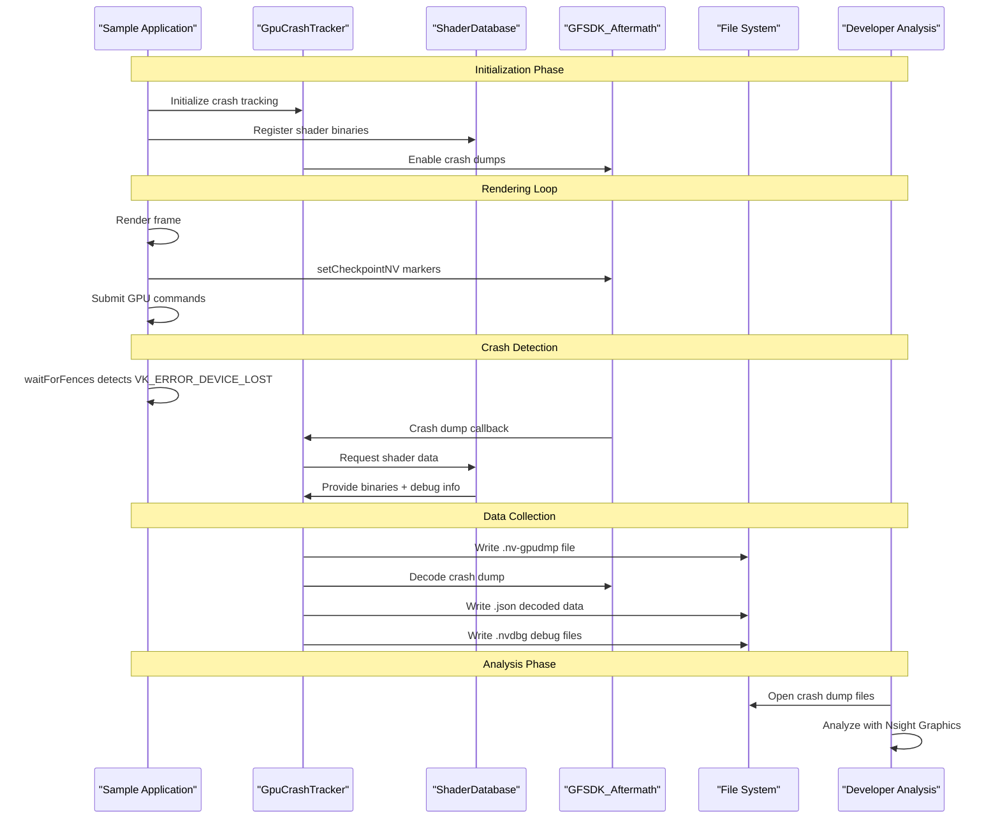

<!-- source: DeepWiki mcp.deepwiki.com · repo NVIDIA/nsight-aftermath-samples · page 1 Overview · fetched 2026-10-26 -->

# Overview

<details>
<summary>Relevant source files</summary>

The following files were used as context for generating this wiki page:

- [D3D12HelloNsightAftermath/README.md](D3D12HelloNsightAftermath/README.md)
- [VkHelloNsightAftermath/README.md](VkHelloNsightAftermath/README.md)
- [VkHelloNsightAftermath/VkHelloNsightAftermath.cpp](VkHelloNsightAftermath/VkHelloNsightAftermath.cpp)

</details>


This document provides a comprehensive overview of the NVIDIA Nsight Aftermath Samples repository, which serves as a collection of reference implementations demonstrating GPU crash debugging capabilities for graphics applications. The repository contains two primary sample applications that showcase how to integrate the Nsight Aftermath SDK for automatic GPU crash dump collection, decoding, and analysis in both Vulkan and Direct3D 12 rendering pipelines.

The samples are designed as educational tools that intentionally trigger GPU crashes to demonstrate the complete debugging workflow, from crash detection through data collection to offline analysis. For detailed implementation specifics of individual samples, see [Vulkan Sample](#2) and [Direct3D 12 Sample](#3). For development environment setup, see [Development Setup](#4).

## Repository Architecture

The repository follows a dual-sample architecture with shared utility components, designed to demonstrate Nsight Aftermath integration across multiple graphics APIs while maintaining code reuse.

```mermaid
graph TB
    subgraph "VkHelloNsightAftermath Sample"
        VkMain[VkHelloNsightAftermath.cpp<br/>"Main Vulkan Application"]
        VkCrash[GpuCrashTracker<br/>"Vulkan Implementation"]  
        VkShader[ShaderDatabase<br/>"Vulkan Implementation"]
        VkCMake[CMakeLists.txt<br/>"Cross-platform Build"]
    end
    
    subgraph "D3D12HelloNsightAftermath Sample"
        D3DMain[D3D12HelloNsightAftermath.cpp<br/>"Main D3D12 Application"]
        D3DCrash[GpuCrashTracker<br/>"D3D12 Implementation"]
        D3DShader[ShaderDatabase<br/>"D3D12 Implementation"] 
        D3DProj[D3D12HelloNsightAftermath.vcxproj<br/>"Visual Studio Project"]
    end
    
    subgraph "Shared Components"
        Helpers[NsightAftermathHelpers.h<br/>"Common Utilities"]
        AftermathSDK[GFSDK_Aftermath<br/>"NVIDIA SDK"]
    end
    
    VkMain --> VkCrash
    VkMain --> VkShader
    VkCrash --> Helpers
    VkShader --> Helpers
    
    D3DMain --> D3DCrash
    D3DMain --> D3DShader
    D3DCrash --> Helpers
    D3DShader --> Helpers
    
    Helpers --> AftermathSDK
    
    VkCMake --> VkMain
    D3DProj --> D3DMain
```

*Sources: [VkHelloNsightAftermath/VkHelloNsightAftermath.cpp:1-429](), [VkHelloNsightAftermath/README.md:25-40](), [D3D12HelloNsightAftermath/README.md:13-28]()*

## Core Integration Components

The Nsight Aftermath integration revolves around three primary component types that work together to provide comprehensive GPU crash debugging capabilities.

```mermaid
graph TD
    subgraph "Application Integration Layer"
        MainApp[Application<br/>"VkHelloNsightAftermath::Demo<br/>D3D12HelloNsightAftermath"]
        CompileFlag[USE_NSIGHT_AFTERMATH<br/>"Conditional Compilation"]
    end
    
    subgraph "Crash Management System"  
        CrashTracker[GpuCrashTracker<br/>"gpuCrashTracker"]
        MarkerMap[MarkerMap<br/>"markerMap"]
        FrameNumber[frameNumber<br/>"Frame Tracking"]
    end
    
    subgraph "Shader Debug System"
        ShaderDB[ShaderDatabase<br/>"Shader Binary Management"]
        DebugInfo[Debug Information<br/>".nvdbg Files"]
        BinaryData[Shader Binaries<br/>"SPIR-V/DXIL"]
    end
    
    subgraph "Aftermath SDK Interface"
        AftermathAPI[GFSDK_Aftermath<br/>"Core API"]
        Callbacks[Crash Callbacks<br/>"Async Event Handling"]
        Checkpoints[Device Checkpoints<br/>"setCheckpointNV"]
    end
    
    MainApp --> CompileFlag
    CompileFlag --> CrashTracker
    CompileFlag --> ShaderDB
    
    CrashTracker --> MarkerMap
    CrashTracker --> FrameNumber
    CrashTracker --> AftermathAPI
    
    ShaderDB --> DebugInfo
    ShaderDB --> BinaryData
    ShaderDB --> AftermathAPI
    
    AftermathAPI --> Callbacks
    AftermathAPI --> Checkpoints
    
    MainApp --> Checkpoints
```

*Sources: [VkHelloNsightAftermath/VkHelloNsightAftermath.cpp:49-59](), [VkHelloNsightAftermath/VkHelloNsightAftermath.cpp:423-428](), [VkHelloNsightAftermath/VkHelloNsightAftermath.cpp:972-1006]()*

## Conditional Compilation System

Both samples use a consistent conditional compilation approach to allow Nsight Aftermath features to be easily enabled or disabled during development.

| Compilation Flag | Purpose | Implementation |
|------------------|---------|----------------|
| `USE_NSIGHT_AFTERMATH` | Master enable/disable | Defined as `1` in main source files |
| Header Guards | Selective inclusion | Wraps Aftermath-specific headers |
| Feature Blocks | Code isolation | Guards crash tracking and debugging code |

The conditional compilation system ensures that Nsight Aftermath integration can be cleanly removed from release builds while maintaining full functionality during development and testing phases.

*Sources: [VkHelloNsightAftermath/VkHelloNsightAftermath.cpp:50](), [VkHelloNsightAftermath/VkHelloNsightAftermath.cpp:52-59](), [VkHelloNsightAftermath/README.md:31-33]()*

## GPU Crash Debugging Workflow

The samples implement a complete GPU crash debugging pipeline that demonstrates the typical workflow from crash detection to analysis.



*Sources: [VkHelloNsightAftermath/VkHelloNsightAftermath.cpp:814-848](), [VkHelloNsightAftermath/README.md:78-87](), [D3D12HelloNsightAftermath/README.md:45-55]()*

## Platform and API Support

The repository demonstrates cross-platform and multi-API support through its dual-sample architecture:

### Vulkan Sample Support
- **Platforms**: Windows, Linux
- **Build System**: CMake with cross-platform configuration
- **Graphics API**: Vulkan 1.2.135+ required
- **Extensions**: `VK_NV_device_diagnostic_checkpoints`, `VK_NV_device_diagnostics_config`

### Direct3D 12 Sample Support  
- **Platforms**: Windows only
- **Build System**: Visual Studio projects with MSBuild
- **Graphics API**: Direct3D 12
- **Requirements**: Windows SDK 10.0.22621.755+

Both samples require NVIDIA GPUs (vendor ID `0x10DE`) and NVIDIA R550+ display drivers to function properly.

*Sources: [VkHelloNsightAftermath/README.md:6-24](), [D3D12HelloNsightAftermath/README.md:6-11](), [VkHelloNsightAftermath/VkHelloNsightAftermath.cpp:1395-1412]()*

## Educational Design Philosophy

The samples are explicitly designed as educational tools rather than production-ready applications. Key educational aspects include:

- **Intentional GPU Crashes**: Both samples deliberately trigger GPU hangs/TDRs to demonstrate crash detection
- **Comprehensive Comments**: Code includes detailed explanations of Aftermath integration points  
- **Offline Analysis Demonstration**: Shows complete pipeline from crash to analysis
- **Reference Implementation**: Provides template for integrating Aftermath into real applications

The samples serve as both learning resources for developers new to GPU debugging and reference implementations for integrating Nsight Aftermath into production graphics applications.

*Sources: [VkHelloNsightAftermath/README.md:41-45](), [D3D12HelloNsightAftermath/README.md:29-33](), [VkHelloNsightAftermath/README.md:78-87]()*

---

