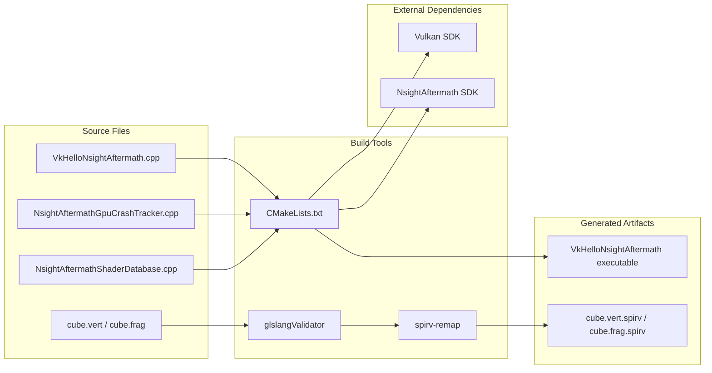
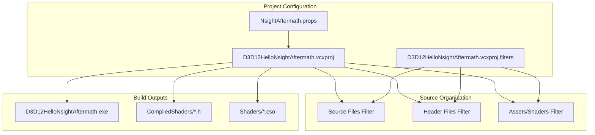
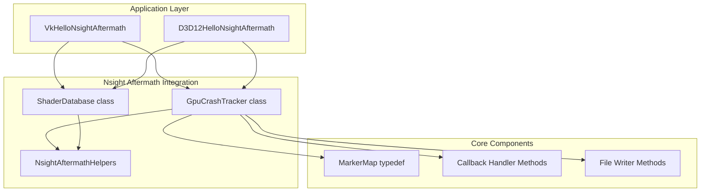

<!-- source: DeepWiki mcp.deepwiki.com · repo NVIDIA/nsight-aftermath-samples · page 1.1 Repository Structure · fetched 2026-10-26 -->

# Repository Structure

Relevant source files

The following files were used as context for generating this wiki page:

- [D3D12HelloNsightAftermath/D3D12HelloNsightAftermath.vcxproj](D3D12HelloNsightAftermath/D3D12HelloNsightAftermath.vcxproj)
- [D3D12HelloNsightAftermath/D3D12HelloNsightAftermath.vcxproj.filters](D3D12HelloNsightAftermath/D3D12HelloNsightAftermath.vcxproj.filters)
- [VkHelloNsightAftermath/CMakeLists.txt](VkHelloNsightAftermath/CMakeLists.txt)
- [VkHelloNsightAftermath/NsightAftermathGpuCrashTracker.h](VkHelloNsightAftermath/NsightAftermathGpuCrashTracker.h)

This document outlines the organization and structure of the NVIDIA Nsight Aftermath Samples repository, detailing how the two main sample applications are organized and what components they share. For information about specific build configurations and dependencies, see [Build Configuration](#2.4) and [Build Configuration](#3.4).

## Repository Overview

The repository is organized around two primary sample applications that demonstrate Nsight Aftermath GPU crash debugging integration for different graphics APIs. Each sample maintains its own directory structure while sharing common utility components.

### Top-Level Directory Structure

```mermaid
graph TD
    Root["nsight-aftermath-samples/"]
    VkDir["VkHelloNsightAftermath/"]
    D3DDir["D3D12HelloNsightAftermath/"]
    
    Root --> VkDir
    Root --> D3DDir
    
    subgraph "Vulkan Sample Directory"
        VkCMake["CMakeLists.txt"]
        VkMain["VkHelloNsightAftermath.cpp"]
        VkTracker["NsightAftermathGpuCrashTracker.cpp"]
        VkShaderDB["NsightAftermathShaderDatabase.cpp"]
        VkHelpers["NsightAftermathHelpers.h"]
        VkShaders["cube.vert / cube.frag"]
        VkCMakeDir["cmake/"]
    end
    
    subgraph "D3D12 Sample Directory"
        D3DProj["D3D12HelloNsightAftermath.vcxproj"]
        D3DMain["D3D12HelloNsightAftermath.cpp"]
        D3DTracker["NsightAftermathGpuCrashTracker.cpp"]
        D3DShaderDB["NsightAftermathShaderDatabase.cpp"]
        D3DHelpers["NsightAftermathHelpers.h"]
        D3DShaders["VertexShader.hlsl / PixelShader.hlsl"]
        D3DProps["NsightAftermath.props"]
    end
    
    VkDir --> VkCMake
    VkDir --> VkMain
    VkDir --> VkTracker
    VkDir --> VkShaderDB
    VkDir --> VkHelpers
    VkDir --> VkShaders
    VkDir --> VkCMakeDir
    
    D3DDir --> D3DProj
    D3DDir --> D3DMain
    D3DDir --> D3DTracker
    D3DDir --> D3DShaderDB
    D3DDir --> D3DHelpers
    D3DDir --> D3DShaders
    D3DDir --> D3DProps
```

*Sources: [VkHelloNsightAftermath/CMakeLists.txt:1-304](), [D3D12HelloNsightAftermath/D3D12HelloNsightAftermath.vcxproj:1-165]()*

## Vulkan Sample Structure

The `VkHelloNsightAftermath` directory contains the primary Vulkan-based sample with CMake build configuration and cross-platform support.

### Component Organization

| Component Type | Files | Purpose |
|---|---|---|
| **Application Entry Point** | `VkHelloNsightAftermath.cpp` | Main Vulkan application logic |
| **Crash Tracking** | `NsightAftermathGpuCrashTracker.cpp/.h` | GPU crash detection and dump handling |
| **Shader Management** | `NsightAftermathShaderDatabase.cpp/.h` | Shader binary and debug info storage |
| **Utilities** | `NsightAftermathHelpers.h` | Common helper functions and macros |
| **Shaders** | `cube.vert`, `cube.frag` | GLSL vertex and fragment shaders |
| **Build System** | `CMakeLists.txt`, `cmake/` | Cross-platform build configuration |

### Build Artifacts and Dependencies

*Sources: [VkHelloNsightAftermath/CMakeLists.txt:227-246](), [VkHelloNsightAftermath/CMakeLists.txt:262-304]()*

## Direct3D 12 Sample Structure

The `D3D12HelloNsightAftermath` directory contains the Direct3D 12 sample with Visual Studio project configuration for Windows development.

### Component Organization

| Component Type | Files | Purpose |
|---|---|---|
| **Application Entry Point** | `D3D12HelloNsightAftermath.cpp`, `Main.cpp` | Main D3D12 application and entry point |
| **Crash Tracking** | `NsightAftermathGpuCrashTracker.cpp/.h` | GPU crash detection and dump handling |
| **Shader Management** | `NsightAftermathShaderDatabase.cpp/.h` | Shader binary and debug info storage |
| **Utilities** | `NsightAftermathHelpers.h` | Common helper functions and macros |
| **Framework** | `DXSample.cpp/.h`, `Win32Application.cpp/.h` | D3D12 application framework |
| **Shaders** | `VertexShader.hlsl`, `PixelShader.hlsl` | HLSL shaders |
| **Build System** | `D3D12HelloNsightAftermath.vcxproj`, `NsightAftermath.props` | Visual Studio project configuration |

### Visual Studio Project Structure

*Sources: [D3D12HelloNsightAftermath/D3D12HelloNsightAftermath.vcxproj:1-165](), [D3D12HelloNsightAftermath/D3D12HelloNsightAftermath.vcxproj.filters:1-83]()*

## Shared Component Architecture

Both samples share core Nsight Aftermath integration components with API-specific implementations where necessary.

### Core Class Relationships

### GpuCrashTracker Component Structure

The `GpuCrashTracker` class provides the core crash detection and handling functionality shared between both samples.

| Member Category | Components | Purpose |
|---|---|---|
| **Static Callbacks** | `GpuCrashDumpCallback`, `ShaderDebugInfoCallback` | Interface with Aftermath SDK callbacks |
| **Instance Handlers** | `OnCrashDump`, `OnShaderDebugInfo`, `OnDescription` | Process crash dump events |
| **File Operations** | `WriteGpuCrashDumpToFile`, `WriteShaderDebugInformationToFile` | Persist crash data |
| **Lookup Handlers** | `OnShaderDebugInfoLookup`, `OnShaderLookup` | Resolve shader information during decoding |
| **State Management** | `m_shaderDebugInfo`, `m_shaderDatabase`, `m_markerMap` | Track crash-related data |

*Sources: [VkHelloNsightAftermath/NsightAftermathGpuCrashTracker.h:37-166]()*

## Build System Differences

### CMake vs Visual Studio Configuration

| Aspect | Vulkan Sample (CMake) | D3D12 Sample (Visual Studio) |
|---|---|---|
| **Build File** | `CMakeLists.txt` | `D3D12HelloNsightAftermath.vcxproj` |
| **Platform Support** | Cross-platform (Windows, Linux) | Windows-only |
| **Shader Compilation** | `glslangValidator` + `spirv-remap` | FxCompile (D3D shader compiler) |
| **Dependency Management** | `find_package()` commands | Property sheets and explicit paths |
| **Output Directory** | CMake standard directories | `bin/$(Platform)/$(Configuration)/` |

*Sources: [VkHelloNsightAftermath/CMakeLists.txt:227-246](), [D3D12HelloNsightAftermath/D3D12HelloNsightAftermath.vcxproj:112-123]()*

---

