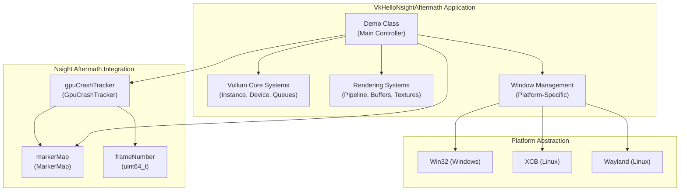
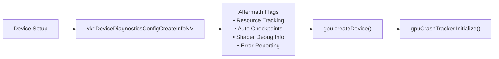
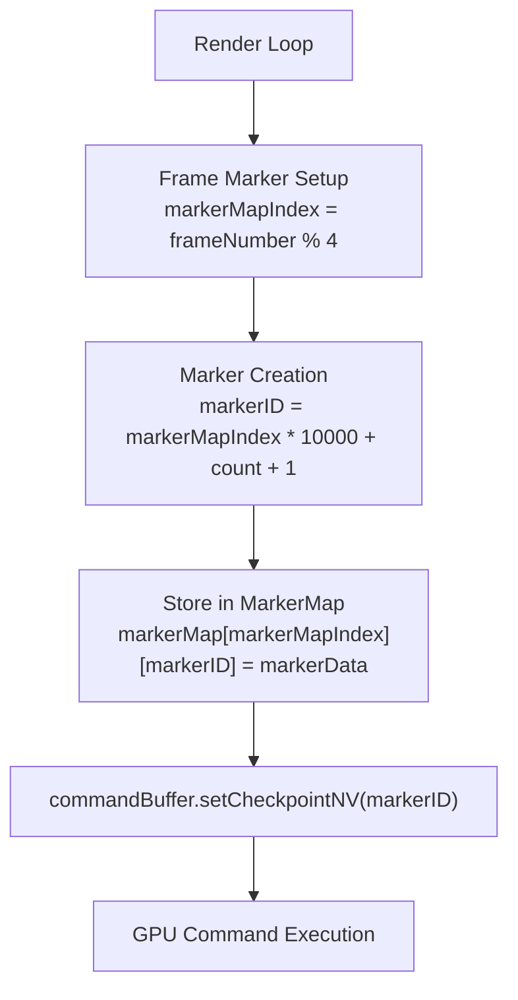
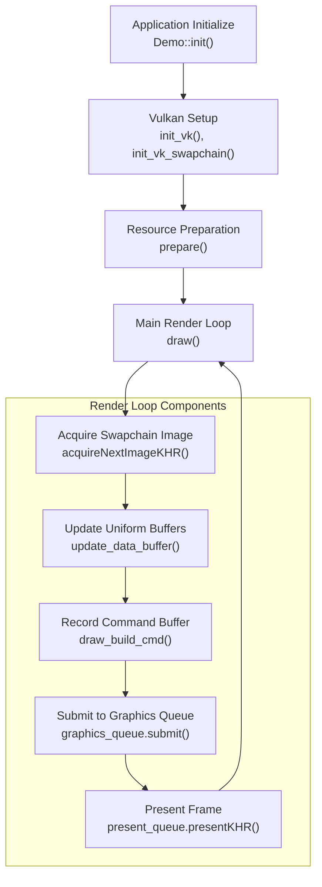
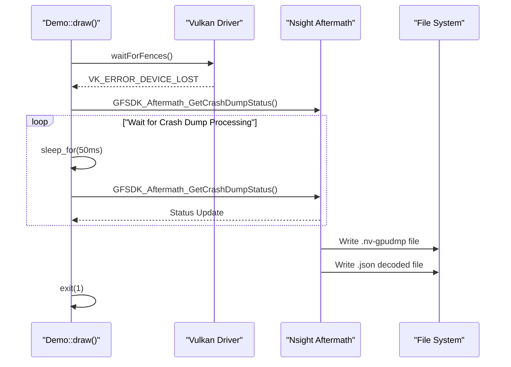
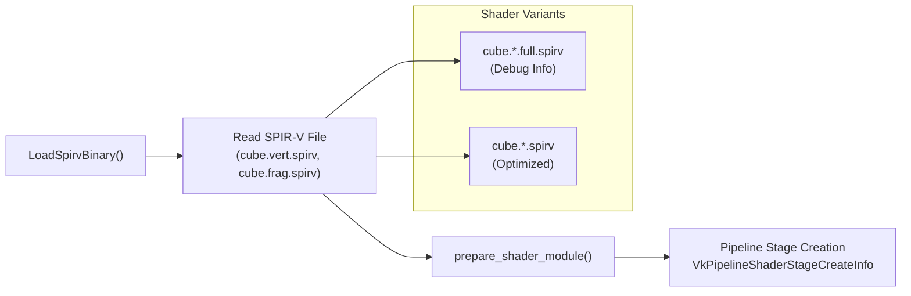
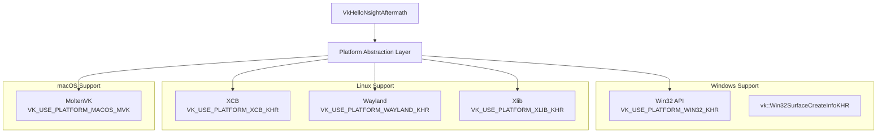

<!-- source: DeepWiki mcp.deepwiki.com · repo NVIDIA/nsight-aftermath-samples · page 2 Vulkan Sample (VkHelloNsightAftermath) · fetched 2026-10-26 -->

# Vulkan Sample (VkHelloNsightAftermath)

Relevant source files

The following files were used as context for generating this wiki page:

- [VkHelloNsightAftermath/README.md](VkHelloNsightAftermath/README.md)
- [VkHelloNsightAftermath/VkHelloNsightAftermath.cpp](VkHelloNsightAftermath/VkHelloNsightAftermath.cpp)

## Purpose and Scope

This document covers the primary Vulkan-based demonstration sample in the NVIDIA Nsight Aftermath repository. The `VkHelloNsightAftermath` application serves as a comprehensive reference implementation showing how to integrate NVIDIA Nsight Aftermath GPU crash debugging capabilities into a Vulkan graphics application. The sample intentionally triggers GPU crashes to demonstrate the complete crash dump collection and analysis workflow.

For information about the Direct3D 12 equivalent sample, see [Direct3D 12 Sample](#3). For general development setup instructions, see [Development Setup](#4).

## Application Architecture Overview

The `VkHelloNsightAftermath` sample is built around a monolithic `Demo` class that encapsulates all Vulkan operations, platform-specific windowing, and Nsight Aftermath integration. The application follows a traditional Vulkan rendering architecture with added instrumentation for crash dump generation.

**Core Application Structure**

Sources: [VkHelloNsightAftermath/VkHelloNsightAftermath.cpp:237-429]()

**Demo Class Core Components**

The `Demo` class contains all essential Vulkan objects and Nsight Aftermath integration components:

| Component Category | Key Members | Purpose |
|-------------------|-------------|---------|
| Vulkan Core | `inst`, `gpu`, `device`, `graphics_queue` | Core Vulkan objects |
| Rendering | `swapchain`, `render_pass`, `pipeline` | Graphics pipeline |
| Resources | `uniform_data`, `textures[]`, `depth` | Rendering resources |
| Synchronization | `fences[]`, `*_semaphores[]` | Frame synchronization |
| Aftermath Integration | `gpuCrashTracker`, `markerMap`, `frameNumber` | Crash debugging |

Sources: [VkHelloNsightAftermath/VkHelloNsightAftermath.cpp:325-428]()

## Nsight Aftermath Integration Points

The application demonstrates several key integration points where Nsight Aftermath functionality is woven into the standard Vulkan workflow.

**Device Creation with Aftermath Features**

Sources: [VkHelloNsightAftermath/VkHelloNsightAftermath.cpp:747-800]()

The application enables comprehensive Aftermath features during device creation:
- **Resource Tracking**: Captures resource information for GPU page fault analysis
- **Automatic Checkpoints**: Automatically captures call stacks for draw/dispatch operations  
- **Shader Debug Info**: Generates debug information for all shaders
- **Error Reporting**: Enables enhanced error reporting capabilities

**Checkpoint Marker System**

Sources: [VkHelloNsightAftermath/VkHelloNsightAftermath.cpp:972-1007]()

The marker system provides a rolling buffer of debug information across the last 4 frames, enabling precise crash location identification.

## Rendering Pipeline and Crash Demonstration

The application implements a standard Vulkan rendering pipeline that renders a textured cube with intentional crash triggering for demonstration purposes.

**Core Rendering Flow**

Sources: [VkHelloNsightAftermath/VkHelloNsightAftermath.cpp:809-943](), [VkHelloNsightAftermath/VkHelloNsightAftermath.cpp:945-1040]()

**GPU Crash Handling Mechanism**

The application includes sophisticated error handling for intentionally triggered GPU crashes:

Sources: [VkHelloNsightAftermath/VkHelloNsightAftermath.cpp:814-848]()

## Resource Management and Shader Handling

The application demonstrates proper resource lifecycle management and shader binary handling for Aftermath integration.

**Shader Loading System**

Sources: [VkHelloNsightAftermath/VkHelloNsightAftermath.cpp:544-554](), [VkHelloNsightAftermath/VkHelloNsightAftermath.cpp:2101-2107]()

The application supports both full debug shaders and stripped optimized shaders, controlled by the `use_stripped_shaders` flag.

**Memory and Resource Management**

| Resource Type | Management Strategy | Cleanup Location |
|---------------|-------------------|------------------|
| Swapchain Images | Per-frame resources in `SwapchainImageResources` | `Demo::cleanup()` |
| Uniform Buffers | Per-swapchain-image allocation | `Demo::prepare_cube_data_buffers()` |
| Textures | Static allocation with staging buffers | `Demo::destroy_texture()` |
| Command Pools | Graphics and present queue pools | `Demo::cleanup()` |

Sources: [VkHelloNsightAftermath/VkHelloNsightAftermath.cpp:663-737](), [VkHelloNsightAftermath/VkHelloNsightAftermath.cpp:1904-1961]()

## Platform Integration and Window Management

The application provides comprehensive cross-platform support through conditional compilation and platform-specific windowing code.

**Platform Support Matrix**

Sources: [VkHelloNsightAftermath/VkHelloNsightAftermath.cpp:276-295](), [VkHelloNsightAftermath/VkHelloNsightAftermath.cpp:1500-1550]()

The application uses preprocessor directives to conditionally compile platform-specific windowing code, ensuring broad compatibility while maintaining clean separation of platform concerns.

---

