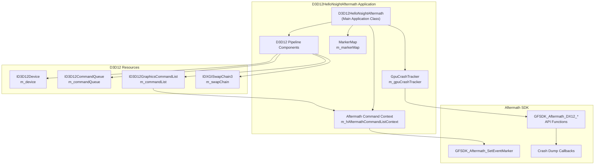
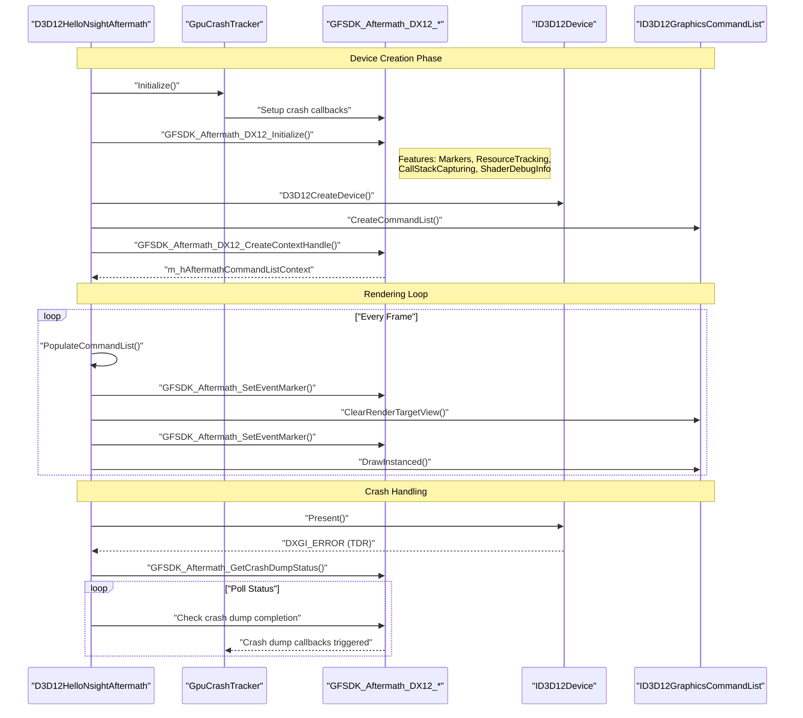
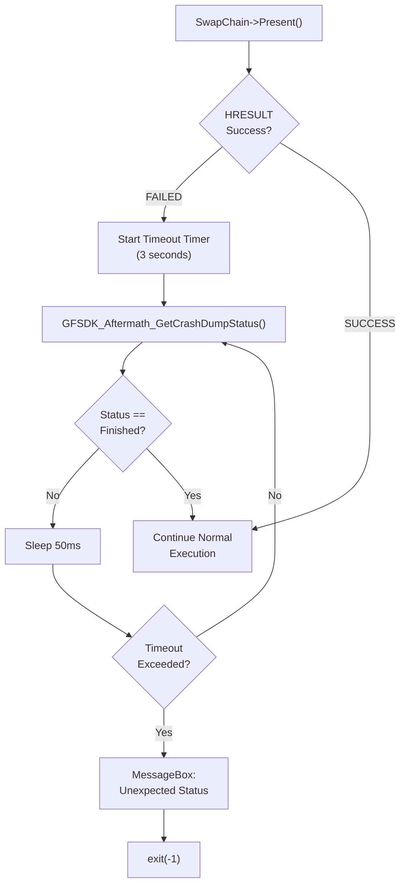

<!-- source: DeepWiki mcp.deepwiki.com · repo NVIDIA/nsight-aftermath-samples · page 3 Direct3D 12 Sample (D3D12HelloNsightAftermath) · fetched 2026-10-26 -->

# Direct3D 12 Sample (D3D12HelloNsightAftermath)

<details>
<summary>Relevant source files</summary>

The following files were used as context for generating this wiki page:

- [D3D12HelloNsightAftermath/D3D12HelloNsightAftermath.cpp](D3D12HelloNsightAftermath/D3D12HelloNsightAftermath.cpp)
- [D3D12HelloNsightAftermath/README.md](D3D12HelloNsightAftermath/README.md)

</details>


This document covers the Direct3D 12-based Nsight Aftermath integration sample, which demonstrates how to implement GPU crash debugging capabilities in a D3D12 application. The sample provides a complete reference implementation for crash dump collection, event marker integration, and shader debugging data management. For information about the Vulkan-based equivalent, see [Vulkan Sample (VkHelloNsightAftermath)](#2). For details about setting up the development environment, see [Development Setup](#4).

## Application Architecture

The `D3D12HelloNsightAftermath` class serves as the main application framework, extending the base `DXSample` class to provide a complete D3D12 rendering pipeline with integrated Nsight Aftermath crash debugging capabilities.

### Core Application Structure



The application initializes Aftermath integration during device creation and maintains crash tracking throughout the rendering lifecycle. The `m_gpuCrashTracker` component handles crash dump collection, while `m_markerMap` provides event marker management for debugging context.

Sources: [D3D12HelloNsightAftermath/D3D12HelloNsightAftermath.cpp:23-37](), [D3D12HelloNsightAftermath/D3D12HelloNsightAftermath.cpp:88-147]()

### Rendering Pipeline Integration

The application implements a standard D3D12 triangle rendering demo with strategic Aftermath integration points:

| Component | Purpose | Aftermath Integration |
|-----------|---------|----------------------|
| Device Creation | Initialize D3D12 device | `GFSDK_Aftermath_DX12_Initialize` called before device creation |
| Command List | Record rendering commands | Event markers inserted via `GFSDK_Aftermath_SetEventMarker` |
| Present | Display rendered frame | Crash detection and timeout handling on present failure |
| Resource Management | Handle D3D12 resources | Resource tracking enabled via `EnableResourceTracking` flag |

The `PopulateCommandList` method demonstrates proper event marker placement around critical GPU operations like render target clearing and triangle drawing.

Sources: [D3D12HelloNsightAftermath/D3D12HelloNsightAftermath.cpp:456-549](), [D3D12HelloNsightAftermath/D3D12HelloNsightAftermath.cpp:392-444]()

## GPU Crash Debugging Integration

### Aftermath Initialization Sequence



The initialization occurs in two phases: first the `GpuCrashTracker` sets up callback handlers, then the main Aftermath system is initialized with comprehensive feature flags before D3D12 device creation.

Sources: [D3D12HelloNsightAftermath/D3D12HelloNsightAftermath.cpp:88-147](), [D3D12HelloNsightAftermath/D3D12HelloNsightAftermath.cpp:289-292]()

### Event Marker Management

The application implements a dual approach to event marker management:

```cpp
// App-managed markers (high performance)
auto setAftermathEventMarker = [this](const std::string& markerData, bool appManagedMarker) {
    if (appManagedMarker) {
        UINT markerMapIndex = m_frameCounter % GpuCrashTracker::c_markerFrameHistory;
        auto& currentFrameMarkerMap = m_markerMap[markerMapIndex];
        size_t markerID = markerMapIndex * 10000 + currentFrameMarkerMap.size() + 1;
        currentFrameMarkerMap[markerID] = markerData;
        AFTERMATH_CHECK_ERROR(GFSDK_Aftermath_SetEventMarker(m_hAftermathCommandListContext, (void*)markerID, 0));
    } else {
        // Aftermath-managed markers (simpler but lower performance)
        AFTERMATH_CHECK_ERROR(GFSDK_Aftermath_SetEventMarker(m_hAftermathCommandListContext, (void*)markerData.c_str(), (unsigned int)markerData.size() + 1));
    }
};
```

The app-managed approach uses a ringbuffer-based identifier scheme where markers are stored in `m_markerMap` with unique IDs calculated as `markerMapIndex * 10000 + markerCount + 1`, supporting up to 10,000 markers per frame across 4 frame history.

Sources: [D3D12HelloNsightAftermath/D3D12HelloNsightAftermath.cpp:484-527](), [D3D12HelloNsightAftermath/D3D12HelloNsightAftermath.cpp:531-543]()

### Crash Detection and Recovery

The application implements comprehensive crash handling in the `OnRender` method:



The crash handling system provides a 3-second timeout window for Aftermath to complete crash dump processing, polling the status every 50 milliseconds to ensure proper cleanup before application termination.

Sources: [D3D12HelloNsightAftermath/D3D12HelloNsightAftermath.cpp:402-441]()

## Shader Database Integration

While this sample uses pre-compiled shader bytecode embedded directly in the application via `VertexShader.h` and `PixelShader.h`, it integrates with the broader Nsight Aftermath shader database system for crash analysis. The `GenerateShaderDebugInfo` flag ensures that shader debug information is available for instruction-level crash analysis.

The shader integration enables:

- **Instruction Mapping**: Links GPU crash addresses to specific shader instructions
- **Debug Information**: Provides source-level debugging context for shader execution
- **Binary Analysis**: Associates shader bytecode with crash dump data

The application loads shader bytecode during pipeline state creation and the Aftermath system automatically captures this information for crash analysis.

Sources: [D3D12HelloNsightAftermath/D3D12HelloNsightAftermath.cpp:271-272](), [D3D12HelloNsightAftermath/D3D12HelloNsightAftermath.cpp:137-141]()

## Build Configuration

The Direct3D 12 sample uses Visual Studio 2022 with MSBuild for compilation. The build system is configured through Visual Studio project files and property sheets:

### Key Build Components

| File | Purpose |
|------|---------|
| `D3D12HelloNsightAftermath.vcxproj` | Main Visual Studio project file |
| `NsightAftermath.props` | Property sheet with Aftermath SDK paths |
| `*.hlsl` files | HLSL shader source files compiled to bytecode |

The build process requires the `NSIGHT_AFTERMATH_SDK` environment variable to locate the Aftermath SDK installation. The project is configured to compile with Windows SDK 10.0.22621.755 or newer.

### Conditional Compilation

The entire Aftermath integration is controlled by the `USE_NSIGHT_AFTERMATH` preprocessor definition:

- When defined as `1`: Full Aftermath integration enabled
- When undefined or `0`: Aftermath code is excluded, standard D3D12 debug layer available

This allows the same codebase to serve both as a crash debugging demonstration and as a clean D3D12 sample application.

Sources: [D3D12HelloNsightAftermath/README.md:37-41](), [D3D12HelloNsightAftermath/D3D12HelloNsightAftermath.cpp:15-17]()

---

