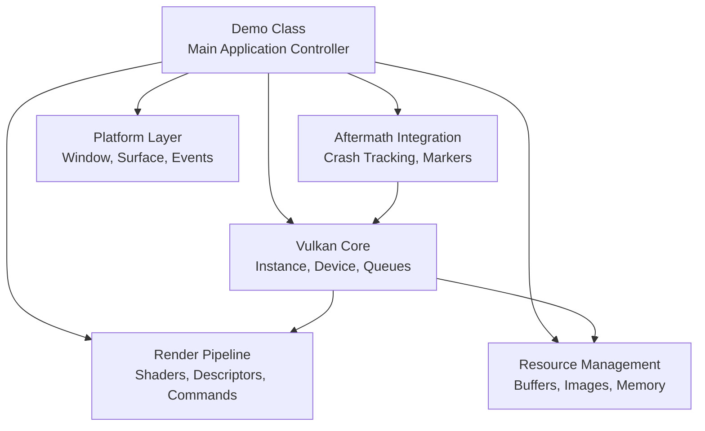
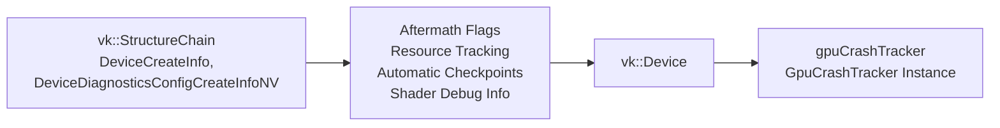
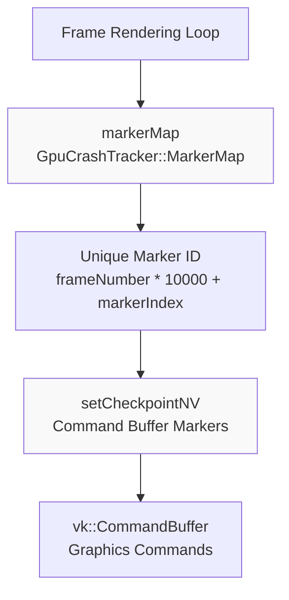
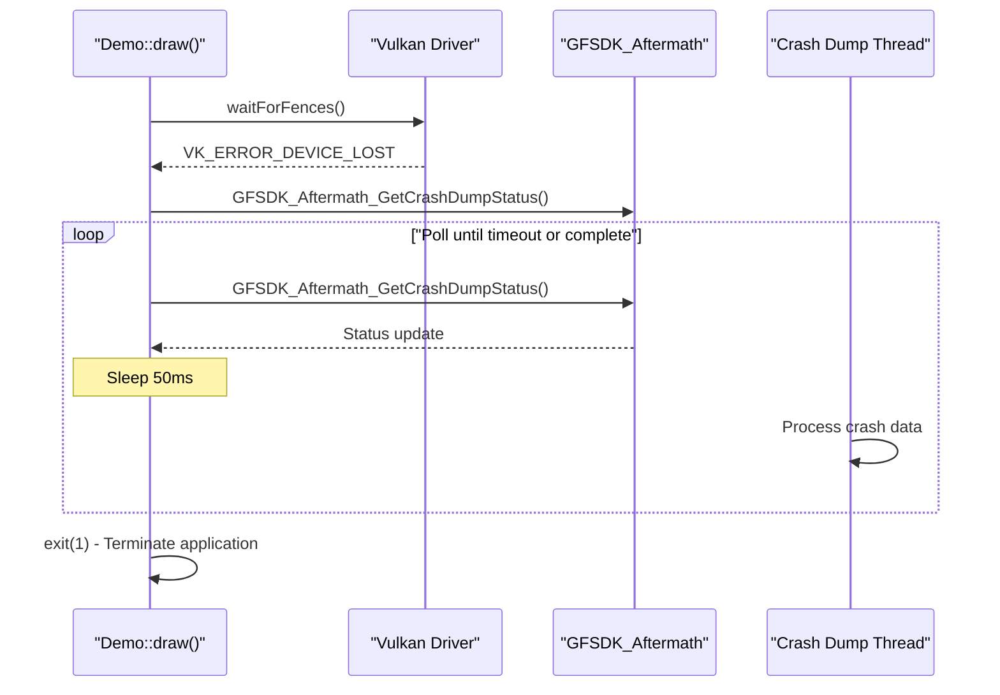
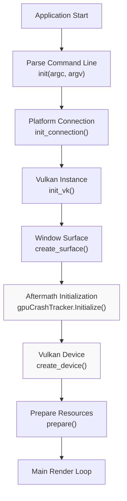
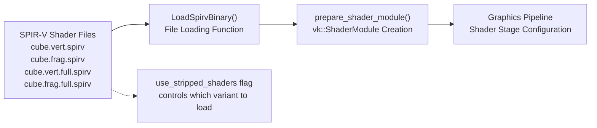
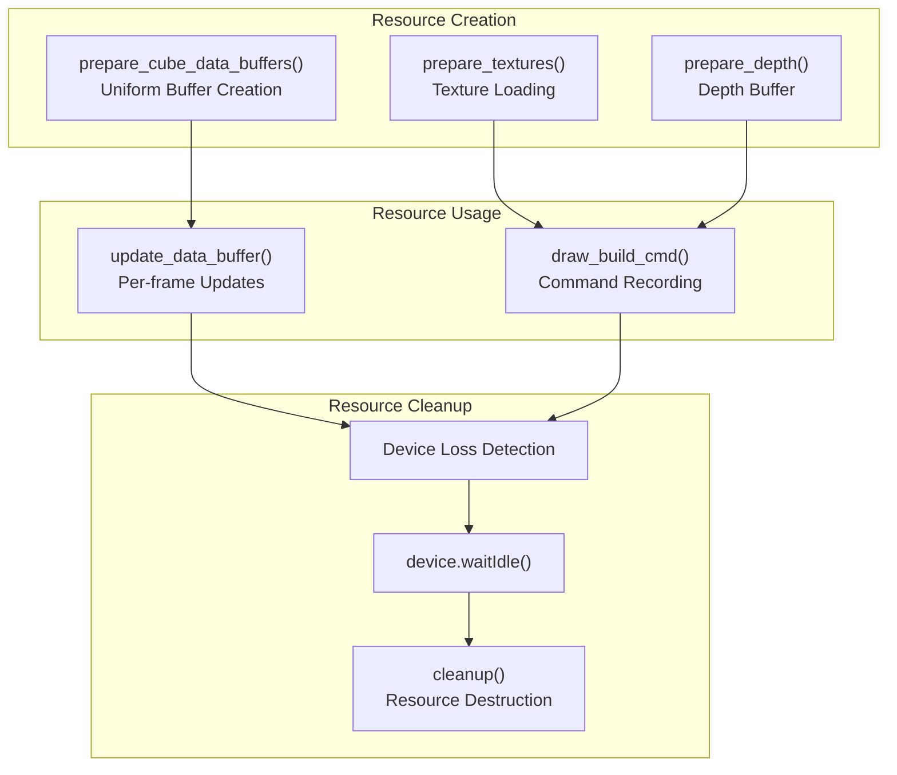

<!-- source: DeepWiki mcp.deepwiki.com · repo NVIDIA/nsight-aftermath-samples · page 3.1 Application Architecture · fetched 2026-10-26 -->

# Application Architecture

Relevant source files

The following files were used as context for generating this wiki page:

- [VkHelloNsightAftermath/VkHelloNsightAftermath.cpp](VkHelloNsightAftermath/VkHelloNsightAftermath.cpp)

This document describes the architectural design of the VkHelloNsightAftermath Vulkan sample application, focusing on how NVIDIA Nsight Aftermath GPU crash debugging capabilities are integrated into a standard Vulkan rendering pipeline. The application demonstrates real-world integration patterns for crash tracking, shader debug information management, and GPU state capture.

For information about the specific crash tracking implementation, see [GPU Crash Tracking System](#2.2). For shader-specific debugging integration, see [Shader Database System](#2.3).

## Core Application Structure

The application is built around a single `Demo` class that encapsulates all Vulkan operations and Nsight Aftermath integration. This monolithic design simplifies the demonstration of how Aftermath components integrate with existing Vulkan code.

Sources: [VkHelloNsightAftermath/VkHelloNsightAftermath.cpp:237-429]()

## Nsight Aftermath Integration Points

The application integrates Nsight Aftermath at several critical points in the Vulkan pipeline to enable comprehensive GPU crash debugging.

### Device Creation with Diagnostics

The device creation process is enhanced with Aftermath-specific configuration to enable crash dump collection and additional debugging information.

Sources: [VkHelloNsightAftermath/VkHelloNsightAftermath.cpp:747-800]()

### Checkpoint Marker System

The marker system provides a way to correlate GPU crashes with specific rendering operations by inserting checkpoints into command buffers.

Sources: [VkHelloNsightAftermath/VkHelloNsightAftermath.cpp:972-1007]()

## Device Loss Handling Architecture

The application implements sophisticated device loss detection and recovery that works with Nsight Aftermath's asynchronous crash dump generation.

The device loss handling includes a timeout mechanism to allow Aftermath's background thread time to collect and process crash dump data before application termination.

Sources: [VkHelloNsightAftermath/VkHelloNsightAftermath.cpp:814-848]()

## Class Member Organization

The `Demo` class organizes its members into logical groups that separate Vulkan core functionality from Aftermath-specific features.

| Component Category | Key Members | Purpose |
|------------------|-------------|---------|
| **Vulkan Core** | `inst`, `device`, `gpu`, `graphics_queue` | Basic Vulkan objects |
| **Rendering** | `pipeline`, `render_pass`, `swapchain` | Graphics pipeline setup |
| **Resources** | `textures[]`, `uniform_data`, `depth` | Rendering resources |
| **Synchronization** | `fences[]`, `image_acquired_semaphores[]` | Frame synchronization |
| **Aftermath Integration** | `gpuCrashTracker`, `markerMap`, `frameNumber` | Crash debugging |
| **Platform** | `window`, `surface`, `connection` | Platform-specific handles |

Sources: [VkHelloNsightAftermath/VkHelloNsightAftermath.cpp:325-428]()

## Initialization Sequence

The application follows a specific initialization order to ensure Aftermath is properly configured before any GPU operations begin.

The key architectural decision is initializing Aftermath before device creation, allowing the device to be configured with appropriate diagnostic flags.

Sources: [VkHelloNsightAftermath/VkHelloNsightAftermath.cpp:1597-1601](), [VkHelloNsightAftermath/VkHelloNsightAftermath.cpp:1074-1156]()

## Shader Loading Architecture

The application supports both stripped and full shader variants to demonstrate different debugging scenarios with Nsight Aftermath.

The shader loading system allows switching between debug and release shader variants at runtime, enabling different levels of debugging information to be available to Aftermath.

Sources: [VkHelloNsightAftermath/VkHelloNsightAftermath.cpp:544-554](), [VkHelloNsightAftermath/VkHelloNsightAftermath.cpp:2101-2107](), [VkHelloNsightAftermath/VkHelloNsightAftermath.cpp:2460-2465]()

## Memory and Resource Management

The application demonstrates proper resource lifecycle management in the context of potential GPU crashes and device loss scenarios.

The resource management includes specific handling for device loss scenarios where Aftermath may be processing crash dumps asynchronously.

Sources: [VkHelloNsightAftermath/VkHelloNsightAftermath.cpp:1904-1961](), [VkHelloNsightAftermath/VkHelloNsightAftermath.cpp:2376-2458](), [VkHelloNsightAftermath/VkHelloNsightAftermath.cpp:663-737]()

---

