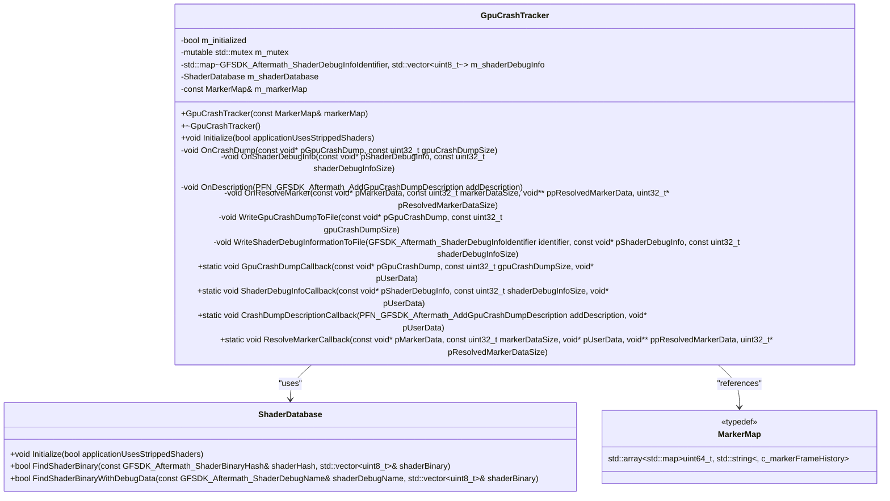
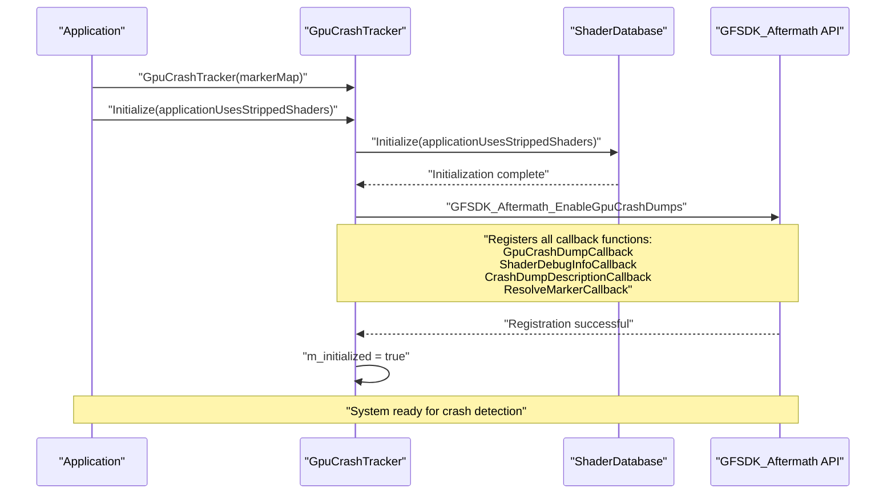
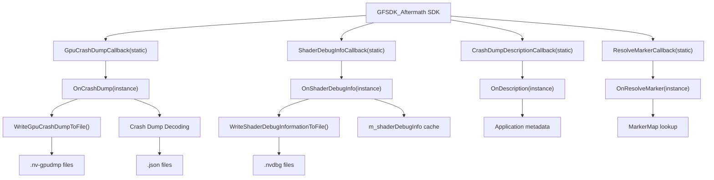
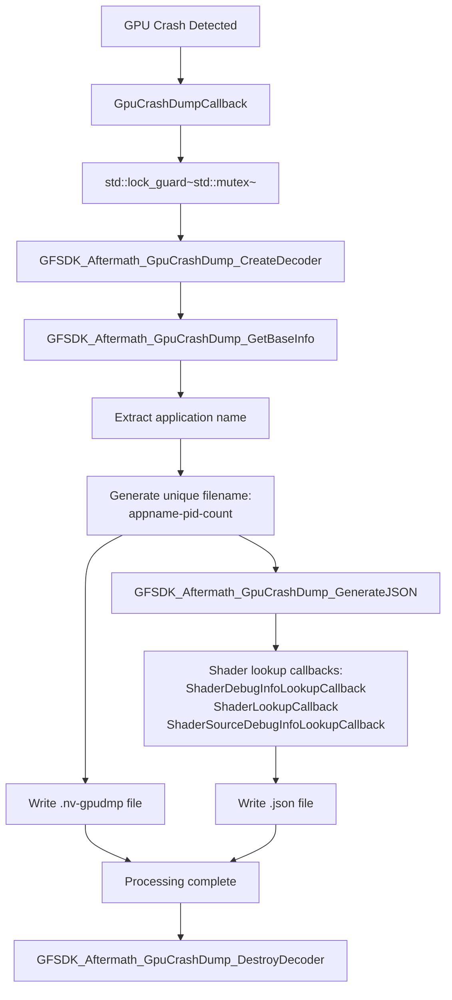
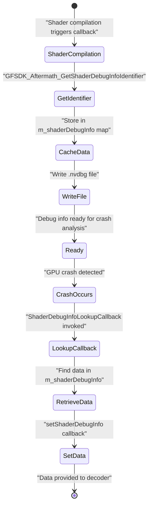

<!-- source: DeepWiki mcp.deepwiki.com · repo NVIDIA/nsight-aftermath-samples · page 3.2 GPU Crash Tracking System · fetched 2026-10-26 -->

# GPU Crash Tracking System

<details>
<summary>Relevant source files</summary>

The following files were used as context for generating this wiki page:

- [VkHelloNsightAftermath/NsightAftermathGpuCrashTracker.cpp](VkHelloNsightAftermath/NsightAftermathGpuCrashTracker.cpp)
- [VkHelloNsightAftermath/NsightAftermathGpuCrashTracker.h](VkHelloNsightAftermath/NsightAftermathGpuCrashTracker.h)

</details>


## Purpose and Scope

The GPU Crash Tracking System implements comprehensive GPU crash dump collection and analysis capabilities for the Vulkan sample application using the NVIDIA Nsight Aftermath SDK. This system captures GPU crash dumps, shader debug information, and application-defined markers to enable post-mortem debugging of GPU hangs and crashes.

This document covers the `GpuCrashTracker` class implementation specific to the Vulkan sample. For information about the shader management components that work alongside this system, see [Shader Database System](#2.3). For the Direct3D 12 equivalent implementation, see [GPU Crash Tracking System](#3.2).

## Architecture Overview

The `GpuCrashTracker` class serves as the central coordinator between the application, Nsight Aftermath SDK, and the file system for crash dump management. The system operates through a callback-driven architecture where the Nsight Aftermath SDK invokes registered callbacks when GPU events occur.

### Core Class Structure



Sources: [VkHelloNsightAftermath/NsightAftermathGpuCrashTracker.h:37-166]()

### Initialization and SDK Integration

The system initializes through a two-phase process: shader database setup followed by Nsight Aftermath SDK registration.



Sources: [VkHelloNsightAftermath/NsightAftermathGpuCrashTracker.cpp:55-80]()

The `Initialize` function configures the Nsight Aftermath SDK with specific flags and callback registrations:

| Parameter | Value | Purpose |
|-----------|-------|---------|
| `GFSDK_Aftermath_GpuCrashDumpWatchedApiFlags_Vulkan` | API flag | Enables Vulkan API monitoring |
| `GFSDK_Aftermath_GpuCrashDumpFeatureFlags_DeferDebugInfoCallbacks` | Feature flag | Caches shader debug info until crash occurs |
| Static callback functions | Function pointers | Bridge between C API and C++ class methods |

## Callback System Architecture

The system implements a dual-layer callback architecture where static C-style callbacks interface with the Nsight Aftermath SDK and dispatch to instance methods of the `GpuCrashTracker` class.

### Callback Registration and Dispatch



Sources: [VkHelloNsightAftermath/NsightAftermathGpuCrashTracker.cpp:315-384](), [VkHelloNsightAftermath/NsightAftermathGpuCrashTracker.h:105-147]()

### Callback Handler Implementation

Each callback handler serves a specific purpose in the crash tracking pipeline:

| Handler | Trigger | Function | Output |
|---------|---------|----------|--------|
| `OnCrashDump` | GPU crash detected | Processes crash dump data, generates analysis files | `.nv-gpudmp`, `.json` files |
| `OnShaderDebugInfo` | Shader compilation (deferred) | Caches shader debug information for crash analysis | `.nvdbg` files, in-memory cache |
| `OnDescription` | Pre-crash metadata collection | Adds application-specific crash context | Embedded in crash dump |
| `OnResolveMarker` | Marker resolution request | Resolves application-managed debug markers | String data for crash analysis |

## Crash Dump Processing Pipeline

When a GPU crash occurs, the system executes a comprehensive processing pipeline that generates multiple output formats for analysis.

### Crash Dump Decoding Workflow



Sources: [VkHelloNsightAftermath/NsightAftermathGpuCrashTracker.cpp:149-233]()

The crash dump processor generates multiple file formats:

- **Raw dump (`.nv-gpudmp`)**: Binary crash dump data readable by Nsight Graphics
- **JSON dump (`.json`)**: Human-readable crash analysis with shader mappings
- **Debug info (`.nvdbg`)**: Individual shader debug information files

### File Naming Convention

The system generates unique filenames to handle multiple crash dumps from the same process:

```
{applicationName}-{processId}-{incrementalCount}.nv-gpudmp
{applicationName}-{processId}-{incrementalCount}.nv-gpudmp.json
shader-{shaderIdentifier}.nvdbg
```

Sources: [VkHelloNsightAftermath/NsightAftermathGpuCrashTracker.cpp:180-194](), [VkHelloNsightAftermath/NsightAftermathGpuCrashTracker.cpp:242]()

## Shader Information Management

The crash tracker maintains shader debug information through a caching mechanism that stores data in memory and writes debug files to disk.

### Shader Debug Info Caching

The `m_shaderDebugInfo` map stores shader debug information keyed by `GFSDK_Aftermath_ShaderDebugInfoIdentifier`. This cache is populated when `OnShaderDebugInfo` is called and consumed during crash dump JSON generation.



Sources: [VkHelloNsightAftermath/NsightAftermathGpuCrashTracker.cpp:92-113](), [VkHelloNsightAftermath/NsightAftermathGpuCrashTracker.cpp:254-269]()

### Integration with ShaderDatabase

The crash tracker coordinates with the `ShaderDatabase` component to resolve shader binaries during crash analysis:

| Lookup Type | Handler | Database Method | Purpose |
|-------------|---------|-----------------|---------|
| Shader Binary | `OnShaderLookup` | `FindShaderBinary` | Maps shader hash to binary data |
| Debug Data | `OnShaderSourceDebugInfoLookup` | `FindShaderBinaryWithDebugData` | Maps debug name to source debug info |

Sources: [VkHelloNsightAftermath/NsightAftermathGpuCrashTracker.cpp:277-313]()

## Thread Safety and Synchronization

The system implements thread-safe access to shared resources using mutex protection around all callback handlers and shared state modifications.

### Mutex Protection Strategy

```cpp
std::lock_guard<std::mutex> lock(m_mutex);
```

All callback handlers (`OnCrashDump`, `OnShaderDebugInfo`) acquire the mutex lock before accessing shared state. This ensures thread safety when multiple GPU threads trigger callbacks simultaneously.

Sources: [VkHelloNsightAftermath/NsightAftermathGpuCrashTracker.cpp:86](), [VkHelloNsightAftermath/NsightAftermathGpuCrashTracker.cpp:96](), [VkHelloNsightAftermath/NsightAftermathGpuCrashTracker.h:156]()

### Marker Resolution System

The system supports application-managed debug markers through the `MarkerMap` typedef, which maintains a history of debug markers across multiple frames:

```cpp
typedef std::array<std::map<uint64_t, std::string>, c_markerFrameHistory> MarkerMap;
```

The `OnResolveMarker` function searches through the marker history to resolve marker data pointers to human-readable strings, enabling better crash analysis context.

Sources: [VkHelloNsightAftermath/NsightAftermathGpuCrashTracker.h:40-42](), [VkHelloNsightAftermath/NsightAftermathGpuCrashTracker.cpp:129-146]()

## Cleanup and Resource Management

The destructor ensures proper cleanup of Nsight Aftermath resources:

```cpp
if (m_initialized)
{
    GFSDK_Aftermath_DisableGpuCrashDumps();
}
```

This automatic cleanup prevents resource leaks and properly unregisters callbacks when the `GpuCrashTracker` instance is destroyed.

Sources: [VkHelloNsightAftermath/NsightAftermathGpuCrashTracker.cpp:45-52]()

---

