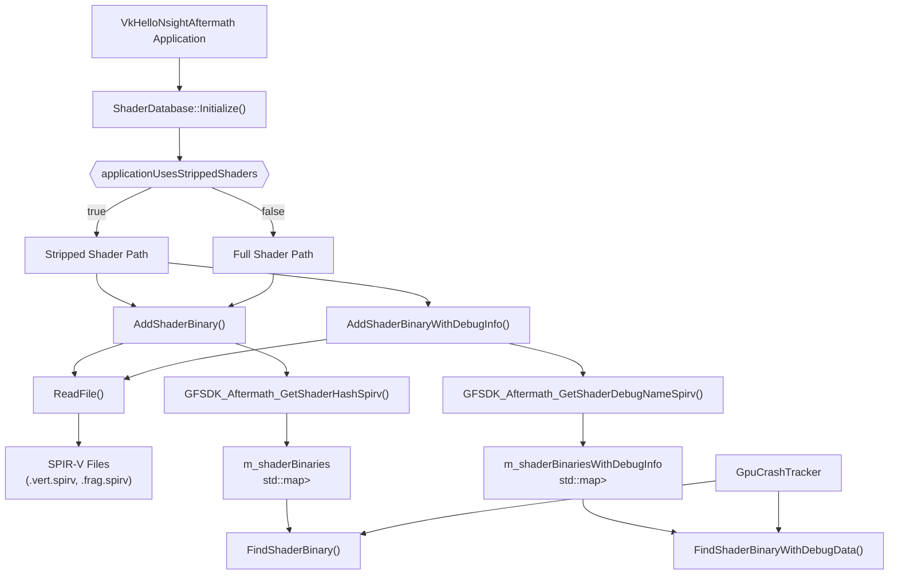
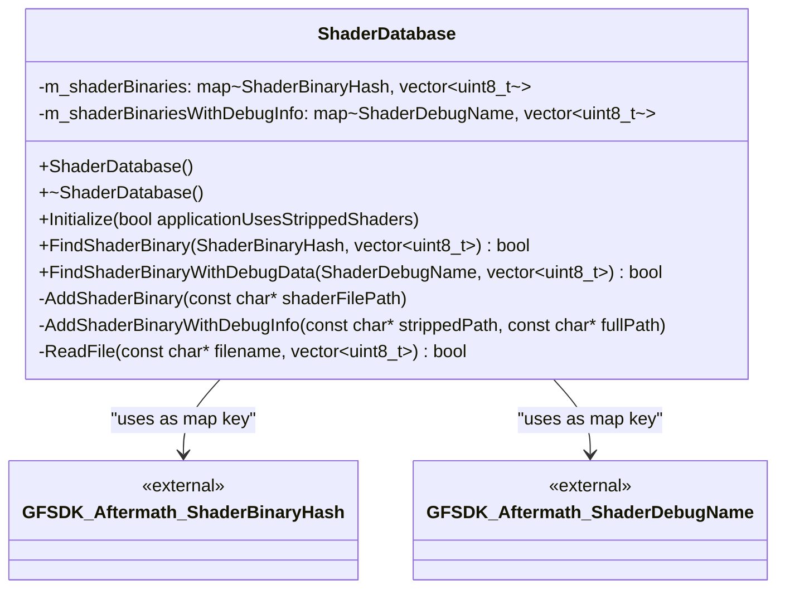
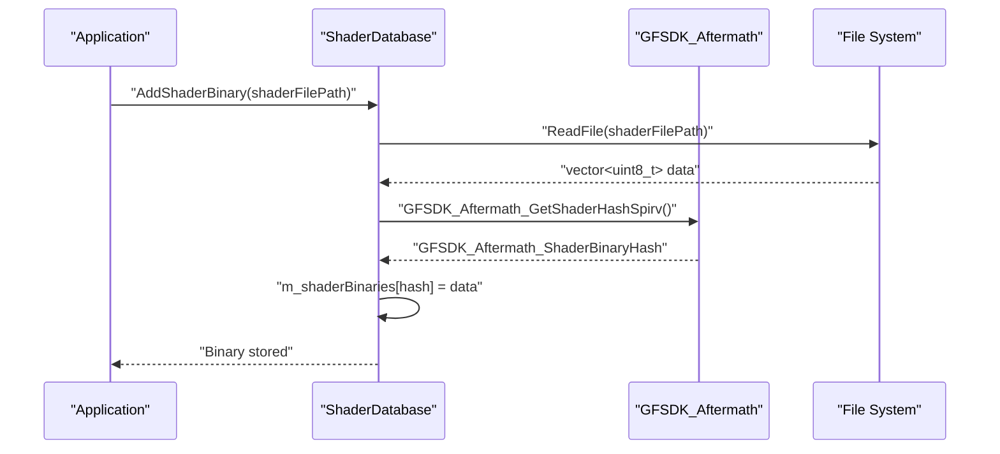
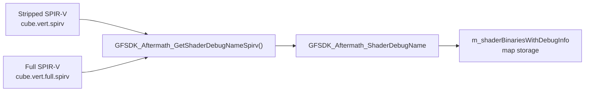
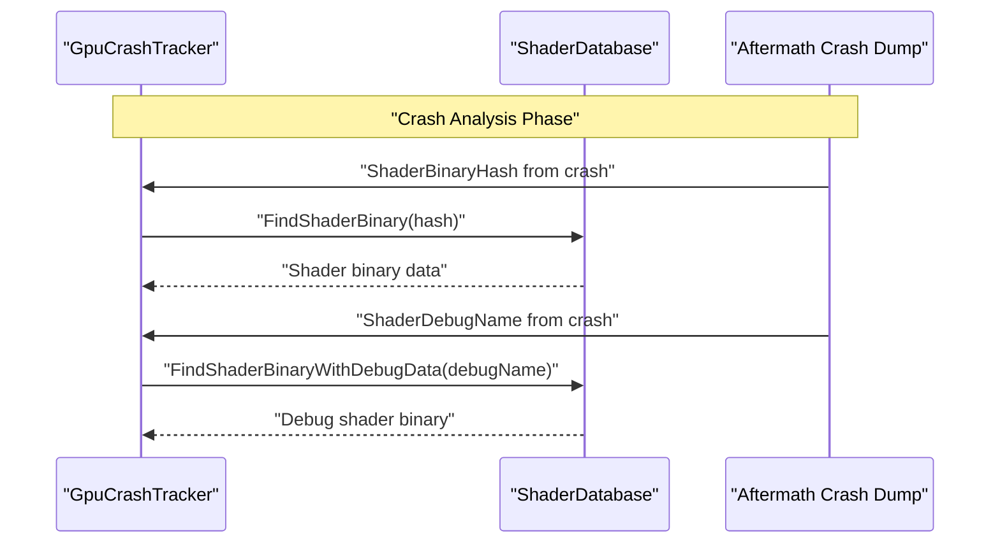

<!-- source: DeepWiki mcp.deepwiki.com · repo NVIDIA/nsight-aftermath-samples · page 3.3 Shader Database System · fetched 2026-10-26 -->

# Shader Database System

Relevant source files

The following files were used as context for generating this wiki page:

- [VkHelloNsightAftermath/NsightAftermathShaderDatabase.cpp](VkHelloNsightAftermath/NsightAftermathShaderDatabase.cpp)
- [VkHelloNsightAftermath/NsightAftermathShaderDatabase.h](VkHelloNsightAftermath/NsightAftermathShaderDatabase.h)

## Purpose and Scope

The Shader Database System provides shader binary and debug information management for GPU crash dump analysis in the Vulkan sample. This system stores shader bytecode and associated debug information, enabling correlation between shaders used during rendering and those referenced in Nsight Aftermath crash dumps. The system supports both stripped and full shader configurations to accommodate different deployment scenarios.

For information about crash dump generation and processing, see [GPU Crash Tracking System](#2.2). For details about the main application architecture, see [Application Architecture](#2.1).

## System Architecture

The Shader Database System centers around the `ShaderDatabase` class, which manages two distinct data stores for shader correlation during crash analysis.

### Core Architecture Diagram

**Sources:** [VkHelloNsightAftermath/NsightAftermathShaderDatabase.h:40-67](), [VkHelloNsightAftermath/NsightAftermathShaderDatabase.cpp:34-76]()

### Class Structure and Data Storage

**Sources:** [VkHelloNsightAftermath/NsightAftermathShaderDatabase.h:55-67](), [VkHelloNsightAftermath/NsightAftermathShaderDatabase.cpp:34-42]()

## Shader Binary Management

The system manages shader binaries through a hash-based lookup mechanism using Nsight Aftermath's shader identification system.

### Binary Storage Process

| Operation | Method | Purpose |
|-----------|---------|----------|
| File Reading | `ReadFile()` | Loads SPIR-V bytecode from disk |
| Hash Generation | `GFSDK_Aftermath_GetShaderHashSpirv()` | Creates unique identifier for shader binary |
| Storage | `m_shaderBinaries[hash] = data` | Maps hash to binary data |
| Retrieval | `FindShaderBinary()` | Locates binary by hash during crash analysis |

The `AddShaderBinary()` method processes each shader file through the following workflow:

**Sources:** [VkHelloNsightAftermath/NsightAftermathShaderDatabase.cpp:95-115](), [VkHelloNsightAftermath/NsightAftermathShaderDatabase.cpp:78-93]()

## Debug Information Handling

The system supports two shader configurations: stripped shaders for production deployment and full shaders containing debug information for development analysis.

### Configuration Modes

The `Initialize()` method configures the database based on the `applicationUsesStrippedShaders` parameter:

#### Stripped Shader Mode (`applicationUsesStrippedShaders = true`)
- Stores both stripped and full versions of each shader
- Maps stripped versions for runtime correlation
- Maps full versions for debug information extraction
- Uses shader files: `cube.vert.spirv`, `cube.frag.spirv` (stripped) and `cube.vert.full.spirv`, `cube.frag.full.spirv` (full)

#### Full Shader Mode (`applicationUsesStrippedShaders = false`) 
- Stores only full shader versions
- Uses shader files: `cube.vert.full.spirv`, `cube.frag.full.spirv`

**Sources:** [VkHelloNsightAftermath/NsightAftermathShaderDatabase.cpp:45-76]()

### Debug Name Generation

For stripped shader configurations, the system generates debug names to correlate stripped and full shader versions:

**Sources:** [VkHelloNsightAftermath/NsightAftermathShaderDatabase.cpp:117-144]()

## Nsight Aftermath Integration

The Shader Database integrates with the Nsight Aftermath SDK through specific API calls for shader identification and correlation.

### SDK Integration Points

| SDK Function | Purpose | Usage Location |
|--------------|---------|----------------|
| `GFSDK_Aftermath_GetShaderHashSpirv()` | Generate shader binary hash | [NsightAftermathShaderDatabase.cpp:107-110]() |
| `GFSDK_Aftermath_GetShaderDebugNameSpirv()` | Generate debug correlation name | [NsightAftermathShaderDatabase.cpp:135-139]() |

### Crash Analysis Workflow

During crash analysis, the GPU Crash Tracking System queries the Shader Database using identifiers from crash dumps:

**Sources:** [VkHelloNsightAftermath/NsightAftermathShaderDatabase.cpp:147-174]()

## API Reference

### Core Methods

#### `Initialize(bool applicationUsesStrippedShaders)`
Configures the database with appropriate shader files based on deployment mode. Clears existing data and populates shader maps.

**Parameters:**
- `applicationUsesStrippedShaders`: Determines shader file selection and storage strategy

**Sources:** [VkHelloNsightAftermath/NsightAftermathShaderDatabase.cpp:45-76]()

#### `FindShaderBinary(const GFSDK_Aftermath_ShaderBinaryHash& shaderHash, std::vector<uint8_t>& shader)`
Locates shader binary data by hash value from crash dump analysis.

**Returns:** `bool` - `true` if shader found, `false` otherwise

**Sources:** [VkHelloNsightAftermath/NsightAftermathShaderDatabase.cpp:147-159]()

#### `FindShaderBinaryWithDebugData(const GFSDK_Aftermath_ShaderDebugName& shaderDebugName, std::vector<uint8_t>& shader)`
Locates shader binary with debug information using debug name correlation.

**Returns:** `bool` - `true` if debug shader found, `false` otherwise

**Sources:** [VkHelloNsightAftermath/NsightAftermathShaderDatabase.cpp:162-174]()

### Data Members

| Member | Type | Purpose |
|--------|------|---------|
| `m_shaderBinaries` | `std::map<GFSDK_Aftermath_ShaderBinaryHash, std::vector<uint8_t>>` | Shader binary storage indexed by hash |
| `m_shaderBinariesWithDebugInfo` | `std::map<GFSDK_Aftermath_ShaderDebugName, std::vector<uint8_t>>` | Debug shader storage indexed by debug name |

**Sources:** [VkHelloNsightAftermath/NsightAftermathShaderDatabase.h:62-66]()

---

