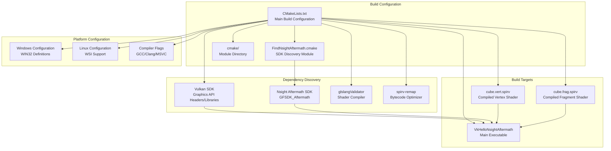
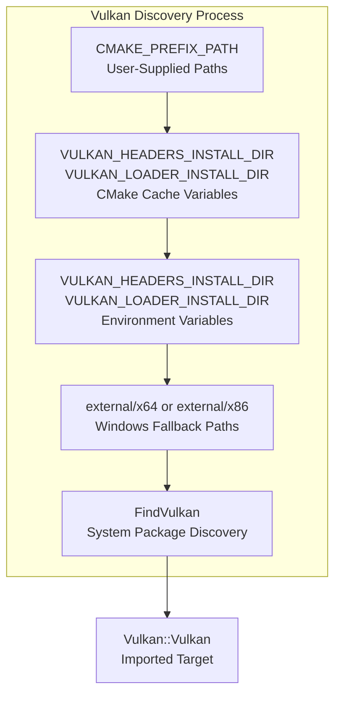
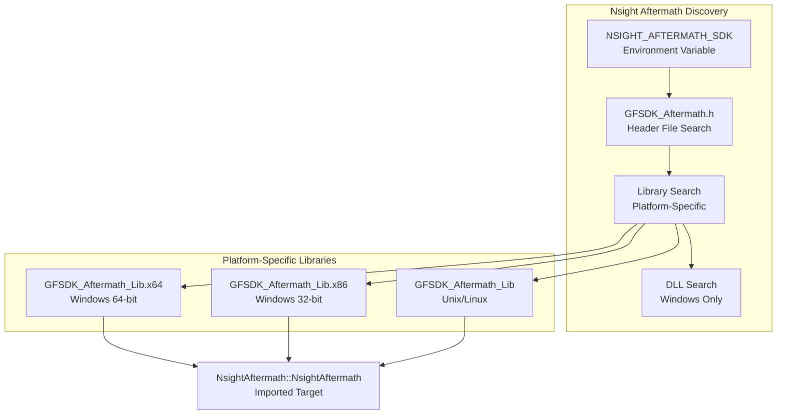
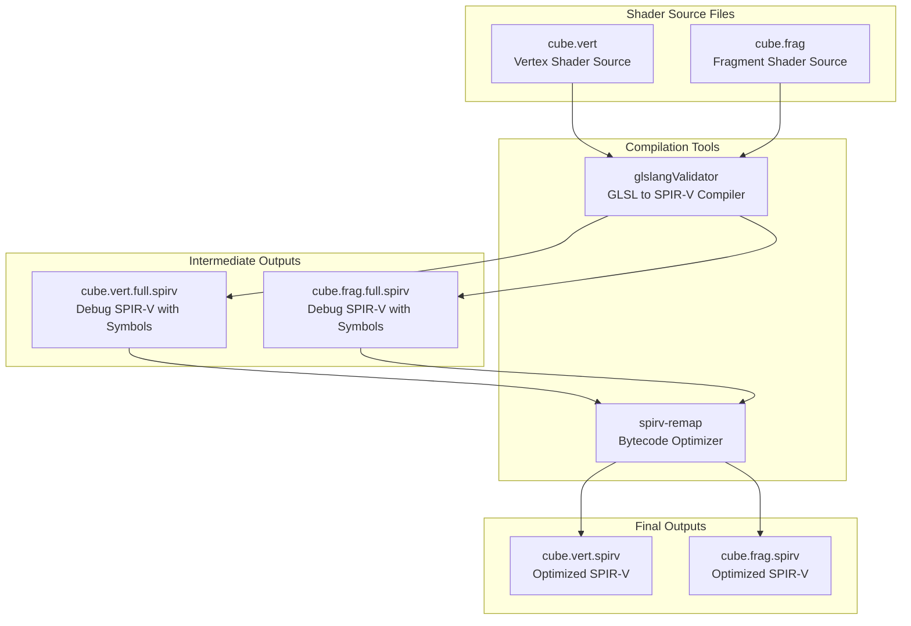

<!-- source: DeepWiki mcp.deepwiki.com · repo NVIDIA/nsight-aftermath-samples · page 3.4 Build Configuration · fetched 2026-10-26 -->

# Build Configuration

Relevant source files

The following files were used as context for generating this wiki page:

- [VkHelloNsightAftermath/CMakeLists.txt](VkHelloNsightAftermath/CMakeLists.txt)
- [VkHelloNsightAftermath/cmake/FindNsightAftermath.cmake](VkHelloNsightAftermath/cmake/FindNsightAftermath.cmake)

This document covers the CMake-based build system for the VkHelloNsightAftermath Vulkan sample application. It details how dependencies are discovered, platform-specific configurations are handled, shader compilation is managed, and the final executable target is configured and linked.

For information about the overall development environment setup, see [Development Setup](#4). For details about CMake utilities shared across the repository, see [CMake Build System](#4.1).

## Build System Overview

The VkHelloNsightAftermath sample uses a comprehensive CMake build system that handles cross-platform compilation, dependency management, and shader processing. The build configuration is centered around the main `CMakeLists.txt` file with support from custom CMake modules.

**Sources:** [VkHelloNsightAftermath/CMakeLists.txt:1-304](), [VkHelloNsightAftermath/cmake/FindNsightAftermath.cmake:1-117]()

## Dependency Management

The build system manages several critical dependencies through CMake's `find_package` mechanism and custom find modules.

### Core Dependencies

| Dependency | Discovery Method | Purpose |
|------------|------------------|---------|
| Vulkan SDK | `find_package(Vulkan)` | Graphics API headers and loader library |
| Vulkan Headers | `find_package(VulkanHeaders)` | Vulkan specification headers |
| Nsight Aftermath | `find_package(NsightAftermath)` | GPU crash debugging SDK |

### Vulkan SDK Discovery

The build system searches for Vulkan components in multiple locations using a priority-based approach:

**Sources:** [VkHelloNsightAftermath/CMakeLists.txt:54-85]()

### Nsight Aftermath SDK Discovery

The `FindNsightAftermath.cmake` module locates the SDK using the `NSIGHT_AFTERMATH_SDK` environment variable:

**Sources:** [VkHelloNsightAftermath/cmake/FindNsightAftermath.cmake:43-107]()

## Platform Configuration

The build system adapts to different platforms through conditional configuration blocks.

### Windows Configuration

Windows builds include specific definitions and security features:

- Platform definitions: `VK_USE_PLATFORM_WIN32_KHR`, `WIN32_LEAN_AND_MEAN`, `NOMINMAX`
- Control Flow Guard: Enabled for MSVC 2015+ (`/guard:cf`)
- Static MSVCRT: Replaces `/MD` with `/MT` for static linking
- DLL handling: Automatic copying of `NsightAftermath_DLL` to output directory

**Sources:** [VkHelloNsightAftermath/CMakeLists.txt:155-163](), [VkHelloNsightAftermath/CMakeLists.txt:204-225](), [VkHelloNsightAftermath/CMakeLists.txt:292-301]()

### Linux Configuration

Linux builds support multiple Window System Integration (WSI) options:

| WSI Option | Library | Platform Define |
|------------|---------|-----------------|
| XCB | `${XCB_LIBRARIES}` | `VK_USE_PLATFORM_XCB_KHR` |
| Xlib | `${X11_LIBRARIES}` | `VK_USE_PLATFORM_XLIB_KHR` |
| Wayland | `${WAYLAND_CLIENT_LIBRARIES}` | `VK_USE_PLATFORM_WAYLAND_KHR` |
| Display | None | `VK_USE_PLATFORM_DISPLAY_KHR` |

The default WSI selection is controlled by `VKHELLONSIGHTAFTERMATH_WSI_SELECTION`.

**Sources:** [VkHelloNsightAftermath/CMakeLists.txt:134-195]()

### Compiler Configuration

The build system configures compiler-specific flags:

- **GCC/Clang**: Wall warnings, C++11 standard, hidden visibility on Unix
- **MSVC**: CRT security warnings disabled, math defines enabled
- **All platforms**: No RTTI, strict aliasing disabled

**Sources:** [VkHelloNsightAftermath/CMakeLists.txt:99-114](), [VkHelloNsightAftermath/CMakeLists.txt:250-253]()

## Shader Compilation Pipeline

The build system includes a sophisticated shader compilation process that generates both debug and optimized SPIR-V bytecode.

### Shader Compilation Commands

Each shader undergoes a multi-step compilation process:

1. **Debug Compilation**: `glslangValidator -V -g` generates full SPIR-V with debug information
2. **Copy Operations**: Intermediate files copied to both target and build directories
3. **Optimization**: `spirv-remap --map all --strip-all` removes debug symbols and optimizes
4. **Final Copy**: Optimized SPIR-V copied to final locations

**Sources:** [VkHelloNsightAftermath/CMakeLists.txt:227-246]()

## Target Configuration and Linking

The `VkHelloNsightAftermath` executable target is configured with platform-specific source files and linking requirements.

### Source Files

| File Type | Files | Purpose |
|-----------|-------|---------|
| C++ Sources | `VkHelloNsightAftermath.cpp` | Main application |
| | `NsightAftermathGpuCrashTracker.cpp` | Crash tracking implementation |
| | `NsightAftermathShaderDatabase.cpp` | Shader database implementation |
| GLSL Sources | `cube.vert`, `cube.frag` | Shader source files |
| SPIR-V Outputs | `cube.vert.spirv`, `cube.frag.spirv` | Compiled shader bytecode |

### Linking Configuration

The target links against imported CMake targets:

- `Vulkan::Vulkan`: Vulkan loader and headers
- `NsightAftermath::NsightAftermath`: Nsight Aftermath SDK
- Platform libraries: `dl` on Linux for dynamic loading

### Compilation Options

The target uses specific compilation options:
- `VULKAN_HPP_DISABLE_IMPLICIT_RESULT_VALUE_CAST`: Disables implicit conversions in Vulkan-Hpp

**Sources:** [VkHelloNsightAftermath/CMakeLists.txt:260-303]()

---

