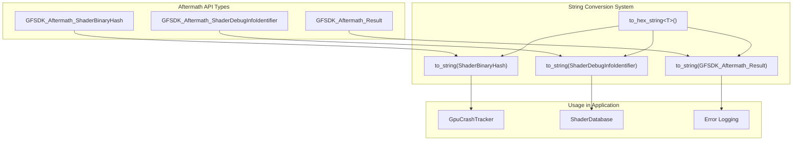
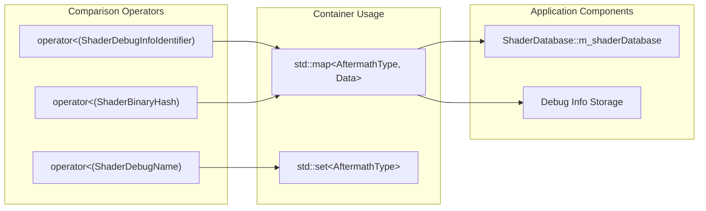
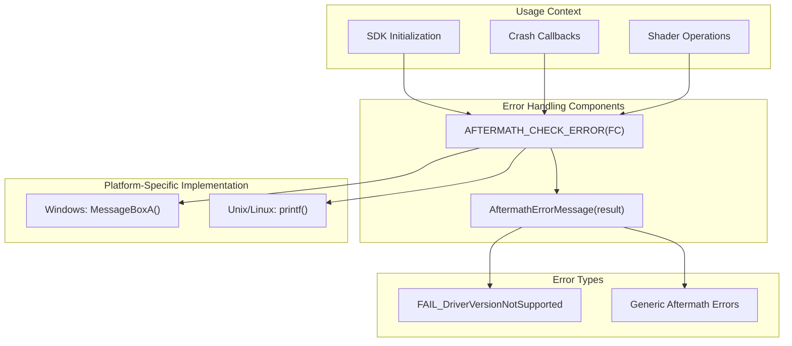
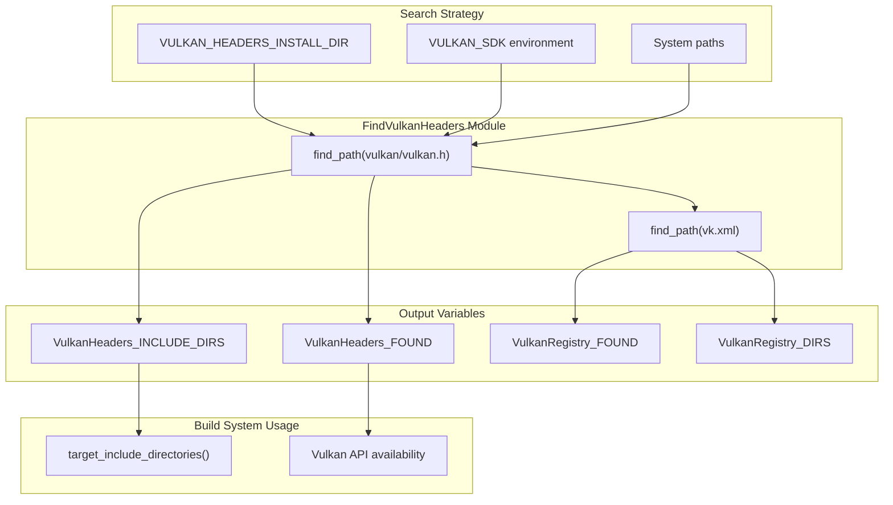
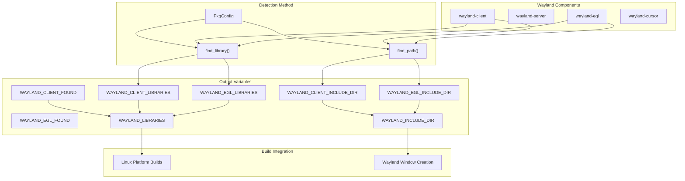
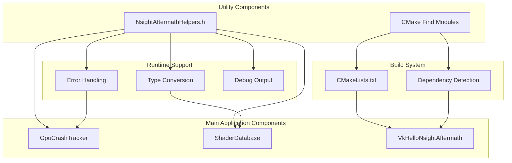

<!-- source: DeepWiki mcp.deepwiki.com · repo NVIDIA/nsight-aftermath-samples · page 3.5 Utility Components · fetched 2026-10-26 -->

# Utility Components

Relevant source files

The following files were used as context for generating this wiki page:

- [VkHelloNsightAftermath/NsightAftermathHelpers.h](VkHelloNsightAftermath/NsightAftermathHelpers.h)
- [VkHelloNsightAftermath/cmake/FindVulkanHeaders.cmake](VkHelloNsightAftermath/cmake/FindVulkanHeaders.cmake)
- [VkHelloNsightAftermath/cmake/FindWayland.cmake](VkHelloNsightAftermath/cmake/FindWayland.cmake)

This page documents the utility components that support the Vulkan sample application, including helper functions for Nsight Aftermath integration and CMake find modules for dependency management. These utilities provide common functionality used by the main application components documented in other sections.

For information about the main application architecture, see [Application Architecture](#2.1). For details about the CMake build system configuration, see [Build Configuration](#2.4).

## Nsight Aftermath Helper Utilities

The `NsightAftermathHelpers` module provides essential utility functions, macros, and operators that simplify working with Nsight Aftermath API types throughout the Vulkan sample application.

### String Conversion Utilities

The helper utilities extend the `std` namespace with specialized string conversion functions for Aftermath types:

| Function | Purpose | Return Type |
|----------|---------|-------------|
| `to_hex_string<T>()` | Converts numeric types to hexadecimal strings | `std::string` |
| `to_string(GFSDK_Aftermath_Result)` | Converts Aftermath result codes to hex strings | `std::string` |
| `to_string(GFSDK_Aftermath_ShaderDebugInfoIdentifier)` | Converts shader debug identifiers to readable strings | `std::string` |
| `to_string(GFSDK_Aftermath_ShaderBinaryHash)` | Converts shader binary hashes to hex strings | `std::string` |

**Sources:** [VkHelloNsightAftermath/NsightAftermathHelpers.h:41-65]()

### Comparison Operators

The module defines comparison operators that enable Aftermath types to be used as keys in standard containers:

**Sources:** [VkHelloNsightAftermath/NsightAftermathHelpers.h:72-91]()

### Error Handling System

The error handling utilities provide centralized error reporting and validation for Aftermath operations:

**Sources:** [VkHelloNsightAftermath/NsightAftermathHelpers.h:97-131]()

## CMake Find Modules

The Vulkan sample includes specialized CMake find modules that locate required dependencies across different platforms and installation configurations.

### FindVulkanHeaders Module

The `FindVulkanHeaders` module locates Vulkan headers and registry files independently of the Vulkan loader library:

| Variable | Purpose | Type |
|----------|---------|------|
| `VulkanHeaders_FOUND` | Indicates if Vulkan headers were found | Boolean |
| `VulkanHeaders_INCLUDE_DIRS` | Include directories for Vulkan headers | Path list |
| `VulkanRegistry_FOUND` | Indicates if Vulkan registry was found | Boolean |
| `VulkanRegistry_DIRS` | Directory containing vk.xml registry | Path |

**Sources:** [VkHelloNsightAftermath/cmake/FindVulkanHeaders.cmake:44-70]()

### FindWayland Module

The `FindWayland` module provides comprehensive Wayland windowing system detection for Linux builds:

**Sources:** [VkHelloNsightAftermath/cmake/FindWayland.cmake:21-76]()

## Integration with Application Components

The utility components integrate with the main application systems to provide essential support functionality:

**Sources:** [VkHelloNsightAftermath/NsightAftermathHelpers.h:1-132](), [VkHelloNsightAftermath/cmake/FindVulkanHeaders.cmake:1-71](), [VkHelloNsightAftermath/cmake/FindWayland.cmake:1-77]()

---

