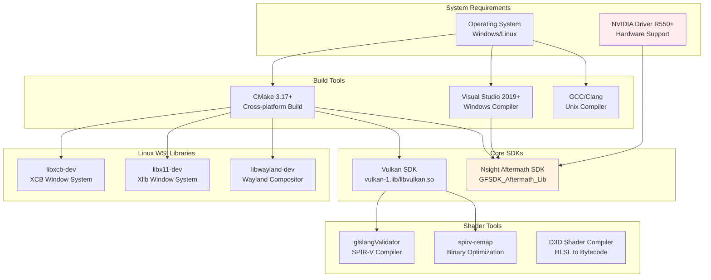
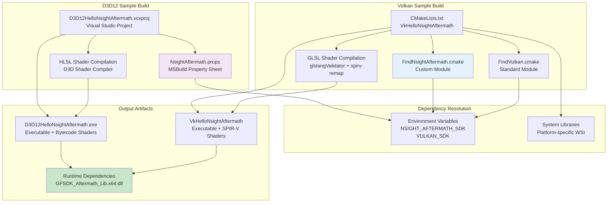

<!-- source: DeepWiki mcp.deepwiki.com · repo NVIDIA/nsight-aftermath-samples · page 4 Development Setup · fetched 2026-10-26 -->

# Development Setup

<details>
<summary>Relevant source files</summary>

The following files were used as context for generating this wiki page:

- [D3D12HelloNsightAftermath/NsightAftermath.props](D3D12HelloNsightAftermath/NsightAftermath.props)
- [VkHelloNsightAftermath/CMakeLists.txt](VkHelloNsightAftermath/CMakeLists.txt)
- [VkHelloNsightAftermath/cmake/FindNsightAftermath.cmake](VkHelloNsightAftermath/cmake/FindNsightAftermath.cmake)

</details>


This page provides a comprehensive guide for setting up the development environment to build and run the NVIDIA Nsight Aftermath samples. It covers prerequisite software, environment configuration, and build system setup for both the Vulkan and Direct3D 12 samples across supported platforms.

For information about the CMake build system implementation details, see [CMake Build System](#4.1). For Visual Studio project configuration, see [Visual Studio Integration](#4.2).

## Prerequisites and Dependencies

The Nsight Aftermath samples require several key dependencies that must be installed and configured before building.

### Core Dependencies

| Component | Version | Purpose | Required For |
|-----------|---------|---------|--------------|
| CMake | 3.17+ | Build system generator | Vulkan sample |
| Visual Studio | 2019+ | IDE and compiler | Direct3D 12 sample |
| Vulkan SDK | Latest | Graphics API headers and libraries | Vulkan sample |
| Nsight Aftermath SDK | Latest | GPU crash debugging framework | Both samples |
| NVIDIA Driver | R550+ | Hardware support | Both samples |

### Platform Support Matrix

| Platform | Vulkan Sample | D3D12 Sample | Notes |
|----------|---------------|--------------|-------|
| Windows x64 | ✅ | ✅ | Full support |
| Windows x86 | ✅ | ❌ | Vulkan only |
| Linux x64 | ✅ | ❌ | Requires WSI libraries |
| macOS | ❌ | ❌ | Not supported by Nsight Aftermath |

**Development Environment Dependencies**


Sources: [VkHelloNsightAftermath/CMakeLists.txt:22-39](), [VkHelloNsightAftermath/CMakeLists.txt:134-153]()

## Environment Setup

### Nsight Aftermath SDK Configuration

Both samples require the Nsight Aftermath SDK to be installed and accessible through environment variables or default paths.

**Environment Variable Setup:**
- Set `NSIGHT_AFTERMATH_SDK` to the SDK installation directory
- Default Windows path: `C:\NsightAftermathSDK`
- SDK must contain `include/` and `lib/` subdirectories

The `FindNsightAftermath.cmake` module locates the SDK using this search order:
1. `NSIGHT_AFTERMATH_SDK` environment variable
2. Platform-specific default paths
3. Architecture-specific library selection (x64/x86)

### Vulkan SDK Configuration

The Vulkan sample requires Vulkan headers and loader libraries with flexible configuration options:

**Configuration Variables:**
- `VULKAN_HEADERS_INSTALL_DIR` - Custom Vulkan headers path
- `VULKAN_LOADER_INSTALL_DIR` - Custom Vulkan loader path
- `CMAKE_PREFIX_PATH` - Additional search paths

**Default Resolution:**
- Uses `FindVulkan` module for standard SDK detection
- Falls back to `VULKAN_SDK` environment variable
- Windows: Uses bundled loader in `external/x64` or `external/x86`

### Shader Compilation Tools

**GLSLANG Configuration:**
- Set `GLSLANG_INSTALL_DIR` environment variable
- Auto-detection from `VULKAN_SDK/bin` directory
- Required tools: `glslangValidator`, `spirv-remap`

Sources: [VkHelloNsightAftermath/cmake/FindNsightAftermath.cmake:43-90](), [VkHelloNsightAftermath/CMakeLists.txt:64-84](), [VkHelloNsightAftermath/CMakeLists.txt:118-132]()

## Build System Architecture

The repository uses different build systems for each sample, reflecting platform-specific development practices.

**Build System Integration Flow**


Sources: [VkHelloNsightAftermath/CMakeLists.txt:24-35](), [D3D12HelloNsightAftermath/NsightAftermath.props:1-23]()

## Platform-Specific Configuration

### Windows Configuration

**Compiler Settings:**
- Static MSVCRT linking (`/MT` instead of `/MD`)
- Control flow guard enabled (`/guard:cf`)
- Windows-specific preprocessor definitions: `WIN32_LEAN_AND_MEAN`, `NOMINMAX`

**Library Handling:**
- Automatic DLL copying for Nsight Aftermath library
- Platform detection for x64/x86 library selection
- Runtime dependency management through MSBuild targets

### Linux Configuration

**Window System Interface (WSI) Support:**
The Vulkan sample supports multiple WSI backends on Linux:

| WSI Backend | Library | CMake Option | Preprocessor Define |
|-------------|---------|--------------|-------------------|
| XCB | libxcb | `BUILD_WSI_XCB_SUPPORT` | `VK_USE_PLATFORM_XCB_KHR` |
| Xlib | libX11 | `BUILD_WSI_XLIB_SUPPORT` | `VK_USE_PLATFORM_XLIB_KHR` |
| Wayland | libwayland-client | `BUILD_WSI_WAYLAND_SUPPORT` | `VK_USE_PLATFORM_WAYLAND_KHR` |
| Display | Direct-to-display | N/A | `VK_USE_PLATFORM_DISPLAY_KHR` |

**Compiler Configuration:**
- GCC/Clang with strict warnings (`-Wall -Wextra`)
- Hidden symbol visibility (`-fvisibility=hidden`)
- C++11 standard with disabled RTTI (`-fno-rtti`)

### Shader Compilation Pipeline

**GLSL to SPIR-V (Vulkan):**
1. `glslangValidator -V -g` - Compile with debug info to `.full.spirv`
2. `spirv-remap --map all --strip-all` - Optimize and strip debug info to `.spirv`
3. Copy both versions to build and binary directories

**HLSL to Bytecode (D3D12):**
- Handled by Visual Studio's built-in D3D shader compiler
- Integrated into MSBuild pipeline

Sources: [VkHelloNsightAftermath/CMakeLists.txt:156-199](), [VkHelloNsightAftermath/CMakeLists.txt:227-246](), [D3D12HelloNsightAftermath/NsightAftermath.props:17-22]()

## Dependency Resolution Process

**CMake Dependency Resolution Workflow**
```mermaid
sequenceDiagram
    participant CMake as "CMake Build System"
    participant FindVulkan as "FindVulkan Module" 
    participant FindAftermath as "FindNsightAftermath Module"
    participant EnvVars as "Environment Variables"
    participant FileSystem as "File System"
    participant Target as "VkHelloNsightAftermath Target"
    
    Note over CMake,Target: Dependency Discovery Phase
    CMake->>FindVulkan: find_package(Vulkan)
    FindVulkan->>EnvVars: Check VULKAN_SDK
    FindVulkan->>FileSystem: Search for vulkan-1.lib
    FindVulkan-->>CMake: Vulkan::Vulkan target
    
    CMake->>FindAftermath: find_package(NsightAftermath)
    FindAftermath->>EnvVars: Check NSIGHT_AFTERMATH_SDK
    FindAftermath->>FileSystem: Search for GFSDK_Aftermath.h
    FindAftermath->>FileSystem: Search for GFSDK_Aftermath_Lib.x64
    FindAftermath-->>CMake: NsightAftermath::NsightAftermath target
    
    Note over CMake,Target: Target Configuration Phase
    CMake->>Target: add_executable(VkHelloNsightAftermath)
    CMake->>Target: target_link_libraries(Vulkan::Vulkan)
    CMake->>Target: target_link_libraries(NsightAftermath::NsightAftermath)
    
    Note over CMake,Target: Platform-Specific Linking
    alt Windows
        CMake->>Target: Link vulkan-1.lib
        CMake->>Target: Copy GFSDK_Aftermath_Lib.x64.dll
    else Linux
        CMake->>Target: Link libvulkan.so
        CMake->>Target: Link WSI libraries (XCB/X11/Wayland)
        CMake->>Target: Link libdl
    end
    
    style FindAftermath fill:#e3f2fd
    style EnvVars fill:#fff3e0
```

The dependency resolution follows these key principles:

**Search Priority:**
1. User-specified paths (`CMAKE_PREFIX_PATH`, cache variables)
2. Environment variables (`NSIGHT_AFTERMATH_SDK`, `VULKAN_SDK`)
3. Platform-specific default locations
4. System package managers (Linux)

**Error Handling:**
- Clear error messages for missing dependencies
- Environment variable validation in find modules
- Platform compatibility checks (Apple exclusion)

**Target Creation:**
- Modern CMake imported targets (`Vulkan::Vulkan`, `NsightAftermath::NsightAftermath`)
- Interface include directories and link libraries
- Transitive dependency propagation

Sources: [VkHelloNsightAftermath/cmake/FindNsightAftermath.cmake:95-116](), [VkHelloNsightAftermath/CMakeLists.txt:89-96](), [VkHelloNsightAftermath/CMakeLists.txt:270-301]()

---

