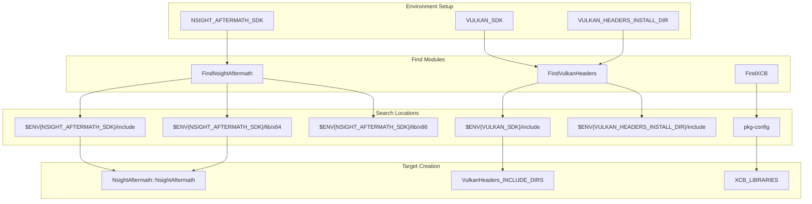
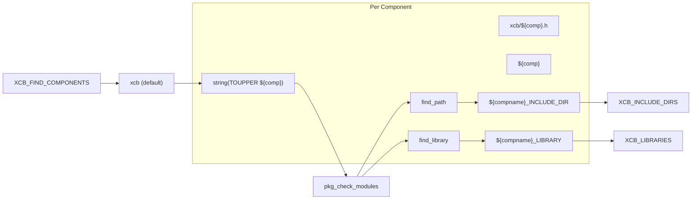

<!-- source: DeepWiki mcp.deepwiki.com · repo NVIDIA/nsight-aftermath-samples · page 4.1 CMake Build System · fetched 2026-10-26 -->

# CMake Build System

<details>
<summary>Relevant source files</summary>

The following files were used as context for generating this wiki page:

- [VkHelloNsightAftermath/cmake/FindNsightAftermath.cmake](VkHelloNsightAftermath/cmake/FindNsightAftermath.cmake)
- [VkHelloNsightAftermath/cmake/FindVulkanHeaders.cmake](VkHelloNsightAftermath/cmake/FindVulkanHeaders.cmake)
- [VkHelloNsightAftermath/cmake/FindXCB.cmake](VkHelloNsightAftermath/cmake/FindXCB.cmake)

</details>


This document covers the CMake build system used primarily by the Vulkan sample (`VkHelloNsightAftermath`) in the NVIDIA Nsight Aftermath samples repository. The CMake configuration provides cross-platform build support and manages complex dependencies including the Nsight Aftermath SDK, Vulkan SDK, and platform-specific windowing libraries. 

For information about the Visual Studio build system used by the Direct3D 12 sample, see [Visual Studio Integration](#4.2).

## Build System Architecture

The CMake build system is structured around a main configuration that delegates dependency discovery to specialized find modules. The system handles platform detection, architecture-specific library selection, and environment variable-based SDK discovery.

CMake Build Flow
```mermaid
graph TD
    MainCMake["`CMakeLists.txt`"]
    FindModules["`cmake/` Directory"]
    FindNsight["`FindNsightAftermath.cmake`"]
    FindVulkan["`FindVulkanHeaders.cmake`"]
    FindXCB["`FindXCB.cmake`"]
    
    EnvVars["`Environment Variables`"]
    NSIGHT_SDK["`NSIGHT_AFTERMATH_SDK`"]
    VULKAN_SDK["`VULKAN_SDK`"]
    VULKAN_HEADERS["`VULKAN_HEADERS_INSTALL_DIR`"]
    
    Targets["`Build Targets`"]
    NsightTarget["`NsightAftermath::NsightAftermath`"]
    VulkanApp["`VkHelloNsightAftermath`"]
    
    MainCMake --> FindModules
    FindModules --> FindNsight
    FindModules --> FindVulkan
    FindModules --> FindXCB
    
    EnvVars --> NSIGHT_SDK
    EnvVars --> VULKAN_SDK
    EnvVars --> VULKAN_HEADERS
    
    NSIGHT_SDK --> FindNsight
    VULKAN_SDK --> FindVulkan
    VULKAN_HEADERS --> FindVulkan
    
    FindNsight --> NsightTarget
    FindVulkan --> Targets
    FindXCB --> Targets
    
    NsightTarget --> VulkanApp
    Targets --> VulkanApp
```

Sources: [VkHelloNsightAftermath/cmake/FindNsightAftermath.cmake:1-117](), [VkHelloNsightAftermath/cmake/FindVulkanHeaders.cmake:1-71](), [VkHelloNsightAftermath/cmake/FindXCB.cmake:1-52]()

## Dependency Management System

The CMake system manages three primary categories of dependencies: graphics APIs, debugging frameworks, and windowing systems. Each dependency is handled by a specialized find module that creates standardized CMake targets.

Dependency Resolution Architecture


Sources: [VkHelloNsightAftermath/cmake/FindNsightAftermath.cmake:44-90](), [VkHelloNsightAftermath/cmake/FindVulkanHeaders.cmake:44-56](), [VkHelloNsightAftermath/cmake/FindXCB.cmake:24-36]()

## Nsight Aftermath SDK Integration

The `FindNsightAftermath.cmake` module implements comprehensive SDK discovery and target creation for the NVIDIA Nsight Aftermath debugging framework. It handles platform-specific library naming conventions and architecture detection.

### Architecture-Specific Library Resolution

The module uses `CMAKE_SIZEOF_VOID_P` to determine the target architecture and selects the appropriate library variant:

| Architecture | Library Name | Windows DLL |
|-------------|-------------|-------------|
| 64-bit | `GFSDK_Aftermath_Lib.x64` | `GFSDK_Aftermath_Lib.x64.dll` |
| 32-bit | `GFSDK_Aftermath_Lib.x86` | `GFSDK_Aftermath_Lib.x86.dll` |

The module searches for the header `GFSDK_Aftermath.h` in `$ENV{NSIGHT_AFTERMATH_SDK}/include` and creates an imported target `NsightAftermath::NsightAftermath` with the appropriate interface properties.

### Error Handling and Diagnostics

The find module includes comprehensive error reporting when the SDK is not found, checking both the existence and validity of the `NSIGHT_AFTERMATH_SDK` environment variable:

```cmake
if(NOT NsightAftermath_FOUND)
    if(DEFINED ENV{NSIGHT_AFTERMATH_SDK})
        message("NSIGHT_AFTERMATH_SDK environment variable not set to a valid location")
    else()
        message("NSIGHT_AFTERMATH_SDK environment variable not set")
    endif()
endif()
```

Sources: [VkHelloNsightAftermath/cmake/FindNsightAftermath.cmake:50-80](), [VkHelloNsightAftermath/cmake/FindNsightAftermath.cmake:102-107](), [VkHelloNsightAftermath/cmake/FindNsightAftermath.cmake:109-115]()

## Vulkan Headers Discovery

The `FindVulkanHeaders.cmake` module locates Vulkan API headers and the Vulkan registry XML file. It supports multiple installation scenarios through environment variable hints.

### Search Strategy

The module implements a prioritized search strategy using CMake's `HINTS` parameter to check locations in order of preference:

1. `VULKAN_HEADERS_INSTALL_DIR` - Explicit headers installation directory
2. `VULKAN_SDK` - Standard Vulkan SDK installation

The module searches for `vulkan/vulkan.h` and uses the found header location to derive the registry path by looking for `vk.xml` in the expected relative location `share/vulkan/registry`.

### Registry Discovery

The Vulkan registry discovery uses path manipulation to locate the XML specification:

```cmake
if(VulkanHeaders_INCLUDE_DIR)
   get_filename_component(VULKAN_REGISTRY_PATH_HINT ${VulkanHeaders_INCLUDE_DIR} DIRECTORY)
   find_path(VulkanRegistry_DIR
       NAMES vk.xml
       HINTS "${VULKAN_REGISTRY_PATH_HINT}/share/vulkan/registry")
endif()
```

Sources: [VkHelloNsightAftermath/cmake/FindVulkanHeaders.cmake:44-49](), [VkHelloNsightAftermath/cmake/FindVulkanHeaders.cmake:51-56]()

## XCB Windowing System Support

The `FindXCB.cmake` module provides Linux windowing support through the X11 XCB library system. It implements a component-based discovery system that can locate multiple XCB libraries simultaneously.

XCB Component Resolution Flow


The module transforms component names by converting hyphens to underscores for variable names and strips the `xcb-` prefix for header paths, allowing flexible component specification while maintaining consistent naming conventions.

Sources: [VkHelloNsightAftermath/cmake/FindXCB.cmake:7-9](), [VkHelloNsightAftermath/cmake/FindXCB.cmake:15-23](), [VkHelloNsightAftermath/cmake/FindXCB.cmake:43-44]()

## Platform-Specific Configuration

The CMake build system handles platform differences through conditional compilation paths and platform-specific dependency management.

### Windows vs Unix Architecture Detection

The `FindNsightAftermath.cmake` module uses platform detection to handle different library naming and location conventions:

- **Windows/Unix Path**: Uses environment variable-based paths with architecture-specific subdirectories
- **Other Platforms**: Falls back to generic library naming without architecture subdirectories

### Architecture-Specific Library Selection

The system uses `CMAKE_SIZEOF_VOID_P` to detect pointer size and select appropriate library variants:

- `CMAKE_SIZEOF_VOID_P EQUAL 8`: Selects x64 libraries
- `CMAKE_SIZEOF_VOID_P EQUAL 4`: Selects x86 libraries

On Windows platforms, the system additionally locates the corresponding DLL files for runtime deployment.

Sources: [VkHelloNsightAftermath/cmake/FindNsightAftermath.cmake:43-90](), [VkHelloNsightAftermath/cmake/FindNsightAftermath.cmake:50-80]()

## Build Integration Workflow

The CMake system integrates with the development workflow by providing standardized targets and variables that the main application CMakeLists.txt can consume reliably across different development environments.

CMake Target Integration
```mermaid
graph TD
    subgraph "Find Phase"
        FindModules["`find_package()` calls"]
        ModuleSearch["`Custom Find Modules`"]
        EnvValidation["`Environment Validation`"]
    end
    
    subgraph "Target Creation"
        ImportedTargets["`IMPORTED Targets`"]
        NsightTarget["`NsightAftermath::NsightAftermath`"]
        Variables["`Result Variables`"]
        IncludeDirs["`*_INCLUDE_DIRS`"]
        Libraries["`*_LIBRARIES`"]
    end
    
    subgraph "Application Build"
        MainApp["`VkHelloNsightAftermath`"]
        LinkLibs["`target_link_libraries()`"]
        IncludePath["`target_include_directories()`"]
    end
    
    FindModules --> ModuleSearch
    ModuleSearch --> EnvValidation
    EnvValidation --> ImportedTargets
    
    ImportedTargets --> NsightTarget
    ImportedTargets --> Variables
    Variables --> IncludeDirs
    Variables --> Libraries
    
    NsightTarget --> LinkLibs
    IncludeDirs --> IncludePath
    LinkLibs --> MainApp
    IncludePath --> MainApp
```

The find modules provide both modern CMake targets (prefixed with `::`) and traditional variables for maximum compatibility. This dual approach allows the build system to work with different CMake versions and coding styles while maintaining a consistent interface.

Sources: [VkHelloNsightAftermath/cmake/FindNsightAftermath.cmake:102-107](), [VkHelloNsightAftermath/cmake/FindVulkanHeaders.cmake:58-59](), [VkHelloNsightAftermath/cmake/FindXCB.cmake:12-14]()

---

