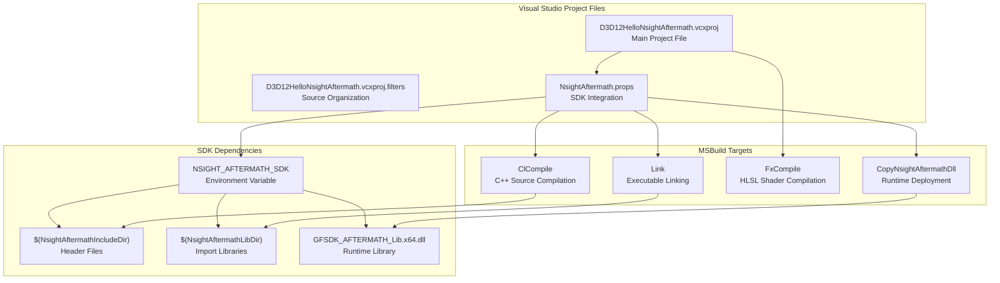
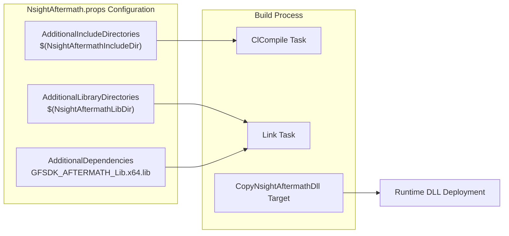
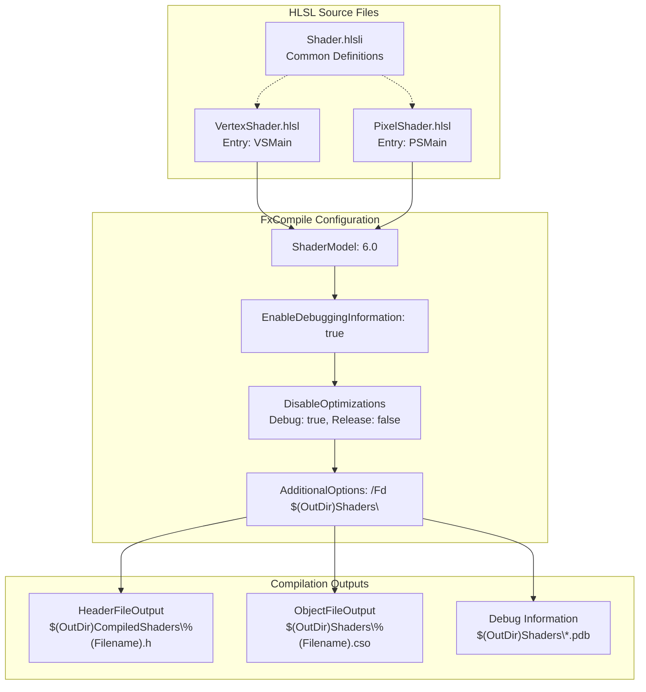

<!-- source: DeepWiki mcp.deepwiki.com · repo NVIDIA/nsight-aftermath-samples · page 4.2 Visual Studio Integration · fetched 2026-10-26 -->

# Visual Studio Integration

Relevant source files

The following files were used as context for generating this wiki page:

- [D3D12HelloNsightAftermath/D3D12HelloNsightAftermath.vcxproj](D3D12HelloNsightAftermath/D3D12HelloNsightAftermath.vcxproj)
- [D3D12HelloNsightAftermath/D3D12HelloNsightAftermath.vcxproj.filters](D3D12HelloNsightAftermath/D3D12HelloNsightAftermath.vcxproj.filters)
- [D3D12HelloNsightAftermath/NsightAftermath.props](D3D12HelloNsightAftermath/NsightAftermath.props)

This document covers the Visual Studio project configuration and MSBuild integration for the Direct3D 12 sample application in the NVIDIA Nsight Aftermath Samples repository. The Visual Studio integration provides a Windows-specific build environment with automated SDK dependency management, shader compilation, and runtime deployment.

For information about the cross-platform CMake build system used by the Vulkan sample, see [CMake Build System](#4.1). For details about the Direct3D 12 sample application itself, see [Direct3D 12 Sample (D3D12HelloNsightAftermath)](#3).

## Project Structure Overview

The Visual Studio integration centers around the `D3D12HelloNsightAftermath.vcxproj` project file and a custom MSBuild property sheet `NsightAftermath.props` that manages Nsight Aftermath SDK integration.

**Sources:** [D3D12HelloNsightAftermath/D3D12HelloNsightAftermath.vcxproj:1-165](), [D3D12HelloNsightAftermath/NsightAftermath.props:1-24](), [D3D12HelloNsightAftermath/D3D12HelloNsightAftermath.vcxproj.filters:1-83]()

## MSBuild Property Sheet Integration

The `NsightAftermath.props` file encapsulates all SDK-specific configuration, making the integration reusable across projects. The property sheet defines SDK paths, include directories, and library dependencies.

### SDK Path Configuration

The property sheet establishes the SDK root directory through the `NSIGHT_AFTERMATH_SDK` environment variable with a default fallback location:

| Property | Default Value | Usage |
|----------|---------------|-------|
| `NSIGHT_AFTERMATH_SDK` | `C:\NsightAftermathSDK` | Root SDK directory |
| `NsightAftermathIncludeDir` | `$(NSIGHT_AFTERMATH_SDK)\include` | Header file location |
| `NsightAftermathLibDir` | `$(NSIGHT_AFTERMATH_SDK)\lib\x64` | Import library location |

### Compiler and Linker Integration

The property sheet automatically configures compiler include paths and linker dependencies:

### Runtime DLL Deployment

The property sheet includes a custom MSBuild target `CopyNsightAftermathDll` that automatically copies the required runtime DLL to the output directory during the post-build phase.

**Sources:** [D3D12HelloNsightAftermath/NsightAftermath.props:3-7](), [D3D12HelloNsightAftermath/NsightAftermath.props:8-16](), [D3D12HelloNsightAftermath/NsightAftermath.props:17-23](), [D3D12HelloNsightAftermath/D3D12HelloNsightAftermath.vcxproj:43]()

## Project Configuration Details

### Platform and Toolset Configuration

The project is configured exclusively for x64 architecture with Visual Studio 2022 toolset:

| Configuration | Platform | Toolset | Target Platform |
|---------------|----------|---------|-----------------|
| Debug | x64 | v143 | Windows 10.0 |
| Release | x64 | v143 | Windows 10.0 |

### Build Output Configuration

Build outputs are organized in a structured directory hierarchy under the project root:

| Artifact Type | Debug Location | Release Location |
|---------------|----------------|------------------|
| Executable | `bin/x64/Debug/` | `bin/x64/Release/` |
| Object Files | `obj/x64/Debug/` | `obj/x64/Release/` |
| Shader Headers | `bin/x64/Debug/CompiledShaders/` | `bin/x64/Release/CompiledShaders/` |
| Shader Objects | `bin/x64/Debug/Shaders/` | `bin/x64/Release/Shaders/` |

### Preprocessor Definitions

The project defines several preprocessor macros for build configuration:

- `SHADERS_DIR="$(OutDir)Shaders"` - Runtime shader directory path
- Configuration-specific macros (`_DEBUG`, `NDEBUG`)
- Platform macros (`WIN32`, `_WINDOWS`)

**Sources:** [D3D12HelloNsightAftermath/D3D12HelloNsightAftermath.vcxproj:21-33](), [D3D12HelloNsightAftermath/D3D12HelloNsightAftermath.vcxproj:45-54](), [D3D12HelloNsightAftermath/D3D12HelloNsightAftermath.vcxproj:60](), [D3D12HelloNsightAftermath/D3D12HelloNsightAftermath.vcxproj:90]()

## HLSL Shader Compilation Configuration

The project includes sophisticated HLSL shader compilation configuration that generates both header files for embedding and compiled shader objects for runtime loading.

### Shader Compilation Pipeline

### Shader Build Configuration

The `FxCompile` item definition group configures shader compilation with the following settings:

| Property | Value | Purpose |
|----------|-------|---------|
| `ShaderModel` | `6.0` | HLSL Shader Model version |
| `VariableName` | `g_%(Filename)` | C++ variable name for embedded bytecode |
| `HeaderFileOutput` | `$(OutDir)CompiledShaders\%(Filename).h` | Header file generation |
| `ObjectFileOutput` | `$(OutDir)Shaders\%(Filename).cso` | Compiled shader object |
| `AdditionalOptions` | `/Fd $(OutDir)Shaders\` | Debug information output |
| `EnableDebuggingInformation` | `true` | Generate debug symbols |

**Sources:** [D3D12HelloNsightAftermath/D3D12HelloNsightAftermath.vcxproj:112-123](), [D3D12HelloNsightAftermath/D3D12HelloNsightAftermath.vcxproj:147-161]()

## Source File Organization

The Visual Studio project organizes source files using a filter-based structure that groups related components:

### Filter Structure

| Filter | Contents | Purpose |
|--------|----------|---------|
| Header Files | All `.h` files | C++ header declarations |
| Source Files | All `.cpp` files | C++ implementation |
| Assets\Shaders | `.hlsl` and `.hlsli` files | HLSL shader source |

### Key Source Components

The project includes the following primary source files:

- **Application Framework:** `D3D12HelloNsightAftermath.cpp`, `DXSample.cpp`, `Win32Application.cpp`
- **Nsight Aftermath Integration:** `NsightAftermathGpuCrashTracker.cpp`, `NsightAftermathShaderDatabase.cpp`
- **Utility Components:** `NsightAftermathHelpers.h`, `DXSampleHelper.h`
- **Precompiled Headers:** `stdafx.cpp`, `stdafx.h`

**Sources:** [D3D12HelloNsightAftermath/D3D12HelloNsightAftermath.vcxproj:124-146](), [D3D12HelloNsightAftermath/D3D12HelloNsightAftermath.vcxproj.filters:3-16](), [D3D12HelloNsightAftermath/D3D12HelloNsightAftermath.vcxproj.filters:17-82]()

## Dependencies and Linking Configuration

The project configures several system library dependencies required for Direct3D 12 and Windows development:

### System Library Dependencies

| Library | Purpose |
|---------|---------|
| `d3d12.lib` | Direct3D 12 API |
| `dxgi.lib` | DirectX Graphics Infrastructure |
| `d3dcompiler.lib` | Runtime shader compilation |

### Delay-Loaded Libraries

The project uses delay loading for `d3d12.dll` to improve startup performance and handle systems without Direct3D 12 support gracefully.

**Sources:** [D3D12HelloNsightAftermath/D3D12HelloNsightAftermath.vcxproj:68-70](), [D3D12HelloNsightAftermath/D3D12HelloNsightAftermath.vcxproj:100-102]()

---

