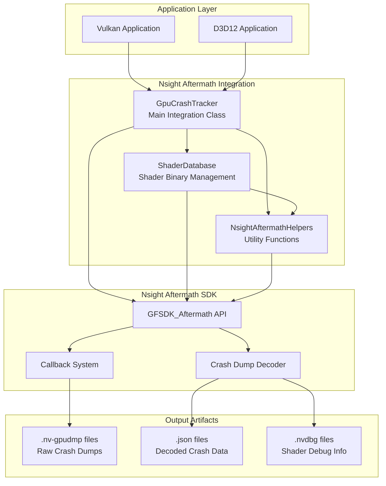
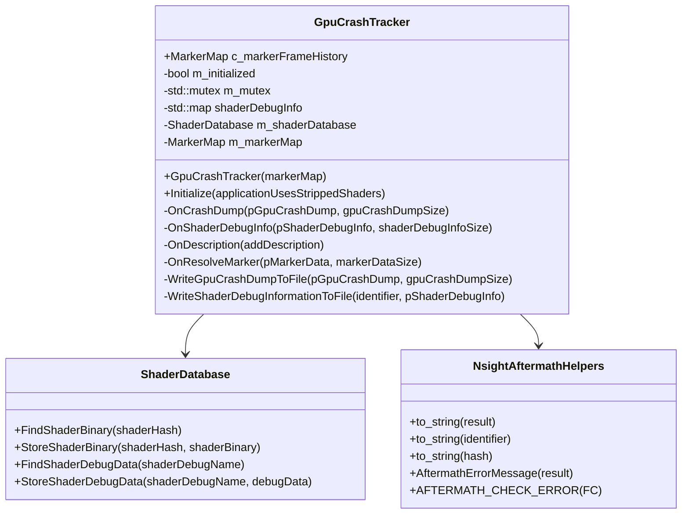
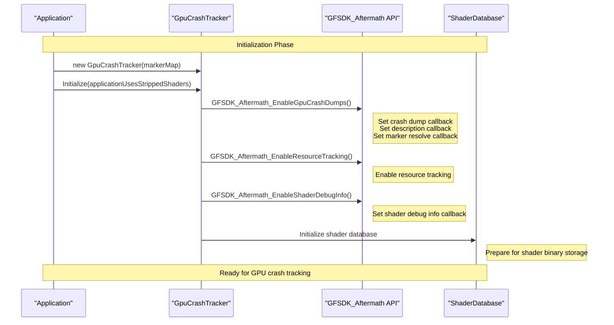
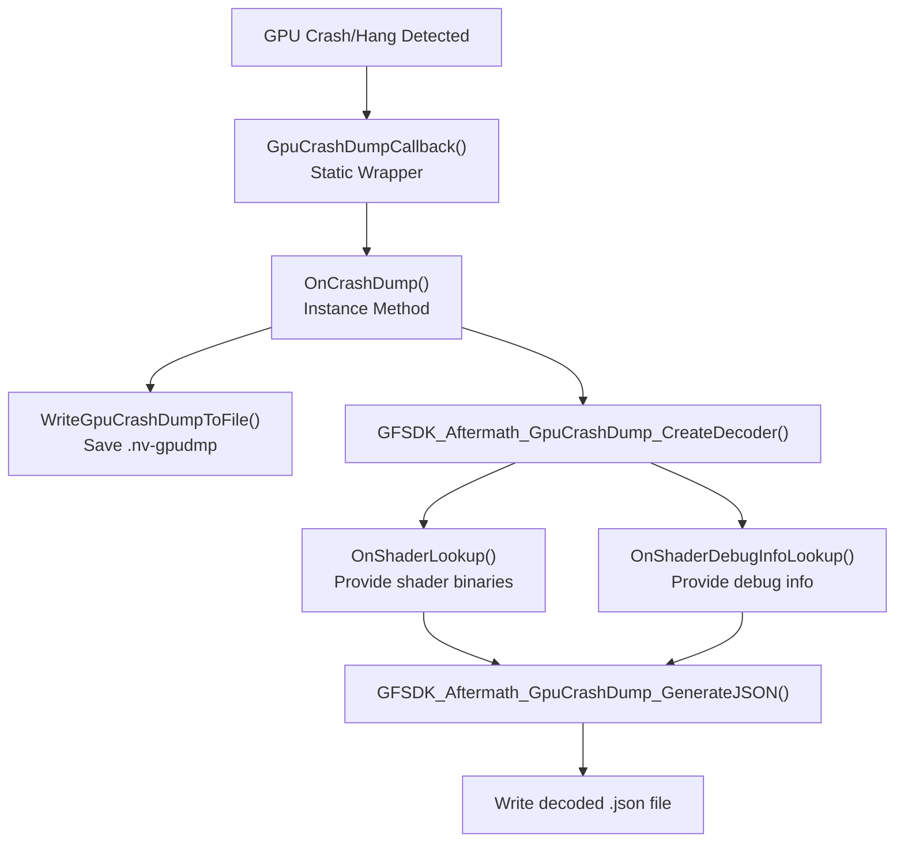
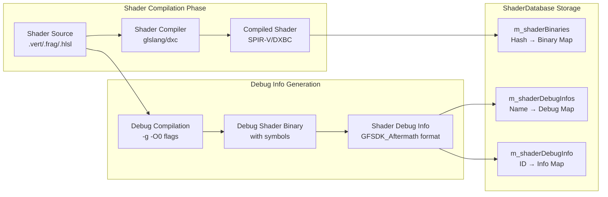

<!-- source: DeepWiki mcp.deepwiki.com · repo NVIDIA/nsight-aftermath-samples · page 5 Nsight Aftermath Integration Guide · fetched 2026-10-26 -->

# Nsight Aftermath Integration Guide

<details>
<summary>Relevant source files</summary>

The following files were used as context for generating this wiki page:

- [D3D12HelloNsightAftermath/NsightAftermathGpuCrashTracker.h](D3D12HelloNsightAftermath/NsightAftermathGpuCrashTracker.h)
- [VkHelloNsightAftermath/NsightAftermathGpuCrashTracker.h](VkHelloNsightAftermath/NsightAftermathGpuCrashTracker.h)
- [VkHelloNsightAftermath/NsightAftermathHelpers.h](VkHelloNsightAftermath/NsightAftermathHelpers.h)

</details>


## Purpose and Scope

This guide provides comprehensive documentation for integrating NVIDIA Nsight Aftermath GPU crash debugging capabilities into graphics applications. It uses the sample implementations in this repository as reference implementations, covering both Vulkan and Direct3D 12 integration patterns.

This document focuses on the practical implementation details of the `GpuCrashTracker` class, `ShaderDatabase` system, and supporting utilities. For detailed documentation of specific sample applications, see [Vulkan Sample](#2) and [Direct3D 12 Sample](#3). For development environment setup, see [Development Setup](#4).

## Integration Architecture Overview

The Nsight Aftermath integration follows a consistent architecture across both graphics APIs, built around three core components that work together to provide comprehensive GPU crash debugging capabilities.

### Core Integration Components



Sources: [VkHelloNsightAftermath/NsightAftermathGpuCrashTracker.h:37-166](), [D3D12HelloNsightAftermath/NsightAftermathGpuCrashTracker.h:37-167]()

## Core Component Breakdown

### GpuCrashTracker Class Structure

The `GpuCrashTracker` class serves as the primary integration point for Nsight Aftermath functionality. Both Vulkan and D3D12 implementations share the same interface and callback architecture.



Sources: [VkHelloNsightAftermath/NsightAftermathGpuCrashTracker.h:37-166](), [D3D12HelloNsightAftermath/NsightAftermathGpuCrashTracker.h:37-167]()

### Callback System Architecture

The integration relies on a comprehensive callback system that handles different aspects of GPU crash debugging:

| Callback Type | Static Wrapper | Instance Handler | Purpose |
|---------------|----------------|------------------|----------|
| GPU Crash Dump | `GpuCrashDumpCallback` | `OnCrashDump` | Receives raw crash dump data |
| Shader Debug Info | `ShaderDebugInfoCallback` | `OnShaderDebugInfo` | Receives shader debug information |
| Crash Description | `CrashDumpDescriptionCallback` | `OnDescription` | Adds contextual information |
| Marker Resolution | `ResolveMarkerCallback` | `OnResolveMarker` | Resolves debug markers |
| Shader Lookup | `ShaderLookupCallback` | `OnShaderLookup` | Provides shader binaries for decoding |
| Debug Info Lookup | `ShaderDebugInfoLookupCallback` | `OnShaderDebugInfoLookup` | Provides debug info for decoding |
| Source Debug Lookup | `ShaderSourceDebugInfoLookupCallback` | `OnShaderSourceDebugInfoLookup` | Provides source debug information |

Sources: [VkHelloNsightAftermath/NsightAftermathGpuCrashTracker.h:105-146](), [D3D12HelloNsightAftermath/NsightAftermathGpuCrashTracker.h:105-147]()

## Initialization Process

### API Initialization Sequence



### Key Initialization Functions

The initialization process involves several critical API calls that must be made in the correct order:

1. **`GFSDK_Aftermath_EnableGpuCrashDumps`** - Enables crash dump generation with callbacks
2. **`GFSDK_Aftermath_EnableResourceTracking`** - Enables resource tracking for detailed crash analysis  
3. **`GFSDK_Aftermath_EnableShaderDebugInfo`** - Enables shader debug information collection

Sources: [VkHelloNsightAftermath/NsightAftermathGpuCrashTracker.h:48](), [D3D12HelloNsightAftermath/NsightAftermathGpuCrashTracker.h:48]()

## Callback System Implementation

### Crash Dump Processing Workflow



### Callback Registration Pattern

Each callback follows the same registration pattern where static wrapper functions forward to instance methods:

```cpp
// Static wrapper registered with Aftermath API
static void GpuCrashDumpCallback(
    const void* pGpuCrashDump,
    const uint32_t gpuCrashDumpSize,
    void* pUserData)

// Instance method that performs actual processing  
void OnCrashDump(const void* pGpuCrashDump, const uint32_t gpuCrashDumpSize)
```

This pattern is used consistently across all callback types in both Vulkan and D3D12 implementations.

Sources: [VkHelloNsightAftermath/NsightAftermathGpuCrashTracker.h:56-66](), [VkHelloNsightAftermath/NsightAftermathGpuCrashTracker.h:106-128]()

## Shader Database Integration

### Shader Binary Management

The `ShaderDatabase` component manages shader binaries and debug information required for crash dump decoding:



### Debug Information Flow

During crash dump decoding, the shader database provides the necessary binary data through lookup callbacks:

1. **`OnShaderLookup`** - Called with `GFSDK_Aftermath_ShaderBinaryHash` to retrieve shader binary
2. **`OnShaderDebugInfoLookup`** - Called with `GFSDK_Aftermath_ShaderDebugInfoIdentifier` for debug info  
3. **`OnShaderSourceDebugInfoLookup`** - Called with `GFSDK_Aftermath_ShaderDebugName` for source debug data

Sources: [VkHelloNsightAftermath/NsightAftermathGpuCrashTracker.h:86-99](), [VkHelloNsightAftermath/NsightAftermathGpuCrashTracker.h:162]()

## Utility Functions and Error Handling

### NsightAftermathHelpers Utilities

The `NsightAftermathHelpers` module provides essential utility functions for Aftermath integration:

| Function Category | Functions | Purpose |
|------------------|-----------|---------|
| String Conversion | `to_string(GFSDK_Aftermath_Result)` | Convert API results to strings |
| | `to_string(GFSDK_Aftermath_ShaderDebugInfoIdentifier)` | Convert identifiers to hex strings |
| | `to_string(GFSDK_Aftermath_ShaderBinaryHash)` | Convert hashes to hex strings |
| Comparison Operators | `operator<(ShaderDebugInfoIdentifier)` | Enable map-based storage |
| | `operator<(ShaderBinaryHash)` | Enable hash-based indexing |
| | `operator<(ShaderDebugName)` | Enable name-based lookup |
| Error Handling | `AftermathErrorMessage(result)` | Human-readable error messages |
| | `AFTERMATH_CHECK_ERROR(FC)` | Error checking macro |

### Error Checking Pattern

The `AFTERMATH_CHECK_ERROR` macro provides consistent error handling across platforms:

```cpp
#ifdef _WIN32
#define AFTERMATH_CHECK_ERROR(FC) \
    // Shows MessageBox on Windows
#else  
#define AFTERMATH_CHECK_ERROR(FC) \
    // Prints to console on other platforms
#endif
```

This macro should wrap all Aftermath API calls to ensure proper error handling and user feedback.

Sources: [VkHelloNsightAftermath/NsightAftermathHelpers.h:41-131]()

## Integration Checklist

### Required Implementation Steps

1. **Initialize Aftermath API**
   - Call `GFSDK_Aftermath_EnableGpuCrashDumps` with callbacks
   - Call `GFSDK_Aftermath_EnableResourceTracking` 
   - Call `GFSDK_Aftermath_EnableShaderDebugInfo` with callback

2. **Implement Core Classes**
   - Create `GpuCrashTracker` class with callback handlers
   - Implement `ShaderDatabase` for binary management
   - Include `NsightAftermathHelpers` utilities

3. **Set Up Callback System**
   - Implement all required static callback wrappers
   - Implement corresponding instance handler methods
   - Ensure thread-safe access with mutex protection

4. **Manage Shader Data**
   - Store shader binaries with hash-based indexing
   - Generate and store shader debug information
   - Implement lookup callbacks for crash dump decoding

5. **Handle File Output**
   - Write raw `.nv-gpudmp` crash dump files
   - Generate decoded `.json` crash analysis files  
   - Save `.nvdbg` shader debug information files

### API Integration Points

For graphics API-specific integration:

- **Vulkan**: Insert debug markers using `vkCmdDebugMarkerInsertEXT`
- **D3D12**: Insert debug markers using command list annotation APIs
- **Both APIs**: Collect shader binaries during pipeline creation
- **Both APIs**: Generate debug info during shader compilation

Sources: [VkHelloNsightAftermath/NsightAftermathGpuCrashTracker.h:37-166](), [D3D12HelloNsightAftermath/NsightAftermathGpuCrashTracker.h:37-167]()