# Page: Overview

# Overview

<details>
<summary>Relevant source files</summary>

The following files were used as context for generating this wiki page:

- [D3D12HelloNsightAftermath/README.md](D3D12HelloNsightAftermath/README.md)
- [VkHelloNsightAftermath/README.md](VkHelloNsightAftermath/README.md)
- [VkHelloNsightAftermath/VkHelloNsightAftermath.cpp](VkHelloNsightAftermath/VkHelloNsightAftermath.cpp)

</details>


This document provides a comprehensive overview of the NVIDIA Nsight Aftermath Samples repository, which serves as a collection of reference implementations demonstrating GPU crash debugging capabilities for graphics applications. The repository contains two primary sample applications that showcase how to integrate the Nsight Aftermath SDK for automatic GPU crash dump collection, decoding, and analysis in both Vulkan and Direct3D 12 rendering pipelines.

The samples are designed as educational tools that intentionally trigger GPU crashes to demonstrate the complete debugging workflow, from crash detection through data collection to offline analysis. For detailed implementation specifics of individual samples, see [Vulkan Sample](#2) and [Direct3D 12 Sample](#3). For development environment setup, see [Development Setup](#4).

## Repository Architecture

The repository follows a dual-sample architecture with shared utility components, designed to demonstrate Nsight Aftermath integration across multiple graphics APIs while maintaining code reuse.

```mermaid
graph TB
    subgraph "VkHelloNsightAftermath Sample"
        VkMain[VkHelloNsightAftermath.cpp<br/>"Main Vulkan Application"]
        VkCrash[GpuCrashTracker<br/>"Vulkan Implementation"]  
        VkShader[ShaderDatabase<br/>"Vulkan Implementation"]
        VkCMake[CMakeLists.txt<br/>"Cross-platform Build"]
    end
    
    subgraph "D3D12HelloNsightAftermath Sample"
        D3DMain[D3D12HelloNsightAftermath.cpp<br/>"Main D3D12 Application"]
        D3DCrash[GpuCrashTracker<br/>"D3D12 Implementation"]
        D3DShader[ShaderDatabase<br/>"D3D12 Implementation"] 
        D3DProj[D3D12HelloNsightAftermath.vcxproj<br/>"Visual Studio Project"]
    end
    
    subgraph "Shared Components"
        Helpers[NsightAftermathHelpers.h<br/>"Common Utilities"]
        AftermathSDK[GFSDK_Aftermath<br/>"NVIDIA SDK"]
    end
    
    VkMain --> VkCrash
    VkMain --> VkShader
    VkCrash --> Helpers
    VkShader --> Helpers
    
    D3DMain --> D3DCrash
    D3DMain --> D3DShader
    D3DCrash --> Helpers
    D3DShader --> Helpers
    
    Helpers --> AftermathSDK
    
    VkCMake --> VkMain
    D3DProj --> D3DMain
```

*Sources: [VkHelloNsightAftermath/VkHelloNsightAftermath.cpp:1-429](), [VkHelloNsightAftermath/README.md:25-40](), [D3D12HelloNsightAftermath/README.md:13-28]()*

## Core Integration Components

The Nsight Aftermath integration revolves around three primary component types that work together to provide comprehensive GPU crash debugging capabilities.

```mermaid
graph TD
    subgraph "Application Integration Layer"
        MainApp[Application<br/>"VkHelloNsightAftermath::Demo<br/>D3D12HelloNsightAftermath"]
        CompileFlag[USE_NSIGHT_AFTERMATH<br/>"Conditional Compilation"]
    end
    
    subgraph "Crash Management System"  
        CrashTracker[GpuCrashTracker<br/>"gpuCrashTracker"]
        MarkerMap[MarkerMap<br/>"markerMap"]
        FrameNumber[frameNumber<br/>"Frame Tracking"]
    end
    
    subgraph "Shader Debug System"
        ShaderDB[ShaderDatabase<br/>"Shader Binary Management"]
        DebugInfo[Debug Information<br/>".nvdbg Files"]
        BinaryData[Shader Binaries<br/>"SPIR-V/DXIL"]
    end
    
    subgraph "Aftermath SDK Interface"
        AftermathAPI[GFSDK_Aftermath<br/>"Core API"]
        Callbacks[Crash Callbacks<br/>"Async Event Handling"]
        Checkpoints[Device Checkpoints<br/>"setCheckpointNV"]
    end
    
    MainApp --> CompileFlag
    CompileFlag --> CrashTracker
    CompileFlag --> ShaderDB
    
    CrashTracker --> MarkerMap
    CrashTracker --> FrameNumber
    CrashTracker --> AftermathAPI
    
    ShaderDB --> DebugInfo
    ShaderDB --> BinaryData
    ShaderDB --> AftermathAPI
    
    AftermathAPI --> Callbacks
    AftermathAPI --> Checkpoints
    
    MainApp --> Checkpoints
```

*Sources: [VkHelloNsightAftermath/VkHelloNsightAftermath.cpp:49-59](), [VkHelloNsightAftermath/VkHelloNsightAftermath.cpp:423-428](), [VkHelloNsightAftermath/VkHelloNsightAftermath.cpp:972-1006]()*

## Conditional Compilation System

Both samples use a consistent conditional compilation approach to allow Nsight Aftermath features to be easily enabled or disabled during development.

| Compilation Flag | Purpose | Implementation |
|------------------|---------|----------------|
| `USE_NSIGHT_AFTERMATH` | Master enable/disable | Defined as `1` in main source files |
| Header Guards | Selective inclusion | Wraps Aftermath-specific headers |
| Feature Blocks | Code isolation | Guards crash tracking and debugging code |

The conditional compilation system ensures that Nsight Aftermath integration can be cleanly removed from release builds while maintaining full functionality during development and testing phases.

*Sources: [VkHelloNsightAftermath/VkHelloNsightAftermath.cpp:50](), [VkHelloNsightAftermath/VkHelloNsightAftermath.cpp:52-59](), [VkHelloNsightAftermath/README.md:31-33]()*

## GPU Crash Debugging Workflow

The samples implement a complete GPU crash debugging pipeline that demonstrates the typical workflow from crash detection to analysis.

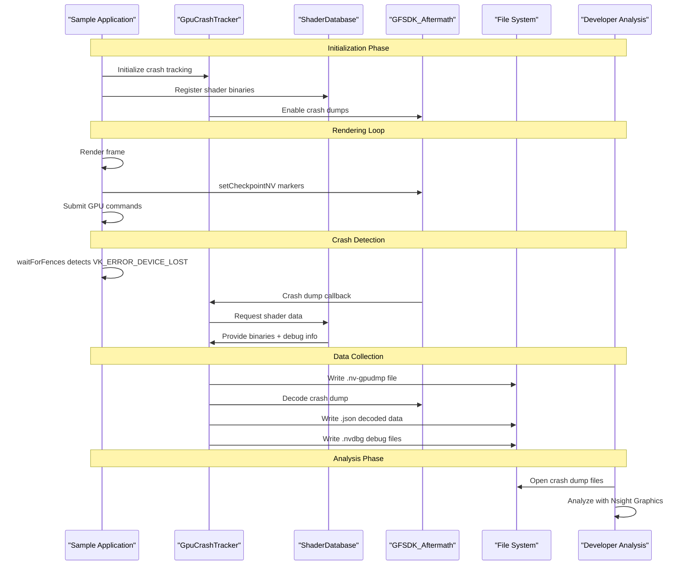

*Sources: [VkHelloNsightAftermath/VkHelloNsightAftermath.cpp:814-848](), [VkHelloNsightAftermath/README.md:78-87](), [D3D12HelloNsightAftermath/README.md:45-55]()*

## Platform and API Support

The repository demonstrates cross-platform and multi-API support through its dual-sample architecture:

### Vulkan Sample Support
- **Platforms**: Windows, Linux
- **Build System**: CMake with cross-platform configuration
- **Graphics API**: Vulkan 1.2.135+ required
- **Extensions**: `VK_NV_device_diagnostic_checkpoints`, `VK_NV_device_diagnostics_config`

### Direct3D 12 Sample Support  
- **Platforms**: Windows only
- **Build System**: Visual Studio projects with MSBuild
- **Graphics API**: Direct3D 12
- **Requirements**: Windows SDK 10.0.22621.755+

Both samples require NVIDIA GPUs (vendor ID `0x10DE`) and NVIDIA R550+ display drivers to function properly.

*Sources: [VkHelloNsightAftermath/README.md:6-24](), [D3D12HelloNsightAftermath/README.md:6-11](), [VkHelloNsightAftermath/VkHelloNsightAftermath.cpp:1395-1412]()*

## Educational Design Philosophy

The samples are explicitly designed as educational tools rather than production-ready applications. Key educational aspects include:

- **Intentional GPU Crashes**: Both samples deliberately trigger GPU hangs/TDRs to demonstrate crash detection
- **Comprehensive Comments**: Code includes detailed explanations of Aftermath integration points  
- **Offline Analysis Demonstration**: Shows complete pipeline from crash to analysis
- **Reference Implementation**: Provides template for integrating Aftermath into real applications

The samples serve as both learning resources for developers new to GPU debugging and reference implementations for integrating Nsight Aftermath into production graphics applications.

*Sources: [VkHelloNsightAftermath/README.md:41-45](), [D3D12HelloNsightAftermath/README.md:29-33](), [VkHelloNsightAftermath/README.md:78-87]()*

---

# Page: Repository Structure

# Repository Structure

<details>
<summary>Relevant source files</summary>

The following files were used as context for generating this wiki page:

- [D3D12HelloNsightAftermath/D3D12HelloNsightAftermath.vcxproj](D3D12HelloNsightAftermath/D3D12HelloNsightAftermath.vcxproj)
- [D3D12HelloNsightAftermath/D3D12HelloNsightAftermath.vcxproj.filters](D3D12HelloNsightAftermath/D3D12HelloNsightAftermath.vcxproj.filters)
- [VkHelloNsightAftermath/CMakeLists.txt](VkHelloNsightAftermath/CMakeLists.txt)
- [VkHelloNsightAftermath/NsightAftermathGpuCrashTracker.h](VkHelloNsightAftermath/NsightAftermathGpuCrashTracker.h)

</details>


This document outlines the organization and structure of the NVIDIA Nsight Aftermath Samples repository, detailing how the two main sample applications are organized and what components they share. For information about specific build configurations and dependencies, see [Build Configuration](#2.4) and [Build Configuration](#3.4).

## Repository Overview

The repository is organized around two primary sample applications that demonstrate Nsight Aftermath GPU crash debugging integration for different graphics APIs. Each sample maintains its own directory structure while sharing common utility components.

### Top-Level Directory Structure

```mermaid
graph TD
    Root["nsight-aftermath-samples/"]
    VkDir["VkHelloNsightAftermath/"]
    D3DDir["D3D12HelloNsightAftermath/"]
    
    Root --> VkDir
    Root --> D3DDir
    
    subgraph "Vulkan Sample Directory"
        VkCMake["CMakeLists.txt"]
        VkMain["VkHelloNsightAftermath.cpp"]
        VkTracker["NsightAftermathGpuCrashTracker.cpp"]
        VkShaderDB["NsightAftermathShaderDatabase.cpp"]
        VkHelpers["NsightAftermathHelpers.h"]
        VkShaders["cube.vert / cube.frag"]
        VkCMakeDir["cmake/"]
    end
    
    subgraph "D3D12 Sample Directory"
        D3DProj["D3D12HelloNsightAftermath.vcxproj"]
        D3DMain["D3D12HelloNsightAftermath.cpp"]
        D3DTracker["NsightAftermathGpuCrashTracker.cpp"]
        D3DShaderDB["NsightAftermathShaderDatabase.cpp"]
        D3DHelpers["NsightAftermathHelpers.h"]
        D3DShaders["VertexShader.hlsl / PixelShader.hlsl"]
        D3DProps["NsightAftermath.props"]
    end
    
    VkDir --> VkCMake
    VkDir --> VkMain
    VkDir --> VkTracker
    VkDir --> VkShaderDB
    VkDir --> VkHelpers
    VkDir --> VkShaders
    VkDir --> VkCMakeDir
    
    D3DDir --> D3DProj
    D3DDir --> D3DMain
    D3DDir --> D3DTracker
    D3DDir --> D3DShaderDB
    D3DDir --> D3DHelpers
    D3DDir --> D3DShaders
    D3DDir --> D3DProps
```

*Sources: [VkHelloNsightAftermath/CMakeLists.txt:1-304](), [D3D12HelloNsightAftermath/D3D12HelloNsightAftermath.vcxproj:1-165]()*

## Vulkan Sample Structure

The `VkHelloNsightAftermath` directory contains the primary Vulkan-based sample with CMake build configuration and cross-platform support.

### Component Organization

| Component Type | Files | Purpose |
|---|---|---|
| **Application Entry Point** | `VkHelloNsightAftermath.cpp` | Main Vulkan application logic |
| **Crash Tracking** | `NsightAftermathGpuCrashTracker.cpp/.h` | GPU crash detection and dump handling |
| **Shader Management** | `NsightAftermathShaderDatabase.cpp/.h` | Shader binary and debug info storage |
| **Utilities** | `NsightAftermathHelpers.h` | Common helper functions and macros |
| **Shaders** | `cube.vert`, `cube.frag` | GLSL vertex and fragment shaders |
| **Build System** | `CMakeLists.txt`, `cmake/` | Cross-platform build configuration |

### Build Artifacts and Dependencies

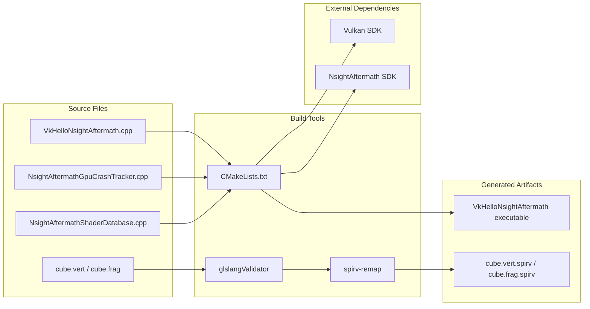

*Sources: [VkHelloNsightAftermath/CMakeLists.txt:227-246](), [VkHelloNsightAftermath/CMakeLists.txt:262-304]()*

## Direct3D 12 Sample Structure

The `D3D12HelloNsightAftermath` directory contains the Direct3D 12 sample with Visual Studio project configuration for Windows development.

### Component Organization

| Component Type | Files | Purpose |
|---|---|---|
| **Application Entry Point** | `D3D12HelloNsightAftermath.cpp`, `Main.cpp` | Main D3D12 application and entry point |
| **Crash Tracking** | `NsightAftermathGpuCrashTracker.cpp/.h` | GPU crash detection and dump handling |
| **Shader Management** | `NsightAftermathShaderDatabase.cpp/.h` | Shader binary and debug info storage |
| **Utilities** | `NsightAftermathHelpers.h` | Common helper functions and macros |
| **Framework** | `DXSample.cpp/.h`, `Win32Application.cpp/.h` | D3D12 application framework |
| **Shaders** | `VertexShader.hlsl`, `PixelShader.hlsl` | HLSL shaders |
| **Build System** | `D3D12HelloNsightAftermath.vcxproj`, `NsightAftermath.props` | Visual Studio project configuration |

### Visual Studio Project Structure

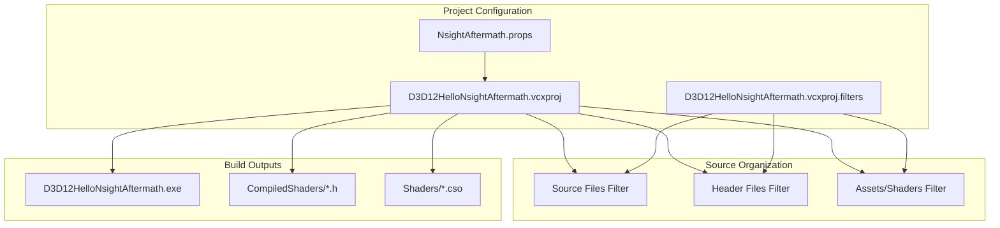

*Sources: [D3D12HelloNsightAftermath/D3D12HelloNsightAftermath.vcxproj:1-165](), [D3D12HelloNsightAftermath/D3D12HelloNsightAftermath.vcxproj.filters:1-83]()*

## Shared Component Architecture

Both samples share core Nsight Aftermath integration components with API-specific implementations where necessary.

### Core Class Relationships

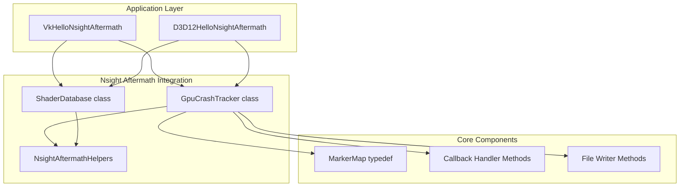

### GpuCrashTracker Component Structure

The `GpuCrashTracker` class provides the core crash detection and handling functionality shared between both samples.

| Member Category | Components | Purpose |
|---|---|---|
| **Static Callbacks** | `GpuCrashDumpCallback`, `ShaderDebugInfoCallback` | Interface with Aftermath SDK callbacks |
| **Instance Handlers** | `OnCrashDump`, `OnShaderDebugInfo`, `OnDescription` | Process crash dump events |
| **File Operations** | `WriteGpuCrashDumpToFile`, `WriteShaderDebugInformationToFile` | Persist crash data |
| **Lookup Handlers** | `OnShaderDebugInfoLookup`, `OnShaderLookup` | Resolve shader information during decoding |
| **State Management** | `m_shaderDebugInfo`, `m_shaderDatabase`, `m_markerMap` | Track crash-related data |

*Sources: [VkHelloNsightAftermath/NsightAftermathGpuCrashTracker.h:37-166]()*

## Build System Differences

### CMake vs Visual Studio Configuration

| Aspect | Vulkan Sample (CMake) | D3D12 Sample (Visual Studio) |
|---|---|---|
| **Build File** | `CMakeLists.txt` | `D3D12HelloNsightAftermath.vcxproj` |
| **Platform Support** | Cross-platform (Windows, Linux) | Windows-only |
| **Shader Compilation** | `glslangValidator` + `spirv-remap` | FxCompile (D3D shader compiler) |
| **Dependency Management** | `find_package()` commands | Property sheets and explicit paths |
| **Output Directory** | CMake standard directories | `bin/$(Platform)/$(Configuration)/` |

*Sources: [VkHelloNsightAftermath/CMakeLists.txt:227-246](), [D3D12HelloNsightAftermath/D3D12HelloNsightAftermath.vcxproj:112-123]()*

---

# Page: Vulkan Sample (VkHelloNsightAftermath)

# Vulkan Sample (VkHelloNsightAftermath)

<details>
<summary>Relevant source files</summary>

The following files were used as context for generating this wiki page:

- [VkHelloNsightAftermath/README.md](VkHelloNsightAftermath/README.md)
- [VkHelloNsightAftermath/VkHelloNsightAftermath.cpp](VkHelloNsightAftermath/VkHelloNsightAftermath.cpp)

</details>


## Purpose and Scope

This document covers the primary Vulkan-based demonstration sample in the NVIDIA Nsight Aftermath repository. The `VkHelloNsightAftermath` application serves as a comprehensive reference implementation showing how to integrate NVIDIA Nsight Aftermath GPU crash debugging capabilities into a Vulkan graphics application. The sample intentionally triggers GPU crashes to demonstrate the complete crash dump collection and analysis workflow.

For information about the Direct3D 12 equivalent sample, see [Direct3D 12 Sample](#3). For general development setup instructions, see [Development Setup](#4).

## Application Architecture Overview

The `VkHelloNsightAftermath` sample is built around a monolithic `Demo` class that encapsulates all Vulkan operations, platform-specific windowing, and Nsight Aftermath integration. The application follows a traditional Vulkan rendering architecture with added instrumentation for crash dump generation.

**Core Application Structure**

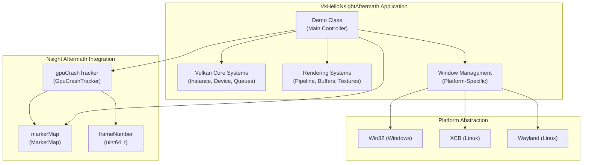

Sources: [VkHelloNsightAftermath/VkHelloNsightAftermath.cpp:237-429]()

**Demo Class Core Components**

The `Demo` class contains all essential Vulkan objects and Nsight Aftermath integration components:

| Component Category | Key Members | Purpose |
|-------------------|-------------|---------|
| Vulkan Core | `inst`, `gpu`, `device`, `graphics_queue` | Core Vulkan objects |
| Rendering | `swapchain`, `render_pass`, `pipeline` | Graphics pipeline |
| Resources | `uniform_data`, `textures[]`, `depth` | Rendering resources |
| Synchronization | `fences[]`, `*_semaphores[]` | Frame synchronization |
| Aftermath Integration | `gpuCrashTracker`, `markerMap`, `frameNumber` | Crash debugging |

Sources: [VkHelloNsightAftermath/VkHelloNsightAftermath.cpp:325-428]()

## Nsight Aftermath Integration Points

The application demonstrates several key integration points where Nsight Aftermath functionality is woven into the standard Vulkan workflow.

**Device Creation with Aftermath Features**

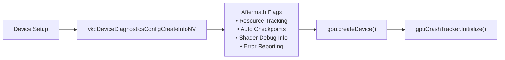

Sources: [VkHelloNsightAftermath/VkHelloNsightAftermath.cpp:747-800]()

The application enables comprehensive Aftermath features during device creation:
- **Resource Tracking**: Captures resource information for GPU page fault analysis
- **Automatic Checkpoints**: Automatically captures call stacks for draw/dispatch operations  
- **Shader Debug Info**: Generates debug information for all shaders
- **Error Reporting**: Enables enhanced error reporting capabilities

**Checkpoint Marker System**

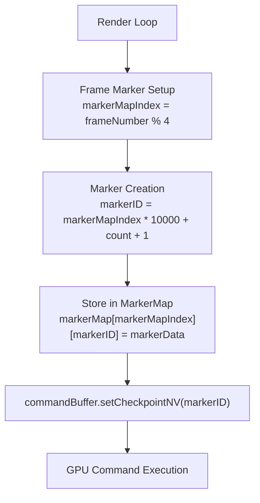

Sources: [VkHelloNsightAftermath/VkHelloNsightAftermath.cpp:972-1007]()

The marker system provides a rolling buffer of debug information across the last 4 frames, enabling precise crash location identification.

## Rendering Pipeline and Crash Demonstration

The application implements a standard Vulkan rendering pipeline that renders a textured cube with intentional crash triggering for demonstration purposes.

**Core Rendering Flow**

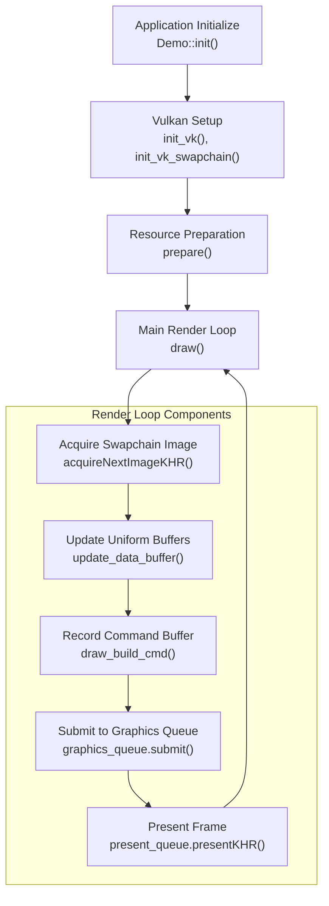

Sources: [VkHelloNsightAftermath/VkHelloNsightAftermath.cpp:809-943](), [VkHelloNsightAftermath/VkHelloNsightAftermath.cpp:945-1040]()

**GPU Crash Handling Mechanism**

The application includes sophisticated error handling for intentionally triggered GPU crashes:

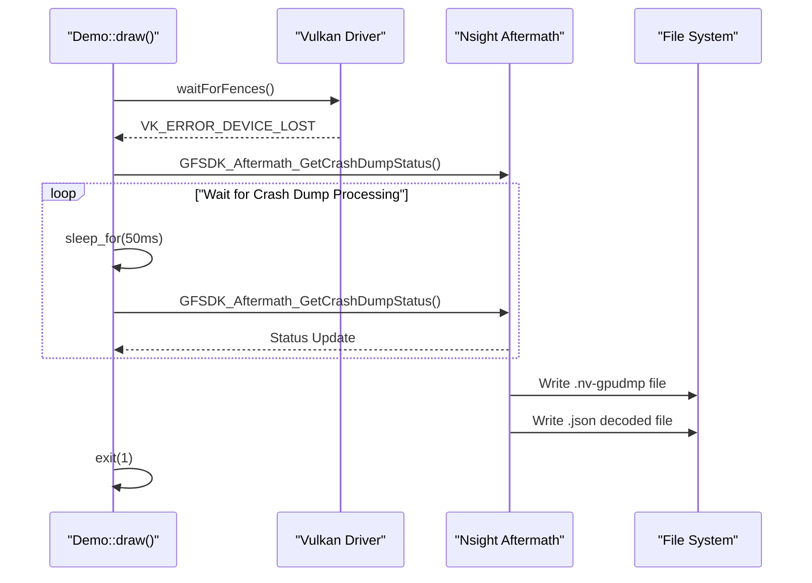

Sources: [VkHelloNsightAftermath/VkHelloNsightAftermath.cpp:814-848]()

## Resource Management and Shader Handling

The application demonstrates proper resource lifecycle management and shader binary handling for Aftermath integration.

**Shader Loading System**

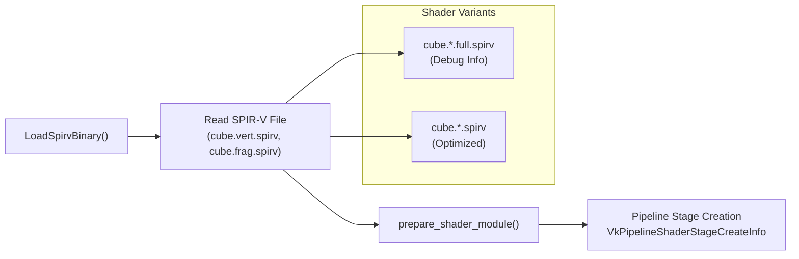

Sources: [VkHelloNsightAftermath/VkHelloNsightAftermath.cpp:544-554](), [VkHelloNsightAftermath/VkHelloNsightAftermath.cpp:2101-2107]()

The application supports both full debug shaders and stripped optimized shaders, controlled by the `use_stripped_shaders` flag.

**Memory and Resource Management**

| Resource Type | Management Strategy | Cleanup Location |
|---------------|-------------------|------------------|
| Swapchain Images | Per-frame resources in `SwapchainImageResources` | `Demo::cleanup()` |
| Uniform Buffers | Per-swapchain-image allocation | `Demo::prepare_cube_data_buffers()` |
| Textures | Static allocation with staging buffers | `Demo::destroy_texture()` |
| Command Pools | Graphics and present queue pools | `Demo::cleanup()` |

Sources: [VkHelloNsightAftermath/VkHelloNsightAftermath.cpp:663-737](), [VkHelloNsightAftermath/VkHelloNsightAftermath.cpp:1904-1961]()

## Platform Integration and Window Management

The application provides comprehensive cross-platform support through conditional compilation and platform-specific windowing code.

**Platform Support Matrix**

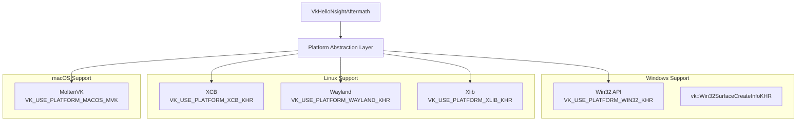

Sources: [VkHelloNsightAftermath/VkHelloNsightAftermath.cpp:276-295](), [VkHelloNsightAftermath/VkHelloNsightAftermath.cpp:1500-1550]()

The application uses preprocessor directives to conditionally compile platform-specific windowing code, ensuring broad compatibility while maintaining clean separation of platform concerns.

---

# Page: Application Architecture

# Application Architecture

<details>
<summary>Relevant source files</summary>

The following files were used as context for generating this wiki page:

- [VkHelloNsightAftermath/VkHelloNsightAftermath.cpp](VkHelloNsightAftermath/VkHelloNsightAftermath.cpp)

</details>


This document describes the architectural design of the VkHelloNsightAftermath Vulkan sample application, focusing on how NVIDIA Nsight Aftermath GPU crash debugging capabilities are integrated into a standard Vulkan rendering pipeline. The application demonstrates real-world integration patterns for crash tracking, shader debug information management, and GPU state capture.

For information about the specific crash tracking implementation, see [GPU Crash Tracking System](#2.2). For shader-specific debugging integration, see [Shader Database System](#2.3).

## Core Application Structure

The application is built around a single `Demo` class that encapsulates all Vulkan operations and Nsight Aftermath integration. This monolithic design simplifies the demonstration of how Aftermath components integrate with existing Vulkan code.

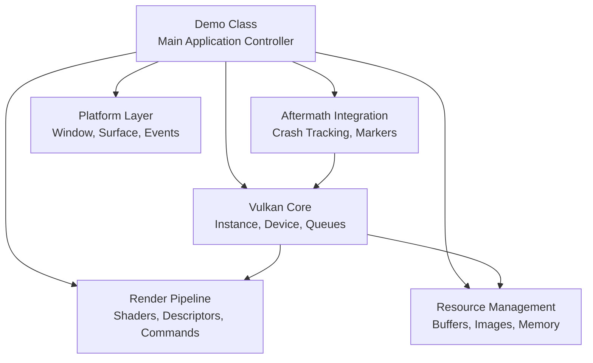

Sources: [VkHelloNsightAftermath/VkHelloNsightAftermath.cpp:237-429]()

## Nsight Aftermath Integration Points

The application integrates Nsight Aftermath at several critical points in the Vulkan pipeline to enable comprehensive GPU crash debugging.

### Device Creation with Diagnostics

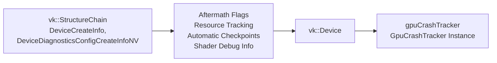

The device creation process is enhanced with Aftermath-specific configuration to enable crash dump collection and additional debugging information.

Sources: [VkHelloNsightAftermath/VkHelloNsightAftermath.cpp:747-800]()

### Checkpoint Marker System

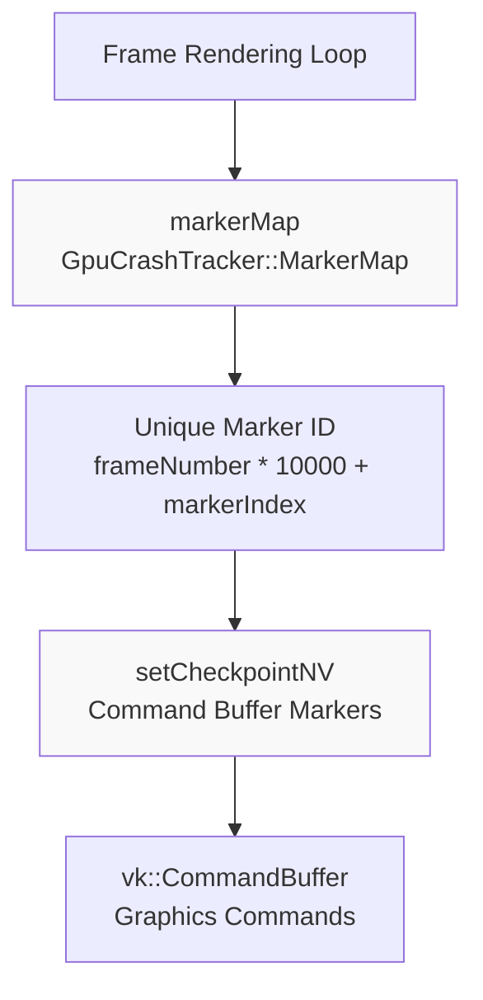

The marker system provides a way to correlate GPU crashes with specific rendering operations by inserting checkpoints into command buffers.

Sources: [VkHelloNsightAftermath/VkHelloNsightAftermath.cpp:972-1007]()

## Device Loss Handling Architecture

The application implements sophisticated device loss detection and recovery that works with Nsight Aftermath's asynchronous crash dump generation.

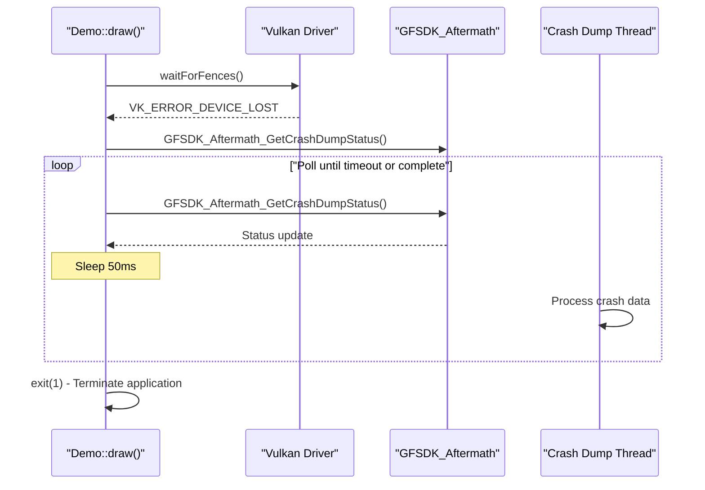

The device loss handling includes a timeout mechanism to allow Aftermath's background thread time to collect and process crash dump data before application termination.

Sources: [VkHelloNsightAftermath/VkHelloNsightAftermath.cpp:814-848]()

## Class Member Organization

The `Demo` class organizes its members into logical groups that separate Vulkan core functionality from Aftermath-specific features.

| Component Category | Key Members | Purpose |
|------------------|-------------|---------|
| **Vulkan Core** | `inst`, `device`, `gpu`, `graphics_queue` | Basic Vulkan objects |
| **Rendering** | `pipeline`, `render_pass`, `swapchain` | Graphics pipeline setup |
| **Resources** | `textures[]`, `uniform_data`, `depth` | Rendering resources |
| **Synchronization** | `fences[]`, `image_acquired_semaphores[]` | Frame synchronization |
| **Aftermath Integration** | `gpuCrashTracker`, `markerMap`, `frameNumber` | Crash debugging |
| **Platform** | `window`, `surface`, `connection` | Platform-specific handles |

Sources: [VkHelloNsightAftermath/VkHelloNsightAftermath.cpp:325-428]()

## Initialization Sequence

The application follows a specific initialization order to ensure Aftermath is properly configured before any GPU operations begin.

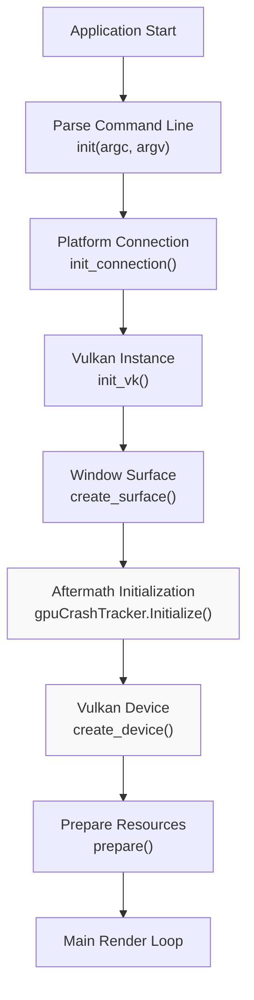

The key architectural decision is initializing Aftermath before device creation, allowing the device to be configured with appropriate diagnostic flags.

Sources: [VkHelloNsightAftermath/VkHelloNsightAftermath.cpp:1597-1601](), [VkHelloNsightAftermath/VkHelloNsightAftermath.cpp:1074-1156]()

## Shader Loading Architecture

The application supports both stripped and full shader variants to demonstrate different debugging scenarios with Nsight Aftermath.

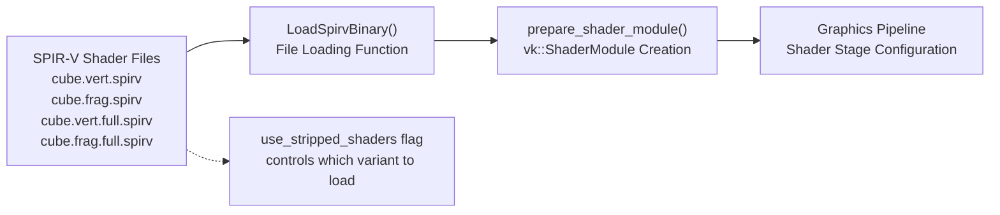

The shader loading system allows switching between debug and release shader variants at runtime, enabling different levels of debugging information to be available to Aftermath.

Sources: [VkHelloNsightAftermath/VkHelloNsightAftermath.cpp:544-554](), [VkHelloNsightAftermath/VkHelloNsightAftermath.cpp:2101-2107](), [VkHelloNsightAftermath/VkHelloNsightAftermath.cpp:2460-2465]()

## Memory and Resource Management

The application demonstrates proper resource lifecycle management in the context of potential GPU crashes and device loss scenarios.

```mermaid
graph TB
    subgraph "Resource Creation"
        CreateBuffers["prepare_cube_data_buffers()<br/>Uniform Buffer Creation"]
        CreateTextures["prepare_textures()<br/>Texture Loading"]
        CreateDepth["prepare_depth()<br/>Depth Buffer"]
    end
    
    subgraph "Resource Usage"
        UpdateData["update_data_buffer()<br/>Per-frame Updates"]
        Rendering["draw_build_cmd()<br/>Command Recording"]
    end
    
    subgraph "Resource Cleanup"
        DeviceLoss["Device Loss Detection"]
        WaitIdle["device.waitIdle()"]
        Cleanup["cleanup()<br/>Resource Destruction"]
    end
    
    CreateBuffers --> UpdateData
    CreateTextures --> Rendering
    CreateDepth --> Rendering
    
    UpdateData --> DeviceLoss
    Rendering --> DeviceLoss
    DeviceLoss --> WaitIdle
    WaitIdle --> Cleanup
```

The resource management includes specific handling for device loss scenarios where Aftermath may be processing crash dumps asynchronously.

Sources: [VkHelloNsightAftermath/VkHelloNsightAftermath.cpp:1904-1961](), [VkHelloNsightAftermath/VkHelloNsightAftermath.cpp:2376-2458](), [VkHelloNsightAftermath/VkHelloNsightAftermath.cpp:663-737]()

---

# Page: GPU Crash Tracking System

# GPU Crash Tracking System

<details>
<summary>Relevant source files</summary>

The following files were used as context for generating this wiki page:

- [VkHelloNsightAftermath/NsightAftermathGpuCrashTracker.cpp](VkHelloNsightAftermath/NsightAftermathGpuCrashTracker.cpp)
- [VkHelloNsightAftermath/NsightAftermathGpuCrashTracker.h](VkHelloNsightAftermath/NsightAftermathGpuCrashTracker.h)

</details>


## Purpose and Scope

The GPU Crash Tracking System implements comprehensive GPU crash dump collection and analysis capabilities for the Vulkan sample application using the NVIDIA Nsight Aftermath SDK. This system captures GPU crash dumps, shader debug information, and application-defined markers to enable post-mortem debugging of GPU hangs and crashes.

This document covers the `GpuCrashTracker` class implementation specific to the Vulkan sample. For information about the shader management components that work alongside this system, see [Shader Database System](#2.3). For the Direct3D 12 equivalent implementation, see [GPU Crash Tracking System](#3.2).

## Architecture Overview

The `GpuCrashTracker` class serves as the central coordinator between the application, Nsight Aftermath SDK, and the file system for crash dump management. The system operates through a callback-driven architecture where the Nsight Aftermath SDK invokes registered callbacks when GPU events occur.

### Core Class Structure

```mermaid
classDiagram
    class GpuCrashTracker {
        -bool m_initialized
        -mutable std::mutex m_mutex
        -std::map~GFSDK_Aftermath_ShaderDebugInfoIdentifier, std::vector~uint8_t~~ m_shaderDebugInfo
        -ShaderDatabase m_shaderDatabase
        -const MarkerMap& m_markerMap
        
        +GpuCrashTracker(const MarkerMap& markerMap)
        +~GpuCrashTracker()
        +void Initialize(bool applicationUsesStrippedShaders)
        
        -void OnCrashDump(const void* pGpuCrashDump, const uint32_t gpuCrashDumpSize)
        -void OnShaderDebugInfo(const void* pShaderDebugInfo, const uint32_t shaderDebugInfoSize)
        -void OnDescription(PFN_GFSDK_Aftermath_AddGpuCrashDumpDescription addDescription)
        -void OnResolveMarker(const void* pMarkerData, const uint32_t markerDataSize, void** ppResolvedMarkerData, uint32_t* pResolvedMarkerDataSize)
        
        -void WriteGpuCrashDumpToFile(const void* pGpuCrashDump, const uint32_t gpuCrashDumpSize)
        -void WriteShaderDebugInformationToFile(GFSDK_Aftermath_ShaderDebugInfoIdentifier identifier, const void* pShaderDebugInfo, const uint32_t shaderDebugInfoSize)
        
        +static void GpuCrashDumpCallback(const void* pGpuCrashDump, const uint32_t gpuCrashDumpSize, void* pUserData)
        +static void ShaderDebugInfoCallback(const void* pShaderDebugInfo, const uint32_t shaderDebugInfoSize, void* pUserData)
        +static void CrashDumpDescriptionCallback(PFN_GFSDK_Aftermath_AddGpuCrashDumpDescription addDescription, void* pUserData)
        +static void ResolveMarkerCallback(const void* pMarkerData, const uint32_t markerDataSize, void* pUserData, void** ppResolvedMarkerData, uint32_t* pResolvedMarkerDataSize)
    }

    class ShaderDatabase {
        +void Initialize(bool applicationUsesStrippedShaders)
        +bool FindShaderBinary(const GFSDK_Aftermath_ShaderBinaryHash& shaderHash, std::vector~uint8_t~& shaderBinary)
        +bool FindShaderBinaryWithDebugData(const GFSDK_Aftermath_ShaderDebugName& shaderDebugName, std::vector~uint8_t~& shaderBinary)
    }

    class MarkerMap {
        <<typedef>>
        std::array~std::map~uint64_t, std::string~, c_markerFrameHistory~
    }

    GpuCrashTracker --> ShaderDatabase : "uses"
    GpuCrashTracker --> MarkerMap : "references"
```

Sources: [VkHelloNsightAftermath/NsightAftermathGpuCrashTracker.h:37-166]()

### Initialization and SDK Integration

The system initializes through a two-phase process: shader database setup followed by Nsight Aftermath SDK registration.

```mermaid
sequenceDiagram
    participant App as "Application"
    participant GCT as "GpuCrashTracker"
    participant SDB as "ShaderDatabase" 
    participant SDK as "GFSDK_Aftermath API"

    App->>GCT: "GpuCrashTracker(markerMap)"
    App->>GCT: "Initialize(applicationUsesStrippedShaders)"
    
    GCT->>SDB: "Initialize(applicationUsesStrippedShaders)"
    SDB-->>GCT: "Initialization complete"
    
    GCT->>SDK: "GFSDK_Aftermath_EnableGpuCrashDumps"
    Note over GCT,SDK: "Registers all callback functions:<br/>GpuCrashDumpCallback<br/>ShaderDebugInfoCallback<br/>CrashDumpDescriptionCallback<br/>ResolveMarkerCallback"
    
    SDK-->>GCT: "Registration successful"
    GCT->>GCT: "m_initialized = true"
    
    Note over App,SDK: "System ready for crash detection"
```

Sources: [VkHelloNsightAftermath/NsightAftermathGpuCrashTracker.cpp:55-80]()

The `Initialize` function configures the Nsight Aftermath SDK with specific flags and callback registrations:

| Parameter | Value | Purpose |
|-----------|-------|---------|
| `GFSDK_Aftermath_GpuCrashDumpWatchedApiFlags_Vulkan` | API flag | Enables Vulkan API monitoring |
| `GFSDK_Aftermath_GpuCrashDumpFeatureFlags_DeferDebugInfoCallbacks` | Feature flag | Caches shader debug info until crash occurs |
| Static callback functions | Function pointers | Bridge between C API and C++ class methods |

## Callback System Architecture

The system implements a dual-layer callback architecture where static C-style callbacks interface with the Nsight Aftermath SDK and dispatch to instance methods of the `GpuCrashTracker` class.

### Callback Registration and Dispatch

```mermaid
flowchart TD
    SDK["GFSDK_Aftermath SDK"] --> GCC["GpuCrashDumpCallback(static)"]
    SDK --> SDC["ShaderDebugInfoCallback(static)"]  
    SDK --> CDC["CrashDumpDescriptionCallback(static)"]
    SDK --> RMC["ResolveMarkerCallback(static)"]
    
    GCC --> OCD["OnCrashDump(instance)"]
    SDC --> OSDI["OnShaderDebugInfo(instance)"]
    CDC --> OD["OnDescription(instance)"]
    RMC --> ORM["OnResolveMarker(instance)"]
    
    OCD --> WGCD["WriteGpuCrashDumpToFile()"]
    OCD --> DECODER["Crash Dump Decoding"]
    
    OSDI --> WSDI["WriteShaderDebugInformationToFile()"]
    OSDI --> CACHE["m_shaderDebugInfo cache"]
    
    OD --> DESC["Application metadata"]
    ORM --> MARKERS["MarkerMap lookup"]
    
    WGCD --> FILES[".nv-gpudmp files"]
    DECODER --> JSON[".json files"] 
    WSDI --> NVDBG[".nvdbg files"]
```

Sources: [VkHelloNsightAftermath/NsightAftermathGpuCrashTracker.cpp:315-384](), [VkHelloNsightAftermath/NsightAftermathGpuCrashTracker.h:105-147]()

### Callback Handler Implementation

Each callback handler serves a specific purpose in the crash tracking pipeline:

| Handler | Trigger | Function | Output |
|---------|---------|----------|--------|
| `OnCrashDump` | GPU crash detected | Processes crash dump data, generates analysis files | `.nv-gpudmp`, `.json` files |
| `OnShaderDebugInfo` | Shader compilation (deferred) | Caches shader debug information for crash analysis | `.nvdbg` files, in-memory cache |
| `OnDescription` | Pre-crash metadata collection | Adds application-specific crash context | Embedded in crash dump |
| `OnResolveMarker` | Marker resolution request | Resolves application-managed debug markers | String data for crash analysis |

## Crash Dump Processing Pipeline

When a GPU crash occurs, the system executes a comprehensive processing pipeline that generates multiple output formats for analysis.

### Crash Dump Decoding Workflow

```mermaid
flowchart TD
    CRASH["GPU Crash Detected"] --> CALLBACK["GpuCrashDumpCallback"]
    CALLBACK --> LOCK["std::lock_guard~std::mutex~"]
    LOCK --> CREATE["GFSDK_Aftermath_GpuCrashDump_CreateDecoder"]
    
    CREATE --> BASEINFO["GFSDK_Aftermath_GpuCrashDump_GetBaseInfo"]
    BASEINFO --> APPNAME["Extract application name"]
    APPNAME --> FILENAME["Generate unique filename:<br/>appname-pid-count"]
    
    FILENAME --> RAWDUMP["Write .nv-gpudmp file"]
    FILENAME --> JSONDECODE["GFSDK_Aftermath_GpuCrashDump_GenerateJSON"]
    
    JSONDECODE --> LOOKUPS["Shader lookup callbacks:<br/>ShaderDebugInfoLookupCallback<br/>ShaderLookupCallback<br/>ShaderSourceDebugInfoLookupCallback"]
    LOOKUPS --> JSONFILE["Write .json file"]
    
    RAWDUMP --> COMPLETE["Processing complete"]
    JSONFILE --> COMPLETE
    
    COMPLETE --> DESTROY["GFSDK_Aftermath_GpuCrashDump_DestroyDecoder"]
```

Sources: [VkHelloNsightAftermath/NsightAftermathGpuCrashTracker.cpp:149-233]()

The crash dump processor generates multiple file formats:

- **Raw dump (`.nv-gpudmp`)**: Binary crash dump data readable by Nsight Graphics
- **JSON dump (`.json`)**: Human-readable crash analysis with shader mappings
- **Debug info (`.nvdbg`)**: Individual shader debug information files

### File Naming Convention

The system generates unique filenames to handle multiple crash dumps from the same process:

```
{applicationName}-{processId}-{incrementalCount}.nv-gpudmp
{applicationName}-{processId}-{incrementalCount}.nv-gpudmp.json
shader-{shaderIdentifier}.nvdbg
```

Sources: [VkHelloNsightAftermath/NsightAftermathGpuCrashTracker.cpp:180-194](), [VkHelloNsightAftermath/NsightAftermathGpuCrashTracker.cpp:242]()

## Shader Information Management

The crash tracker maintains shader debug information through a caching mechanism that stores data in memory and writes debug files to disk.

### Shader Debug Info Caching

The `m_shaderDebugInfo` map stores shader debug information keyed by `GFSDK_Aftermath_ShaderDebugInfoIdentifier`. This cache is populated when `OnShaderDebugInfo` is called and consumed during crash dump JSON generation.

```mermaid
stateDiagram-v2
    [*] --> ShaderCompilation : "Shader compilation triggers callback"
    ShaderCompilation --> GetIdentifier : "GFSDK_Aftermath_GetShaderDebugInfoIdentifier"
    GetIdentifier --> CacheData : "Store in m_shaderDebugInfo map"
    CacheData --> WriteFile : "Write .nvdbg file"
    WriteFile --> Ready : "Debug info ready for crash analysis"
    
    Ready --> CrashOccurs : "GPU crash detected"
    CrashOccurs --> LookupCallback : "ShaderDebugInfoLookupCallback invoked"
    LookupCallback --> RetrieveData : "Find data in m_shaderDebugInfo"
    RetrieveData --> SetData : "setShaderDebugInfo callback"
    SetData --> [*] : "Data provided to decoder"
```

Sources: [VkHelloNsightAftermath/NsightAftermathGpuCrashTracker.cpp:92-113](), [VkHelloNsightAftermath/NsightAftermathGpuCrashTracker.cpp:254-269]()

### Integration with ShaderDatabase

The crash tracker coordinates with the `ShaderDatabase` component to resolve shader binaries during crash analysis:

| Lookup Type | Handler | Database Method | Purpose |
|-------------|---------|-----------------|---------|
| Shader Binary | `OnShaderLookup` | `FindShaderBinary` | Maps shader hash to binary data |
| Debug Data | `OnShaderSourceDebugInfoLookup` | `FindShaderBinaryWithDebugData` | Maps debug name to source debug info |

Sources: [VkHelloNsightAftermath/NsightAftermathGpuCrashTracker.cpp:277-313]()

## Thread Safety and Synchronization

The system implements thread-safe access to shared resources using mutex protection around all callback handlers and shared state modifications.

### Mutex Protection Strategy

```cpp
std::lock_guard<std::mutex> lock(m_mutex);
```

All callback handlers (`OnCrashDump`, `OnShaderDebugInfo`) acquire the mutex lock before accessing shared state. This ensures thread safety when multiple GPU threads trigger callbacks simultaneously.

Sources: [VkHelloNsightAftermath/NsightAftermathGpuCrashTracker.cpp:86](), [VkHelloNsightAftermath/NsightAftermathGpuCrashTracker.cpp:96](), [VkHelloNsightAftermath/NsightAftermathGpuCrashTracker.h:156]()

### Marker Resolution System

The system supports application-managed debug markers through the `MarkerMap` typedef, which maintains a history of debug markers across multiple frames:

```cpp
typedef std::array<std::map<uint64_t, std::string>, c_markerFrameHistory> MarkerMap;
```

The `OnResolveMarker` function searches through the marker history to resolve marker data pointers to human-readable strings, enabling better crash analysis context.

Sources: [VkHelloNsightAftermath/NsightAftermathGpuCrashTracker.h:40-42](), [VkHelloNsightAftermath/NsightAftermathGpuCrashTracker.cpp:129-146]()

## Cleanup and Resource Management

The destructor ensures proper cleanup of Nsight Aftermath resources:

```cpp
if (m_initialized)
{
    GFSDK_Aftermath_DisableGpuCrashDumps();
}
```

This automatic cleanup prevents resource leaks and properly unregisters callbacks when the `GpuCrashTracker` instance is destroyed.

Sources: [VkHelloNsightAftermath/NsightAftermathGpuCrashTracker.cpp:45-52]()

---

# Page: Shader Database System

# Shader Database System

<details>
<summary>Relevant source files</summary>

The following files were used as context for generating this wiki page:

- [VkHelloNsightAftermath/NsightAftermathShaderDatabase.cpp](VkHelloNsightAftermath/NsightAftermathShaderDatabase.cpp)
- [VkHelloNsightAftermath/NsightAftermathShaderDatabase.h](VkHelloNsightAftermath/NsightAftermathShaderDatabase.h)

</details>


## Purpose and Scope

The Shader Database System provides shader binary and debug information management for GPU crash dump analysis in the Vulkan sample. This system stores shader bytecode and associated debug information, enabling correlation between shaders used during rendering and those referenced in Nsight Aftermath crash dumps. The system supports both stripped and full shader configurations to accommodate different deployment scenarios.

For information about crash dump generation and processing, see [GPU Crash Tracking System](#2.2). For details about the main application architecture, see [Application Architecture](#2.1).

## System Architecture

The Shader Database System centers around the `ShaderDatabase` class, which manages two distinct data stores for shader correlation during crash analysis.

### Core Architecture Diagram
```mermaid
graph TD
    App["VkHelloNsightAftermath Application"] --> Initialize["ShaderDatabase::Initialize()"]
    Initialize --> Config{{"applicationUsesStrippedShaders"}}
    
    Config -->|"true"| StrippedPath["Stripped Shader Path"]
    Config -->|"false"| FullPath["Full Shader Path"]
    
    StrippedPath --> AddBinary["AddShaderBinary()"]
    StrippedPath --> AddDebugBinary["AddShaderBinaryWithDebugInfo()"]
    
    FullPath --> AddBinary
    
    AddBinary --> ReadFile["ReadFile()"]
    AddDebugBinary --> ReadFile
    
    ReadFile --> SpirvFiles["SPIR-V Files<br/>(.vert.spirv, .frag.spirv)"]
    
    AddBinary --> GenerateHash["GFSDK_Aftermath_GetShaderHashSpirv()"]
    AddDebugBinary --> GenerateDebugName["GFSDK_Aftermath_GetShaderDebugNameSpirv()"]
    
    GenerateHash --> BinaryStorage["m_shaderBinaries<br/>std::map<ShaderBinaryHash, vector<uint8_t>>"]
    GenerateDebugName --> DebugStorage["m_shaderBinariesWithDebugInfo<br/>std::map<ShaderDebugName, vector<uint8_t>>"]
    
    BinaryStorage --> FindBinary["FindShaderBinary()"]
    DebugStorage --> FindDebug["FindShaderBinaryWithDebugData()"]
    
    CrashTracker["GpuCrashTracker"] --> FindBinary
    CrashTracker --> FindDebug
```

**Sources:** [VkHelloNsightAftermath/NsightAftermathShaderDatabase.h:40-67](), [VkHelloNsightAftermath/NsightAftermathShaderDatabase.cpp:34-76]()

### Class Structure and Data Storage
```mermaid
classDiagram
    class ShaderDatabase {
        -m_shaderBinaries: map~ShaderBinaryHash, vector~uint8_t~~
        -m_shaderBinariesWithDebugInfo: map~ShaderDebugName, vector~uint8_t~~
        +ShaderDatabase()
        +~ShaderDatabase()
        +Initialize(bool applicationUsesStrippedShaders)
        +FindShaderBinary(ShaderBinaryHash, vector~uint8_t~) bool
        +FindShaderBinaryWithDebugData(ShaderDebugName, vector~uint8_t~) bool
        -AddShaderBinary(const char* shaderFilePath)
        -AddShaderBinaryWithDebugInfo(const char* strippedPath, const char* fullPath)
        -ReadFile(const char* filename, vector~uint8_t~) bool
    }
    
    class GFSDK_Aftermath_ShaderBinaryHash {
        <<external>>
    }
    
    class GFSDK_Aftermath_ShaderDebugName {
        <<external>>
    }
    
    ShaderDatabase --> GFSDK_Aftermath_ShaderBinaryHash : "uses as map key"
    ShaderDatabase --> GFSDK_Aftermath_ShaderDebugName : "uses as map key"
```

**Sources:** [VkHelloNsightAftermath/NsightAftermathShaderDatabase.h:55-67](), [VkHelloNsightAftermath/NsightAftermathShaderDatabase.cpp:34-42]()

## Shader Binary Management

The system manages shader binaries through a hash-based lookup mechanism using Nsight Aftermath's shader identification system.

### Binary Storage Process

| Operation | Method | Purpose |
|-----------|---------|----------|
| File Reading | `ReadFile()` | Loads SPIR-V bytecode from disk |
| Hash Generation | `GFSDK_Aftermath_GetShaderHashSpirv()` | Creates unique identifier for shader binary |
| Storage | `m_shaderBinaries[hash] = data` | Maps hash to binary data |
| Retrieval | `FindShaderBinary()` | Locates binary by hash during crash analysis |

The `AddShaderBinary()` method processes each shader file through the following workflow:

```mermaid
sequenceDiagram
    participant Client as "Application"
    participant DB as "ShaderDatabase"
    participant SDK as "GFSDK_Aftermath"
    participant FS as "File System"
    
    Client->>DB: "AddShaderBinary(shaderFilePath)"
    DB->>FS: "ReadFile(shaderFilePath)"
    FS-->>DB: "vector<uint8_t> data"
    
    DB->>SDK: "GFSDK_Aftermath_GetShaderHashSpirv()"
    SDK-->>DB: "GFSDK_Aftermath_ShaderBinaryHash"
    
    DB->>DB: "m_shaderBinaries[hash] = data"
    DB-->>Client: "Binary stored"
```

**Sources:** [VkHelloNsightAftermath/NsightAftermathShaderDatabase.cpp:95-115](), [VkHelloNsightAftermath/NsightAftermathShaderDatabase.cpp:78-93]()

## Debug Information Handling

The system supports two shader configurations: stripped shaders for production deployment and full shaders containing debug information for development analysis.

### Configuration Modes

The `Initialize()` method configures the database based on the `applicationUsesStrippedShaders` parameter:

#### Stripped Shader Mode (`applicationUsesStrippedShaders = true`)
- Stores both stripped and full versions of each shader
- Maps stripped versions for runtime correlation
- Maps full versions for debug information extraction
- Uses shader files: `cube.vert.spirv`, `cube.frag.spirv` (stripped) and `cube.vert.full.spirv`, `cube.frag.full.spirv` (full)

#### Full Shader Mode (`applicationUsesStrippedShaders = false`) 
- Stores only full shader versions
- Uses shader files: `cube.vert.full.spirv`, `cube.frag.full.spirv`

**Sources:** [VkHelloNsightAftermath/NsightAftermathShaderDatabase.cpp:45-76]()

### Debug Name Generation

For stripped shader configurations, the system generates debug names to correlate stripped and full shader versions:

```mermaid
graph LR
    StrippedShader["Stripped SPIR-V<br/>cube.vert.spirv"] --> DebugName["GFSDK_Aftermath_GetShaderDebugNameSpirv()"]
    FullShader["Full SPIR-V<br/>cube.vert.full.spirv"] --> DebugName
    
    DebugName --> ShaderDebugName["GFSDK_Aftermath_ShaderDebugName"]
    ShaderDebugName --> DebugStorage["m_shaderBinariesWithDebugInfo<br/>map storage"]
```

**Sources:** [VkHelloNsightAftermath/NsightAftermathShaderDatabase.cpp:117-144]()

## Nsight Aftermath Integration

The Shader Database integrates with the Nsight Aftermath SDK through specific API calls for shader identification and correlation.

### SDK Integration Points

| SDK Function | Purpose | Usage Location |
|--------------|---------|----------------|
| `GFSDK_Aftermath_GetShaderHashSpirv()` | Generate shader binary hash | [NsightAftermathShaderDatabase.cpp:107-110]() |
| `GFSDK_Aftermath_GetShaderDebugNameSpirv()` | Generate debug correlation name | [NsightAftermathShaderDatabase.cpp:135-139]() |

### Crash Analysis Workflow

During crash analysis, the GPU Crash Tracking System queries the Shader Database using identifiers from crash dumps:

```mermaid
sequenceDiagram
    participant Tracker as "GpuCrashTracker"
    participant DB as "ShaderDatabase"
    participant CrashDump as "Aftermath Crash Dump"
    
    Note over Tracker,CrashDump: "Crash Analysis Phase"
    
    CrashDump->>Tracker: "ShaderBinaryHash from crash"
    Tracker->>DB: "FindShaderBinary(hash)"
    DB-->>Tracker: "Shader binary data"
    
    CrashDump->>Tracker: "ShaderDebugName from crash"
    Tracker->>DB: "FindShaderBinaryWithDebugData(debugName)"
    DB-->>Tracker: "Debug shader binary"
```

**Sources:** [VkHelloNsightAftermath/NsightAftermathShaderDatabase.cpp:147-174]()

## API Reference

### Core Methods

#### `Initialize(bool applicationUsesStrippedShaders)`
Configures the database with appropriate shader files based on deployment mode. Clears existing data and populates shader maps.

**Parameters:**
- `applicationUsesStrippedShaders`: Determines shader file selection and storage strategy

**Sources:** [VkHelloNsightAftermath/NsightAftermathShaderDatabase.cpp:45-76]()

#### `FindShaderBinary(const GFSDK_Aftermath_ShaderBinaryHash& shaderHash, std::vector<uint8_t>& shader)`
Locates shader binary data by hash value from crash dump analysis.

**Returns:** `bool` - `true` if shader found, `false` otherwise

**Sources:** [VkHelloNsightAftermath/NsightAftermathShaderDatabase.cpp:147-159]()

#### `FindShaderBinaryWithDebugData(const GFSDK_Aftermath_ShaderDebugName& shaderDebugName, std::vector<uint8_t>& shader)`
Locates shader binary with debug information using debug name correlation.

**Returns:** `bool` - `true` if debug shader found, `false` otherwise

**Sources:** [VkHelloNsightAftermath/NsightAftermathShaderDatabase.cpp:162-174]()

### Data Members

| Member | Type | Purpose |
|--------|------|---------|
| `m_shaderBinaries` | `std::map<GFSDK_Aftermath_ShaderBinaryHash, std::vector<uint8_t>>` | Shader binary storage indexed by hash |
| `m_shaderBinariesWithDebugInfo` | `std::map<GFSDK_Aftermath_ShaderDebugName, std::vector<uint8_t>>` | Debug shader storage indexed by debug name |

**Sources:** [VkHelloNsightAftermath/NsightAftermathShaderDatabase.h:62-66]()

---

# Page: Build Configuration

# Build Configuration

<details>
<summary>Relevant source files</summary>

The following files were used as context for generating this wiki page:

- [VkHelloNsightAftermath/CMakeLists.txt](VkHelloNsightAftermath/CMakeLists.txt)
- [VkHelloNsightAftermath/cmake/FindNsightAftermath.cmake](VkHelloNsightAftermath/cmake/FindNsightAftermath.cmake)

</details>


This document covers the CMake-based build system for the VkHelloNsightAftermath Vulkan sample application. It details how dependencies are discovered, platform-specific configurations are handled, shader compilation is managed, and the final executable target is configured and linked.

For information about the overall development environment setup, see [Development Setup](#4). For details about CMake utilities shared across the repository, see [CMake Build System](#4.1).

## Build System Overview

The VkHelloNsightAftermath sample uses a comprehensive CMake build system that handles cross-platform compilation, dependency management, and shader processing. The build configuration is centered around the main `CMakeLists.txt` file with support from custom CMake modules.

```mermaid
graph TD
    subgraph "Build Configuration"
        CMakeMain["CMakeLists.txt<br/>Main Build Configuration"]
        FindNsight["FindNsightAftermath.cmake<br/>SDK Discovery Module"]
        CMakeModules["cmake/<br/>Module Directory"]
    end
    
    subgraph "Dependency Discovery"
        VulkanSDK["Vulkan SDK<br/>Graphics API Headers/Libraries"]
        NsightSDK["Nsight Aftermath SDK<br/>GFSDK_Aftermath"]
        GLSLang["glslangValidator<br/>Shader Compiler"]
        SpirvRemap["spirv-remap<br/>Bytecode Optimizer"]
    end
    
    subgraph "Platform Configuration"
        WindowsConfig["Windows Configuration<br/>WIN32 Definitions"]
        LinuxConfig["Linux Configuration<br/>WSI Support"]
        CompilerFlags["Compiler Flags<br/>GCC/Clang/MSVC"]
    end
    
    subgraph "Build Targets"
        Executable["VkHelloNsightAftermath<br/>Main Executable"]
        VertexShader["cube.vert.spirv<br/>Compiled Vertex Shader"]
        FragmentShader["cube.frag.spirv<br/>Compiled Fragment Shader"]
    end
    
    CMakeMain --> FindNsight
    CMakeMain --> CMakeModules
    
    FindNsight --> NsightSDK
    CMakeMain --> VulkanSDK
    CMakeMain --> GLSLang
    CMakeMain --> SpirvRemap
    
    CMakeMain --> WindowsConfig
    CMakeMain --> LinuxConfig
    CMakeMain --> CompilerFlags
    
    CMakeMain --> Executable
    CMakeMain --> VertexShader
    CMakeMain --> FragmentShader
    
    VulkanSDK --> Executable
    NsightSDK --> Executable
    VertexShader --> Executable
    FragmentShader --> Executable
```

**Sources:** [VkHelloNsightAftermath/CMakeLists.txt:1-304](), [VkHelloNsightAftermath/cmake/FindNsightAftermath.cmake:1-117]()

## Dependency Management

The build system manages several critical dependencies through CMake's `find_package` mechanism and custom find modules.

### Core Dependencies

| Dependency | Discovery Method | Purpose |
|------------|------------------|---------|
| Vulkan SDK | `find_package(Vulkan)` | Graphics API headers and loader library |
| Vulkan Headers | `find_package(VulkanHeaders)` | Vulkan specification headers |
| Nsight Aftermath | `find_package(NsightAftermath)` | GPU crash debugging SDK |

### Vulkan SDK Discovery

The build system searches for Vulkan components in multiple locations using a priority-based approach:

```mermaid
graph TD
    subgraph "Vulkan Discovery Process"
        UserPaths["CMAKE_PREFIX_PATH<br/>User-Supplied Paths"]
        CMakeOptions["VULKAN_HEADERS_INSTALL_DIR<br/>VULKAN_LOADER_INSTALL_DIR<br/>CMake Cache Variables"]
        EnvVars["VULKAN_HEADERS_INSTALL_DIR<br/>VULKAN_LOADER_INSTALL_DIR<br/>Environment Variables"]
        WindowsFallback["external/x64 or external/x86<br/>Windows Fallback Paths"]
        FindVulkan["FindVulkan<br/>System Package Discovery"]
    end
    
    UserPaths --> CMakeOptions
    CMakeOptions --> EnvVars
    EnvVars --> WindowsFallback
    WindowsFallback --> FindVulkan
    
    FindVulkan --> VulkanFound["Vulkan::Vulkan<br/>Imported Target"]
```

**Sources:** [VkHelloNsightAftermath/CMakeLists.txt:54-85]()

### Nsight Aftermath SDK Discovery

The `FindNsightAftermath.cmake` module locates the SDK using the `NSIGHT_AFTERMATH_SDK` environment variable:

```mermaid
graph TD
    subgraph "Nsight Aftermath Discovery"
        EnvVar["NSIGHT_AFTERMATH_SDK<br/>Environment Variable"]
        Headers["GFSDK_Aftermath.h<br/>Header File Search"]
        Libraries["Library Search<br/>Platform-Specific"]
        DLLSearch["DLL Search<br/>Windows Only"]
    end
    
    subgraph "Platform-Specific Libraries"
        Win64["GFSDK_Aftermath_Lib.x64<br/>Windows 64-bit"]
        Win32["GFSDK_Aftermath_Lib.x86<br/>Windows 32-bit"]
        Unix["GFSDK_Aftermath_Lib<br/>Unix/Linux"]
    end
    
    EnvVar --> Headers
    Headers --> Libraries
    Libraries --> Win64
    Libraries --> Win32
    Libraries --> Unix
    Libraries --> DLLSearch
    
    Win64 --> ImportedTarget["NsightAftermath::NsightAftermath<br/>Imported Target"]
    Win32 --> ImportedTarget
    Unix --> ImportedTarget
```

**Sources:** [VkHelloNsightAftermath/cmake/FindNsightAftermath.cmake:43-107]()

## Platform Configuration

The build system adapts to different platforms through conditional configuration blocks.

### Windows Configuration

Windows builds include specific definitions and security features:

- Platform definitions: `VK_USE_PLATFORM_WIN32_KHR`, `WIN32_LEAN_AND_MEAN`, `NOMINMAX`
- Control Flow Guard: Enabled for MSVC 2015+ (`/guard:cf`)
- Static MSVCRT: Replaces `/MD` with `/MT` for static linking
- DLL handling: Automatic copying of `NsightAftermath_DLL` to output directory

**Sources:** [VkHelloNsightAftermath/CMakeLists.txt:155-163](), [VkHelloNsightAftermath/CMakeLists.txt:204-225](), [VkHelloNsightAftermath/CMakeLists.txt:292-301]()

### Linux Configuration

Linux builds support multiple Window System Integration (WSI) options:

| WSI Option | Library | Platform Define |
|------------|---------|-----------------|
| XCB | `${XCB_LIBRARIES}` | `VK_USE_PLATFORM_XCB_KHR` |
| Xlib | `${X11_LIBRARIES}` | `VK_USE_PLATFORM_XLIB_KHR` |
| Wayland | `${WAYLAND_CLIENT_LIBRARIES}` | `VK_USE_PLATFORM_WAYLAND_KHR` |
| Display | None | `VK_USE_PLATFORM_DISPLAY_KHR` |

The default WSI selection is controlled by `VKHELLONSIGHTAFTERMATH_WSI_SELECTION`.

**Sources:** [VkHelloNsightAftermath/CMakeLists.txt:134-195]()

### Compiler Configuration

The build system configures compiler-specific flags:

- **GCC/Clang**: Wall warnings, C++11 standard, hidden visibility on Unix
- **MSVC**: CRT security warnings disabled, math defines enabled
- **All platforms**: No RTTI, strict aliasing disabled

**Sources:** [VkHelloNsightAftermath/CMakeLists.txt:99-114](), [VkHelloNsightAftermath/CMakeLists.txt:250-253]()

## Shader Compilation Pipeline

The build system includes a sophisticated shader compilation process that generates both debug and optimized SPIR-V bytecode.

```mermaid
graph TD
    subgraph "Shader Source Files"
        VertGLSL["cube.vert<br/>Vertex Shader Source"]
        FragGLSL["cube.frag<br/>Fragment Shader Source"]
    end
    
    subgraph "Compilation Tools"
        GLSLValidator["glslangValidator<br/>GLSL to SPIR-V Compiler"]
        SpirvRemap["spirv-remap<br/>Bytecode Optimizer"]
    end
    
    subgraph "Intermediate Outputs"
        VertFull["cube.vert.full.spirv<br/>Debug SPIR-V with Symbols"]
        FragFull["cube.frag.full.spirv<br/>Debug SPIR-V with Symbols"]
    end
    
    subgraph "Final Outputs"
        VertSpirv["cube.vert.spirv<br/>Optimized SPIR-V"]
        FragSpirv["cube.frag.spirv<br/>Optimized SPIR-V"]
    end
    
    VertGLSL --> GLSLValidator
    FragGLSL --> GLSLValidator
    
    GLSLValidator --> VertFull
    GLSLValidator --> FragFull
    
    VertFull --> SpirvRemap
    FragFull --> SpirvRemap
    
    SpirvRemap --> VertSpirv
    SpirvRemap --> FragSpirv
```

### Shader Compilation Commands

Each shader undergoes a multi-step compilation process:

1. **Debug Compilation**: `glslangValidator -V -g` generates full SPIR-V with debug information
2. **Copy Operations**: Intermediate files copied to both target and build directories
3. **Optimization**: `spirv-remap --map all --strip-all` removes debug symbols and optimizes
4. **Final Copy**: Optimized SPIR-V copied to final locations

**Sources:** [VkHelloNsightAftermath/CMakeLists.txt:227-246]()

## Target Configuration and Linking

The `VkHelloNsightAftermath` executable target is configured with platform-specific source files and linking requirements.

### Source Files

| File Type | Files | Purpose |
|-----------|-------|---------|
| C++ Sources | `VkHelloNsightAftermath.cpp` | Main application |
| | `NsightAftermathGpuCrashTracker.cpp` | Crash tracking implementation |
| | `NsightAftermathShaderDatabase.cpp` | Shader database implementation |
| GLSL Sources | `cube.vert`, `cube.frag` | Shader source files |
| SPIR-V Outputs | `cube.vert.spirv`, `cube.frag.spirv` | Compiled shader bytecode |

### Linking Configuration

The target links against imported CMake targets:

- `Vulkan::Vulkan`: Vulkan loader and headers
- `NsightAftermath::NsightAftermath`: Nsight Aftermath SDK
- Platform libraries: `dl` on Linux for dynamic loading

### Compilation Options

The target uses specific compilation options:
- `VULKAN_HPP_DISABLE_IMPLICIT_RESULT_VALUE_CAST`: Disables implicit conversions in Vulkan-Hpp

**Sources:** [VkHelloNsightAftermath/CMakeLists.txt:260-303]()

---

# Page: Utility Components

# Utility Components

<details>
<summary>Relevant source files</summary>

The following files were used as context for generating this wiki page:

- [VkHelloNsightAftermath/NsightAftermathHelpers.h](VkHelloNsightAftermath/NsightAftermathHelpers.h)
- [VkHelloNsightAftermath/cmake/FindVulkanHeaders.cmake](VkHelloNsightAftermath/cmake/FindVulkanHeaders.cmake)
- [VkHelloNsightAftermath/cmake/FindWayland.cmake](VkHelloNsightAftermath/cmake/FindWayland.cmake)

</details>


This page documents the utility components that support the Vulkan sample application, including helper functions for Nsight Aftermath integration and CMake find modules for dependency management. These utilities provide common functionality used by the main application components documented in other sections.

For information about the main application architecture, see [Application Architecture](#2.1). For details about the CMake build system configuration, see [Build Configuration](#2.4).

## Nsight Aftermath Helper Utilities

The `NsightAftermathHelpers` module provides essential utility functions, macros, and operators that simplify working with Nsight Aftermath API types throughout the Vulkan sample application.

### String Conversion Utilities

The helper utilities extend the `std` namespace with specialized string conversion functions for Aftermath types:

| Function | Purpose | Return Type |
|----------|---------|-------------|
| `to_hex_string<T>()` | Converts numeric types to hexadecimal strings | `std::string` |
| `to_string(GFSDK_Aftermath_Result)` | Converts Aftermath result codes to hex strings | `std::string` |
| `to_string(GFSDK_Aftermath_ShaderDebugInfoIdentifier)` | Converts shader debug identifiers to readable strings | `std::string` |
| `to_string(GFSDK_Aftermath_ShaderBinaryHash)` | Converts shader binary hashes to hex strings | `std::string` |

```mermaid
graph TB
    subgraph "String Conversion System"
        to_hex_string["to_hex_string&lt;T&gt;()"]
        to_string_result["to_string(GFSDK_Aftermath_Result)"]
        to_string_identifier["to_string(ShaderDebugInfoIdentifier)"]
        to_string_hash["to_string(ShaderBinaryHash)"]
    end
    
    subgraph "Aftermath API Types"
        result_type["GFSDK_Aftermath_Result"]
        identifier_type["GFSDK_Aftermath_ShaderDebugInfoIdentifier"]
        hash_type["GFSDK_Aftermath_ShaderBinaryHash"]
    end
    
    subgraph "Usage in Application"
        crash_tracker["GpuCrashTracker"]
        shader_db["ShaderDatabase"]
        error_logging["Error Logging"]
    end
    
    result_type --> to_string_result
    identifier_type --> to_string_identifier
    hash_type --> to_string_hash
    
    to_hex_string --> to_string_result
    to_hex_string --> to_string_identifier
    to_hex_string --> to_string_hash
    
    to_string_result --> error_logging
    to_string_identifier --> shader_db
    to_string_hash --> crash_tracker
```

**Sources:** [VkHelloNsightAftermath/NsightAftermathHelpers.h:41-65]()

### Comparison Operators

The module defines comparison operators that enable Aftermath types to be used as keys in standard containers:

```mermaid
graph LR
    subgraph "Comparison Operators"
        op_identifier["operator&lt;(ShaderDebugInfoIdentifier)"]
        op_hash["operator&lt;(ShaderBinaryHash)"] 
        op_name["operator&lt;(ShaderDebugName)"]
    end
    
    subgraph "Container Usage"
        std_map["std::map&lt;AftermathType, Data&gt;"]
        std_set["std::set&lt;AftermathType&gt;"]
    end
    
    subgraph "Application Components"
        shader_database["ShaderDatabase::m_shaderDatabase"]
        debug_info_map["Debug Info Storage"]
    end
    
    op_identifier --> std_map
    op_hash --> std_map  
    op_name --> std_set
    
    std_map --> shader_database
    std_map --> debug_info_map
```

**Sources:** [VkHelloNsightAftermath/NsightAftermathHelpers.h:72-91]()

### Error Handling System

The error handling utilities provide centralized error reporting and validation for Aftermath operations:

```mermaid
graph TB
    subgraph "Error Handling Components"
        AftermathErrorMessage["AftermathErrorMessage(result)"]
        AFTERMATH_CHECK_ERROR["AFTERMATH_CHECK_ERROR(FC)"]
    end
    
    subgraph "Platform-Specific Implementation"
        windows_impl["Windows: MessageBoxA()"]
        unix_impl["Unix/Linux: printf()"]
    end
    
    subgraph "Error Types"
        driver_version["FAIL_DriverVersionNotSupported"]
        generic_error["Generic Aftermath Errors"]
    end
    
    subgraph "Usage Context"
        initialization["SDK Initialization"]
        crash_callbacks["Crash Callbacks"]
        shader_operations["Shader Operations"]
    end
    
    AftermathErrorMessage --> driver_version
    AftermathErrorMessage --> generic_error
    
    AFTERMATH_CHECK_ERROR --> AftermathErrorMessage
    AFTERMATH_CHECK_ERROR --> windows_impl
    AFTERMATH_CHECK_ERROR --> unix_impl
    
    initialization --> AFTERMATH_CHECK_ERROR
    crash_callbacks --> AFTERMATH_CHECK_ERROR
    shader_operations --> AFTERMATH_CHECK_ERROR
```

**Sources:** [VkHelloNsightAftermath/NsightAftermathHelpers.h:97-131]()

## CMake Find Modules

The Vulkan sample includes specialized CMake find modules that locate required dependencies across different platforms and installation configurations.

### FindVulkanHeaders Module

The `FindVulkanHeaders` module locates Vulkan headers and registry files independently of the Vulkan loader library:

| Variable | Purpose | Type |
|----------|---------|------|
| `VulkanHeaders_FOUND` | Indicates if Vulkan headers were found | Boolean |
| `VulkanHeaders_INCLUDE_DIRS` | Include directories for Vulkan headers | Path list |
| `VulkanRegistry_FOUND` | Indicates if Vulkan registry was found | Boolean |
| `VulkanRegistry_DIRS` | Directory containing vk.xml registry | Path |

```mermaid
graph TB
    subgraph "Search Strategy"
        vulkan_headers_install_dir["VULKAN_HEADERS_INSTALL_DIR"]
        vulkan_sdk_env["VULKAN_SDK environment"]
        system_paths["System paths"]
    end
    
    subgraph "FindVulkanHeaders Module"
        find_vulkan_h["find_path(vulkan/vulkan.h)"]
        find_vk_xml["find_path(vk.xml)"]
    end
    
    subgraph "Output Variables"
        headers_found["VulkanHeaders_FOUND"]
        headers_dirs["VulkanHeaders_INCLUDE_DIRS"]
        registry_found["VulkanRegistry_FOUND"]
        registry_dirs["VulkanRegistry_DIRS"]
    end
    
    subgraph "Build System Usage"
        target_include["target_include_directories()"]
        compile_definitions["Vulkan API availability"]
    end
    
    vulkan_headers_install_dir --> find_vulkan_h
    vulkan_sdk_env --> find_vulkan_h
    system_paths --> find_vulkan_h
    
    find_vulkan_h --> find_vk_xml
    find_vulkan_h --> headers_found
    find_vulkan_h --> headers_dirs
    find_vk_xml --> registry_found
    find_vk_xml --> registry_dirs
    
    headers_dirs --> target_include
    headers_found --> compile_definitions
```

**Sources:** [VkHelloNsightAftermath/cmake/FindVulkanHeaders.cmake:44-70]()

### FindWayland Module

The `FindWayland` module provides comprehensive Wayland windowing system detection for Linux builds:

```mermaid
graph TB
    subgraph "Wayland Components"
        wayland_client["wayland-client"]
        wayland_server["wayland-server"] 
        wayland_egl["wayland-egl"]
        wayland_cursor["wayland-cursor"]
    end
    
    subgraph "Detection Method"
        pkg_config["PkgConfig"]
        find_path["find_path()"]
        find_library["find_library()"]
    end
    
    subgraph "Output Variables"
        client_found["WAYLAND_CLIENT_FOUND"]
        client_libs["WAYLAND_CLIENT_LIBRARIES"]
        client_includes["WAYLAND_CLIENT_INCLUDE_DIR"]
        
        egl_found["WAYLAND_EGL_FOUND"] 
        egl_libs["WAYLAND_EGL_LIBRARIES"]
        egl_includes["WAYLAND_EGL_INCLUDE_DIR"]
        
        unified_libs["WAYLAND_LIBRARIES"]
        unified_includes["WAYLAND_INCLUDE_DIR"]
    end
    
    subgraph "Build Integration"
        linux_build["Linux Platform Builds"]
        windowing_support["Wayland Window Creation"]
    end
    
    pkg_config --> find_path
    pkg_config --> find_library
    
    wayland_client --> find_path
    wayland_client --> find_library
    wayland_egl --> find_path
    wayland_egl --> find_library
    
    find_path --> client_includes
    find_path --> egl_includes
    find_library --> client_libs
    find_library --> egl_libs
    
    client_found --> unified_libs
    client_libs --> unified_libs
    egl_libs --> unified_libs
    
    client_includes --> unified_includes
    egl_includes --> unified_includes
    
    unified_libs --> linux_build
    unified_includes --> windowing_support
```

**Sources:** [VkHelloNsightAftermath/cmake/FindWayland.cmake:21-76]()

## Integration with Application Components

The utility components integrate with the main application systems to provide essential support functionality:

```mermaid
graph TB
    subgraph "Utility Components"
        nsight_helpers["NsightAftermathHelpers.h"]
        cmake_modules["CMake Find Modules"]
    end
    
    subgraph "Main Application Components"
        gpu_crash_tracker["GpuCrashTracker"]
        shader_database["ShaderDatabase"] 
        vulkan_app["VkHelloNsightAftermath"]
    end
    
    subgraph "Build System"
        cmake_config["CMakeLists.txt"]
        dependency_detection["Dependency Detection"]
    end
    
    subgraph "Runtime Support"
        error_handling["Error Handling"]
        type_conversion["Type Conversion"]
        debug_output["Debug Output"]
    end
    
    nsight_helpers --> gpu_crash_tracker
    nsight_helpers --> shader_database
    nsight_helpers --> error_handling
    nsight_helpers --> type_conversion
    nsight_helpers --> debug_output
    
    cmake_modules --> cmake_config
    cmake_modules --> dependency_detection
    cmake_config --> vulkan_app
    
    dependency_detection --> vulkan_app
    error_handling --> gpu_crash_tracker
    type_conversion --> shader_database
```

**Sources:** [VkHelloNsightAftermath/NsightAftermathHelpers.h:1-132](), [VkHelloNsightAftermath/cmake/FindVulkanHeaders.cmake:1-71](), [VkHelloNsightAftermath/cmake/FindWayland.cmake:1-77]()

---

# Page: Direct3D 12 Sample (D3D12HelloNsightAftermath)

# Direct3D 12 Sample (D3D12HelloNsightAftermath)

<details>
<summary>Relevant source files</summary>

The following files were used as context for generating this wiki page:

- [D3D12HelloNsightAftermath/D3D12HelloNsightAftermath.cpp](D3D12HelloNsightAftermath/D3D12HelloNsightAftermath.cpp)
- [D3D12HelloNsightAftermath/README.md](D3D12HelloNsightAftermath/README.md)

</details>


This document covers the Direct3D 12-based Nsight Aftermath integration sample, which demonstrates how to implement GPU crash debugging capabilities in a D3D12 application. The sample provides a complete reference implementation for crash dump collection, event marker integration, and shader debugging data management. For information about the Vulkan-based equivalent, see [Vulkan Sample (VkHelloNsightAftermath)](#2). For details about setting up the development environment, see [Development Setup](#4).

## Application Architecture

The `D3D12HelloNsightAftermath` class serves as the main application framework, extending the base `DXSample` class to provide a complete D3D12 rendering pipeline with integrated Nsight Aftermath crash debugging capabilities.

### Core Application Structure

```mermaid
graph TB
    subgraph "D3D12HelloNsightAftermath Application"
        MainApp["D3D12HelloNsightAftermath<br/>(Main Application Class)"]
        Pipeline["D3D12 Pipeline Components"]
        CrashTracker["GpuCrashTracker<br/>m_gpuCrashTracker"]
        MarkerMap["MarkerMap<br/>m_markerMap"]
        CommandContext["Aftermath Command Context<br/>m_hAftermathCommandListContext"]
    end
    
    subgraph "D3D12 Resources"
        Device["ID3D12Device<br/>m_device"]
        CommandQueue["ID3D12CommandQueue<br/>m_commandQueue"]
        CommandList["ID3D12GraphicsCommandList<br/>m_commandList"]
        SwapChain["IDXGISwapChain3<br/>m_swapChain"]
    end
    
    subgraph "Aftermath SDK"
        AftermathAPI["GFSDK_Aftermath_DX12_*<br/>API Functions"]
        EventMarkers["GFSDK_Aftermath_SetEventMarker"]
        CrashCallbacks["Crash Dump Callbacks"]
    end
    
    MainApp --> Pipeline
    MainApp --> CrashTracker
    MainApp --> MarkerMap
    MainApp --> CommandContext
    
    Pipeline --> Device
    Pipeline --> CommandQueue
    Pipeline --> CommandList
    Pipeline --> SwapChain
    
    CrashTracker --> AftermathAPI
    CommandContext --> EventMarkers
    AftermathAPI --> CrashCallbacks
    
    CommandList --> CommandContext
```

The application initializes Aftermath integration during device creation and maintains crash tracking throughout the rendering lifecycle. The `m_gpuCrashTracker` component handles crash dump collection, while `m_markerMap` provides event marker management for debugging context.

Sources: [D3D12HelloNsightAftermath/D3D12HelloNsightAftermath.cpp:23-37](), [D3D12HelloNsightAftermath/D3D12HelloNsightAftermath.cpp:88-147]()

### Rendering Pipeline Integration

The application implements a standard D3D12 triangle rendering demo with strategic Aftermath integration points:

| Component | Purpose | Aftermath Integration |
|-----------|---------|----------------------|
| Device Creation | Initialize D3D12 device | `GFSDK_Aftermath_DX12_Initialize` called before device creation |
| Command List | Record rendering commands | Event markers inserted via `GFSDK_Aftermath_SetEventMarker` |
| Present | Display rendered frame | Crash detection and timeout handling on present failure |
| Resource Management | Handle D3D12 resources | Resource tracking enabled via `EnableResourceTracking` flag |

The `PopulateCommandList` method demonstrates proper event marker placement around critical GPU operations like render target clearing and triangle drawing.

Sources: [D3D12HelloNsightAftermath/D3D12HelloNsightAftermath.cpp:456-549](), [D3D12HelloNsightAftermath/D3D12HelloNsightAftermath.cpp:392-444]()

## GPU Crash Debugging Integration

### Aftermath Initialization Sequence

```mermaid
sequenceDiagram
    participant App as "D3D12HelloNsightAftermath"
    participant Tracker as "GpuCrashTracker"
    participant Aftermath as "GFSDK_Aftermath_DX12_*"
    participant Device as "ID3D12Device"
    participant CommandList as "ID3D12GraphicsCommandList"
    
    Note over App,CommandList: Device Creation Phase
    App->>Tracker: "Initialize()"
    Tracker->>Aftermath: "Setup crash callbacks"
    
    App->>Aftermath: "GFSDK_Aftermath_DX12_Initialize()"
    Note right of Aftermath: Features: Markers, ResourceTracking,<br/>CallStackCapturing, ShaderDebugInfo
    
    App->>Device: "D3D12CreateDevice()"
    App->>CommandList: "CreateCommandList()"
    App->>Aftermath: "GFSDK_Aftermath_DX12_CreateContextHandle()"
    Aftermath-->>App: "m_hAftermathCommandListContext"
    
    Note over App,CommandList: Rendering Loop
    loop "Every Frame"
        App->>App: "PopulateCommandList()"
        App->>Aftermath: "GFSDK_Aftermath_SetEventMarker()"
        App->>CommandList: "ClearRenderTargetView()"
        App->>Aftermath: "GFSDK_Aftermath_SetEventMarker()"
        App->>CommandList: "DrawInstanced()"
    end
    
    Note over App,CommandList: Crash Handling
    App->>Device: "Present()"
    Device-->>App: "DXGI_ERROR (TDR)"
    App->>Aftermath: "GFSDK_Aftermath_GetCrashDumpStatus()"
    loop "Poll Status"
        App->>Aftermath: "Check crash dump completion"
        Aftermath-->>Tracker: "Crash dump callbacks triggered"
    end
```

The initialization occurs in two phases: first the `GpuCrashTracker` sets up callback handlers, then the main Aftermath system is initialized with comprehensive feature flags before D3D12 device creation.

Sources: [D3D12HelloNsightAftermath/D3D12HelloNsightAftermath.cpp:88-147](), [D3D12HelloNsightAftermath/D3D12HelloNsightAftermath.cpp:289-292]()

### Event Marker Management

The application implements a dual approach to event marker management:

```cpp
// App-managed markers (high performance)
auto setAftermathEventMarker = [this](const std::string& markerData, bool appManagedMarker) {
    if (appManagedMarker) {
        UINT markerMapIndex = m_frameCounter % GpuCrashTracker::c_markerFrameHistory;
        auto& currentFrameMarkerMap = m_markerMap[markerMapIndex];
        size_t markerID = markerMapIndex * 10000 + currentFrameMarkerMap.size() + 1;
        currentFrameMarkerMap[markerID] = markerData;
        AFTERMATH_CHECK_ERROR(GFSDK_Aftermath_SetEventMarker(m_hAftermathCommandListContext, (void*)markerID, 0));
    } else {
        // Aftermath-managed markers (simpler but lower performance)
        AFTERMATH_CHECK_ERROR(GFSDK_Aftermath_SetEventMarker(m_hAftermathCommandListContext, (void*)markerData.c_str(), (unsigned int)markerData.size() + 1));
    }
};
```

The app-managed approach uses a ringbuffer-based identifier scheme where markers are stored in `m_markerMap` with unique IDs calculated as `markerMapIndex * 10000 + markerCount + 1`, supporting up to 10,000 markers per frame across 4 frame history.

Sources: [D3D12HelloNsightAftermath/D3D12HelloNsightAftermath.cpp:484-527](), [D3D12HelloNsightAftermath/D3D12HelloNsightAftermath.cpp:531-543]()

### Crash Detection and Recovery

The application implements comprehensive crash handling in the `OnRender` method:

```mermaid
graph TB
    Present["SwapChain->Present()"]
    CheckResult{"HRESULT<br/>Success?"}
    StartTimer["Start Timeout Timer<br/>(3 seconds)"]
    PollStatus["GFSDK_Aftermath_GetCrashDumpStatus()"]
    CheckStatus{"Status ==<br/>Finished?"}
    Sleep["Sleep 50ms"]
    CheckTimeout{"Timeout<br/>Exceeded?"}
    ShowError["MessageBox:<br/>Unexpected Status"]
    ExitApp["exit(-1)"]
    Continue["Continue Normal<br/>Execution"]
    
    Present --> CheckResult
    CheckResult -->|"FAILED"| StartTimer
    CheckResult -->|"SUCCESS"| Continue
    StartTimer --> PollStatus
    PollStatus --> CheckStatus
    CheckStatus -->|"No"| Sleep
    CheckStatus -->|"Yes"| Continue
    Sleep --> CheckTimeout
    CheckTimeout -->|"No"| PollStatus
    CheckTimeout -->|"Yes"| ShowError
    ShowError --> ExitApp
```

The crash handling system provides a 3-second timeout window for Aftermath to complete crash dump processing, polling the status every 50 milliseconds to ensure proper cleanup before application termination.

Sources: [D3D12HelloNsightAftermath/D3D12HelloNsightAftermath.cpp:402-441]()

## Shader Database Integration

While this sample uses pre-compiled shader bytecode embedded directly in the application via `VertexShader.h` and `PixelShader.h`, it integrates with the broader Nsight Aftermath shader database system for crash analysis. The `GenerateShaderDebugInfo` flag ensures that shader debug information is available for instruction-level crash analysis.

The shader integration enables:

- **Instruction Mapping**: Links GPU crash addresses to specific shader instructions
- **Debug Information**: Provides source-level debugging context for shader execution
- **Binary Analysis**: Associates shader bytecode with crash dump data

The application loads shader bytecode during pipeline state creation and the Aftermath system automatically captures this information for crash analysis.

Sources: [D3D12HelloNsightAftermath/D3D12HelloNsightAftermath.cpp:271-272](), [D3D12HelloNsightAftermath/D3D12HelloNsightAftermath.cpp:137-141]()

## Build Configuration

The Direct3D 12 sample uses Visual Studio 2022 with MSBuild for compilation. The build system is configured through Visual Studio project files and property sheets:

### Key Build Components

| File | Purpose |
|------|---------|
| `D3D12HelloNsightAftermath.vcxproj` | Main Visual Studio project file |
| `NsightAftermath.props` | Property sheet with Aftermath SDK paths |
| `*.hlsl` files | HLSL shader source files compiled to bytecode |

The build process requires the `NSIGHT_AFTERMATH_SDK` environment variable to locate the Aftermath SDK installation. The project is configured to compile with Windows SDK 10.0.22621.755 or newer.

### Conditional Compilation

The entire Aftermath integration is controlled by the `USE_NSIGHT_AFTERMATH` preprocessor definition:

- When defined as `1`: Full Aftermath integration enabled
- When undefined or `0`: Aftermath code is excluded, standard D3D12 debug layer available

This allows the same codebase to serve both as a crash debugging demonstration and as a clean D3D12 sample application.

Sources: [D3D12HelloNsightAftermath/README.md:37-41](), [D3D12HelloNsightAftermath/D3D12HelloNsightAftermath.cpp:15-17]()

---

# Page: Application Architecture

# Application Architecture

<details>
<summary>Relevant source files</summary>

The following files were used as context for generating this wiki page:

- [D3D12HelloNsightAftermath/D3D12HelloNsightAftermath.cpp](D3D12HelloNsightAftermath/D3D12HelloNsightAftermath.cpp)
- [D3D12HelloNsightAftermath/D3D12HelloNsightAftermath.h](D3D12HelloNsightAftermath/D3D12HelloNsightAftermath.h)
- [D3D12HelloNsightAftermath/DXSample.cpp](D3D12HelloNsightAftermath/DXSample.cpp)

</details>


This document covers the architecture of the Direct3D 12 Nsight Aftermath sample application, focusing on the main `D3D12HelloNsightAftermath` class structure, D3D12 pipeline integration, and Nsight Aftermath instrumentation points. For information about the GPU crash tracking system implementation, see [GPU Crash Tracking System](#3.2). For shader database management, see [Shader Database System](#3.3).

## Class Hierarchy and Core Components

The D3D12 sample follows a layered architecture with clear separation between the base framework, D3D12 pipeline management, and Nsight Aftermath integration.

### Primary Class Structure

```mermaid
classDiagram
    class DXSample {
        +UINT m_width
        +UINT m_height  
        +std::wstring m_title
        +float m_aspectRatio
        +bool m_useWarpDevice
        +GetHardwareAdapter()
        +ParseCommandLineArgs()
        +SetCustomWindowText()
    }
    
    class D3D12HelloNsightAftermath {
        -ComPtr~ID3D12Device~ m_device
        -ComPtr~ID3D12CommandQueue~ m_commandQueue
        -ComPtr~ID3D12GraphicsCommandList~ m_commandList
        -ComPtr~IDXGISwapChain3~ m_swapChain
        -GpuCrashTracker m_gpuCrashTracker
        -GFSDK_Aftermath_ContextHandle m_hAftermathCommandListContext
        -MarkerMap m_markerMap
        +OnInit()
        +OnUpdate()
        +OnRender()
        +OnDestroy()
        +LoadPipeline()
        +LoadAssets()
        +PopulateCommandList()
    }
    
    class GpuCrashTracker {
        +Initialize()
        +MarkerMap
        +c_markerFrameHistory
    }
    
    DXSample <|-- D3D12HelloNsightAftermath
    D3D12HelloNsightAftermath *-- GpuCrashTracker
```

Sources: [D3D12HelloNsightAftermath/D3D12HelloNsightAftermath.h:33-99](), [D3D12HelloNsightAftermath/DXSample.cpp:17-28]()

### D3D12 Pipeline Architecture

The application implements a standard D3D12 rendering pipeline with integrated Nsight Aftermath instrumentation at key points.

```mermaid
graph TD
    subgraph "Hardware Layer"
        NvidiaGPU["NVIDIA GPU (Required)"]
        D3D12Driver["D3D12 Compatible Driver"]
    end
    
    subgraph "D3D12 Core Objects"
        Device["ID3D12Device m_device"]
        CommandQueue["ID3D12CommandQueue m_commandQueue"]
        CommandList["ID3D12GraphicsCommandList m_commandList"]
        CommandAllocator["ID3D12CommandAllocator m_commandAllocator"]
        SwapChain["IDXGISwapChain3 m_swapChain"]
    end
    
    subgraph "Pipeline State Objects"
        RootSignature["ID3D12RootSignature m_rootSignature"]
        PipelineState["ID3D12PipelineState m_pipelineState"]
        DescriptorHeaps["Descriptor Heaps (RTV, CBV)"]
    end
    
    subgraph "Resources"
        VertexBuffer["ID3D12Resource m_vertexBuffer"]
        ConstantBuffer["ID3D12Resource m_constantBuffer"]
        RenderTargets["ID3D12Resource m_renderTargets[2]"]
    end
    
    subgraph "Nsight Aftermath Integration"
        AftermathContext["GFSDK_Aftermath_ContextHandle"]
        CrashTracker["GpuCrashTracker m_gpuCrashTracker"]
        MarkerSystem["MarkerMap m_markerMap"]
    end
    
    Device --> CommandQueue
    Device --> CommandAllocator
    CommandAllocator --> CommandList
    CommandQueue --> SwapChain
    Device --> RootSignature
    Device --> PipelineState
    Device --> DescriptorHeaps
    Device --> VertexBuffer
    Device --> ConstantBuffer
    Device --> RenderTargets
    
    CommandList --> AftermathContext
    CrashTracker --> MarkerSystem
    AftermathContext --> MarkerSystem
    
    NvidiaGPU --> Device
    D3D12Driver --> Device
```

Sources: [D3D12HelloNsightAftermath/D3D12HelloNsightAftermath.h:57-83](), [D3D12HelloNsightAftermath/D3D12HelloNsightAftermath.cpp:150-217]()

## Application Lifecycle

The application follows a structured initialization and rendering lifecycle with Nsight Aftermath integration at critical points.

### Initialization Flow

```mermaid
sequenceDiagram
    participant App as D3D12HelloNsightAftermath
    participant Base as DXSample
    participant D3D12 as D3D12 API
    participant Aftermath as GFSDK_Aftermath
    participant Tracker as GpuCrashTracker
    
    App->>Base: Constructor(width, height, name)
    App->>App: OnInit()
    App->>App: LoadPipeline()
    
    Note over App,D3D12: Hardware Adapter Selection
    App->>Base: GetHardwareAdapter() - NVIDIA GPU Required
    
    Note over App,Aftermath: Aftermath Initialization
    App->>Tracker: m_gpuCrashTracker.Initialize()
    App->>D3D12: D3D12CreateDevice()
    App->>Aftermath: GFSDK_Aftermath_DX12_Initialize()
    
    Note over App,D3D12: Pipeline Setup
    App->>D3D12: CreateCommandQueue()
    App->>D3D12: CreateSwapChain()
    App->>D3D12: CreateDescriptorHeaps()
    
    App->>App: LoadAssets()
    App->>D3D12: CreateRootSignature()
    App->>D3D12: CreateGraphicsPipelineState()
    App->>D3D12: CreateCommandList()
    App->>Aftermath: GFSDK_Aftermath_DX12_CreateContextHandle()
    
    Note over App,D3D12: Resource Creation
    App->>D3D12: Create Vertex/Constant Buffers
    App->>D3D12: Create Synchronization Objects
```

Sources: [D3D12HelloNsightAftermath/D3D12HelloNsightAftermath.cpp:39-43](), [D3D12HelloNsightAftermath/D3D12HelloNsightAftermath.cpp:46-218]()

### Rendering Loop with Aftermath Markers

```mermaid
sequenceDiagram
    participant App as D3D12HelloNsightAftermath
    participant CmdList as ID3D12GraphicsCommandList
    participant Aftermath as GFSDK_Aftermath
    participant Queue as ID3D12CommandQueue
    participant SwapChain as IDXGISwapChain3
    
    loop Every Frame
        App->>App: OnUpdate() - Update constant buffer
        App->>App: OnRender()
        App->>App: PopulateCommandList()
        
        Note over App,CmdList: Command Recording with Markers
        App->>CmdList: Reset()
        App->>CmdList: SetGraphicsRootSignature()
        App->>CmdList: SetDescriptorHeaps()
        
        App->>App: setAftermathEventMarker("Clear Render Target")
        App->>Aftermath: GFSDK_Aftermath_SetEventMarker()
        App->>CmdList: ClearRenderTargetView()
        
        App->>App: setAftermathEventMarker("Draw Triangle")
        App->>Aftermath: GFSDK_Aftermath_SetEventMarker()
        App->>CmdList: DrawInstanced()
        
        App->>CmdList: Close()
        App->>Queue: ExecuteCommandLists()
        App->>SwapChain: Present()
        
        Note over App,Aftermath: Crash Detection
        alt Present() Fails (GPU Crash)
            App->>Aftermath: GFSDK_Aftermath_GetCrashDumpStatus()
            App->>App: Wait for crash dump processing
            App->>App: exit(-1)
        end
        
        App->>App: WaitForPreviousFrame()
    end
```

Sources: [D3D12HelloNsightAftermath/D3D12HelloNsightAftermath.cpp:392-444](), [D3D12HelloNsightAftermath/D3D12HelloNsightAftermath.cpp:456-549]()

## Data Structures and Memory Management

The application defines specific data structures for vertex data, constant buffers, and Aftermath marker management.

| Component | Type | Purpose |
|-----------|------|---------|
| `Vertex` | Struct | Position (XMFLOAT3) + Color (XMFLOAT4) |
| `SceneConstantBuffer` | Struct | Animation offset (XMFLOAT4) |
| `MarkerMap` | Container | Frame-based marker storage for crash analysis |
| `m_frameCounter` | UINT64 | Frame tracking for marker ring buffer |

### Marker Management System

```mermaid
graph TD
    subgraph "Marker Ring Buffer System"
        FrameCounter["m_frameCounter (UINT64)"]
        MarkerMap["m_markerMap[c_markerFrameHistory]"]
        RingBuffer["Ring Buffer (4 frames)"]
    end
    
    subgraph "Marker ID Generation"
        MarkerIndex["markerMapIndex = frameCounter % 4"]
        MarkerID["markerID = index * 10000 + count + 1"]
        UniqueID["Unique Identifier per Frame"]
    end
    
    subgraph "Aftermath Integration"
        SetMarker["GFSDK_Aftermath_SetEventMarker()"]
        AppManaged["App-Managed Markers"]
        AftermathManaged["Aftermath-Managed Markers"]
    end
    
    FrameCounter --> MarkerIndex
    MarkerIndex --> MarkerID
    MarkerID --> UniqueID
    UniqueID --> SetMarker
    MarkerMap --> RingBuffer
    SetMarker --> AppManaged
    SetMarker --> AftermathManaged
```

Sources: [D3D12HelloNsightAftermath/D3D12HelloNsightAftermath.h:86-88](), [D3D12HelloNsightAftermath/D3D12HelloNsightAftermath.cpp:496-511]()

## Hardware Requirements and Adapter Selection

The application specifically targets NVIDIA GPUs and includes hardware validation during initialization.

### NVIDIA GPU Detection Logic

The `DXSample::GetHardwareAdapter()` method implements specific logic to detect and select NVIDIA hardware:

```mermaid
flowchart TD
    Start["GetHardwareAdapter()"]
    EnumAdapters["Enumerate DXGI Adapters"]
    CheckSoftware{"Software Adapter?"}
    CheckVendor{"Vendor ID == 0x10DE (NVIDIA)?"}
    TestD3D12{"D3D12CreateDevice() Success?"}
    SetAdapter["Set NVIDIA Adapter"]
    ShowError["Show Error: NVIDIA GPU Required"]
    Exit["exit(1)"]
    
    Start --> EnumAdapters
    EnumAdapters --> CheckSoftware
    CheckSoftware -->|Yes| EnumAdapters
    CheckSoftware -->|No| CheckVendor
    CheckVendor -->|No| EnumAdapters
    CheckVendor -->|Yes| TestD3D12
    TestD3D12 -->|Success| SetAdapter
    TestD3D12 -->|Fail| EnumAdapters
    EnumAdapters -->|No More Adapters| ShowError
    ShowError --> Exit
```

Sources: [D3D12HelloNsightAftermath/DXSample.cpp:43-82]()

## Nsight Aftermath Feature Configuration

The application enables comprehensive Nsight Aftermath features during D3D12 device initialization:

| Feature Flag | Purpose | Performance Impact |
|--------------|---------|-------------------|
| `EnableMarkers` | Event marker tracking near crashes | Moderate CPU overhead |
| `EnableResourceTracking` | Resource information for page faults | Low overhead |
| `CallStackCapturing` | Call stack capture for draw calls | Very high CPU overhead |
| `GenerateShaderDebugInfo` | Shader debug information generation | High shader compilation overhead |

The configuration is set in `LoadPipeline()` with all features enabled for comprehensive debugging capabilities.

Sources: [D3D12HelloNsightAftermath/D3D12HelloNsightAftermath.cpp:137-147]()

---

# Page: GPU Crash Tracking System

# GPU Crash Tracking System

<details>
<summary>Relevant source files</summary>

The following files were used as context for generating this wiki page:

- [D3D12HelloNsightAftermath/NsightAftermathGpuCrashTracker.cpp](D3D12HelloNsightAftermath/NsightAftermathGpuCrashTracker.cpp)
- [D3D12HelloNsightAftermath/NsightAftermathGpuCrashTracker.h](D3D12HelloNsightAftermath/NsightAftermathGpuCrashTracker.h)

</details>


## Purpose and Scope

This document covers the `GpuCrashTracker` implementation for the Direct3D 12 sample application. The GPU Crash Tracking System provides comprehensive GPU crash detection, dump collection, and analysis capabilities using the NVIDIA Nsight Aftermath SDK. This system captures crash dumps when GPU timeouts or hangs occur, collects associated shader debug information, and generates multiple output formats for analysis.

For information about the Vulkan implementation of the crash tracking system, see [2.2](#2.2). For details about shader database integration, see [3.3](#3.3).

## Class Architecture

The `GpuCrashTracker` class serves as the central coordinator for all GPU crash tracking functionality. It manages the integration with the Nsight Aftermath SDK and orchestrates the collection and processing of crash-related data.

**GpuCrashTracker Class Structure**
```mermaid
classDiagram
    class GpuCrashTracker {
        -bool m_initialized
        -mutex m_mutex
        -map~GFSDK_Aftermath_ShaderDebugInfoIdentifier, vector~uint8_t~~ m_shaderDebugInfo
        -ShaderDatabase m_shaderDatabase
        -MarkerMap& m_markerMap
        
        +GpuCrashTracker(MarkerMap& markerMap)
        +~GpuCrashTracker()
        +Initialize() void
        
        -OnCrashDump(pGpuCrashDump, gpuCrashDumpSize) void
        -OnShaderDebugInfo(pShaderDebugInfo, shaderDebugInfoSize) void
        -OnDescription(addDescription) void
        -OnResolveMarker(pMarkerData, markerDataSize, ppResolvedMarkerData, pResolvedMarkerDataSize) void
        
        -WriteGpuCrashDumpToFile(pGpuCrashDump, gpuCrashDumpSize) void
        -WriteShaderDebugInformationToFile(identifier, pShaderDebugInfo, shaderDebugInfoSize) void
        
        +GpuCrashDumpCallback(pGpuCrashDump, gpuCrashDumpSize, pUserData)$ void
        +ShaderDebugInfoCallback(pShaderDebugInfo, shaderDebugInfoSize, pUserData)$ void
        +CrashDumpDescriptionCallback(addDescription, pUserData)$ void
        +ResolveMarkerCallback(pMarkerData, markerDataSize, pUserData, ppResolvedMarkerData, pResolvedMarkerDataSize)$ void
    }
    
    class ShaderDatabase {
        +FindShaderBinary(shaderHash, shaderBinary) bool
        +FindSourceShaderDebugData(shaderDebugName, sourceDebugInfo) bool
    }
    
    class MarkerMap {
        <<typedef>>
        array~map~uint64_t, string~, 4~
    }
    
    GpuCrashTracker --> ShaderDatabase : "uses"
    GpuCrashTracker --> MarkerMap : "references"
```

Sources: [D3D12HelloNsightAftermath/NsightAftermathGpuCrashTracker.h:37-167]()

## Initialization Process

The initialization process establishes the connection with the Nsight Aftermath SDK and registers all necessary callback functions. The `Initialize()` method configures the crash tracking system for Direct3D 12 API monitoring.

**Initialization Workflow**
```mermaid
flowchart TD
    A["GpuCrashTracker::Initialize()"] --> B["GFSDK_Aftermath_EnableGpuCrashDumps()"]
    B --> C["Configure API Flags"]
    C --> D["GFSDK_Aftermath_GpuCrashDumpWatchedApiFlags_DX"]
    B --> E["Configure Feature Flags"]
    E --> F["GFSDK_Aftermath_GpuCrashDumpFeatureFlags_DeferDebugInfoCallbacks"]
    B --> G["Register Callbacks"]
    G --> H["GpuCrashDumpCallback"]
    G --> I["ShaderDebugInfoCallback"]
    G --> J["CrashDumpDescriptionCallback"]
    G --> K["ResolveMarkerCallback"]
    B --> L["Set User Data Pointer"]
    L --> M["this pointer for callback context"]
    M --> N["m_initialized = true"]
    
    style A fill:#e1f5fe
    style N fill:#c8e6c9
```

The initialization includes specific configuration for Direct3D 12 API monitoring and deferred debug information callbacks, which cache shader debug information until a crash occurs.

Sources: [D3D12HelloNsightAftermath/NsightAftermathGpuCrashTracker.cpp:57-79]()

## Callback System Architecture

The callback system uses a dual-layer architecture with static C-style callback wrappers that delegate to instance methods. This design accommodates the C-style callback requirements of the Nsight Aftermath SDK while maintaining object-oriented encapsulation.

**Callback Processing Pipeline**
```mermaid
flowchart LR
    subgraph "Nsight Aftermath SDK"
        A["GFSDK_Aftermath API"] --> B["C-style Callbacks"]
    end
    
    subgraph "Static Callback Wrappers"
        B --> C["GpuCrashDumpCallback"]
        B --> D["ShaderDebugInfoCallback"]
        B --> E["CrashDumpDescriptionCallback"]
        B --> F["ResolveMarkerCallback"]
    end
    
    subgraph "Instance Method Handlers"
        C --> G["OnCrashDump()"]
        D --> H["OnShaderDebugInfo()"]
        E --> I["OnDescription()"]
        F --> J["OnResolveMarker()"]
    end
    
    subgraph "Processing Actions"
        G --> K["WriteGpuCrashDumpToFile()"]
        G --> L["Generate JSON Decode"]
        H --> M["Cache Debug Info"]
        H --> N["WriteShaderDebugInformationToFile()"]
        I --> O["Add Crash Description"]
        J --> P["Resolve Marker Data"]
    end
    
    style A fill:#fff3e0
    style K fill:#c8e6c9
```

Each callback type serves a specific purpose in the crash tracking workflow:

| Callback Type | Purpose | Output |
|---------------|---------|--------|
| `GpuCrashDumpCallback` | Primary crash dump collection | `.nv-gpudmp` and `.json` files |
| `ShaderDebugInfoCallback` | Shader debug data collection | `.nvdbg` files and memory cache |
| `CrashDumpDescriptionCallback` | Application metadata injection | Embedded description data |
| `ResolveMarkerCallback` | Debug marker resolution | Resolved marker strings |

Sources: [D3D12HelloNsightAftermath/NsightAftermathGpuCrashTracker.cpp:314-383](), [D3D12HelloNsightAftermath/NsightAftermathGpuCrashTracker.h:105-147]()

## Crash Dump Processing Pipeline

When a GPU crash occurs, the system processes the crash dump through multiple stages, generating both raw and decoded output formats for comprehensive analysis.

**Crash Dump Processing Flow**
```mermaid
flowchart TD
    A["GPU Crash Detected"] --> B["OnCrashDump()"]
    B --> C["mutex lock"]
    C --> D["WriteGpuCrashDumpToFile()"]
    
    subgraph "Crash Dump Decoding"
        D --> E["GFSDK_Aftermath_GpuCrashDump_CreateDecoder()"]
        E --> F["GFSDK_Aftermath_GpuCrashDump_GetBaseInfo()"]
        F --> G["Extract Application Name & PID"]
        G --> H["Generate Unique Filename"]
        H --> I["baseFileName = appName-pid-count"]
    end
    
    subgraph "File Output Generation"
        I --> J["Write Raw Dump"]
        J --> K["crashDumpFileName + .nv-gpudmp"]
        I --> L["Generate JSON"]
        L --> M["GFSDK_Aftermath_GpuCrashDump_GenerateJSON()"]
        M --> N["crashDumpFileName + .nv-gpudmp.json"]
    end
    
    subgraph "JSON Generation Callbacks"
        M --> O["ShaderDebugInfoLookupCallback"]
        M --> P["ShaderLookupCallback"]
        M --> Q["ShaderSourceDebugInfoLookupCallback"]
    end
    
    D --> R["GFSDK_Aftermath_GpuCrashDump_DestroyDecoder()"]
    
    style A fill:#ffcdd2
    style K fill:#c8e6c9
    style N fill:#c8e6c9
```

The processing pipeline generates multiple output formats to support different analysis workflows:

- **Raw Dump (`.nv-gpudmp`)**: Binary crash dump data for Nsight Graphics
- **JSON Dump (`.nv-gpudmp.json`)**: Human-readable crash analysis with shader mapping
- **Debug Info (`.nvdbg`)**: Shader debug information files

Sources: [D3D12HelloNsightAftermath/NsightAftermathGpuCrashTracker.cpp:82-89](), [D3D12HelloNsightAftermath/NsightAftermathGpuCrashTracker.cpp:148-232]()

## File Output System

The file output system creates multiple file types with specific naming conventions and formats. Each file type serves different analysis purposes and integrates with various NVIDIA debugging tools.

**File Output Architecture**
```mermaid
flowchart LR
    subgraph "Input Data"
        A["GPU Crash Dump"]
        B["Shader Debug Info"]
        C["Application Metadata"]
    end
    
    subgraph "Processing"
        D["WriteGpuCrashDumpToFile()"]
        E["WriteShaderDebugInformationToFile()"]
        F["JSON Generation"]
    end
    
    subgraph "File Outputs"
        G["appName-pid-count.nv-gpudmp"]
        H["appName-pid-count.nv-gpudmp.json"]
        I["shader-identifier.nvdbg"]
    end
    
    subgraph "Analysis Tools"
        J["Nsight Graphics"]
        K["JSON Viewers"]
        L["Text Editors"]
    end
    
    A --> D
    B --> E
    C --> F
    
    D --> G
    D --> F
    F --> H
    E --> I
    
    G --> J
    H --> K
    H --> L
    I --> J
    
    style G fill:#c8e6c9
    style H fill:#c8e6c9
    style I fill:#c8e6c9
```

File naming follows specific patterns to ensure uniqueness and prevent collisions:

- **Crash Dumps**: `{applicationName}-{pid}-{count}.nv-gpudmp`
- **JSON Output**: `{crashDumpFileName}.json`
- **Shader Debug**: `shader-{identifier}.nvdbg`

Sources: [D3D12HelloNsightAftermath/NsightAftermathGpuCrashTracker.cpp:148-232](), [D3D12HelloNsightAftermath/NsightAftermathGpuCrashTracker.cpp:235-248]()

## Shader Database Integration

The crash tracking system integrates tightly with the `ShaderDatabase` component to provide comprehensive shader information during crash analysis. This integration enables accurate shader instruction-to-source mapping in crash dumps.

**Shader Database Lookup Process**
```mermaid
sequenceDiagram
    participant Decoder as "GFSDK_Aftermath Decoder"
    participant Tracker as "GpuCrashTracker"
    participant Database as "ShaderDatabase"
    participant Cache as "m_shaderDebugInfo"
    
    Note over Decoder,Cache: JSON Generation Phase
    Decoder->>Tracker: ShaderDebugInfoLookupCallback
    Tracker->>Cache: Find cached debug info
    Cache-->>Tracker: Return debug data
    Tracker-->>Decoder: setShaderDebugInfo()
    
    Decoder->>Tracker: ShaderLookupCallback
    Tracker->>Database: FindShaderBinary()
    Database-->>Tracker: Return shader binary
    Tracker-->>Decoder: setShaderBinary()
    
    Decoder->>Tracker: ShaderSourceDebugInfoLookupCallback
    Tracker->>Database: FindSourceShaderDebugData()
    Database-->>Tracker: Return source debug info
    Tracker-->>Decoder: setShaderBinary()
```

The lookup system supports three types of shader data retrieval:

| Lookup Type | Data Source | Purpose |
|-------------|-------------|---------|
| Debug Info Lookup | `m_shaderDebugInfo` cache | Maps shader addresses to DXIL/HLSL lines |
| Shader Binary Lookup | `ShaderDatabase` | Provides compiled shader binaries |
| Source Debug Lookup | `ShaderDatabase` | Provides separate debug info files |

Sources: [D3D12HelloNsightAftermath/NsightAftermathGpuCrashTracker.cpp:250-312](), [D3D12HelloNsightAftermath/NsightAftermathGpuCrashTracker.cpp:355-383]()

## Thread Safety and Synchronization

The `GpuCrashTracker` implements thread-safe operations using mutex protection for all callback handlers and shared data access. This ensures data integrity when multiple GPU operations trigger simultaneous callbacks.

The synchronization strategy includes:

- **Mutex Protection**: All callback handlers use `std::lock_guard<std::mutex>` for exclusive access
- **Shared State**: `m_shaderDebugInfo` map and `m_shaderDatabase` are protected during access
- **Marker Resolution**: `m_markerMap` reference requires persistent data guarantees from the application

Sources: [D3D12HelloNsightAftermath/NsightAftermathGpuCrashTracker.cpp:84-85](), [D3D12HelloNsightAftermath/NsightAftermathGpuCrashTracker.cpp:94-95](), [D3D12HelloNsightAftermath/NsightAftermathGpuCrashTracker.h:156-157]()

---

# Page: Shader Database System

# Shader Database System

<details>
<summary>Relevant source files</summary>

The following files were used as context for generating this wiki page:

- [D3D12HelloNsightAftermath/NsightAftermathShaderDatabase.cpp](D3D12HelloNsightAftermath/NsightAftermathShaderDatabase.cpp)
- [D3D12HelloNsightAftermath/NsightAftermathShaderDatabase.h](D3D12HelloNsightAftermath/NsightAftermathShaderDatabase.h)

</details>


This document covers the `ShaderDatabase` implementation in the Direct3D 12 sample, which manages shader binaries and debug information for GPU crash dump analysis. The system provides storage and retrieval mechanisms for compiled shaders and their associated debugging data, enabling the Nsight Aftermath SDK to map GPU crash locations back to source code.

For information about the Vulkan implementation of the shader database system, see [Vulkan Shader Database System](#2.3). For details about how this database integrates with crash tracking, see [GPU Crash Tracking System](#3.2).

## System Architecture

The `ShaderDatabase` class serves as a centralized repository for shader-related data required during GPU crash dump analysis. It automatically discovers and indexes shader binaries and debug information at initialization, then provides lookup services during crash dump processing.

```mermaid
graph TD
    subgraph "File System"
        CSO["*.cso Files<br/>(Compiled Shader Objects)"]
        LLD["*.lld Files<br/>(LLVM Linker Debug)"]
        PDB["*.pdb Files<br/>(Program Debug Database)"]
    end
    
    subgraph "ShaderDatabase Class"
        Constructor["ShaderDatabase()<br/>Constructor"]
        ShaderMap["m_shaderBinaries<br/>Map<ShaderBinaryHash, Binary>"]
        DebugMap["m_sourceShaderDebugData<br/>Map<ShaderDebugName, DebugData>"]
        FindBinary["FindShaderBinary()<br/>Lookup Function"]
        FindDebug["FindSourceShaderDebugData()<br/>Lookup Function"]
    end
    
    subgraph "NVIDIA Aftermath SDK"
        GetHash["GFSDK_Aftermath_GetShaderHash()"]
        CrashDecoder["Crash Dump Decoder"]
    end
    
    CSO --> Constructor
    LLD --> Constructor
    PDB --> Constructor
    
    Constructor --> ShaderMap
    Constructor --> DebugMap
    Constructor --> GetHash
    
    CrashDecoder --> FindBinary
    CrashDecoder --> FindDebug
    
    FindBinary --> ShaderMap
    FindDebug --> DebugMap
```

**ShaderDatabase System Architecture**

*Sources: D3D12HelloNsightAftermath/NsightAftermathShaderDatabase.h:39-63, D3D12HelloNsightAftermath/NsightAftermathShaderDatabase.cpp:38-83*

## Core Components

### Data Storage

The `ShaderDatabase` maintains two primary data structures for efficient lookup during crash analysis:

| Component | Type | Purpose |
|-----------|------|---------|
| `m_shaderBinaries` | `std::map<GFSDK_Aftermath_ShaderBinaryHash, std::vector<uint8_t>>` | Maps shader hashes to compiled bytecode |
| `m_sourceShaderDebugData` | `std::map<GFSDK_Aftermath_ShaderDebugName, std::vector<uint8_t>>` | Maps debug names to debug information |

The shader binary hash is computed using the Aftermath SDK's `GFSDK_Aftermath_GetShaderHash()` function, which creates a unique identifier for each compiled shader. The debug name corresponds to the filename of the debug information file.

*Sources: D3D12HelloNsightAftermath/NsightAftermathShaderDatabase.h:58-62*

### File Discovery Process

During initialization, the database performs automatic file discovery across predefined directories:

```mermaid
flowchart TD
    Start["ShaderDatabase()"]
    ScanDirs["Scan Directories<br/>SHADERS_DIR, 'Shaders'"]
    
    subgraph "Shader Binary Discovery"
        FindCSO["Find *.cso Files<br/>WIN32_FIND_DATAA"]
        ReadBinary["ReadFile()<br/>Load Bytecode"]
        ComputeHash["GFSDK_Aftermath_GetShaderHash()"]
        StoreBinary["Store in m_shaderBinaries"]
    end
    
    subgraph "Debug Data Discovery"
        FindDebug["Find *.lld, *.pdb Files<br/>WIN32_FIND_DATAA"]
        ReadDebug["ReadFile()<br/>Load Debug Data"]
        ExtractName["Extract Debug Name<br/>From Filename"]
        StoreDebug["Store in m_sourceShaderDebugData"]
    end
    
    Start --> ScanDirs
    ScanDirs --> FindCSO
    ScanDirs --> FindDebug
    
    FindCSO --> ReadBinary
    ReadBinary --> ComputeHash
    ComputeHash --> StoreBinary
    
    FindDebug --> ReadDebug
    ReadDebug --> ExtractName
    ExtractName --> StoreDebug
```

**File Discovery and Loading Process**

The system searches in two locations: a compile-time defined `SHADERS_DIR` and a fallback `"Shaders"` directory. This dual-path approach ensures compatibility across different build configurations.

*Sources: D3D12HelloNsightAftermath/NsightAftermathShaderDatabase.cpp:42-82*

## Implementation Details

### Shader Binary Management

The `AddShaderBinary()` function processes compiled shader objects (`.cso` files) generated by the D3D12 shader compiler:

1. **File Reading**: Binary data is loaded using the `ReadFile()` utility function [D3D12HelloNsightAftermath/NsightAftermathShaderDatabase.cpp:89-104]()
2. **Hash Generation**: The Aftermath SDK computes a unique hash for the shader bytecode [D3D12HelloNsightAftermath/NsightAftermathShaderDatabase.cpp:115-121]()
3. **Storage**: The binary data is moved into the hash-indexed map [D3D12HelloNsightAftermath/NsightAftermathShaderDatabase.cpp:125]()

### Debug Information Management

The `AddSourceShaderDebugData()` function handles debug information files (`.lld` and `.pdb` extensions):

```mermaid
graph LR
    File["Debug File<br/>(.lld/.pdb)"] --> Read["ReadFile()"]
    Read --> Name["Extract Debug Name<br/>From Filename"]
    Name --> Store["Store in Map<br/>m_sourceShaderDebugData"]
    
    subgraph "Debug Name Mapping"
        CompilerGen["Compiler-Generated<br/>Debug Names"]
        UserDef["User-Defined<br/>Debug Names"]
        CompilerGen --> DirectMap["Filename = DebugName"]
        UserDef --> CustomMap["Custom Mapping Required"]
    end
    
    Name --> CompilerGen
```

**Debug Information Processing**

The implementation assumes compiler-generated debug names where the filename directly corresponds to the shader's debug name. For custom debug naming schemes, additional mapping logic would be required.

*Sources: D3D12HelloNsightAftermath/NsightAftermathShaderDatabase.cpp:128-153*

### Lookup Services

The database provides two primary lookup functions for crash dump analysis:

#### Shader Binary Lookup
`FindShaderBinary()` retrieves compiled shader bytecode using the shader hash computed during crash analysis [D3D12HelloNsightAftermath/NsightAftermathShaderDatabase.cpp:155-168]().

#### Debug Data Lookup  
`FindSourceShaderDebugData()` retrieves debug information using the debug name extracted from the shader during compilation [D3D12HelloNsightAftermath/NsightAftermathShaderDatabase.cpp:170-183]().

Both functions return boolean success indicators and populate output vectors with the requested data.

## Integration with Crash Analysis

The `ShaderDatabase` integrates with the Nsight Aftermath crash dump decoder through callback mechanisms. During crash dump processing:

1. The decoder requests shader binaries using computed hashes
2. The decoder requests debug information using shader debug names  
3. The database provides the data needed for address-to-source mapping
4. The decoder generates human-readable crash analysis with source code references

This system enables developers to trace GPU crashes from low-level GPU addresses back to specific lines in their HLSL shader source code.

*Sources: D3D12HelloNsightAftermath/NsightAftermathShaderDatabase.h:33-37, D3D12HelloNsightAftermath/NsightAftermathShaderDatabase.cpp:123-124, D3D12HelloNsightAftermath/NsightAftermathShaderDatabase.cpp:150-151*

---

# Page: Build Configuration

# Build Configuration

<details>
<summary>Relevant source files</summary>

The following files were used as context for generating this wiki page:

- [D3D12HelloNsightAftermath/D3D12HelloNsightAftermath.vcxproj](D3D12HelloNsightAftermath/D3D12HelloNsightAftermath.vcxproj)
- [D3D12HelloNsightAftermath/D3D12HelloNsightAftermath.vcxproj.filters](D3D12HelloNsightAftermath/D3D12HelloNsightAftermath.vcxproj.filters)
- [D3D12HelloNsightAftermath/NsightAftermath.props](D3D12HelloNsightAftermath/NsightAftermath.props)

</details>


This document covers the Visual Studio project configuration and MSBuild integration for the Direct3D 12 Nsight Aftermath sample. It explains how dependencies are managed, build configurations are structured, and shader compilation is integrated into the build process.

For information about the CMake build system used by the Vulkan sample, see [CMake Build System](#2.4).

## Visual Studio Project Structure

The D3D12 sample uses a traditional Visual Studio project configuration with MSBuild property sheets to manage the Nsight Aftermath SDK integration. The project targets Windows 10 with the v143 platform toolset and supports both Debug and Release configurations for x64 architecture.

```mermaid
graph TD
    subgraph "MSBuild Project Structure"
        VcxProj["D3D12HelloNsightAftermath.vcxproj<br/>Main Project File"]
        VcxFilters["D3D12HelloNsightAftermath.vcxproj.filters<br/>File Organization"]
        PropSheet["NsightAftermath.props<br/>SDK Property Sheet"]
        
        VcxProj --> PropSheet
        VcxProj --> VcxFilters
    end
    
    subgraph "Build Targets"
        DebugX64["Debug|x64<br/>Configuration"]
        ReleaseX64["Release|x64<br/>Configuration"]
        
        VcxProj --> DebugX64
        VcxProj --> ReleaseX64
    end
    
    subgraph "Toolchain"
        PlatformToolset["v143<br/>Visual Studio 2022"]
        WindowsSDK["Windows 10<br/>Target Platform"]
        
        DebugX64 --> PlatformToolset
        ReleaseX64 --> PlatformToolset
        PlatformToolset --> WindowsSDK
    end
```

**Sources:** [D3D12HelloNsightAftermath/D3D12HelloNsightAftermath.vcxproj:1-19](), [D3D12HelloNsightAftermath/D3D12HelloNsightAftermath.vcxproj:21-33]()

## MSBuild Property Sheets

The Nsight Aftermath SDK integration is managed through the `NsightAftermath.props` property sheet, which provides a reusable configuration for SDK paths, include directories, and library dependencies.

### SDK Path Configuration

| Property | Default Value | Purpose |
|----------|---------------|---------|
| `NSIGHT_AFTERMATH_SDK` | `C:\NsightAftermathSDK` | Root SDK installation directory |
| `NsightAftermathIncludeDir` | `$(NSIGHT_AFTERMATH_SDK)\include` | Header file location |
| `NsightAftermathLibDir` | `$(NSIGHT_AFTERMATH_SDK)\lib\x64` | Library file location (x64 only) |

```mermaid
graph LR
    subgraph "Property Inheritance"
        EnvVar["Environment Variable<br/>NSIGHT_AFTERMATH_SDK"]
        DefaultPath["Default Path<br/>C:\NsightAftermathSDK"]
        PropMacro["Property Macro<br/>$(NSIGHT_AFTERMATH_SDK)"]
        
        EnvVar --> PropMacro
        DefaultPath --> PropMacro
        
        PropMacro --> IncludeDir["NsightAftermathIncludeDir<br/>$(NSIGHT_AFTERMATH_SDK)\include"]
        PropMacro --> LibDir["NsightAftermathLibDir<br/>$(NSIGHT_AFTERMATH_SDK)\lib\x64"]
    end
```

**Sources:** [D3D12HelloNsightAftermath/NsightAftermath.props:3-7]()

### Library Linking Configuration

The property sheet automatically configures the compiler and linker settings for Nsight Aftermath integration:

- **Include Directories**: Adds `$(NsightAftermathIncludeDir)` to the compiler search path
- **Library Directories**: Adds `$(NsightAftermathLibDir)` to the linker search path  
- **Additional Dependencies**: Links against `GFSDK_AFTERMATH_Lib.x64.lib` for x64 builds
- **DLL Deployment**: Copies `GFSDK_AFTERMATH_Lib.x64.dll` to the output directory post-build

**Sources:** [D3D12HelloNsightAftermath/NsightAftermath.props:8-16](), [D3D12HelloNsightAftermath/NsightAftermath.props:17-23]()

## Build Configurations

The project defines two primary build configurations with distinct optimization and debugging characteristics:

### Debug Configuration

| Setting | Value | Purpose |
|---------|-------|---------|
| `Optimization` | `Disabled` | Preserve debugging information |
| `PreprocessorDefinitions` | `WIN32;_DEBUG;_WINDOWS;SHADERS_DIR` | Debug-specific macros |
| `GenerateDebugInformation` | `true` | Enable debugging symbols |
| `LinkIncremental` | `true` | Faster incremental linking |

### Release Configuration

| Setting | Value | Purpose |
|---------|-------|---------|
| `Optimization` | `MaxSpeed` | Maximum performance optimization |
| `FunctionLevelLinking` | `true` | Enable COMDAT folding |
| `IntrinsicFunctions` | `true` | Use compiler intrinsics |
| `WholeProgramOptimization` | `true` | Link-time code generation |

**Sources:** [D3D12HelloNsightAftermath/D3D12HelloNsightAftermath.vcxproj:45-82](), [D3D12HelloNsightAftermath/D3D12HelloNsightAftermath.vcxproj:83-111]()

## Dependency Management

The build configuration manages several categories of dependencies required for Direct3D 12 development and Nsight Aftermath integration.

```mermaid
graph TD
    subgraph "Core Dependencies"
        D3D12Lib["d3d12.lib<br/>Direct3D 12 API"]
        DXGILib["dxgi.lib<br/>DirectX Graphics Infrastructure"] 
        D3DCompilerLib["d3dcompiler.lib<br/>Shader Compilation"]
    end
    
    subgraph "Nsight Aftermath Dependencies"
        AftermathLib["GFSDK_AFTERMATH_Lib.x64.lib<br/>Static Library"]
        AftermathDLL["GFSDK_AFTERMATH_Lib.x64.dll<br/>Runtime Library"]
        AftermathHeaders["GFSDK_Aftermath headers<br/>Include Directory"]
    end
    
    subgraph "Application Components"
        MainApp["D3D12HelloNsightAftermath.exe"]
        CrashTracker["NsightAftermathGpuCrashTracker"]
        ShaderDB["NsightAftermathShaderDatabase"]
    end
    
    MainApp --> D3D12Lib
    MainApp --> DXGILib
    MainApp --> D3DCompilerLib
    MainApp --> AftermathDLL
    
    CrashTracker --> AftermathLib
    ShaderDB --> AftermathLib
    
    AftermathLib --> AftermathHeaders
```

### Delay Loading

The project configures `d3d12.dll` for delay loading, allowing the application to start even if Direct3D 12 is not available on the system. This improves application startup time and provides better error handling for missing dependencies.

**Sources:** [D3D12HelloNsightAftermath/D3D12HelloNsightAftermath.vcxproj:68-69](), [D3D12HelloNsightAftermath/D3D12HelloNsightAftermath.vcxproj:100-101]()

## Shader Compilation Integration

The build system integrates HLSL shader compilation directly into the MSBuild process using the `FxCompile` build tool. This ensures shaders are compiled and available as both compiled shader objects (`.cso`) and embedded header files.

### Shader Build Configuration

| Property | Value | Purpose |
|----------|-------|---------|
| `ShaderModel` | `6.0` | HLSL shader model version |
| `VariableName` | `g_%(Filename)` | C++ variable name pattern |
| `HeaderFileOutput` | `$(OutDir)CompiledShaders\%(Filename).h` | Generated header location |
| `ObjectFileOutput` | `$(OutDir)Shaders\%(Filename).cso` | Compiled shader object location |
| `AdditionalOptions` | `/Fd $(OutDir)Shaders\` | Debug database output |
| `EnableDebuggingInformation` | `true` | Generate shader debug info |

```mermaid
graph LR
    subgraph "Shader Sources"
        VertexHLSL["VertexShader.hlsl<br/>VSMain Entry Point"]
        PixelHLSL["PixelShader.hlsl<br/>PSMain Entry Point"]
        SharedHLSLI["Shader.hlsli<br/>Shared Include"]
    end
    
    subgraph "FxCompile Process"
        FxCompiler["FxCompile<br/>HLSL Compiler"]
        SM60["Shader Model 6.0<br/>Target Profile"]
    end
    
    subgraph "Generated Outputs"
        HeaderFiles["CompiledShaders/*.h<br/>C++ Headers"]
        CSO["Shaders/*.cso<br/>Compiled Objects"]
        PDB["Shaders/*.pdb<br/>Debug Databases"]
    end
    
    VertexHLSL --> FxCompiler
    PixelHLSL --> FxCompiler
    SharedHLSLI --> VertexHLSL
    SharedHLSLI --> PixelHLSL
    
    FxCompiler --> SM60
    FxCompiler --> HeaderFiles
    FxCompiler --> CSO
    FxCompiler --> PDB
```

### Shader File Organization

The project organizes shader files using Visual Studio filters for better project navigation:

- **Source Shaders**: `VertexShader.hlsl`, `PixelShader.hlsl` (compiled)
- **Include Files**: `Shader.hlsli` (excluded from build, used for shared definitions)
- **Generated Headers**: Placed in `$(OutDir)CompiledShaders\` for C++ inclusion
- **Compiled Objects**: Placed in `$(OutDir)Shaders\` for runtime loading

**Sources:** [D3D12HelloNsightAftermath/D3D12HelloNsightAftermath.vcxproj:112-123](), [D3D12HelloNsightAftermath/D3D12HelloNsightAftermath.vcxproj:147-161]()

## Output Directory Structure

The build system organizes outputs into a structured directory hierarchy that separates different types of build artifacts:

```
bin/
└── x64/
    ├── Debug/
    │   ├── D3D12HelloNsightAftermath.exe
    │   ├── GFSDK_AFTERMATH_Lib.x64.dll
    │   ├── CompiledShaders/
    │   │   ├── VertexShader.h
    │   │   └── PixelShader.h
    │   └── Shaders/
    │       ├── VertexShader.cso
    │       ├── PixelShader.cso
    │       └── *.pdb (shader debug files)
    └── Release/
        └── (same structure as Debug)

obj/
└── x64/
    ├── Debug/
    └── Release/
        └── (intermediate build files)
```

### Directory Configuration Properties

| Directory Type | Property | Value |
|----------------|----------|-------|
| Output | `OutDir` | `bin/$(Platform)/$(Configuration)/` |
| Intermediate | `IntDir` | `obj/$(Platform)/$(Configuration)/` |
| Shader Headers | Custom | `$(OutDir)CompiledShaders` |
| Shader Objects | Custom | `$(OutDir)Shaders` |

**Sources:** [D3D12HelloNsightAftermath/D3D12HelloNsightAftermath.vcxproj:47-48](), [D3D12HelloNsightAftermath/D3D12HelloNsightAftermath.vcxproj:52-53]()

---

# Page: Utility Components

# Utility Components

<details>
<summary>Relevant source files</summary>

The following files were used as context for generating this wiki page:

- [D3D12HelloNsightAftermath/NsightAftermathHelpers.h](D3D12HelloNsightAftermath/NsightAftermathHelpers.h)

</details>


This document covers the helper utilities and support classes specific to the Direct3D 12 sample. These components provide type conversion helpers, comparison operators, and error handling utilities that simplify integration with the Nsight Aftermath SDK.

For information about the main D3D12 application architecture, see [Application Architecture](#3.1). For details about the GPU crash tracking system that uses these utilities, see [GPU Crash Tracking System](#3.2).

## Purpose and Scope

The utility components in the D3D12 sample provide foundational support for working with Nsight Aftermath SDK types and error conditions. These utilities handle three primary areas:

- **Type Conversion**: String representation of Aftermath API types for logging and debugging
- **Type Comparison**: Comparison operators for Aftermath types used as map keys
- **Error Handling**: Exception classes and macros for robust error management

## Component Overview

The utility system centers around the `NsightAftermathHelpers.h` header file, which extends the standard library and provides Aftermath-specific functionality.

### Utility Component Architecture

```mermaid
graph TB
    subgraph "NsightAftermathHelpers.h"
        TypeConv["std::to_string Overloads<br/>Type Conversion Utilities"]
        CompOps["Comparison Operators<br/>< operators for Aftermath types"]
        ErrorHand["AftermathException Class<br/>Error Handling System"]
        CheckMacro["AFTERMATH_CHECK_ERROR<br/>Error Checking Macro"]
    end
    
    subgraph "Nsight Aftermath SDK Types"
        ResultType["GFSDK_Aftermath_Result"]
        ShaderID["GFSDK_Aftermath_ShaderDebugInfoIdentifier"]
        ShaderHash["GFSDK_Aftermath_ShaderBinaryHash"]
        ShaderName["GFSDK_Aftermath_ShaderDebugName"]
    end
    
    subgraph "Client Components"
        CrashTracker["GpuCrashTracker"]
        ShaderDB["ShaderDatabase"]
        MainApp["D3D12HelloNsightAftermath"]
    end
    
    TypeConv --> ResultType
    TypeConv --> ShaderID
    TypeConv --> ShaderHash
    
    CompOps --> ShaderID
    CompOps --> ShaderHash
    CompOps --> ShaderName
    
    ErrorHand --> ResultType
    CheckMacro --> ErrorHand
    
    CrashTracker --> TypeConv
    CrashTracker --> ErrorHand
    CrashTracker --> CheckMacro
    
    ShaderDB --> CompOps
    ShaderDB --> TypeConv
    ShaderDB --> ErrorHand
    
    MainApp --> CheckMacro
```

**Sources:** [D3D12HelloNsightAftermath/NsightAftermathHelpers.h:1-139]()

## Type Conversion Utilities

The type conversion system extends the `std` namespace with `to_string` overloads for Nsight Aftermath types, enabling easy string representation for logging and debugging.

### String Conversion Functions

| Function | Purpose | Return Format |
|----------|---------|---------------|
| `std::to_hex_string<T>` | Generic hexadecimal conversion | Zero-padded hex string |
| `std::to_string(GFSDK_Aftermath_Result)` | Result code formatting | "0x" + hex representation |
| `std::to_string(GFSDK_Aftermath_ShaderDebugInfoIdentifier)` | Debug identifier formatting | "hash1-hash2" format |
| `std::to_string(GFSDK_Aftermath_ShaderBinaryHash)` | Binary hash formatting | Hexadecimal hash string |

### Type Conversion Implementation

```mermaid
graph LR
    subgraph "Template Function"
        HexFunc["std::to_hex_string&lt;T&gt;"]
    end
    
    subgraph "Specific Overloads"
        ResultStr["to_string(GFSDK_Aftermath_Result)"]
        IDStr["to_string(ShaderDebugInfoIdentifier)"]
        HashStr["to_string(ShaderBinaryHash)"]
    end
    
    subgraph "Implementation Details"
        StringStream["std::stringstream"]
        SetFill["std::setfill('0')"]
        SetWidth["std::setw(2 * sizeof(T))"]
        HexFormat["std::hex"]
    end
    
    HexFunc --> StringStream
    StringStream --> SetFill
    SetFill --> SetWidth
    SetWidth --> HexFormat
    
    ResultStr --> HexFunc
    IDStr --> HexFunc
    HashStr --> HexFunc
```

**Sources:** [D3D12HelloNsightAftermath/NsightAftermathHelpers.h:42-63]()

## Comparison Operators

The comparison system provides `operator<` implementations for Aftermath types, enabling their use as keys in STL containers like `std::map`.

### Comparison Operator Implementations

The system implements three comparison operators:

- **`GFSDK_Aftermath_ShaderDebugInfoIdentifier`**: Compares the two-element ID array lexicographically
- **`GFSDK_Aftermath_ShaderBinaryHash`**: Compares the hash value directly
- **`GFSDK_Aftermath_ShaderDebugName`**: Uses `strncmp` for string comparison

### Comparison Logic Flow

```mermaid
graph TD
    subgraph "ShaderDebugInfoIdentifier Comparison"
        IDComp["operator&lt;(id1, id2)"]
        ID0Check["id1.id[0] == id2.id[0]?"]
        ID1Comp["Compare id[1] values"]
        ID0Comp["Compare id[0] values"]
    end
    
    subgraph "ShaderBinaryHash Comparison"
        HashComp["operator&lt;(hash1, hash2)"]
        HashDirect["hash1.hash &lt; hash2.hash"]
    end
    
    subgraph "ShaderDebugName Comparison"
        NameComp["operator&lt;(name1, name2)"]
        StrCmp["strncmp(name1.name, name2.name, sizeof)"]
    end
    
    IDComp --> ID0Check
    ID0Check -->|"Yes"| ID1Comp
    ID0Check -->|"No"| ID0Comp
    
    HashComp --> HashDirect
    NameComp --> StrCmp
```

**Sources:** [D3D12HelloNsightAftermath/NsightAftermathHelpers.h:71-90]()

## Error Handling System

The error handling system provides robust exception-based error management for Nsight Aftermath API calls through the `AftermathException` class and `AFTERMATH_CHECK_ERROR` macro.

### AftermathException Class

The `AftermathException` class extends `std::runtime_error` to provide Aftermath-specific error handling:

| Component | Purpose | Implementation |
|-----------|---------|----------------|
| Constructor | Creates exception from result code | Calls `GetErrorMessage(result)` |
| `Error()` method | Returns the result code | Returns `m_result` member |
| `GetErrorMessage()` | Provides human-readable error messages | Switch statement with specific cases |

### Error Handling Workflow

```mermaid
graph TD
    subgraph "Error Detection"
        APICall["Nsight Aftermath API Call"]
        Result["GFSDK_Aftermath_Result"]
        SuccessCheck["GFSDK_Aftermath_SUCCEED(result)"]
    end
    
    subgraph "AFTERMATH_CHECK_ERROR Macro"
        MacroCall["AFTERMATH_CHECK_ERROR(function_call)"]
        LambdaWrap["Lambda wrapper execution"]
        SuccessTest["Success test"]
        ErrorPath["Error handling path"]
    end
    
    subgraph "Exception Handling"
        GetMessage["AftermathException::GetErrorMessage()"]
        MessageBox["MessageBoxA() display"]
        ThrowEx["throw AftermathException"]
    end
    
    subgraph "Error Message Generation"
        DriverCheck["DriverVersionNotSupported?"]
        D3DCheck["D3dDllInterceptionNotSupported?"]
        DefaultMsg["Default hex error message"]
    end
    
    APICall --> Result
    Result --> MacroCall
    MacroCall --> LambdaWrap
    LambdaWrap --> SuccessTest
    SuccessTest -->|"Failure"| ErrorPath
    ErrorPath --> GetMessage
    GetMessage --> DriverCheck
    DriverCheck -->|"Yes"| MessageBox
    GetMessage --> D3DCheck
    D3DCheck -->|"Yes"| MessageBox
    GetMessage --> DefaultMsg
    DefaultMsg --> MessageBox
    MessageBox --> ThrowEx
```

**Sources:** [D3D12HelloNsightAftermath/NsightAftermathHelpers.h:96-138]()

## Integration with Core Components

The utility components serve as a foundation layer for the main D3D12 sample components:

### Component Dependencies

```mermaid
graph TB
    subgraph "Core Application Components"
        D3DApp["D3D12HelloNsightAftermath"]
        CrashTracker["GpuCrashTracker"]
        ShaderDB["ShaderDatabase"]
    end
    
    subgraph "Utility Functions"
        ErrorMacro["AFTERMATH_CHECK_ERROR"]
        TypeConv["Type Conversion Functions"]
        CompOp["Comparison Operators"]
    end
    
    subgraph "Usage Patterns"
        ErrorCheck["API Call Validation"]
        Logging["Debug Output Generation"]
        MapKeys["STL Container Keys"]
    end
    
    D3DApp --> ErrorMacro
    CrashTracker --> ErrorMacro
    CrashTracker --> TypeConv
    ShaderDB --> CompOp
    ShaderDB --> TypeConv
    
    ErrorMacro --> ErrorCheck
    TypeConv --> Logging
    CompOp --> MapKeys
```

**Sources:** [D3D12HelloNsightAftermath/NsightAftermathHelpers.h:1-139]()

---

# Page: Development Setup

# Development Setup

<details>
<summary>Relevant source files</summary>

The following files were used as context for generating this wiki page:

- [D3D12HelloNsightAftermath/NsightAftermath.props](D3D12HelloNsightAftermath/NsightAftermath.props)
- [VkHelloNsightAftermath/CMakeLists.txt](VkHelloNsightAftermath/CMakeLists.txt)
- [VkHelloNsightAftermath/cmake/FindNsightAftermath.cmake](VkHelloNsightAftermath/cmake/FindNsightAftermath.cmake)

</details>


This page provides a comprehensive guide for setting up the development environment to build and run the NVIDIA Nsight Aftermath samples. It covers prerequisite software, environment configuration, and build system setup for both the Vulkan and Direct3D 12 samples across supported platforms.

For information about the CMake build system implementation details, see [CMake Build System](#4.1). For Visual Studio project configuration, see [Visual Studio Integration](#4.2).

## Prerequisites and Dependencies

The Nsight Aftermath samples require several key dependencies that must be installed and configured before building.

### Core Dependencies

| Component | Version | Purpose | Required For |
|-----------|---------|---------|--------------|
| CMake | 3.17+ | Build system generator | Vulkan sample |
| Visual Studio | 2019+ | IDE and compiler | Direct3D 12 sample |
| Vulkan SDK | Latest | Graphics API headers and libraries | Vulkan sample |
| Nsight Aftermath SDK | Latest | GPU crash debugging framework | Both samples |
| NVIDIA Driver | R550+ | Hardware support | Both samples |

### Platform Support Matrix

| Platform | Vulkan Sample | D3D12 Sample | Notes |
|----------|---------------|--------------|-------|
| Windows x64 | ✅ | ✅ | Full support |
| Windows x86 | ✅ | ❌ | Vulkan only |
| Linux x64 | ✅ | ❌ | Requires WSI libraries |
| macOS | ❌ | ❌ | Not supported by Nsight Aftermath |

**Development Environment Dependencies**
```mermaid
graph TB
    subgraph "System Requirements"
        OS["Operating System<br/>Windows/Linux"]
        Driver["NVIDIA Driver R550+<br/>Hardware Support"]
    end
    
    subgraph "Core SDKs"
        VulkanSDK["Vulkan SDK<br/>vulkan-1.lib/libvulkan.so"]
        AftermathSDK["Nsight Aftermath SDK<br/>GFSDK_Aftermath_Lib"]
    end
    
    subgraph "Build Tools"
        CMake["CMake 3.17+<br/>Cross-platform Build"]
        VS["Visual Studio 2019+<br/>Windows Compiler"]
        GCC["GCC/Clang<br/>Unix Compiler"]
    end
    
    subgraph "Shader Tools"
        GLSLang["glslangValidator<br/>SPIR-V Compiler"]
        SPIRVRemap["spirv-remap<br/>Binary Optimization"]
        D3DCompiler["D3D Shader Compiler<br/>HLSL to Bytecode"]
    end
    
    subgraph "Linux WSI Libraries"
        XCB["libxcb-dev<br/>XCB Window System"]
        X11["libx11-dev<br/>Xlib Window System"] 
        Wayland["libwayland-dev<br/>Wayland Compositor"]
    end
    
    OS --> CMake
    OS --> VS
    OS --> GCC
    
    VulkanSDK --> GLSLang
    VulkanSDK --> SPIRVRemap
    
    CMake --> VulkanSDK
    CMake --> AftermathSDK
    VS --> AftermathSDK
    
    Driver --> AftermathSDK
    
    CMake --> XCB
    CMake --> X11
    CMake --> Wayland
    
    style AftermathSDK fill:#fff3e0
    style Driver fill:#ffebee
```

Sources: [VkHelloNsightAftermath/CMakeLists.txt:22-39](), [VkHelloNsightAftermath/CMakeLists.txt:134-153]()

## Environment Setup

### Nsight Aftermath SDK Configuration

Both samples require the Nsight Aftermath SDK to be installed and accessible through environment variables or default paths.

**Environment Variable Setup:**
- Set `NSIGHT_AFTERMATH_SDK` to the SDK installation directory
- Default Windows path: `C:\NsightAftermathSDK`
- SDK must contain `include/` and `lib/` subdirectories

The `FindNsightAftermath.cmake` module locates the SDK using this search order:
1. `NSIGHT_AFTERMATH_SDK` environment variable
2. Platform-specific default paths
3. Architecture-specific library selection (x64/x86)

### Vulkan SDK Configuration

The Vulkan sample requires Vulkan headers and loader libraries with flexible configuration options:

**Configuration Variables:**
- `VULKAN_HEADERS_INSTALL_DIR` - Custom Vulkan headers path
- `VULKAN_LOADER_INSTALL_DIR` - Custom Vulkan loader path
- `CMAKE_PREFIX_PATH` - Additional search paths

**Default Resolution:**
- Uses `FindVulkan` module for standard SDK detection
- Falls back to `VULKAN_SDK` environment variable
- Windows: Uses bundled loader in `external/x64` or `external/x86`

### Shader Compilation Tools

**GLSLANG Configuration:**
- Set `GLSLANG_INSTALL_DIR` environment variable
- Auto-detection from `VULKAN_SDK/bin` directory
- Required tools: `glslangValidator`, `spirv-remap`

Sources: [VkHelloNsightAftermath/cmake/FindNsightAftermath.cmake:43-90](), [VkHelloNsightAftermath/CMakeLists.txt:64-84](), [VkHelloNsightAftermath/CMakeLists.txt:118-132]()

## Build System Architecture

The repository uses different build systems for each sample, reflecting platform-specific development practices.

**Build System Integration Flow**
```mermaid
flowchart TD
    subgraph "Vulkan Sample Build"
        CMakeVk["CMakeLists.txt<br/>VkHelloNsightAftermath"]
        FindVulkan["FindVulkan.cmake<br/>Standard Module"]
        FindAftermath["FindNsightAftermath.cmake<br/>Custom Module"]
        GLSLCompile["GLSL Shader Compilation<br/>glslangValidator + spirv-remap"]
    end
    
    subgraph "D3D12 Sample Build"
        VSProj["D3D12HelloNsightAftermath.vcxproj<br/>Visual Studio Project"]
        AftermathProps["NsightAftermath.props<br/>MSBuild Property Sheet"]
        HLSLCompile["HLSL Shader Compilation<br/>D3D Shader Compiler"]
    end
    
    subgraph "Dependency Resolution"
        EnvVars["Environment Variables<br/>NSIGHT_AFTERMATH_SDK<br/>VULKAN_SDK"]
        SystemLibs["System Libraries<br/>Platform-specific WSI"]
    end
    
    subgraph "Output Artifacts"
        VkExe["VkHelloNsightAftermath<br/>Executable + SPIR-V Shaders"]
        D3DExe["D3D12HelloNsightAftermath.exe<br/>Executable + Bytecode Shaders"] 
        RuntimeDLLs["Runtime Dependencies<br/>GFSDK_Aftermath_Lib.x64.dll"]
    end
    
    CMakeVk --> FindVulkan
    CMakeVk --> FindAftermath
    CMakeVk --> GLSLCompile
    
    VSProj --> AftermathProps
    VSProj --> HLSLCompile
    
    FindVulkan --> EnvVars
    FindAftermath --> EnvVars
    AftermathProps --> EnvVars
    
    CMakeVk --> SystemLibs
    
    GLSLCompile --> VkExe
    CMakeVk --> VkExe
    
    HLSLCompile --> D3DExe
    VSProj --> D3DExe
    
    VkExe --> RuntimeDLLs
    D3DExe --> RuntimeDLLs
    
    style FindAftermath fill:#e3f2fd
    style AftermathProps fill:#f3e5f5
    style RuntimeDLLs fill:#c8e6c9
```

Sources: [VkHelloNsightAftermath/CMakeLists.txt:24-35](), [D3D12HelloNsightAftermath/NsightAftermath.props:1-23]()

## Platform-Specific Configuration

### Windows Configuration

**Compiler Settings:**
- Static MSVCRT linking (`/MT` instead of `/MD`)
- Control flow guard enabled (`/guard:cf`)
- Windows-specific preprocessor definitions: `WIN32_LEAN_AND_MEAN`, `NOMINMAX`

**Library Handling:**
- Automatic DLL copying for Nsight Aftermath library
- Platform detection for x64/x86 library selection
- Runtime dependency management through MSBuild targets

### Linux Configuration

**Window System Interface (WSI) Support:**
The Vulkan sample supports multiple WSI backends on Linux:

| WSI Backend | Library | CMake Option | Preprocessor Define |
|-------------|---------|--------------|-------------------|
| XCB | libxcb | `BUILD_WSI_XCB_SUPPORT` | `VK_USE_PLATFORM_XCB_KHR` |
| Xlib | libX11 | `BUILD_WSI_XLIB_SUPPORT` | `VK_USE_PLATFORM_XLIB_KHR` |
| Wayland | libwayland-client | `BUILD_WSI_WAYLAND_SUPPORT` | `VK_USE_PLATFORM_WAYLAND_KHR` |
| Display | Direct-to-display | N/A | `VK_USE_PLATFORM_DISPLAY_KHR` |

**Compiler Configuration:**
- GCC/Clang with strict warnings (`-Wall -Wextra`)
- Hidden symbol visibility (`-fvisibility=hidden`)
- C++11 standard with disabled RTTI (`-fno-rtti`)

### Shader Compilation Pipeline

**GLSL to SPIR-V (Vulkan):**
1. `glslangValidator -V -g` - Compile with debug info to `.full.spirv`
2. `spirv-remap --map all --strip-all` - Optimize and strip debug info to `.spirv`
3. Copy both versions to build and binary directories

**HLSL to Bytecode (D3D12):**
- Handled by Visual Studio's built-in D3D shader compiler
- Integrated into MSBuild pipeline

Sources: [VkHelloNsightAftermath/CMakeLists.txt:156-199](), [VkHelloNsightAftermath/CMakeLists.txt:227-246](), [D3D12HelloNsightAftermath/NsightAftermath.props:17-22]()

## Dependency Resolution Process

**CMake Dependency Resolution Workflow**
```mermaid
sequenceDiagram
    participant CMake as "CMake Build System"
    participant FindVulkan as "FindVulkan Module" 
    participant FindAftermath as "FindNsightAftermath Module"
    participant EnvVars as "Environment Variables"
    participant FileSystem as "File System"
    participant Target as "VkHelloNsightAftermath Target"
    
    Note over CMake,Target: Dependency Discovery Phase
    CMake->>FindVulkan: find_package(Vulkan)
    FindVulkan->>EnvVars: Check VULKAN_SDK
    FindVulkan->>FileSystem: Search for vulkan-1.lib
    FindVulkan-->>CMake: Vulkan::Vulkan target
    
    CMake->>FindAftermath: find_package(NsightAftermath)
    FindAftermath->>EnvVars: Check NSIGHT_AFTERMATH_SDK
    FindAftermath->>FileSystem: Search for GFSDK_Aftermath.h
    FindAftermath->>FileSystem: Search for GFSDK_Aftermath_Lib.x64
    FindAftermath-->>CMake: NsightAftermath::NsightAftermath target
    
    Note over CMake,Target: Target Configuration Phase
    CMake->>Target: add_executable(VkHelloNsightAftermath)
    CMake->>Target: target_link_libraries(Vulkan::Vulkan)
    CMake->>Target: target_link_libraries(NsightAftermath::NsightAftermath)
    
    Note over CMake,Target: Platform-Specific Linking
    alt Windows
        CMake->>Target: Link vulkan-1.lib
        CMake->>Target: Copy GFSDK_Aftermath_Lib.x64.dll
    else Linux
        CMake->>Target: Link libvulkan.so
        CMake->>Target: Link WSI libraries (XCB/X11/Wayland)
        CMake->>Target: Link libdl
    end
    
    style FindAftermath fill:#e3f2fd
    style EnvVars fill:#fff3e0
```

The dependency resolution follows these key principles:

**Search Priority:**
1. User-specified paths (`CMAKE_PREFIX_PATH`, cache variables)
2. Environment variables (`NSIGHT_AFTERMATH_SDK`, `VULKAN_SDK`)
3. Platform-specific default locations
4. System package managers (Linux)

**Error Handling:**
- Clear error messages for missing dependencies
- Environment variable validation in find modules
- Platform compatibility checks (Apple exclusion)

**Target Creation:**
- Modern CMake imported targets (`Vulkan::Vulkan`, `NsightAftermath::NsightAftermath`)
- Interface include directories and link libraries
- Transitive dependency propagation

Sources: [VkHelloNsightAftermath/cmake/FindNsightAftermath.cmake:95-116](), [VkHelloNsightAftermath/CMakeLists.txt:89-96](), [VkHelloNsightAftermath/CMakeLists.txt:270-301]()

---

# Page: CMake Build System

# CMake Build System

<details>
<summary>Relevant source files</summary>

The following files were used as context for generating this wiki page:

- [VkHelloNsightAftermath/cmake/FindNsightAftermath.cmake](VkHelloNsightAftermath/cmake/FindNsightAftermath.cmake)
- [VkHelloNsightAftermath/cmake/FindVulkanHeaders.cmake](VkHelloNsightAftermath/cmake/FindVulkanHeaders.cmake)
- [VkHelloNsightAftermath/cmake/FindXCB.cmake](VkHelloNsightAftermath/cmake/FindXCB.cmake)

</details>


This document covers the CMake build system used primarily by the Vulkan sample (`VkHelloNsightAftermath`) in the NVIDIA Nsight Aftermath samples repository. The CMake configuration provides cross-platform build support and manages complex dependencies including the Nsight Aftermath SDK, Vulkan SDK, and platform-specific windowing libraries. 

For information about the Visual Studio build system used by the Direct3D 12 sample, see [Visual Studio Integration](#4.2).

## Build System Architecture

The CMake build system is structured around a main configuration that delegates dependency discovery to specialized find modules. The system handles platform detection, architecture-specific library selection, and environment variable-based SDK discovery.

CMake Build Flow
```mermaid
graph TD
    MainCMake["`CMakeLists.txt`"]
    FindModules["`cmake/` Directory"]
    FindNsight["`FindNsightAftermath.cmake`"]
    FindVulkan["`FindVulkanHeaders.cmake`"]
    FindXCB["`FindXCB.cmake`"]
    
    EnvVars["`Environment Variables`"]
    NSIGHT_SDK["`NSIGHT_AFTERMATH_SDK`"]
    VULKAN_SDK["`VULKAN_SDK`"]
    VULKAN_HEADERS["`VULKAN_HEADERS_INSTALL_DIR`"]
    
    Targets["`Build Targets`"]
    NsightTarget["`NsightAftermath::NsightAftermath`"]
    VulkanApp["`VkHelloNsightAftermath`"]
    
    MainCMake --> FindModules
    FindModules --> FindNsight
    FindModules --> FindVulkan
    FindModules --> FindXCB
    
    EnvVars --> NSIGHT_SDK
    EnvVars --> VULKAN_SDK
    EnvVars --> VULKAN_HEADERS
    
    NSIGHT_SDK --> FindNsight
    VULKAN_SDK --> FindVulkan
    VULKAN_HEADERS --> FindVulkan
    
    FindNsight --> NsightTarget
    FindVulkan --> Targets
    FindXCB --> Targets
    
    NsightTarget --> VulkanApp
    Targets --> VulkanApp
```

Sources: [VkHelloNsightAftermath/cmake/FindNsightAftermath.cmake:1-117](), [VkHelloNsightAftermath/cmake/FindVulkanHeaders.cmake:1-71](), [VkHelloNsightAftermath/cmake/FindXCB.cmake:1-52]()

## Dependency Management System

The CMake system manages three primary categories of dependencies: graphics APIs, debugging frameworks, and windowing systems. Each dependency is handled by a specialized find module that creates standardized CMake targets.

Dependency Resolution Architecture
```mermaid
graph TB
    subgraph "Environment Setup"
        NSIGHT_ENV["`NSIGHT_AFTERMATH_SDK`"]
        VULKAN_ENV["`VULKAN_SDK`"]
        HEADERS_ENV["`VULKAN_HEADERS_INSTALL_DIR`"]
    end
    
    subgraph "Find Modules"
        FindAftermath["`FindNsightAftermath`"]
        FindHeaders["`FindVulkanHeaders`"]
        FindXCB["`FindXCB`"]
    end
    
    subgraph "Search Locations"
        AftermathInc["`$ENV{NSIGHT_AFTERMATH_SDK}/include`"]
        AftermathLib64["`$ENV{NSIGHT_AFTERMATH_SDK}/lib/x64`"]
        AftermathLib86["`$ENV{NSIGHT_AFTERMATH_SDK}/lib/x86`"]
        
        VulkanInc["`$ENV{VULKAN_SDK}/include`"]
        HeadersInc["`$ENV{VULKAN_HEADERS_INSTALL_DIR}/include`"]
        
        PkgConfig["`pkg-config`"]
    end
    
    subgraph "Target Creation"
        NsightTarget["`NsightAftermath::NsightAftermath`"]
        VulkanVars["`VulkanHeaders_INCLUDE_DIRS`"]
        XCBVars["`XCB_LIBRARIES`"]
    end
    
    NSIGHT_ENV --> FindAftermath
    VULKAN_ENV --> FindHeaders
    HEADERS_ENV --> FindHeaders
    
    FindAftermath --> AftermathInc
    FindAftermath --> AftermathLib64
    FindAftermath --> AftermathLib86
    
    FindHeaders --> VulkanInc
    FindHeaders --> HeadersInc
    
    FindXCB --> PkgConfig
    
    AftermathInc --> NsightTarget
    AftermathLib64 --> NsightTarget
    VulkanInc --> VulkanVars
    PkgConfig --> XCBVars
```

Sources: [VkHelloNsightAftermath/cmake/FindNsightAftermath.cmake:44-90](), [VkHelloNsightAftermath/cmake/FindVulkanHeaders.cmake:44-56](), [VkHelloNsightAftermath/cmake/FindXCB.cmake:24-36]()

## Nsight Aftermath SDK Integration

The `FindNsightAftermath.cmake` module implements comprehensive SDK discovery and target creation for the NVIDIA Nsight Aftermath debugging framework. It handles platform-specific library naming conventions and architecture detection.

### Architecture-Specific Library Resolution

The module uses `CMAKE_SIZEOF_VOID_P` to determine the target architecture and selects the appropriate library variant:

| Architecture | Library Name | Windows DLL |
|-------------|-------------|-------------|
| 64-bit | `GFSDK_Aftermath_Lib.x64` | `GFSDK_Aftermath_Lib.x64.dll` |
| 32-bit | `GFSDK_Aftermath_Lib.x86` | `GFSDK_Aftermath_Lib.x86.dll` |

The module searches for the header `GFSDK_Aftermath.h` in `$ENV{NSIGHT_AFTERMATH_SDK}/include` and creates an imported target `NsightAftermath::NsightAftermath` with the appropriate interface properties.

### Error Handling and Diagnostics

The find module includes comprehensive error reporting when the SDK is not found, checking both the existence and validity of the `NSIGHT_AFTERMATH_SDK` environment variable:

```cmake
if(NOT NsightAftermath_FOUND)
    if(DEFINED ENV{NSIGHT_AFTERMATH_SDK})
        message("NSIGHT_AFTERMATH_SDK environment variable not set to a valid location")
    else()
        message("NSIGHT_AFTERMATH_SDK environment variable not set")
    endif()
endif()
```

Sources: [VkHelloNsightAftermath/cmake/FindNsightAftermath.cmake:50-80](), [VkHelloNsightAftermath/cmake/FindNsightAftermath.cmake:102-107](), [VkHelloNsightAftermath/cmake/FindNsightAftermath.cmake:109-115]()

## Vulkan Headers Discovery

The `FindVulkanHeaders.cmake` module locates Vulkan API headers and the Vulkan registry XML file. It supports multiple installation scenarios through environment variable hints.

### Search Strategy

The module implements a prioritized search strategy using CMake's `HINTS` parameter to check locations in order of preference:

1. `VULKAN_HEADERS_INSTALL_DIR` - Explicit headers installation directory
2. `VULKAN_SDK` - Standard Vulkan SDK installation

The module searches for `vulkan/vulkan.h` and uses the found header location to derive the registry path by looking for `vk.xml` in the expected relative location `share/vulkan/registry`.

### Registry Discovery

The Vulkan registry discovery uses path manipulation to locate the XML specification:

```cmake
if(VulkanHeaders_INCLUDE_DIR)
   get_filename_component(VULKAN_REGISTRY_PATH_HINT ${VulkanHeaders_INCLUDE_DIR} DIRECTORY)
   find_path(VulkanRegistry_DIR
       NAMES vk.xml
       HINTS "${VULKAN_REGISTRY_PATH_HINT}/share/vulkan/registry")
endif()
```

Sources: [VkHelloNsightAftermath/cmake/FindVulkanHeaders.cmake:44-49](), [VkHelloNsightAftermath/cmake/FindVulkanHeaders.cmake:51-56]()

## XCB Windowing System Support

The `FindXCB.cmake` module provides Linux windowing support through the X11 XCB library system. It implements a component-based discovery system that can locate multiple XCB libraries simultaneously.

XCB Component Resolution Flow
```mermaid
graph LR
    Components["`XCB_FIND_COMPONENTS`"]
    DefaultXCB["`xcb (default)`"]
    PkgConfig["`pkg_check_modules`"]
    
    subgraph "Per Component"
        CompName["`string(TOUPPER ${comp})`"]
        HeaderName["`xcb/${comp}.h`"]
        LibName["`${comp}`"]
        
        FindPath["`find_path`"]
        FindLib["`find_library`"]
        
        IncludeVar["`${compname}_INCLUDE_DIR`"]
        LibraryVar["`${compname}_LIBRARY`"]
    end
    
    Results["`XCB_INCLUDE_DIRS`"]
    LibResults["`XCB_LIBRARIES`"]
    
    Components --> DefaultXCB
    DefaultXCB --> CompName
    CompName --> PkgConfig
    
    PkgConfig --> FindPath
    PkgConfig --> FindLib
    
    FindPath --> IncludeVar
    FindLib --> LibraryVar
    
    IncludeVar --> Results
    LibraryVar --> LibResults
```

The module transforms component names by converting hyphens to underscores for variable names and strips the `xcb-` prefix for header paths, allowing flexible component specification while maintaining consistent naming conventions.

Sources: [VkHelloNsightAftermath/cmake/FindXCB.cmake:7-9](), [VkHelloNsightAftermath/cmake/FindXCB.cmake:15-23](), [VkHelloNsightAftermath/cmake/FindXCB.cmake:43-44]()

## Platform-Specific Configuration

The CMake build system handles platform differences through conditional compilation paths and platform-specific dependency management.

### Windows vs Unix Architecture Detection

The `FindNsightAftermath.cmake` module uses platform detection to handle different library naming and location conventions:

- **Windows/Unix Path**: Uses environment variable-based paths with architecture-specific subdirectories
- **Other Platforms**: Falls back to generic library naming without architecture subdirectories

### Architecture-Specific Library Selection

The system uses `CMAKE_SIZEOF_VOID_P` to detect pointer size and select appropriate library variants:

- `CMAKE_SIZEOF_VOID_P EQUAL 8`: Selects x64 libraries
- `CMAKE_SIZEOF_VOID_P EQUAL 4`: Selects x86 libraries

On Windows platforms, the system additionally locates the corresponding DLL files for runtime deployment.

Sources: [VkHelloNsightAftermath/cmake/FindNsightAftermath.cmake:43-90](), [VkHelloNsightAftermath/cmake/FindNsightAftermath.cmake:50-80]()

## Build Integration Workflow

The CMake system integrates with the development workflow by providing standardized targets and variables that the main application CMakeLists.txt can consume reliably across different development environments.

CMake Target Integration
```mermaid
graph TD
    subgraph "Find Phase"
        FindModules["`find_package()` calls"]
        ModuleSearch["`Custom Find Modules`"]
        EnvValidation["`Environment Validation`"]
    end
    
    subgraph "Target Creation"
        ImportedTargets["`IMPORTED Targets`"]
        NsightTarget["`NsightAftermath::NsightAftermath`"]
        Variables["`Result Variables`"]
        IncludeDirs["`*_INCLUDE_DIRS`"]
        Libraries["`*_LIBRARIES`"]
    end
    
    subgraph "Application Build"
        MainApp["`VkHelloNsightAftermath`"]
        LinkLibs["`target_link_libraries()`"]
        IncludePath["`target_include_directories()`"]
    end
    
    FindModules --> ModuleSearch
    ModuleSearch --> EnvValidation
    EnvValidation --> ImportedTargets
    
    ImportedTargets --> NsightTarget
    ImportedTargets --> Variables
    Variables --> IncludeDirs
    Variables --> Libraries
    
    NsightTarget --> LinkLibs
    IncludeDirs --> IncludePath
    LinkLibs --> MainApp
    IncludePath --> MainApp
```

The find modules provide both modern CMake targets (prefixed with `::`) and traditional variables for maximum compatibility. This dual approach allows the build system to work with different CMake versions and coding styles while maintaining a consistent interface.

Sources: [VkHelloNsightAftermath/cmake/FindNsightAftermath.cmake:102-107](), [VkHelloNsightAftermath/cmake/FindVulkanHeaders.cmake:58-59](), [VkHelloNsightAftermath/cmake/FindXCB.cmake:12-14]()

---

# Page: Visual Studio Integration

# Visual Studio Integration

<details>
<summary>Relevant source files</summary>

The following files were used as context for generating this wiki page:

- [D3D12HelloNsightAftermath/D3D12HelloNsightAftermath.vcxproj](D3D12HelloNsightAftermath/D3D12HelloNsightAftermath.vcxproj)
- [D3D12HelloNsightAftermath/D3D12HelloNsightAftermath.vcxproj.filters](D3D12HelloNsightAftermath/D3D12HelloNsightAftermath.vcxproj.filters)
- [D3D12HelloNsightAftermath/NsightAftermath.props](D3D12HelloNsightAftermath/NsightAftermath.props)

</details>


This document covers the Visual Studio project configuration and MSBuild integration for the Direct3D 12 sample application in the NVIDIA Nsight Aftermath Samples repository. The Visual Studio integration provides a Windows-specific build environment with automated SDK dependency management, shader compilation, and runtime deployment.

For information about the cross-platform CMake build system used by the Vulkan sample, see [CMake Build System](#4.1). For details about the Direct3D 12 sample application itself, see [Direct3D 12 Sample (D3D12HelloNsightAftermath)](#3).

## Project Structure Overview

The Visual Studio integration centers around the `D3D12HelloNsightAftermath.vcxproj` project file and a custom MSBuild property sheet `NsightAftermath.props` that manages Nsight Aftermath SDK integration.

```mermaid
graph TB
    subgraph "Visual Studio Project Files"
        vcxproj["D3D12HelloNsightAftermath.vcxproj<br/>Main Project File"]
        filters["D3D12HelloNsightAftermath.vcxproj.filters<br/>Source Organization"]
        props["NsightAftermath.props<br/>SDK Integration"]
    end
    
    subgraph "MSBuild Targets"
        compile["ClCompile<br/>C++ Source Compilation"]
        link["Link<br/>Executable Linking"]
        fxcompile["FxCompile<br/>HLSL Shader Compilation"]
        postbuild["CopyNsightAftermathDll<br/>Runtime Deployment"]
    end
    
    subgraph "SDK Dependencies"
        aftermath["NSIGHT_AFTERMATH_SDK<br/>Environment Variable"]
        includes["$(NsightAftermathIncludeDir)<br/>Header Files"]
        libs["$(NsightAftermathLibDir)<br/>Import Libraries"]
        dlls["GFSDK_AFTERMATH_Lib.x64.dll<br/>Runtime Library"]
    end
    
    vcxproj --> props
    props --> compile
    props --> link
    vcxproj --> fxcompile
    props --> postbuild
    
    props --> aftermath
    aftermath --> includes
    aftermath --> libs
    aftermath --> dlls
    
    compile --> includes
    link --> libs
    postbuild --> dlls
```

**Sources:** [D3D12HelloNsightAftermath/D3D12HelloNsightAftermath.vcxproj:1-165](), [D3D12HelloNsightAftermath/NsightAftermath.props:1-24](), [D3D12HelloNsightAftermath/D3D12HelloNsightAftermath.vcxproj.filters:1-83]()

## MSBuild Property Sheet Integration

The `NsightAftermath.props` file encapsulates all SDK-specific configuration, making the integration reusable across projects. The property sheet defines SDK paths, include directories, and library dependencies.

### SDK Path Configuration

The property sheet establishes the SDK root directory through the `NSIGHT_AFTERMATH_SDK` environment variable with a default fallback location:

| Property | Default Value | Usage |
|----------|---------------|-------|
| `NSIGHT_AFTERMATH_SDK` | `C:\NsightAftermathSDK` | Root SDK directory |
| `NsightAftermathIncludeDir` | `$(NSIGHT_AFTERMATH_SDK)\include` | Header file location |
| `NsightAftermathLibDir` | `$(NSIGHT_AFTERMATH_SDK)\lib\x64` | Import library location |

### Compiler and Linker Integration

The property sheet automatically configures compiler include paths and linker dependencies:

```mermaid
graph LR
    subgraph "NsightAftermath.props Configuration"
        includes["AdditionalIncludeDirectories<br/>$(NsightAftermathIncludeDir)"]
        libdirs["AdditionalLibraryDirectories<br/>$(NsightAftermathLibDir)"]
        deps["AdditionalDependencies<br/>GFSDK_AFTERMATH_Lib.x64.lib"]
    end
    
    subgraph "Build Process"
        compile["ClCompile Task"]
        link["Link Task"]
        postbuild["CopyNsightAftermathDll Target"]
    end
    
    includes --> compile
    libdirs --> link
    deps --> link
    postbuild --> runtime["Runtime DLL Deployment"]
```

### Runtime DLL Deployment

The property sheet includes a custom MSBuild target `CopyNsightAftermathDll` that automatically copies the required runtime DLL to the output directory during the post-build phase.

**Sources:** [D3D12HelloNsightAftermath/NsightAftermath.props:3-7](), [D3D12HelloNsightAftermath/NsightAftermath.props:8-16](), [D3D12HelloNsightAftermath/NsightAftermath.props:17-23](), [D3D12HelloNsightAftermath/D3D12HelloNsightAftermath.vcxproj:43]()

## Project Configuration Details

### Platform and Toolset Configuration

The project is configured exclusively for x64 architecture with Visual Studio 2022 toolset:

| Configuration | Platform | Toolset | Target Platform |
|---------------|----------|---------|-----------------|
| Debug | x64 | v143 | Windows 10.0 |
| Release | x64 | v143 | Windows 10.0 |

### Build Output Configuration

Build outputs are organized in a structured directory hierarchy under the project root:

| Artifact Type | Debug Location | Release Location |
|---------------|----------------|------------------|
| Executable | `bin/x64/Debug/` | `bin/x64/Release/` |
| Object Files | `obj/x64/Debug/` | `obj/x64/Release/` |
| Shader Headers | `bin/x64/Debug/CompiledShaders/` | `bin/x64/Release/CompiledShaders/` |
| Shader Objects | `bin/x64/Debug/Shaders/` | `bin/x64/Release/Shaders/` |

### Preprocessor Definitions

The project defines several preprocessor macros for build configuration:

- `SHADERS_DIR="$(OutDir)Shaders"` - Runtime shader directory path
- Configuration-specific macros (`_DEBUG`, `NDEBUG`)
- Platform macros (`WIN32`, `_WINDOWS`)

**Sources:** [D3D12HelloNsightAftermath/D3D12HelloNsightAftermath.vcxproj:21-33](), [D3D12HelloNsightAftermath/D3D12HelloNsightAftermath.vcxproj:45-54](), [D3D12HelloNsightAftermath/D3D12HelloNsightAftermath.vcxproj:60](), [D3D12HelloNsightAftermath/D3D12HelloNsightAftermath.vcxproj:90]()

## HLSL Shader Compilation Configuration

The project includes sophisticated HLSL shader compilation configuration that generates both header files for embedding and compiled shader objects for runtime loading.

### Shader Compilation Pipeline

```mermaid
graph TD
    subgraph "HLSL Source Files"
        vs["VertexShader.hlsl<br/>Entry: VSMain"]
        ps["PixelShader.hlsl<br/>Entry: PSMain"]
        common["Shader.hlsli<br/>Common Definitions"]
    end
    
    subgraph "FxCompile Configuration"
        model["ShaderModel: 6.0"]
        debug["EnableDebuggingInformation: true"]
        optimize["DisableOptimizations<br/>Debug: true, Release: false"]
        fdoption["AdditionalOptions: /Fd $(OutDir)Shaders\"]
    end
    
    subgraph "Compilation Outputs"
        headers["HeaderFileOutput<br/>$(OutDir)CompiledShaders\%(Filename).h"]
        objects["ObjectFileOutput<br/>$(OutDir)Shaders\%(Filename).cso"]
        pdb["Debug Information<br/>$(OutDir)Shaders\*.pdb"]
    end
    
    vs --> model
    ps --> model
    model --> debug
    debug --> optimize
    optimize --> fdoption
    fdoption --> headers
    fdoption --> objects
    fdoption --> pdb
    
    common -.-> vs
    common -.-> ps
```

### Shader Build Configuration

The `FxCompile` item definition group configures shader compilation with the following settings:

| Property | Value | Purpose |
|----------|-------|---------|
| `ShaderModel` | `6.0` | HLSL Shader Model version |
| `VariableName` | `g_%(Filename)` | C++ variable name for embedded bytecode |
| `HeaderFileOutput` | `$(OutDir)CompiledShaders\%(Filename).h` | Header file generation |
| `ObjectFileOutput` | `$(OutDir)Shaders\%(Filename).cso` | Compiled shader object |
| `AdditionalOptions` | `/Fd $(OutDir)Shaders\` | Debug information output |
| `EnableDebuggingInformation` | `true` | Generate debug symbols |

**Sources:** [D3D12HelloNsightAftermath/D3D12HelloNsightAftermath.vcxproj:112-123](), [D3D12HelloNsightAftermath/D3D12HelloNsightAftermath.vcxproj:147-161]()

## Source File Organization

The Visual Studio project organizes source files using a filter-based structure that groups related components:

### Filter Structure

| Filter | Contents | Purpose |
|--------|----------|---------|
| Header Files | All `.h` files | C++ header declarations |
| Source Files | All `.cpp` files | C++ implementation |
| Assets\Shaders | `.hlsl` and `.hlsli` files | HLSL shader source |

### Key Source Components

The project includes the following primary source files:

- **Application Framework:** `D3D12HelloNsightAftermath.cpp`, `DXSample.cpp`, `Win32Application.cpp`
- **Nsight Aftermath Integration:** `NsightAftermathGpuCrashTracker.cpp`, `NsightAftermathShaderDatabase.cpp`
- **Utility Components:** `NsightAftermathHelpers.h`, `DXSampleHelper.h`
- **Precompiled Headers:** `stdafx.cpp`, `stdafx.h`

**Sources:** [D3D12HelloNsightAftermath/D3D12HelloNsightAftermath.vcxproj:124-146](), [D3D12HelloNsightAftermath/D3D12HelloNsightAftermath.vcxproj.filters:3-16](), [D3D12HelloNsightAftermath/D3D12HelloNsightAftermath.vcxproj.filters:17-82]()

## Dependencies and Linking Configuration

The project configures several system library dependencies required for Direct3D 12 and Windows development:

### System Library Dependencies

| Library | Purpose |
|---------|---------|
| `d3d12.lib` | Direct3D 12 API |
| `dxgi.lib` | DirectX Graphics Infrastructure |
| `d3dcompiler.lib` | Runtime shader compilation |

### Delay-Loaded Libraries

The project uses delay loading for `d3d12.dll` to improve startup performance and handle systems without Direct3D 12 support gracefully.

**Sources:** [D3D12HelloNsightAftermath/D3D12HelloNsightAftermath.vcxproj:68-70](), [D3D12HelloNsightAftermath/D3D12HelloNsightAftermath.vcxproj:100-102]()

---

# Page: Nsight Aftermath Integration Guide

# Nsight Aftermath Integration Guide

<details>
<summary>Relevant source files</summary>

The following files were used as context for generating this wiki page:

- [D3D12HelloNsightAftermath/NsightAftermathGpuCrashTracker.h](D3D12HelloNsightAftermath/NsightAftermathGpuCrashTracker.h)
- [VkHelloNsightAftermath/NsightAftermathGpuCrashTracker.h](VkHelloNsightAftermath/NsightAftermathGpuCrashTracker.h)
- [VkHelloNsightAftermath/NsightAftermathHelpers.h](VkHelloNsightAftermath/NsightAftermathHelpers.h)

</details>


## Purpose and Scope

This guide provides comprehensive documentation for integrating NVIDIA Nsight Aftermath GPU crash debugging capabilities into graphics applications. It uses the sample implementations in this repository as reference implementations, covering both Vulkan and Direct3D 12 integration patterns.

This document focuses on the practical implementation details of the `GpuCrashTracker` class, `ShaderDatabase` system, and supporting utilities. For detailed documentation of specific sample applications, see [Vulkan Sample](#2) and [Direct3D 12 Sample](#3). For development environment setup, see [Development Setup](#4).

## Integration Architecture Overview

The Nsight Aftermath integration follows a consistent architecture across both graphics APIs, built around three core components that work together to provide comprehensive GPU crash debugging capabilities.

### Core Integration Components

```mermaid
graph TD
    subgraph "Application Layer"
        VulkanApp["Vulkan Application"]
        D3D12App["D3D12 Application"]
    end
    
    subgraph "Nsight Aftermath Integration"
        GpuCrashTracker["GpuCrashTracker<br/>Main Integration Class"]
        ShaderDatabase["ShaderDatabase<br/>Shader Binary Management"]
        AftermathHelpers["NsightAftermathHelpers<br/>Utility Functions"]
    end
    
    subgraph "Nsight Aftermath SDK"
        AftermathAPI["GFSDK_Aftermath API"]
        CallbackSystem["Callback System"]
        CrashDumpDecoder["Crash Dump Decoder"]
    end
    
    subgraph "Output Artifacts"
        RawDumps[".nv-gpudmp files<br/>Raw Crash Dumps"]
        JsonDumps[".json files<br/>Decoded Crash Data"]
        DebugInfo[".nvdbg files<br/>Shader Debug Info"]
    end
    
    VulkanApp --> GpuCrashTracker
    D3D12App --> GpuCrashTracker
    
    GpuCrashTracker --> ShaderDatabase
    GpuCrashTracker --> AftermathHelpers
    ShaderDatabase --> AftermathHelpers
    
    GpuCrashTracker --> AftermathAPI
    ShaderDatabase --> AftermathAPI
    AftermathHelpers --> AftermathAPI
    
    AftermathAPI --> CallbackSystem
    AftermathAPI --> CrashDumpDecoder
    
    CallbackSystem --> RawDumps
    CrashDumpDecoder --> JsonDumps
    CrashDumpDecoder --> DebugInfo
```

Sources: [VkHelloNsightAftermath/NsightAftermathGpuCrashTracker.h:37-166](), [D3D12HelloNsightAftermath/NsightAftermathGpuCrashTracker.h:37-167]()

## Core Component Breakdown

### GpuCrashTracker Class Structure

The `GpuCrashTracker` class serves as the primary integration point for Nsight Aftermath functionality. Both Vulkan and D3D12 implementations share the same interface and callback architecture.

```mermaid
classDiagram
    class GpuCrashTracker {
        +MarkerMap c_markerFrameHistory
        -bool m_initialized
        -std::mutex m_mutex
        -std::map shaderDebugInfo
        -ShaderDatabase m_shaderDatabase
        -MarkerMap m_markerMap
        
        +GpuCrashTracker(markerMap)
        +Initialize(applicationUsesStrippedShaders)
        -OnCrashDump(pGpuCrashDump, gpuCrashDumpSize)
        -OnShaderDebugInfo(pShaderDebugInfo, shaderDebugInfoSize)
        -OnDescription(addDescription)
        -OnResolveMarker(pMarkerData, markerDataSize)
        -WriteGpuCrashDumpToFile(pGpuCrashDump, gpuCrashDumpSize)
        -WriteShaderDebugInformationToFile(identifier, pShaderDebugInfo)
    }
    
    class ShaderDatabase {
        +FindShaderBinary(shaderHash)
        +StoreShaderBinary(shaderHash, shaderBinary)
        +FindShaderDebugData(shaderDebugName)
        +StoreShaderDebugData(shaderDebugName, debugData)
    }
    
    class NsightAftermathHelpers {
        +to_string(result)
        +to_string(identifier)
        +to_string(hash)
        +AftermathErrorMessage(result)
        +AFTERMATH_CHECK_ERROR(FC)
    }
    
    GpuCrashTracker --> ShaderDatabase
    GpuCrashTracker --> NsightAftermathHelpers
```

Sources: [VkHelloNsightAftermath/NsightAftermathGpuCrashTracker.h:37-166](), [D3D12HelloNsightAftermath/NsightAftermathGpuCrashTracker.h:37-167]()

### Callback System Architecture

The integration relies on a comprehensive callback system that handles different aspects of GPU crash debugging:

| Callback Type | Static Wrapper | Instance Handler | Purpose |
|---------------|----------------|------------------|----------|
| GPU Crash Dump | `GpuCrashDumpCallback` | `OnCrashDump` | Receives raw crash dump data |
| Shader Debug Info | `ShaderDebugInfoCallback` | `OnShaderDebugInfo` | Receives shader debug information |
| Crash Description | `CrashDumpDescriptionCallback` | `OnDescription` | Adds contextual information |
| Marker Resolution | `ResolveMarkerCallback` | `OnResolveMarker` | Resolves debug markers |
| Shader Lookup | `ShaderLookupCallback` | `OnShaderLookup` | Provides shader binaries for decoding |
| Debug Info Lookup | `ShaderDebugInfoLookupCallback` | `OnShaderDebugInfoLookup` | Provides debug info for decoding |
| Source Debug Lookup | `ShaderSourceDebugInfoLookupCallback` | `OnShaderSourceDebugInfoLookup` | Provides source debug information |

Sources: [VkHelloNsightAftermath/NsightAftermathGpuCrashTracker.h:105-146](), [D3D12HelloNsightAftermath/NsightAftermathGpuCrashTracker.h:105-147]()

## Initialization Process

### API Initialization Sequence

```mermaid
sequenceDiagram
    participant App as "Application"
    participant Tracker as "GpuCrashTracker"
    participant Aftermath as "GFSDK_Aftermath API"
    participant Database as "ShaderDatabase"
    
    Note over App,Database: Initialization Phase
    App->>Tracker: new GpuCrashTracker(markerMap)
    App->>Tracker: Initialize(applicationUsesStrippedShaders)
    
    Tracker->>Aftermath: GFSDK_Aftermath_EnableGpuCrashDumps()
    Note right of Aftermath: Set crash dump callback<br/>Set description callback<br/>Set marker resolve callback
    
    Tracker->>Aftermath: GFSDK_Aftermath_EnableResourceTracking()
    Note right of Aftermath: Enable resource tracking
    
    Tracker->>Aftermath: GFSDK_Aftermath_EnableShaderDebugInfo()
    Note right of Aftermath: Set shader debug info callback
    
    Tracker->>Database: Initialize shader database
    Note right of Database: Prepare for shader binary storage
    
    Note over App,Database: Ready for GPU crash tracking
```

### Key Initialization Functions

The initialization process involves several critical API calls that must be made in the correct order:

1. **`GFSDK_Aftermath_EnableGpuCrashDumps`** - Enables crash dump generation with callbacks
2. **`GFSDK_Aftermath_EnableResourceTracking`** - Enables resource tracking for detailed crash analysis  
3. **`GFSDK_Aftermath_EnableShaderDebugInfo`** - Enables shader debug information collection

Sources: [VkHelloNsightAftermath/NsightAftermathGpuCrashTracker.h:48](), [D3D12HelloNsightAftermath/NsightAftermathGpuCrashTracker.h:48]()

## Callback System Implementation

### Crash Dump Processing Workflow

```mermaid
flowchart TD
    GPUCrash["GPU Crash/Hang Detected"]
    
    CrashDumpCB["GpuCrashDumpCallback()<br/>Static Wrapper"]
    OnCrashDump["OnCrashDump()<br/>Instance Method"]
    WriteRawDump["WriteGpuCrashDumpToFile()<br/>Save .nv-gpudmp"]
    
    DecodeDump["GFSDK_Aftermath_GpuCrashDump_CreateDecoder()"]
    ShaderLookup["OnShaderLookup()<br/>Provide shader binaries"]
    DebugInfoLookup["OnShaderDebugInfoLookup()<br/>Provide debug info"]
    GenerateJSON["GFSDK_Aftermath_GpuCrashDump_GenerateJSON()"]
    WriteJSON["Write decoded .json file"]
    
    GPUCrash --> CrashDumpCB
    CrashDumpCB --> OnCrashDump
    OnCrashDump --> WriteRawDump
    OnCrashDump --> DecodeDump
    
    DecodeDump --> ShaderLookup
    DecodeDump --> DebugInfoLookup
    ShaderLookup --> GenerateJSON
    DebugInfoLookup --> GenerateJSON
    GenerateJSON --> WriteJSON
```

### Callback Registration Pattern

Each callback follows the same registration pattern where static wrapper functions forward to instance methods:

```cpp
// Static wrapper registered with Aftermath API
static void GpuCrashDumpCallback(
    const void* pGpuCrashDump,
    const uint32_t gpuCrashDumpSize,
    void* pUserData)

// Instance method that performs actual processing  
void OnCrashDump(const void* pGpuCrashDump, const uint32_t gpuCrashDumpSize)
```

This pattern is used consistently across all callback types in both Vulkan and D3D12 implementations.

Sources: [VkHelloNsightAftermath/NsightAftermathGpuCrashTracker.h:56-66](), [VkHelloNsightAftermath/NsightAftermathGpuCrashTracker.h:106-128]()

## Shader Database Integration

### Shader Binary Management

The `ShaderDatabase` component manages shader binaries and debug information required for crash dump decoding:

```mermaid
graph LR
    subgraph "Shader Compilation Phase"
        ShaderSource["Shader Source<br/>.vert/.frag/.hlsl"]
        Compiler["Shader Compiler<br/>glslang/dxc"]
        ShaderBinary["Compiled Shader<br/>SPIR-V/DXBC"]
    end
    
    subgraph "Debug Info Generation"
        DebugCompile["Debug Compilation<br/>-g -O0 flags"]
        DebugBinary["Debug Shader Binary<br/>with symbols"]
        DebugInfo["Shader Debug Info<br/>GFSDK_Aftermath format"]
    end
    
    subgraph "ShaderDatabase Storage"
        BinaryStore["m_shaderBinaries<br/>Hash → Binary Map"]
        DebugStore["m_shaderDebugInfos<br/>Name → Debug Map"]
        IdentifierStore["m_shaderDebugInfo<br/>ID → Info Map"]
    end
    
    ShaderSource --> Compiler
    Compiler --> ShaderBinary
    
    ShaderSource --> DebugCompile  
    DebugCompile --> DebugBinary
    DebugBinary --> DebugInfo
    
    ShaderBinary --> BinaryStore
    DebugInfo --> DebugStore
    DebugInfo --> IdentifierStore
```

### Debug Information Flow

During crash dump decoding, the shader database provides the necessary binary data through lookup callbacks:

1. **`OnShaderLookup`** - Called with `GFSDK_Aftermath_ShaderBinaryHash` to retrieve shader binary
2. **`OnShaderDebugInfoLookup`** - Called with `GFSDK_Aftermath_ShaderDebugInfoIdentifier` for debug info  
3. **`OnShaderSourceDebugInfoLookup`** - Called with `GFSDK_Aftermath_ShaderDebugName` for source debug data

Sources: [VkHelloNsightAftermath/NsightAftermathGpuCrashTracker.h:86-99](), [VkHelloNsightAftermath/NsightAftermathGpuCrashTracker.h:162]()

## Utility Functions and Error Handling

### NsightAftermathHelpers Utilities

The `NsightAftermathHelpers` module provides essential utility functions for Aftermath integration:

| Function Category | Functions | Purpose |
|------------------|-----------|---------|
| String Conversion | `to_string(GFSDK_Aftermath_Result)` | Convert API results to strings |
| | `to_string(GFSDK_Aftermath_ShaderDebugInfoIdentifier)` | Convert identifiers to hex strings |
| | `to_string(GFSDK_Aftermath_ShaderBinaryHash)` | Convert hashes to hex strings |
| Comparison Operators | `operator<(ShaderDebugInfoIdentifier)` | Enable map-based storage |
| | `operator<(ShaderBinaryHash)` | Enable hash-based indexing |
| | `operator<(ShaderDebugName)` | Enable name-based lookup |
| Error Handling | `AftermathErrorMessage(result)` | Human-readable error messages |
| | `AFTERMATH_CHECK_ERROR(FC)` | Error checking macro |

### Error Checking Pattern

The `AFTERMATH_CHECK_ERROR` macro provides consistent error handling across platforms:

```cpp
#ifdef _WIN32
#define AFTERMATH_CHECK_ERROR(FC) \
    // Shows MessageBox on Windows
#else  
#define AFTERMATH_CHECK_ERROR(FC) \
    // Prints to console on other platforms
#endif
```

This macro should wrap all Aftermath API calls to ensure proper error handling and user feedback.

Sources: [VkHelloNsightAftermath/NsightAftermathHelpers.h:41-131]()

## Integration Checklist

### Required Implementation Steps

1. **Initialize Aftermath API**
   - Call `GFSDK_Aftermath_EnableGpuCrashDumps` with callbacks
   - Call `GFSDK_Aftermath_EnableResourceTracking` 
   - Call `GFSDK_Aftermath_EnableShaderDebugInfo` with callback

2. **Implement Core Classes**
   - Create `GpuCrashTracker` class with callback handlers
   - Implement `ShaderDatabase` for binary management
   - Include `NsightAftermathHelpers` utilities

3. **Set Up Callback System**
   - Implement all required static callback wrappers
   - Implement corresponding instance handler methods
   - Ensure thread-safe access with mutex protection

4. **Manage Shader Data**
   - Store shader binaries with hash-based indexing
   - Generate and store shader debug information
   - Implement lookup callbacks for crash dump decoding

5. **Handle File Output**
   - Write raw `.nv-gpudmp` crash dump files
   - Generate decoded `.json` crash analysis files  
   - Save `.nvdbg` shader debug information files

### API Integration Points

For graphics API-specific integration:

- **Vulkan**: Insert debug markers using `vkCmdDebugMarkerInsertEXT`
- **D3D12**: Insert debug markers using command list annotation APIs
- **Both APIs**: Collect shader binaries during pipeline creation
- **Both APIs**: Generate debug info during shader compilation

Sources: [VkHelloNsightAftermath/NsightAftermathGpuCrashTracker.h:37-166](), [D3D12HelloNsightAftermath/NsightAftermathGpuCrashTracker.h:37-167]()