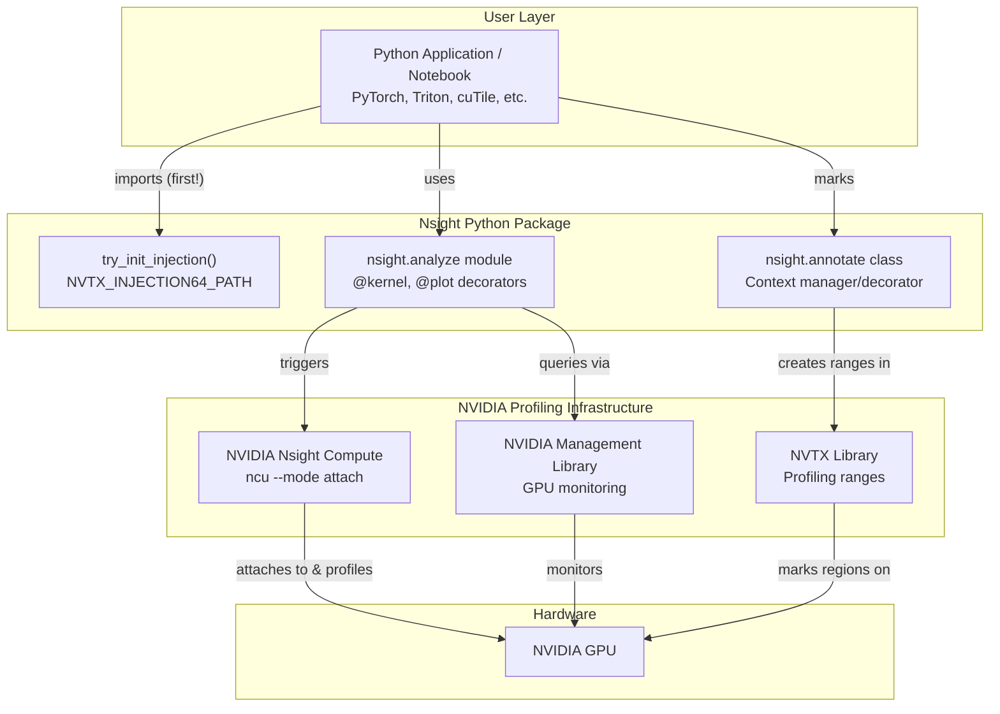

<!-- source: DeepWiki mcp.deepwiki.com · repo NVIDIA/nsight-python · page 1 Overview · fetched 2026-10-26 -->

# Overview

<details>
<summary>Relevant source files</summary>

The following files were used as context for generating this wiki page:

- [DESCRIPTION.rst](DESCRIPTION.rst)
- [README.md](README.md)
- [docs/source/_templates/version.html](docs/source/_templates/version.html)
- [docs/source/feedback.rst](docs/source/feedback.rst)
- [docs/source/index.rst](docs/source/index.rst)
- [docs/source/installation/runtime_requirements.rst](docs/source/installation/runtime_requirements.rst)
- [docs/source/overview/introduction.rst](docs/source/overview/introduction.rst)
- [docs/source/release_notes/topics/updates-in-nsight-python-0.9.5.rst](docs/source/release_notes/topics/updates-in-nsight-python-0.9.5.rst)
- [nsight/__init__.py](nsight/__init__.py)

</details>


This document introduces **Nsight Python**, a Python-based interface for profiling GPU kernels using NVIDIA Nsight Tools. It explains the tool's purpose, its position within the NVIDIA profiling ecosystem, and provides a high-level overview of the system architecture and core components.

For installation instructions, see [Installation](#2). For a hands-on introduction, see [Getting Started](#3). For detailed architectural information, see [Architecture Deep Dive](#5).

## What is Nsight Python?

Nsight Python is a Python package that automates GPU kernel profiling by orchestrating NVIDIA Nsight Compute and other NVIDIA profiling tools. As of version 1.0.0, it utilizes a sophisticated injection-based approach where the profiler attaches to the running process, eliminating the need for script relaunches and enabling seamless profiling in environments like Jupyter and Google Colab.

The package enables users to:
- Profile GPU kernels across multiple configurations from a single Python script or notebook.
- Collect detailed architectural metrics (memory throughput, compute utilization, etc.) with proper unit association.
- Annotate code regions using NVTX (NVIDIA Tools Extension) for fine-grained profiling.
- Prevent thermal throttling during benchmarking through GPU temperature monitoring and device-specific pinning.
- Generate publication-quality visualizations and structured CSV outputs.

**Target Users**: Researchers, GPU performance engineers, and developers who need detailed kernel-level metrics for optimization work.

**Sources**: [DESCRIPTION.rst:1-23](), [docs/source/overview/introduction.rst:1-30](), [README.md:1-67](), [nsight/__init__.py:1-17]()

## Position in the NVIDIA Ecosystem



**Diagram: Nsight Python as an Orchestration Layer**

Nsight Python acts as a high-level manager for NVIDIA's low-level profiling tools. A critical change in v1.0.0 is the `try_init_injection()` call at import time, which sets up the environment for `ncu --mode attach`. This allows the profiler to hook into the existing process rather than restarting it.

**Key Distinction**: Nsight Python does **not** replace NVIDIA Nsight Compute—it automates and orchestrates it. It requires `ncu` (version 2026.2.1+ or CUDA Toolkit 13.3 Update 1+) to be available on the system path.

**Sources**: [DESCRIPTION.rst:8](), [docs/source/overview/introduction.rst:6](), [nsight/__init__.py:8-12](), [docs/source/installation/runtime_requirements.rst:7-19]()

## Core Components and Code Entities

```mermaid
graph TB
    subgraph "Public API: nsight package"
        AnalyzeModule["nsight.analyze<br/>module"]
        AnnotateModule["nsight.annotate<br/>class"]
        Injection["try_init_injection()<br/>Injection Setup"]
    end
    
    subgraph "Decorators and Contexts"
        KernelDecorator["@analyze.kernel<br/>Function decorator"]
        PlotDecorator["@analyze.plot<br/>Function decorator"]
        AnnotateContext["annotate(...)<br/>Context manager"]
    end
    
    subgraph "Collection Layer: nsight.collection"
        NCUCollector["collection.ncu.NCUCollector<br/>ncu --mode attach"]
        ProfilingHooks["begin_profiling() / end_profiling()"]
    end
    
    subgraph "Processing Layers"
        Extraction["nsight.extraction<br/>extract_df_from_report"]
        Transformation["nsight.transformation<br/>aggregate_data & Units"]
        Visualization["nsight.visualization<br/>matplotlib / row_panel / col_panel"]
    end
    
    subgraph "Utilities"
        Thermovision["nsight.thermovision<br/>ThermalController (NVML)"]
        Verbosity["VerbosityLevel<br/>SILENT/INFO/DEBUG"]
    end
    
    AnalyzeModule --> KernelDecorator
    AnalyzeModule --> PlotDecorator
    AnnotateModule --> AnnotateContext
    
    KernelDecorator --> NCUCollector
    NCUCollector --> ProfilingHooks
    ProfilingHooks --> Extraction
    Extraction --> Transformation
    Transformation --> Visualization
    
    KernelDecorator -.."thermal_device"..-> Thermovision
    KernelDecorator -.."verbosity"..-> Verbosity
```

**Diagram: Core Code Components and Their Relationships**

The architecture is built around a pipeline that starts with the `analyze.kernel` decorator. It configures the `NCUCollector`, which manages the `begin_profiling()` and `end_profiling()` lifecycle. Data flows from raw reports through extraction and transformation (where units and derived metrics are handled) into the visualization layer.

**Sources**: [nsight/__init__.py:6-16](), [docs/source/overview/introduction.rst:8-9](), [docs/source/release_notes/topics/updates-in-nsight-python-0.9.5.rst:19-31]()

## Primary API Entry Points

| API Component | Type | Purpose | Key Updates (v1.0.0) |
|---------------|------|---------|----------------------|
| `@nsight.analyze.kernel` | Function decorator | Profile a function across multiple configurations | Injection-based (no relaunch), `thermal_device`, `verbosity` |
| `@nsight.analyze.plot` | Function decorator | Generate visualizations from results | Support for `row_panel` and `col_panel` |
| `nsight.annotate` | Context manager/decorator | Mark code regions with NVTX ranges | Required for identifying kernels in the report |
| `nsight.analyze.ignore_failures` | Context manager | Suppress profiling errors | Requires `cuda-core` dependency |

The `@analyze.kernel` decorator now supports keyword-only parameters and default value padding for complex configuration spaces. It also introduces `VerbosityLevel` to control output detail.

For details, see [Key Features and Capabilities](#1.2).

**Sources**: [nsight/__init__.py:6-16](), [docs/source/overview/introduction.rst:26]()

## Three-Phase Processing Pipeline

Nsight Python processes profiling data through three distinct phases:

### Phase 1: Collection
- **Injection**: `try_init_injection()` is called at import to set `NVTX_INJECTION64_PATH`.
- **Execution**: The user function runs. `NCUCollector` triggers `ncu --mode attach`.
- **Annotation**: `nsight.annotate` creates NVTX ranges that the profiler uses to filter data.
- **Thermal Control**: `ThermalController` monitors a specific `thermal_device` via NVML to prevent throttling.

### Phase 2: Extraction and Transformation
- **Parsing**: `extract_df_from_report` parses `.ncu-rep` files.
- **Unit Handling**: Results now include a `Unit` column for all metrics.
- **Derivation**: `derive_metric` functions calculate complex values (like TFLOPs), returning `(value, unit)` tuples.
- **Normalization**: Results can be normalized against a "baseline" annotation.

### Phase 3: Visualization and Output
- **Plotting**: `nsight.visualization` uses matplotlib to create multi-panel figures.
- **DataFrames**: Results are returned as `ProfileResults` containing a structured pandas DataFrame.
- **Formats**: Supports CSV export for both raw and aggregated data.

For details, see [High-Level Architecture](#1.1).

**Sources**: [docs/source/overview/introduction.rst:8](), [nsight/__init__.py:12](), [docs/source/installation/runtime_requirements.rst:9-19]()

## Typical Workflow

1. **Import First**: `import nsight` must occur before any CUDA initialization (e.g., `import torch`).
2. **Annotate**: Wrap GPU kernel invocations with `nsight.annotate`.
3. **Decorate**: Apply `@nsight.analyze.kernel` with desired `configs` and `metrics`.
4. **Execute**: Run the script or cell. The profiler attaches and collects data in-process.
5. **Analyze**: Inspect the returned DataFrame or generated CSVs.

```python
import nsight # MUST BE FIRST
import torch

@nsight.analyze.kernel(
    configs=[(16,), (32,)], # Parameter sweep
    metric=["sm__throughput.avg.pct_of_peak_sustained_elapsed", "gpu__time.avg"],
    verbosity=nsight.VerbosityLevel.INFO
)
def train_step(block_size):
    with nsight.annotate("forward_pass"):
        # GPU operations here
        pass
```

For a complete walkthrough, see [Quick Start Tutorial](#3.1).

**Sources**: [docs/source/installation/runtime_requirements.rst:9-19](), [docs/source/overview/introduction.rst:8-9]()

## System Requirements

- **Python**: 3.10 or later (v1.0.0 update).
- **NVIDIA Nsight Compute**: Version 2026.2.1.0 (CUDA Toolkit 13.3 Update 1) or later.
- **CUDA**: `cuda-core` and `cuda-bindings` are now required dependencies.
- **Frameworks**: Compatible with PyTorch, Triton, and cuTile.

For complete details, see [Dependencies and Requirements](#2.3).

**Sources**: [README.md:26-46](), [docs/source/installation/runtime_requirements.rst:7-8]()

## License and Support

Nsight Python is licensed under the **Apache License 2.0**. Support is provided via the [Nsight Python Developer Forum](https://forums.developer.nvidia.com/c/developer-tools/nsight-python/749).

**Sources**: [README.md:60-62](), [docs/source/feedback.rst:7]()

---

