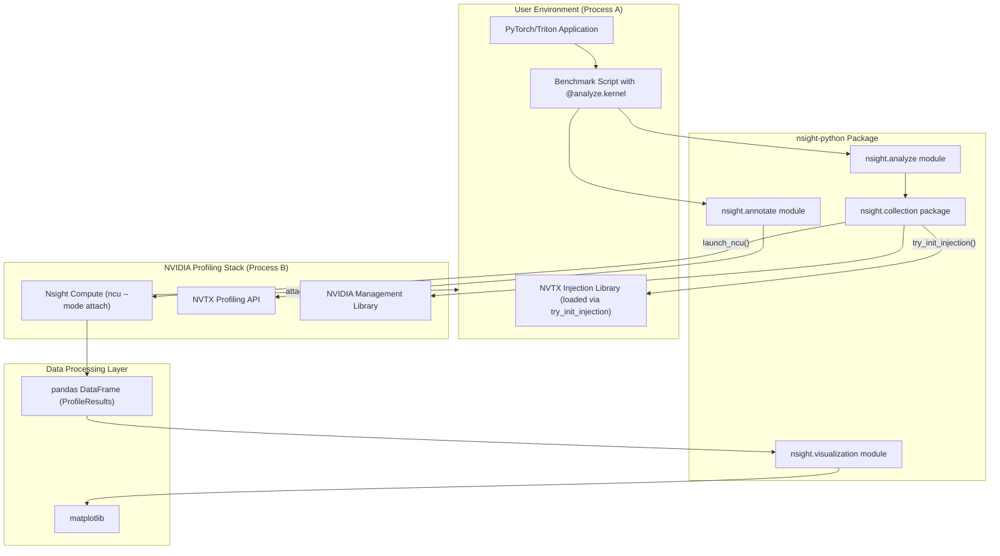
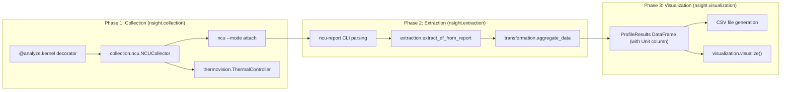
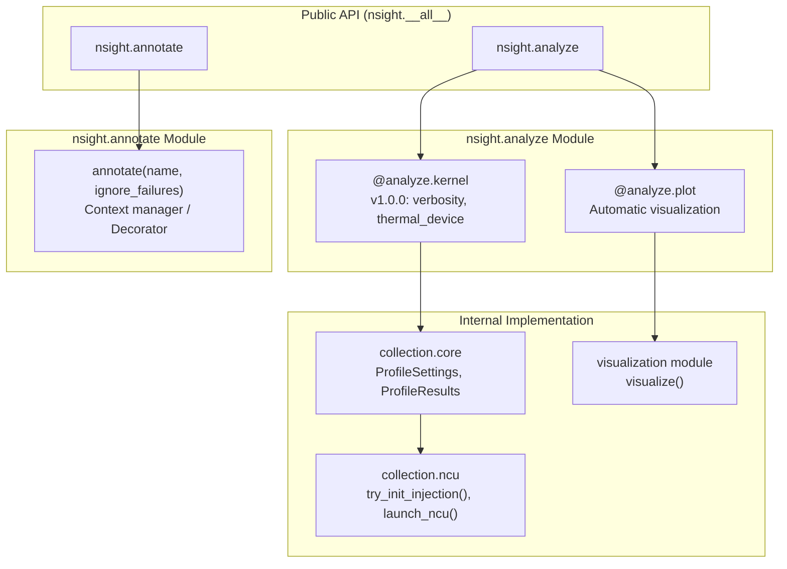
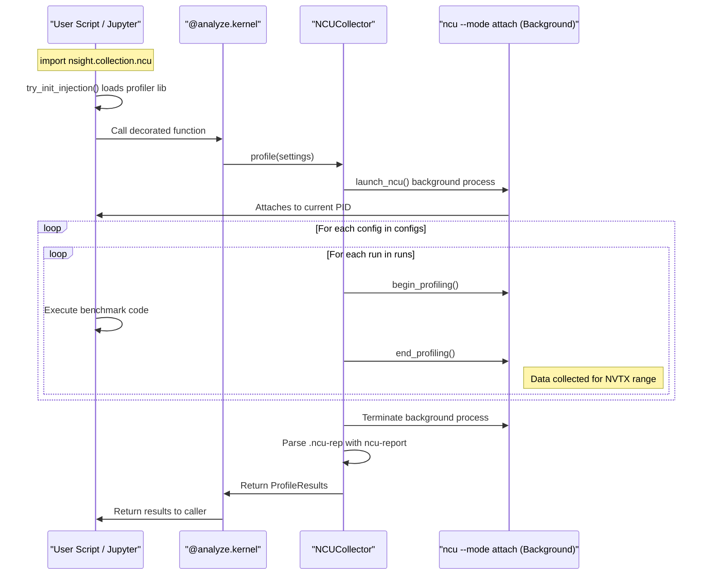

<!-- source: DeepWiki mcp.deepwiki.com · repo NVIDIA/nsight-python · page 1.1 High-Level Architecture · fetched 2026-10-26 -->

# High-Level Architecture

Relevant source files

The following files were used as context for generating this wiki page:

- [docs/source/overview/architecture.rst](docs/source/overview/architecture.rst)
- [nsight/analyze.py](nsight/analyze.py)
- [nsight/collection/core.py](nsight/collection/core.py)
- [nsight/visualization.py](nsight/visualization.py)

## Purpose and Scope

This document provides a high-level overview of nsight-python's system architecture, explaining how components relate to each other and how data flows through the system. As of version 1.0.0, the architecture has transitioned to an **injection-based attach model**, eliminating the need for script relaunches and enabling profiling in interactive environments like Jupyter and Google Colab.

- The three-phase pipeline (Collection, Extraction, Visualization)
- Core API surface and internal modules
- Integration points with NVIDIA profiling tools via the new attach mode
- Data flow from user code to analysis results

**Sources**: [docs/source/index.rst:1-72](), [docs/source/overview/architecture.rst:1-76]()

---

## System Overview: Orchestration Layer

nsight-python functions as a **Python-based orchestration layer** that bridges user code with NVIDIA's GPU profiling infrastructure. Instead of relaunching the script, it now uses `ncu --mode attach` to profile the current running process by injecting a profiling library at runtime.

### Key Architectural Characteristics

| Characteristic | Description |
|----------------|-------------|
| **Injection Pattern** | Uses `ncu --mode attach` to profile the existing process without relaunching [nsight/collection/ncu.py:168-175](). |
| **Python-Native** | All APIs are Python-first; outputs are `ProfileResults` containing pandas DataFrames [nsight/collection/core.py:1928-1945](). |
| **Non-Invasive** | Uses decorators and context managers; supports Jupyter/Colab since v1.0.0. |
| **Interactive Support** | No script relaunch means global state and imported modules are preserved across profiling runs. |

**Sources**: [nsight/collection/ncu.py:155-210](), [nsight/collection/core.py:1920-1950]()

---

## Three-Phase Pipeline Architecture

nsight-python implements a classic **ETL (Extract-Transform-Load) pattern** for GPU profiling data. The system processes data through three distinct phases:

### Phase 1: Collection

The Collection phase orchestrates GPU kernel profiling using the new injection approach:

- **Injection Initialization**: Upon importing `nsight.collection.ncu`, the system calls `try_init_injection()` to load the Nsight Compute injection library into the current process [nsight/collection/ncu.py:155-165]().
- **NCU Attach**: Instead of running the script *under* ncu, `NCUCollector` calls `launch_ncu()` which starts `ncu --mode attach` as a background process targeting the current PID [nsight/collection/ncu.py:175-205]().
- **Profiling Triggers**: The `begin_profiling()` and `end_profiling()` functions signal to the attached `ncu` process when to start and stop data collection for specific NVTX ranges [nsight/collection/ncu.py:212-240]().
- **Thermal Management**: The `ThermalController` [nsight/thermovision.py:48-65]() monitors GPU temperature via NVML to prevent thermal throttling, now supporting a specific `thermal_device` [nsight/analyze.py:83]().

### Phase 2: Extraction

The Extraction phase parses and transforms raw profiling data:

- **Report Parsing**: Raw `.ncu-rep` files are parsed using the `ncu-report` CLI tool [nsight/extraction.py:10-50]().
- **Metric Association**: The `extraction` module associates collected metrics with user-defined annotations and configuration tuples, now including a dedicated `Unit` column [nsight/collection/core.py:1940-1945]().
- **Derived Metrics**: The `transformation` module computes derived metrics. In v1.0.0, `derive_metric` functions should return `(value, unit)` tuples to populate the results correctly [nsight/analyze.py:142-152]().

### Phase 3: Visualization

The Visualization phase structures and presents results:

- **DataFrame Construction**: Results are organized into a `ProfileResults` object [nsight/collection/core.py:1928-1950]().
- **Unit Tracking**: The new `Unit` column ensures that metrics like TFLOPS and Latency are clearly labeled in both DataFrames and plots [nsight/collection/core.py:1942]().
- **Plot Generation**: The `visualization.visualize()` function [nsight/visualization.py:22-42]() generates plots, supporting subplots via `row_panels` and `col_panels` [nsight/visualization.py:95-107]().

**Sources**: [nsight/collection/core.py:1920-1960](), [nsight/analyze.py:61-155](), [nsight/collection/ncu.py:150-250]()

---

## Core API Surface

nsight-python exposes a minimal, focused public API through `nsight.analyze` and `nsight.annotate`.

### API Module Responsibilities

| Module | Primary Class/Function | Responsibility |
|--------|------------------------|----------------|
| `nsight.analyze` | `@analyze.kernel()` | Orchestrates profiling workflow, manages config matrix, supports keyword-only params [nsight/analyze.py:61-90](). |
| `nsight.analyze` | `VerbosityLevel` | New enum for controlling output (SILENT, INFO, DEBUG) [nsight/utils.py:20](). |
| `nsight.annotate` | `annotate` class | Creates NVTX ranges; now thread-local and prevents nested annotations [nsight/annotation.py:15-40](). |

**Sources**: [nsight/analyze.py:22-90](), [nsight/annotation.py:1-60](), [nsight/utils.py:1-30]()

---

## Internal Component Structure

The internal architecture follows a **layered abstraction pattern** updated for the injection-based model.

### Core Abstractions (`collection.core`)

1. **`ProfileSettings`**: Encapsulates all profiling configuration. In v1.0.0, this includes `thermal_device` for multi-GPU systems and `verbosity` [nsight/collection/core.py:1750-1800]().
2. **`ProfileResults`**: Container for results. It now includes the `Unit` column by default to improve data clarity [nsight/collection/core.py:1942]().
3. **`NsightProfiler`**: Abstract base class defining the `profile()` interface [nsight/collection/core.py:1820-1840]().

### Concrete Implementation: `NCUCollector`

The `NCUCollector` class [nsight/collection/ncu.py:115-145]() is the concrete implementation that:
- Uses `try_init_injection()` to prepare the Python process for profiling [nsight/collection/ncu.py:155]().
- Manages the lifecycle of the `ncu --mode attach` background process [nsight/collection/ncu.py:175]().
- Calls `begin_profiling()` and `end_profiling()` around the targeted code regions [nsight/collection/ncu.py:212-240]().

**Sources**: [nsight/collection/core.py:1740-1950](), [nsight/collection/ncu.py:110-250]()

---

## Data Flow and Execution Model (v1.0.0+)

The execution model has shifted from a relaunch pattern to an **attach-and-run pattern**.

### Configuration Matrix Execution

The system handles configuration padding and binding automatically. If a config tuple is shorter than the function signature, nsight-python pads it with the function's default parameter values [nsight/collection/core.py:49-71]().

### Injection and Threading

- **Injection**: `try_init_injection()` must succeed for profiling to work. It checks for the presence of the Nsight Compute injection library [nsight/collection/ncu.py:155-165]().
- **Thread Locality**: NVTX ranges are thread-local. Kernels launched from threads other than the one calling the `@analyze.kernel` function will not be captured [nsight/annotation.py:35-45]().

**Sources**: [nsight/collection/ncu.py:155-240](), [nsight/collection/core.py:49-108](), [nsight/annotation.py:15-50]()

---

