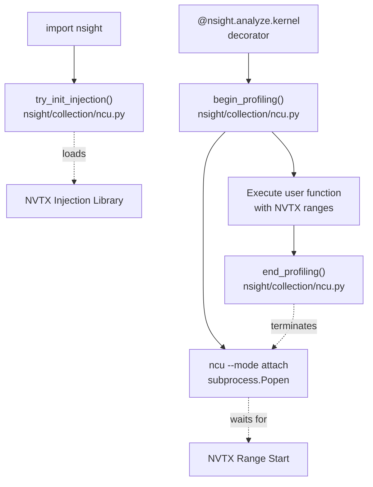
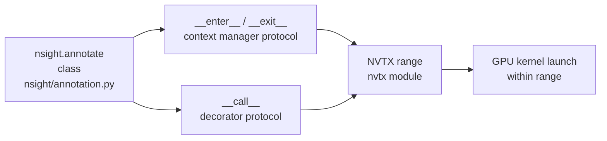
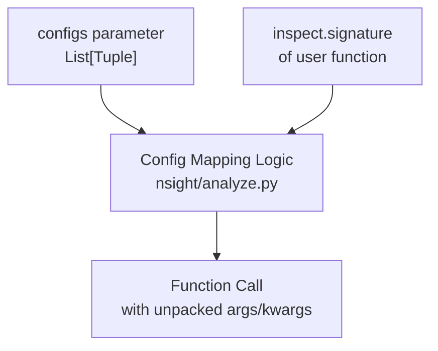

<!-- source: DeepWiki mcp.deepwiki.com · repo NVIDIA/nsight-python · page 1.2 Key Features and Capabilities · fetched 2026-10-26 -->

# Key Features and Capabilities

Relevant source files

The following files were used as context for generating this wiki page:

- [DESCRIPTION.rst](DESCRIPTION.rst)
- [docs/source/_templates/version.html](docs/source/_templates/version.html)
- [docs/source/analyze.rst](docs/source/analyze.rst)
- [docs/source/annotation.rst](docs/source/annotation.rst)
- [docs/source/feedback.rst](docs/source/feedback.rst)
- [docs/source/overview/core_concepts.rst](docs/source/overview/core_concepts.rst)
- [docs/source/overview/introduction.rst](docs/source/overview/introduction.rst)
- [docs/source/overview/quickstart.rst](docs/source/overview/quickstart.rst)
- [docs/source/release_notes/topics/updates-in-nsight-python-0.9.5.rst](docs/source/release_notes/topics/updates-in-nsight-python-0.9.5.rst)

## Purpose and Scope

This page describes the main features and capabilities of Nsight Python v1.0.0, explaining what the system can do and how these capabilities are implemented in the codebase. Nsight Python is a Python kernel profiling interface that automates performance analysis across multiple kernel configurations using NVIDIA Nsight Tools [DESCRIPTION.rst:8-9]().

## Overview

Nsight Python provides core capabilities that enable automated, large-scale GPU kernel profiling from Python, now including support for Jupyter and Google Colab through a new injection-based attach mechanism [docs/source/overview/introduction.rst:6-10]().

| Capability | Primary Component | User-Facing API |
|-----------|-------------------|-----------------|
| Decorator-based profiling | `nsight.analyze` | `@analyze.kernel` |
| NVTX code annotation | `nsight.annotate` | `nsight.annotate(...)` context |
| Multi-configuration execution | `collection.core.ProfileSettings` | `configs` parameter |
| Hardware metric collection | `collection.ncu.NCUCollector` | `metric` parameter |
| Thermal throttling prevention | `thermovision` | `thermal_control` / `thermal_device` |
| Custom derived metrics | `extraction.compute_derived_metric` | `derive_metric` parameter |
| Baseline normalization | `transformation.normalize_results` | `normalize_against` parameter |
| Publication-quality plots | `visualization.visualize` | `@analyze.plot` |

**Sources:** [docs/source/overview/introduction.rst:20-30](), [docs/source/overview/core_concepts.rst:7-12]()

---

## Injection-Based Profiling (New in v1.0.0)

Starting with v1.0.0, Nsight Python uses an injection-based approach. Instead of re-launching the entire script under `ncu`, the profiler attaches to the currently running process using `ncu --mode attach`.

### Feature Diagram: Injection and Attach Flow

**Key Implementation Details:**
- **Jupyter/Colab Support:** Because it attaches to a running process, it works in interactive environments where script re-execution is not possible.
- **Library Loading:** `try_init_injection()` is called at import time to prepare the environment for Nsight Compute attachment.
- **Process Management:** The `NCUCollector` manages the `ncu` lifecycle using `subprocess.Popen` without restarting the Python interpreter.

**Sources:** [docs/source/overview/quickstart.rst:7-34](), [docs/source/overview/introduction.rst:8-10]()

---

## NVTX Annotation System

The `nsight.annotate` class provides dual-mode operation as both a decorator and context manager for marking GPU kernel regions with NVTX ranges [docs/source/overview/core_concepts.rst:26-39]().

### Feature Diagram: Annotation Mechanism

**Annotation Capabilities:**
- **Context Manager:** `with nsight.annotate("label"):` wraps specific code blocks [docs/source/overview/core_concepts.rst:21-22]().
- **Decorator:** `@nsight.annotate("label")` annotates entire functions [docs/source/overview/core_concepts.rst:32-33]().
- **Unit Tracking:** v1.0.0 introduces the `Unit` column in results, tracking the measurement units (e.g., `ns`, `cycle`) for every metric [docs/source/overview/quickstart.rst:32-34]().

**Sources:** [docs/source/overview/core_concepts.rst:26-45](), [docs/source/annotation.rst:1-13]()

---

## Multi-Configuration Benchmarking

The `configs` parameter enables systematic profiling across parameter spaces. It supports regular parameters, keyword-only parameters, and default value padding [docs/source/overview/core_concepts.rst:47-60]().

### Configuration Processing Flow

**Configuration Features:**
- **Keyword-Only Support:** Config values are automatically passed to keyword-only parameters (after `*` in signature) [docs/source/overview/core_concepts.rst:65-66]().
- **Default Values:** If a config tuple is shorter than the function signature, trailing parameters with defaults are filled automatically [docs/source/overview/core_concepts.rst:67-68]().
- **Scalar Configs:** Single-argument functions can accept scalar configs instead of tuples [docs/source/release_notes/topics/updates-in-nsight-python-0.9.5.rst:13-14]().

**Sources:** [docs/source/overview/core_concepts.rst:47-82](), [docs/source/release_notes/topics/updates-in-nsight-python-0.9.5.rst:13-14]()

---

## Thermal Throttling Prevention

The `thermovision` subsystem prevents GPU throttling by monitoring temperature via NVML and enforcing cooling periods [docs/source/overview/introduction.rst:27]().

**Thermal Control Features:**
- **Adaptive Monitoring:** Checks temperature before each run.
- **Thermal Device Pinning:** Use `thermal_device` (new in v1.0.0) to specify which CUDA device index to monitor.
- **Throttling Prevention:** Delays execution until the GPU temperature drops below a safe threshold derived from `get_gpu_tlimit()`.

**Sources:** [docs/source/overview/introduction.rst:27](), [docs/source/analyze.rst:14]() (via `thermal_device` parameter reference)

---

## Derived Metrics and Normalization

Nsight Python supports computing new metrics from raw counters and normalizing results against a baseline [docs/source/overview/introduction.rst:28-29]().

**Derived Metric Capabilities:**
- **Custom Functions:** `derive_metric` accepts a callable. In v1.0.0, it is recommended to return a `(value, unit)` tuple to populate the `Unit` column.
- **TFLOPs Example:** Commonly used to calculate throughput from cycle counts and instruction counts.

**Normalization Features:**
- **Baseline Selection:** `normalize_against` takes an annotation name.
- **Relative Performance:** Automatically calculates speedup relative to the baseline.

**Sources:** [docs/source/overview/introduction.rst:28-29](), [docs/source/release_notes/topics/updates-in-nsight-python-0.9.5.rst:20-21]()

---

## Publication-Quality Visualization

The `@analyze.plot` decorator automates visualization using matplotlib [docs/source/overview/core_concepts.rst:83-84]().

| Feature | Description |
|---------|-------------|
| **Multi-Panel Plots** | Automatically generates subplots for multiple metrics. |
| **Data Export** | Generates both PNG plots and structured CSV files. |
| **Unit Awareness** | Uses the new `Unit` column to label axes correctly (e.g., "Runtime (ns)"). |
| **Customization** | Supports `row_panels` and `col_panels` for complex grids. |

**Sources:** [docs/source/overview/core_concepts.rst:83-92](), [docs/source/analyze.rst:16]()

---

## Framework-Agnostic Design

Nsight Python works with any Python framework that launches CUDA kernels because it profiles at the driver/NVTX level [docs/source/overview/introduction.rst:23]().

- **PyTorch:** Fully supported [docs/source/overview/quickstart.rst:11-26]().
- **Triton:** Fully supported [docs/source/overview/introduction.rst:23]().
- **cuTile:** Support added in v1.0.0.

**Sources:** [docs/source/overview/introduction.rst:23](), [docs/source/overview/quickstart.rst:11-26]()

---

