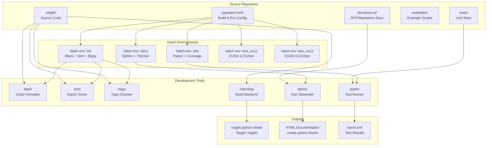
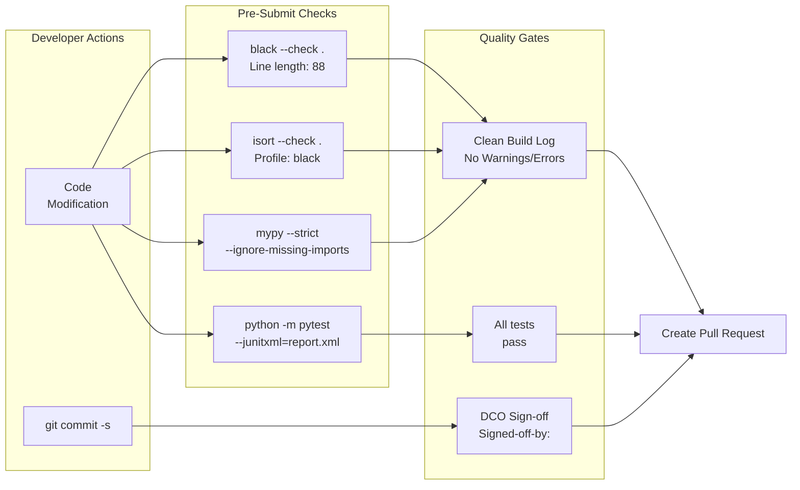

<!-- source: DeepWiki mcp.deepwiki.com · repo NVIDIA/nsight-python · page 10 Development and Contributing · fetched 2026-10-26 -->

# Development and Contributing

<details>
<summary>Relevant source files</summary>

The following files were used as context for generating this wiki page:

- [Contributing.md](Contributing.md)
- [nsight/thermovision.py](nsight/thermovision.py)
- [pyproject.toml](pyproject.toml)

</details>


This page provides guidance for developers who want to contribute to nsight-python. It covers the development environment setup, build system, code quality standards, testing procedures, and the contribution workflow. For detailed information on specific topics, see:
- Project structure and organization: [Project Structure](#10.1)
- Build tools and environments: [Build System and Development Tools](#10.2)
- Formal contribution process: [Contributing Guidelines](#10.3)
- Test organization and execution: [Testing](#10.4)
- Documentation building: [Documentation System](#10.5)

---

## Overview

nsight-python uses modern Python development practices centered around the **Hatch** build system [pyproject.toml:4-6](). The project maintains isolated environments for different development tasks (`docs`, `lint`, `test`), enforces code quality through automated formatting and type checking, and requires all contributions to follow the Developer Certificate of Origin (DCO) sign-off process [Contributing.md:68-82]().

As of v1.0.0, the project requires `cuda-core` and `cuda-bindings` as core dependencies to support the injection-based profiling mechanism [pyproject.toml:25-26]().

**Sources**: [pyproject.toml:1-121](), [Contributing.md:1-121]()

---

## Development Environment Architecture

The following diagram shows the relationship between development environments, tools, and outputs:



**Sources**: [pyproject.toml:4-6](), [pyproject.toml:48-49](), [pyproject.toml:69-121]()

---

## Development Environments

nsight-python defines several Hatch environments in [pyproject.toml:69-121]():

| Environment | Purpose | Dependencies | Commands |
|------------|---------|--------------|----------|
| `lint` | Code quality checks | `black`, `isort`, `mypy` | `hatch run lint:check`, `hatch run lint:format` |
| `docs` | Documentation building | `sphinx`, `furo`, `nvidia-sphinx-theme` | `hatch run docs:build` |
| `test` | Base testing env | `pytest`, `pytest-cov` | `hatch run test:run` |
| `test_cu12` | CUDA 12 testing | `cuda-core[cu12]` | `hatch run test_cu12:run` |
| `test_cu13` | CUDA 13 testing | `cuda-core[cu13]` | `hatch run test_cu13:run` |

### Using Hatch Environments

```bash
# Auto-format code according to project standards
hatch run lint:format

# Run type checking and linting
hatch run lint:check

# Build documentation locally
hatch run docs:build

# Run tests with CUDA 12 support
hatch run test_cu12:run
```

**Sources**: [pyproject.toml:79-121]()

---

## Code Quality Pipeline

The following diagram shows the code quality enforcement pipeline for contributors:



**Sources**: [pyproject.toml:84-112](), [Contributing.md:9-42](), [Contributing.md:68-82]()

---

## Code Quality Standards

### Formatting Requirements

- **black**: Automatic code formatting with 88-character line length [pyproject.toml:51-52]().
- **isort**: Import statement organization using the black profile [pyproject.toml:54-55]().
- **mypy**: Strict type checking with `--strict` and `--ignore-missing-imports` [pyproject.toml:95]().

### Configuration Details

| Tool | Configuration | Location |
|------|--------------|----------|
| `black` | `line-length = 88` | [pyproject.toml:51-52]() |
| `isort` | `profile = "black"` | [pyproject.toml:54-55]() |
| `mypy` | `--strict` | [pyproject.toml:95]() |
| `pytest` | Filters `SwigPy` and `swigvarlink` deprecation warnings | [pyproject.toml:63-68]() |

**Sources**: [pyproject.toml:51-68](), [pyproject.toml:84-101]()

---

## Testing

### Test Organization

The project organizes tests into specific functional areas to ensure coverage of the profiling pipeline:

- `tests/test_profiler.py`: Core `NsightProfiler` and `NCUCollector` logic.
- `tests/test_annotate.py`: `nsight.annotate` context manager and decorator behavior.
- `tests/test_thermovision.py`: `ThermalController` logic and NVML integration [nsight/thermovision.py:44-110]().
- `tests/test_api_params.py`: Validation of `@analyze.kernel` parameters.
- `tests/test_cuda_init_before_nsight.py`: Verifies injection works even if CUDA is initialized before the profiler.

### Running Tests

Tests are executed using `pytest`. The `test` environment is configured to use system packages to allow access to CUDA drivers and Nsight Compute binaries [pyproject.toml:108]().

```bash
# Run all tests in the default hatch test environment
hatch run test:run

# Run a specific test file
hatch run test:run tests/test_thermovision.py
```

**Sources**: [pyproject.toml:103-121](), [nsight/thermovision.py:1-110]()

---

## Contribution Workflow

### Issue Tracking
All enhancement, bugfix, or change requests must begin with an **Issue Request** on GitHub [Contributing.md:3-6]().

### Pull Request Process
1. **Fork and Clone**: Fork the repository and clone your fork [Contributing.md:48-54]().
2. **Implement**: Create a branch and implement changes following the coding guidelines.
3. **Sign-off**: Every commit must be signed with `git commit -s` to certify the Developer Certificate of Origin (DCO) [Contributing.md:68-82]().
4. **Submit**: Create a Pull Request (PR). Ensure the commit title uses the format `#<Issue Number> - <Title>` [Contributing.md:25-30]().
5. **Review**: Nsight Python engineers will review the PR. At least one review is required for acceptance [Contributing.md:63-64]().

**Sources**: [Contributing.md:1-82]()

---

## Documentation System

The documentation is built using **Sphinx** with the **Furo** and **NVIDIA Sphinx Theme** [pyproject.toml:70-77]().

### Building Docs Locally

```bash
# Build HTML documentation in the html/ directory
hatch run docs:build
```

The build process uses `sphinx-build -W` to treat warnings as errors, ensuring documentation integrity [pyproject.toml:81]().

**Sources**: [pyproject.toml:70-82]()

---

## Key Files Reference

| File | Purpose |
|------|---------|
| `pyproject.toml` | Defines build system (`hatchling`), dependencies, and dev environments [pyproject.toml:1-121]() |
| `nsight/thermovision.py` | Thermal monitoring and throttling prevention using NVML [nsight/thermovision.py:11-49]() |
| `Contributing.md` | Detailed guidelines on PRs, DCO, and coding standards [Contributing.md:1-121]() |
| `nsight/` | Main package source code [pyproject.toml:49]() |

**Sources**: [pyproject.toml:1-121](), [nsight/thermovision.py:1-49](), [Contributing.md:1-121]()

---

