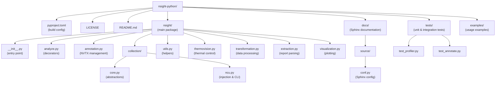
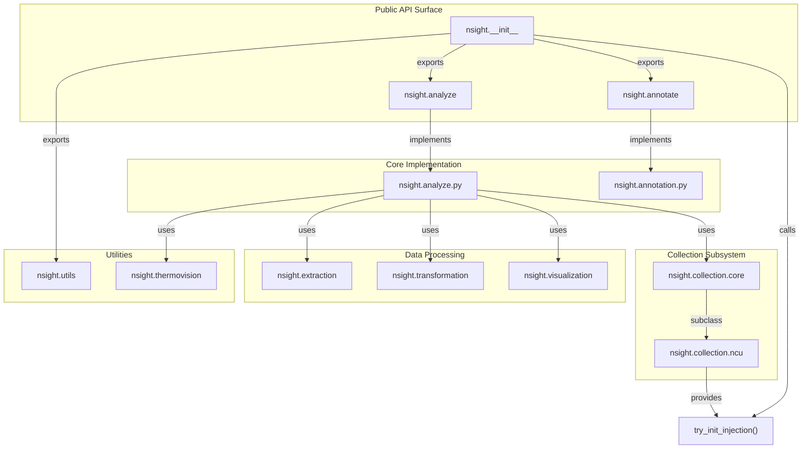
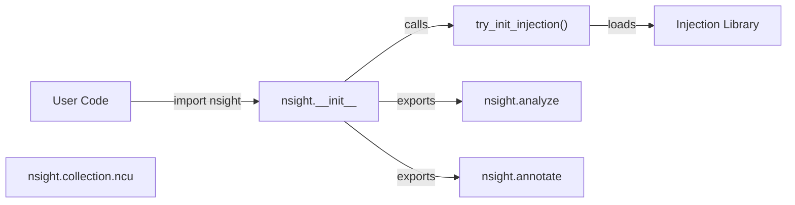
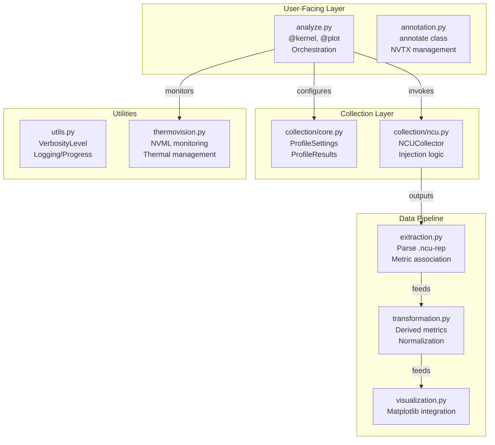

<!-- source: DeepWiki mcp.deepwiki.com · repo NVIDIA/nsight-python · page 10.1 Project Structure · fetched 2026-10-26 -->

# Project Structure

<details>
<summary>Relevant source files</summary>

The following files were used as context for generating this wiki page:

- [nsight/__init__.py](nsight/__init__.py)
- [nsight/collection/__init__.py](nsight/collection/__init__.py)

</details>


## Purpose and Scope

This document describes the organization of the `nsight-python` repository, including the directory layout, Python package structure, and module hierarchy. It provides a map from the repository's physical structure to its logical components, helping developers understand where different functionality resides and how modules relate to each other.

As of version 1.0.0, the project architecture has shifted to an **injection-based attach mode**, where Nsight Compute (NCU) attaches to the running process without requiring a script relaunch. This change is reflected in the package initialization and collection logic.

**Sources:** [nsight/__init__.py:1-17](), [nsight/collection/ncu.py:1-20]()

---

## Repository Layout

The `nsight-python` repository follows a standard Python project structure with clear separation between source code, tests, documentation, and examples.

### Directory Structure



**Sources:** [nsight/__init__.py:1-17](), [nsight/collection/__init__.py:1-11]()

---

## Package Structure

The `nsight` package is organized into a public API layer and internal implementation modules. A critical feature in v1.0.0 is the automatic initialization of the injection library upon package import.

### Module Hierarchy



**Sources:** [nsight/__init__.py:4-16](), [nsight/collection/__init__.py:6-8]()

---

## Package Entry Point and Public API

The package's public interface is defined in `nsight/__init__.py`. It handles the crucial task of loading NVTX injection symbols to support NCU's attach mode.

### Public Exports

| Symbol | Type | Source | Purpose |
|--------|------|--------|---------|
| `analyze` | Module | `nsight.analyze` | Profiling decorators (`@kernel`, `@plot`) |
| `annotate` | Class | `nsight.annotation` | NVTX range marking context/decorator |
| `VerbosityLevel` | Enum | `nsight.utils` | Controls output detail (SILENT, INFO, DEBUG) |
| `col_panel` | Function | `nsight.utils` | Layout utility for visualization subplots |
| `row_panel` | Function | `nsight.utils` | Layout utility for visualization subplots |

Upon import, the package calls `try_init_injection()` [nsight/__init__.py:12](), which attempts to load the necessary libraries for Nsight Compute to intercept GPU activities without restarting the Python process.



**Sources:** [nsight/__init__.py:6-16](), [nsight/collection/ncu.py:8-12]()

---

## Module Organization and Responsibilities

### Core Modules

The `nsight` package contains several modules with distinct responsibilities that form the three-phase pipeline (Collection, Extraction, Visualization):



**Sources:** [nsight/__init__.py:6-12](), [nsight/collection/__init__.py:6-8]()

---

## Collection Subsystem Architecture

The `nsight.collection` package abstracts the profiling backend. It is responsible for the transition from Natural Language Space (user configurations) to Code Entity Space (CLI commands and library calls).

### Collection Package Structure

| File | Entity | Responsibility |
|------|--------|----------------|
| `core.py` | `ProfileSettings` | Stores user-defined metrics, configs, and replay modes. |
| `core.py` | `NsightProfiler` | Abstract Base Class defining the `run()` interface. |
| `ncu.py` | `NCUCollector` | Concrete implementation using Nsight Compute. |
| `ncu.py` | `try_init_injection` | Loads symbols for `ncu --mode attach`. |
| `ncu.py` | `begin_profiling` | Signals NCU to start capturing a range. |

```mermaid
graph TB
    subgraph "nsight.collection.core"
        PS["ProfileSettings<br/>(Data Object)"]
        NP["NsightProfiler<br/>(ABC)"]
    end
    
    subgraph "nsight.collection.ncu"
        NCU["NCUCollector"]
        Inj["try_init_injection()"]
        Begin["begin_profiling()"]
        End["end_profiling()"]
    end
    
    NCU --|> NP
    NCU -->|"uses"| PS
    NCU -->|"invokes"| Begin
    NCU -->|"invokes"| End
```

**Sources:** [nsight/collection/__init__.py:6-10](), [nsight/collection/ncu.py:1-20]()

---

## Dependency Management

The project requirements have evolved in v1.0.0 to ensure better compatibility with the injection-based approach.

### Dependency Categories

| Category | Dependencies | Purpose |
|----------|--------------|---------|
| **Runtime** | `nvtx`, `pandas`, `numpy`, `matplotlib`, `nvidia-ml-py`, `ncu-report` | Core functionality and data processing. |
| **CUDA Core** | `cuda-core` (Required) | Required for CUDA context management and `ignore_failures`. |
| **Extras** | `cu12`, `cu13` | Selects specific `cuda-core` variants for CUDA 12.x or 13.x. |

**Sources:** [nsight/__init__.py:4-14](), [nsight/collection/ncu.py:8-12]()

---

## Summary

The `nsight-python` repository is structured to support a seamless profiling experience:

- **`nsight/__init__.py`**: Acts as the gatekeeper, initializing the injection environment and exposing the public API.
- **`nsight/analyze.py`**: The primary orchestrator that coordinates between collection, thermal management, and visualization.
- **`nsight/collection/`**: Encapsulates the complexity of interacting with Nsight Compute, specifically the new injection-based attach mechanism.
- **`nsight/utils.py`**: Provides cross-cutting concerns like verbosity control and UI helpers.

This modularity allows for the "Three-Phase Pipeline" (Collection → Extraction → Visualization) to operate efficiently, even within restricted environments like Jupyter or Google Colab.

**Sources:** [nsight/__init__.py:1-17](), [nsight/collection/__init__.py:1-11]()

---

