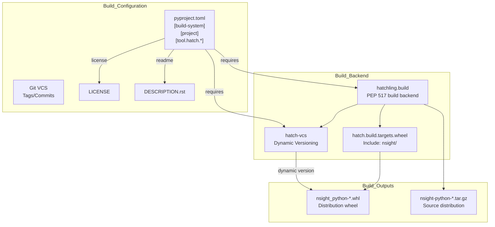
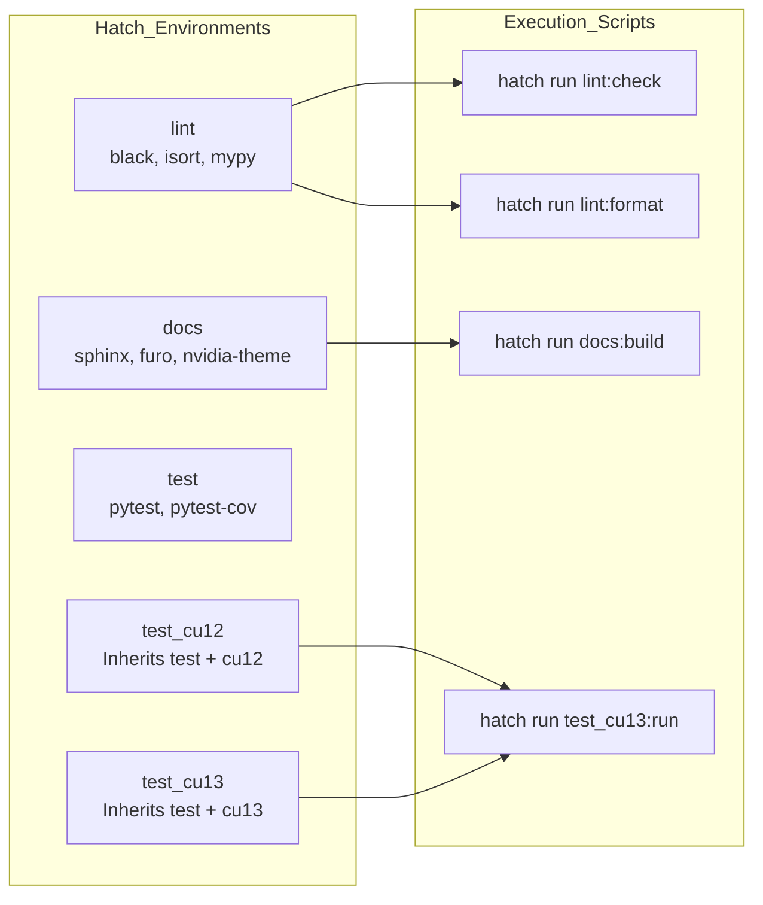

<!-- source: DeepWiki mcp.deepwiki.com · repo NVIDIA/nsight-python · page 10.2 Build System and Development Tools · fetched 2026-10-26 -->

# Build System and Development Tools

<details>
<summary>Relevant source files</summary>

The following files were used as context for generating this wiki page:

- [.github/copy-pr-bot.yaml](.github/copy-pr-bot.yaml)
- [.github/workflows/ci.yaml](.github/workflows/ci.yaml)
- [nsight/thermovision.py](nsight/thermovision.py)
- [pyproject.toml](pyproject.toml)

</details>


## Purpose and Scope

This page documents the build system and development tools used in the `nsight-python` project. It covers the build configuration, package structure, development environments, code quality tools, and testing infrastructure. As of version 1.0.0, the build system has transitioned to a VCS-based versioning scheme and expanded its environment definitions to support multi-version CUDA testing.

**Sources:** [pyproject.toml:1-121](), [.github/workflows/ci.yaml:1-63]()

---

## Build System Architecture

The `nsight-python` project uses **Hatch** as its build orchestrator and **Hatchling** as its build backend [pyproject.toml:4-6](). This approach provides isolated environments and reproducible builds through `pyproject.toml`.

### Build System Components



**Diagram: Build System Component Flow**

The build system is configured in several key sections:
- **`[build-system]`**: Specifies `hatchling` and `hatch-vcs` as requirements [pyproject.toml:4-6]().
- **`[tool.hatch.version]`**: Uses the `vcs` source to determine the version from Git tags [pyproject.toml:60-61]().
- **`[tool.hatch.build.targets.wheel]`**: Explicitly includes only the `nsight` package directory [pyproject.toml:48-49]().

**Sources:** [pyproject.toml:4-6](), [pyproject.toml:48-49](), [pyproject.toml:60-61]()

---

## Package Configuration

### Project Metadata and Dependencies

| Field | Value | Description |
|-------|-------|-------------|
| `name` | `nsight-python` | Package name [pyproject.toml:9]() |
| `requires-python` | `>=3.10` | Minimum Python version [pyproject.toml:13]() |
| `dependencies` | `nvtx`, `pandas`, `numpy`, `matplotlib`, `ncu-report`, `cuda-core`, `cuda-bindings`, `deepdiff` | Core runtime requirements [pyproject.toml:18-27]() |

**Sources:** [pyproject.toml:8-27]()

### Dependency Management (v1.0.0+)

As of v1.0.0, `cuda-core` and `cuda-bindings` are mandatory dependencies [pyproject.toml:25-26](). The project provides optional extras to select specific CUDA-version-optimized variants:

```toml
[project.optional-dependencies]
cu12 = ["cuda-core[cu12]"]
cu13 = ["cuda-core[cu13]"]
```

**Sources:** [pyproject.toml:40-42]()

---

## Development Environments

Hatch manages isolated environments for linting, documentation, and testing across different CUDA versions.



**Diagram: Hatch Environment Hierarchy**

### Code Quality (Lint)
The `lint` environment enforces strict formatting and typing:
- **Black**: Standardized formatting with line-length 88 [pyproject.toml:51-52]().
- **Isort**: Import sorting using the `black` profile [pyproject.toml:54-55]().
- **Mypy**: Strict static type checking [pyproject.toml:95]().

### Documentation (Docs)
The `docs` environment builds the Sphinx documentation using the `nvidia-sphinx-theme` and `furo` [pyproject.toml:74-75]().
- **Command**: `hatch run docs:build` [pyproject.toml:80-82]().

### Testing (Test)
Testing is split into CUDA-specific environments to ensure compatibility with different toolkit versions:
- `test_cu12`: Uses the `cu12` feature [pyproject.toml:114-117]().
- `test_cu13`: Uses the `cu13` feature [pyproject.toml:118-121]().

**Sources:** [pyproject.toml:70-121]()

---

## Continuous Integration (CI)

The project uses GitHub Actions for automated validation. The CI pipeline ensures code quality and functional correctness on actual GPU hardware.

### CI Workflow Jobs

1.  **Lint**: Runs `hatch run lint:check` on `ubuntu-latest` [.github/workflows/ci.yaml:13-23]().
2.  **Build Docs**: Runs `hatch run docs:build` to verify documentation integrity [.github/workflows/ci.yaml:25-35]().
3.  **Test**: Runs functional tests on GPU runners (H100 and L4) using a PyTorch container [.github/workflows/ci.yaml:37-49]().

### Hardware Testing Matrix
The CI utilizes specialized runners to test against different architectures:
- **linux-amd64-gpu-h100-latest-1**: x86_64 architecture [.github/workflows/ci.yaml:43-44]().
- **linux-arm64-gpu-l4-latest-1**: sbsa architecture [.github/workflows/ci.yaml:45-46]().

The tests specifically install Nsight Compute 2026.2.1.0 (CUDA 13.3 Update 1) before execution [.github/workflows/ci.yaml:52-58]().

**Sources:** [.github/workflows/ci.yaml:13-63]()

---

## Development Workflow Summary

| Task | Command | Environment |
|------|---------|-------------|
| **Format Code** | `hatch run lint:format` | `lint` |
| **Check Quality** | `hatch run lint:check` | `lint` |
| **Build Docs** | `hatch run docs:build` | `docs` |
| **Run Tests (CU13)** | `hatch run test_cu13:run` | `test_cu13` |
| **Clean Install** | `pip install -e .[cu13]` | Local |

### Thermal Monitoring in Development
During testing and development, the `ThermalController` in `nsight/thermovision.py` is utilized to prevent hardware damage or throttling. It supports `auto`, `manual`, and `off` modes [nsight/thermovision.py:53-58]().

**Sources:** [pyproject.toml:91-121](), [nsight/thermovision.py:44-59]()

---

