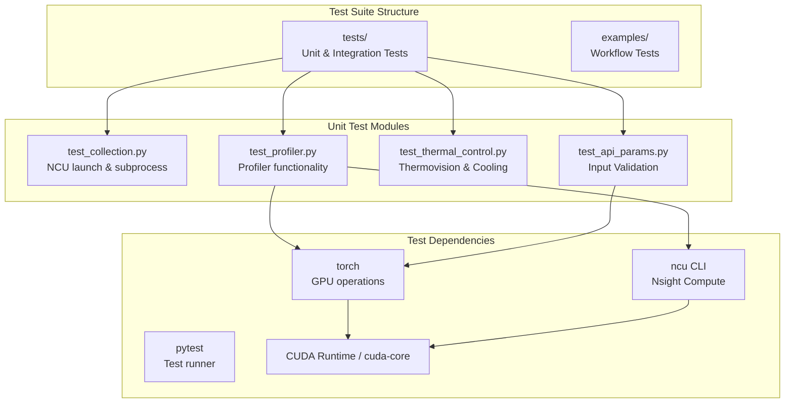
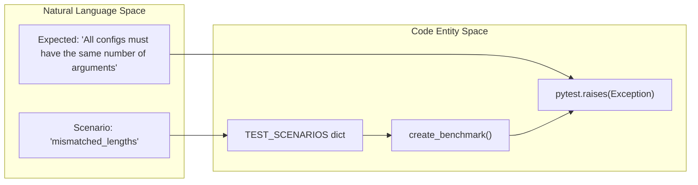

<!-- source: DeepWiki mcp.deepwiki.com · repo NVIDIA/nsight-python · page 10.4 Testing · fetched 2026-10-26 -->

# Testing

<details>
<summary>Relevant source files</summary>

The following files were used as context for generating this wiki page:

- [.github/copy-pr-bot.yaml](.github/copy-pr-bot.yaml)
- [.github/workflows/ci.yaml](.github/workflows/ci.yaml)
- [tests/run_api_params.py](tests/run_api_params.py)
- [tests/test_api_params.py](tests/test_api_params.py)
- [tests/test_profiler.py](tests/test_profiler.py)
- [tests/test_thermal_control.py](tests/test_thermal_control.py)

</details>


This document covers the test infrastructure for nsight-python, including test organization, prerequisites, running tests, and patterns used in the test suite. For information about the build system and development tools, see [Build System and Development Tools]().

## Purpose and Scope

The nsight-python test suite validates profiler functionality, configuration handling, and integration with NVIDIA Nsight Compute. Tests are organized into two main categories: unit tests in the `tests/` directory and example-based integration tests in the `examples/` directory. The test suite requires PyTorch for GPU operations and NVIDIA Nsight Compute to be installed and available in the system PATH.

---

## Test Organization

The codebase uses `pytest` for testing, with specialized modules targeting different subsystems.



**Sources**: [tests/test_profiler.py:1-18](), [tests/test_api_params.py:1-15](), [tests/test_thermal_control.py:1-12]()

---

## Test Categories

The test suite is divided into distinct categories based on functionality and testing approach:

| Category | Location | Purpose | Key Symbols |
|----------|----------|---------|-------------|
| **Profiler Core** | `tests/test_profiler.py` | Test decorator syntax, config handling, and kernel execution. | `decorator_without_parens`, `_simple_kernel_impl` |
| **API Validation** | `tests/test_api_params.py` | Validate error handling for invalid configs, arg counts, and runtime errors. | `TEST_SCENARIOS`, `create_benchmark` |
| **Thermal Control** | `tests/test_thermal_control.py` | Stress test GPU to trigger thermovision cooling mechanisms. | `heavy_gemm_kernel`, `thermal_mode="auto"` |
| **Collection** | `tests/test_collection.py` | Validate NCU launcher, subprocess management, and environment variables. | `test_launch_ncu_runs_with_ncu_available` |
| **Integration** | `examples/` | End-to-end profiling workflows and real-world scenarios. | `examples/00_minimal.py` |

**Sources**: [tests/test_profiler.py:1-12](), [tests/test_api_params.py:20-68](), [tests/test_thermal_control.py:14-19]()

---

## Prerequisites and System Requirements

Tests are executed within a CI environment using specific NVIDIA Pytorch containers and GPU hardware.

### CI Environment (GitHub Actions)
The CI pipeline utilizes the following hardware and software stack:
- **Runners**: `linux-amd64-gpu-h100-latest-1` and `linux-arm64-gpu-l4-latest-1`. [ .github/workflows/ci.yaml:43-46 ]()
- **Container**: `nvcr.io/nvidia/pytorch:26.06-py3` with `--cap-add=SYS_ADMIN --gpus all`. [ .github/workflows/ci.yaml:48-49 ]()
- **Nsight Compute**: NCU 2026.2.1.0 (CUDA 13.3 Update 1). [ .github/workflows/ci.yaml:52-58 ]()

### Required Dependencies
- **pytest**: Test runner.
- **cuda-core**: Required for GPU bindings.
- **PyTorch**: Used for launching kernels in tests.

**Sources**: [ .github/workflows/ci.yaml:37-63 ](), [tests/test_profiler.py:12-14]()

---

## Running Tests with Hatch

The project uses `hatch` to manage test environments and dependencies.

```bash
# Run tests for CUDA 12 environment
hatch run test_cu12:run

# Run tests for CUDA 13 environment
hatch run test_cu13:run

# Run specific test file manually with pytest
pytest tests/test_api_params.py -v
```

**Sources**: [ .github/workflows/ci.yaml:62 ]()

---

## Test Structure and Patterns

### API Parameter Validation
The `test_api_params.py` module uses a scenario-driven approach to validate that the profiler raises correct exceptions for invalid inputs.



**Implementation Details**:
- **Scenarios**: `TEST_SCENARIOS` defines cases like `no_configs`, `empty_configs`, `both_configs`, and `wrong_arg_count`. [tests/test_api_params.py:20-68]()
- **Validation**: `test_config_validation_errors` iterates through these scenarios, calling `create_benchmark` and asserting that `pytest.raises` catches the expected error message. [tests/test_api_params.py:135-190]()

**Sources**: [tests/test_api_params.py:20-190]()

---

### Thermal Management Testing
The `test_thermal_control.py` module contains a "heavy" kernel designed to trigger thermal throttling and verify the `thermovision` subsystem.

- **Kernel**: `heavy_gemm_kernel` performs extreme computation (12288x12288 matrices, 20 matrix multiplications per iteration). [tests/test_thermal_control.py:20-52]()
- **Settings**: Uses `thermal_mode="auto"` and `verbosity=nsight.VerbosityLevel.DEBUG` to monitor cooling cycles. [tests/test_thermal_control.py:16-18]()

**Sources**: [tests/test_thermal_control.py:14-56]()

---

### Profiler Functionality Patterns
The `test_profiler.py` suite validates the core `@nsight.analyze.kernel` decorator.

| Test Feature | Code Entity | Purpose |
|--------------|-------------|---------|
| **No Parentheses** | `decorator_without_parens` | Ensures `@nsight.analyze.kernel` works without `()`. [tests/test_profiler.py:50-59]() |
| **Empty Parentheses** | `decorator_with_empty_parens` | Validates `@nsight.analyze.kernel()`. [tests/test_profiler.py:64-72]() |
| **Positional Configs** | `test_config_at_call_time_positional` | Tests passing configs directly to the function call. [tests/test_profiler.py:113-116]() |
| **No Arguments** | `test_no_args_function_with_parens` | Tests profiling a function that takes no parameters. [tests/test_profiler.py:187-206]() |

**Sources**: [tests/test_profiler.py:50-206]()

---

## CLI Test Tools
For manual QA, `tests/run_api_params.py` provides a CLI wrapper around the validation scenarios.

- **List Scenarios**: `python run_api_params.py --list-scenarios` [tests/run_api_params.py:27-39]()
- **Run Specific Scenario**: `python run_api_params.py --scenario inconsistent_kernel_counts` [tests/run_api_params.py:192-197]()
- **Parameter Resolution**: Uses `resolve_all_params` to prioritize scenario overrides over CLI arguments. [tests/run_api_params.py:50-84]()

**Sources**: [tests/run_api_params.py:1-197]()

---

