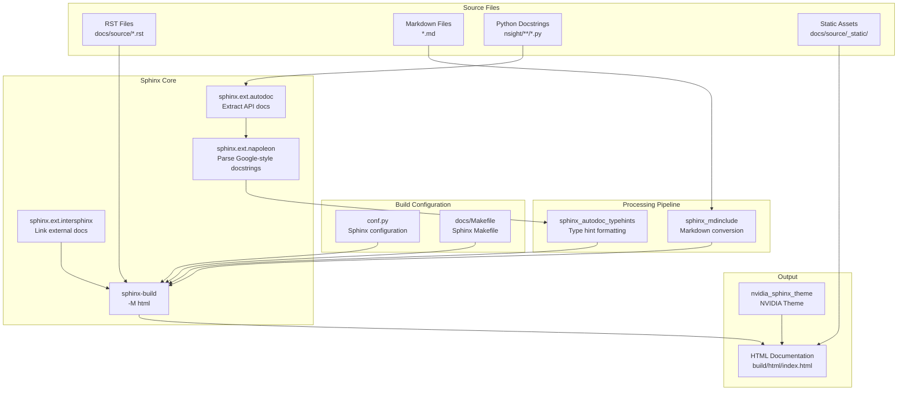
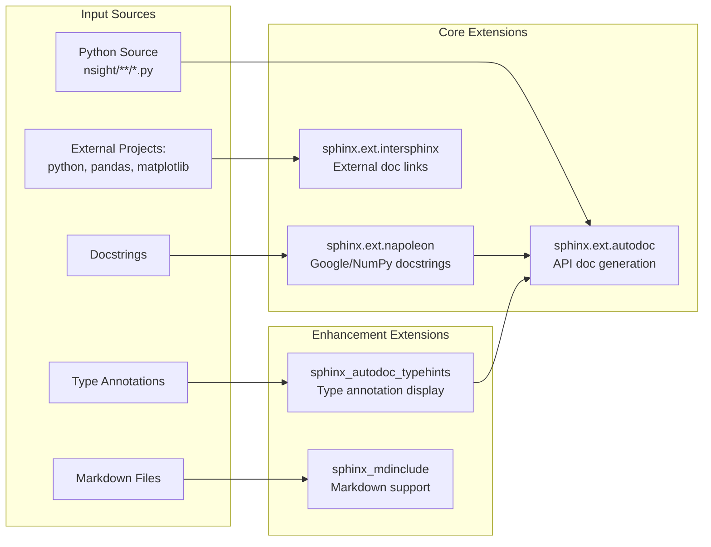
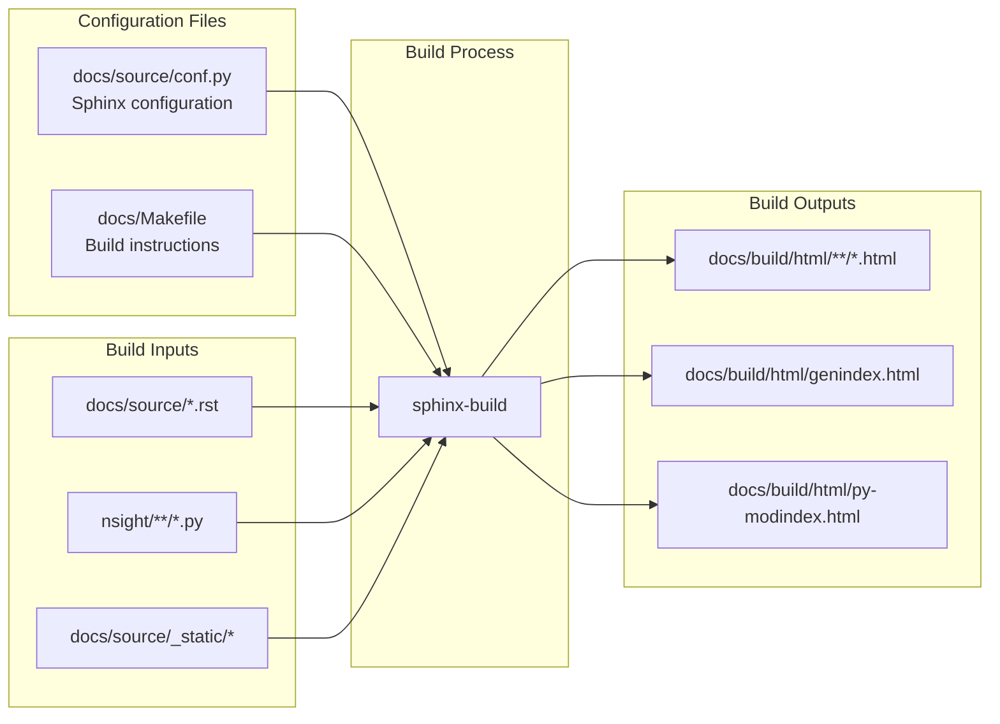

<!-- source: DeepWiki mcp.deepwiki.com · repo NVIDIA/nsight-python · page 10.5 Documentation System · fetched 2026-10-26 -->

# Documentation System

<details>
<summary>Relevant source files</summary>

The following files were used as context for generating this wiki page:

- [docs/Makefile](docs/Makefile)
- [docs/source/conf.py](docs/source/conf.py)
- [docs/source/release_notes/topics/updates-in-nsight-python-0.9.6.rst](docs/source/release_notes/topics/updates-in-nsight-python-0.9.6.rst)

</details>


This page documents the Sphinx-based documentation build system for nsight-python, including configuration, extensions, themes, and build processes. For information about contributing to documentation content, see [Contributing Guidelines](#10.3). For details on the overall build system and development tools, see [Build System and Development Tools](#10.2).

## Purpose and Scope

The nsight-python documentation system uses Sphinx to generate HTML documentation from reStructuredText (RST) and Markdown source files, combined with automatic API documentation extracted from Python docstrings. The system integrates with Hatch for build orchestration and uses the NVIDIA-branded theme for consistent styling across NVIDIA documentation products.

**Sources:** [docs/source/conf.py:1-33](), [docs/Makefile:1-24]()

## Documentation Architecture

The documentation system follows a standard Sphinx architecture with source files in `docs/source/`, built outputs in `build/html/`, and configuration in `docs/source/conf.py`:



**Documentation Build Pipeline**

The system processes multiple input formats (RST, Markdown, Python docstrings) through Sphinx extensions, applies the NVIDIA theme, and produces HTML output with cross-references to external documentation.

**Sources:** [docs/source/conf.py:27-33](), [docs/Makefile:9-23]()

## Sphinx Configuration

The Sphinx configuration is defined in `docs/source/conf.py` and controls all aspects of documentation generation:

| Configuration | Value | Purpose |
|--------------|-------|---------|
| `project` | `"nsight-python"` | Project name displayed in documentation |
| `release` | `importlib.metadata.version("nsight-python")` | Dynamic version from installed package |
| `html_theme` | `"nvidia_sphinx_theme"` | NVIDIA-branded theme |
| `sys.path.insert(0, ...)` | `../../` | Enable autodoc to import nsight package |

### Project Metadata

The configuration extracts project metadata dynamically:

```python
# Line 13: Add nsight package to Python path for autodoc
sys.path.insert(0, os.path.abspath("../../"))

# Lines 19-22: Project metadata
project = "nsight-python"
copyright = "2025-2026, NVIDIA"
author = "NVIDIA"
release = importlib.metadata.version("nsight-python")
```

This approach ensures the documentation always displays the correct version number from the installed package metadata rather than requiring manual updates.

**Sources:** [docs/source/conf.py:13-22]()

## Sphinx Extensions

The documentation system uses five primary Sphinx extensions to enable various features:



**Extension Configuration and Data Flow**

### Extension Purposes

| Extension | Purpose | Configuration |
|-----------|---------|---------------|
| `sphinx.ext.autodoc` | Extract API documentation from Python docstrings | `autodoc_default_options` dict |
| `sphinx.ext.napoleon` | Parse Google-style and NumPy-style docstrings | Enabled by default |
| `sphinx.ext.intersphinx` | Create links to Python, pandas, matplotlib docs | `intersphinx_mapping` dict |
| `sphinx_autodoc_typehints` | Format type hints in documentation | `autodoc_typehints = "description"` |
| `sphinx_mdinclude` | Include Markdown files in RST documents | No specific config |

**Sources:** [docs/source/conf.py:27-33](), [docs/source/conf.py:54-63]()

## Autodoc Configuration

The autodoc extension configuration controls how Python API documentation is automatically generated:

```python
# Lines 54-59: Autodoc default options
autodoc_default_options = {
    "members": True,           # Document all class/module members
    "undoc-members": True,     # Include members without docstrings
    "show-inheritance": True,  # Display class inheritance
    "fullname": True,          # Use fully qualified names
}

# Lines 61-63: Type hints configuration
autodoc_typehints = "description"  # Show type hints in descriptions
typehints_use_rtype = True         # Show return types
typehints_use_signature = True     # Show types in signatures
```

This configuration ensures comprehensive API documentation with type information displayed both in function signatures and parameter descriptions.

**Sources:** [docs/source/conf.py:54-63]()

## Intersphinx Mapping

Intersphinx enables cross-references to external documentation, allowing links from nsight-python docs to Python standard library, pandas, and matplotlib documentation:

```python
# Lines 41-45: External documentation links
intersphinx_mapping = {
    "python": ("https://docs.python.org/3", None),
    "pandas": ("https://pandas.pydata.org/docs/", None),
    "matplotlib": ("https://matplotlib.org/stable/", None),
}
```

This allows documentation to reference types like `pandas.DataFrame` or `matplotlib.figure.Figure` with automatic hyperlinks to their respective documentation sites.

**Sources:** [docs/source/conf.py:41-45]()

## Build System Integration

The documentation build is integrated with Hatch's environment management system, providing isolated dependencies and reproducible builds.

### Build Command

To build documentation locally using the Hatch environment:

```bash
hatch run docs:build
```

This command triggers the `docs:build` script which internally uses the Sphinx Makefile logic. The Makefile defines standard targets:

```makefile
# docs/Makefile:22-23
%: Makefile
	@$(SPHINXBUILD) -M $@ "$(SOURCEDIR)" "$(BUILDDIR)" $(SPHINXOPTS) $(O)
```

**Sources:** [docs/Makefile:9-23]()

## Theme Configuration

The documentation uses the NVIDIA-branded Sphinx theme with custom configuration for version switching:

```python
# Line 51: Theme selection
html_theme = "nvidia_sphinx_theme"

# Lines 67-72: Theme options for version switcher
html_theme_options = {
    "switcher": {
        "json_url": "https://docs.nvidia.com/nsight-python/_static/switcher.json",
        "version_match": release,
    }
}
```

The theme integrates with `furo` as a base but provides NVIDIA specific styling.

**Sources:** [docs/source/conf.py:51-72]()

## Release Notes and Updates

The documentation system includes historical release notes and updates for specific versions, such as version 0.9.6, which introduced multiple derived metrics and adaptive thermovision.

### Key Documentation Topics (v0.9.6)
*   **Multiple Derived Metrics**: Documenting the `derive_metric` parameter in `nsight.analyze.kernel`.
*   **Metric Selection**: Documentation for the `metric` parameter in `nsight.analyze.plot`.
*   **Adaptive Thermovision**: Parameters like `thermal_mode`, `thermal_wait`, `thermal_cont`, and `thermal_timeout`.

**Sources:** [docs/source/release_notes/topics/updates-in-nsight-python-0.9.6.rst:10-25]()

## Local Development Workflow

For documentation development, the typical workflow is:

1.  **Edit source files** in `docs/source/` (RST files) or update Python docstrings in the `nsight/` directory.
2.  **Build documentation**: Execute `hatch run docs:build`.
3.  **View locally**: Open `docs/build/html/index.html` in a web browser.
4.  **Check Output**: Sphinx will report any broken references or syntax errors during the build process.

**Sources:** [docs/Makefile:1-24](), [docs/source/conf.py:1-33]()

## Configuration Summary

The complete documentation configuration chain:



**Documentation Build Configuration Flow**

All configuration is declarative, with Sphinx handling the documentation generation through its extensive extension system and the NVIDIA theme providing the final presentation layer.

**Sources:** [docs/source/conf.py:1-72](), [docs/Makefile:1-24]()

---

