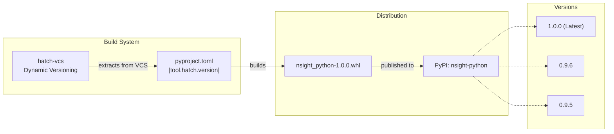
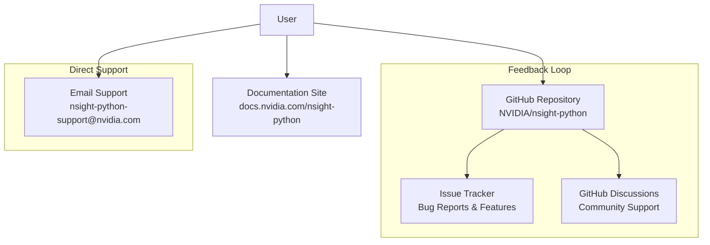

<!-- source: DeepWiki mcp.deepwiki.com · repo NVIDIA/nsight-python · page 11 Release Information · fetched 2026-10-26 -->

# Release Information

Relevant source files

The following files were used as context for generating this wiki page:

- [LICENSE](LICENSE)
- [docs/source/_static/switcher.json](docs/source/_static/switcher.json)
- [docs/source/release_notes/release_notes.rst](docs/source/release_notes/release_notes.rst)

This page documents release management, versioning, licensing, and support resources for `nsight-python`. It covers the transition to version 1.0.0, the new injection-based profiling architecture, distribution channels, and how to access support.

For detailed installation instructions, see [Installation](#2). For detailed release history and change logs, see [Release Notes](#11.2).

## Release Overview

As of version **1.0.0**, `nsight-python` has transitioned from a script-relaunch model to an **injection-based attach mode**. This allows the profiler to attach to an active process (including Jupyter and Colab) without restarting the Python script.

### Versioning and Distribution

**Version Management**: The project uses `hatch-vcs` for dynamic versioning based on Git tags. The `switcher.json` file tracks available documentation versions.

**Sources**: [docs/source/_static/switcher.json:1-22](), [pyproject.toml:59-60]()

## License Information

`nsight-python` is licensed under the **Apache License 2.0**. This is a permissive license that allows for use, reproduction, and distribution of the software.

| Property | Value |
|----------|-------|
| License Type | Apache License 2.0 |
| SPDX Identifier | `Apache-2.0` |
| License File | `LICENSE` in repository root |
| Copyright | Copyright (c) 2025 NVIDIA CORPORATION & AFFILIATES |

For details, see [Version and License](#11.1).

**Sources**: [LICENSE:1-200](), [pyproject.toml:14]()

## Release History Highlights

The following table summarizes the evolution of the package through its major release milestones:

| Version | Key Changes |
|---------|-------------|
| **1.0.0** | **Injection-based attach** (no relaunch), Jupyter/Colab support, `Unit` column in results, `thermal_device` pinning, `verbosity` parameter. |
| **0.9.6** | Multiple derived metrics support, adaptive thermovision improvements. |
| **0.9.5** | Support for multiple metrics and scalar configurations. |

For a full summary of changes, see [Release Notes](#11.2).

**Sources**: [docs/source/release_notes/release_notes.rst:1-13]()

## Support and Resources

NVIDIA provides several channels for support, feedback, and documentation.

### Support Infrastructure

**Support Resources**:
- **Documentation**: Hosted on the NVIDIA documentation portal.
- **Issue Tracking**: GitHub is the primary location for bug reports.
- **Direct Feedback**: Users can reach the team at `nsight-python-support@nvidia.com`.

For details, see [Support and Resources](#11.3).

**Sources**: [pyproject.toml:43-45]()

## Child Pages

Detailed release information is organized into the following sub-pages:

*   **[Version and License](#11.1)**: Deep dive into the Apache 2.0 license, `hatch-vcs` versioning scheme, and the full version history from 0.9.4 to 1.0.0.
*   **[Release Notes](#11.2)**: Comprehensive list of new features, bug fixes, and breaking changes for each version, specifically focusing on the 1.0.0 architectural shift.
*   **[Support and Resources](#11.3)**: Detailed links to the GitHub repository, issue tracker, and community feedback channels.

---

