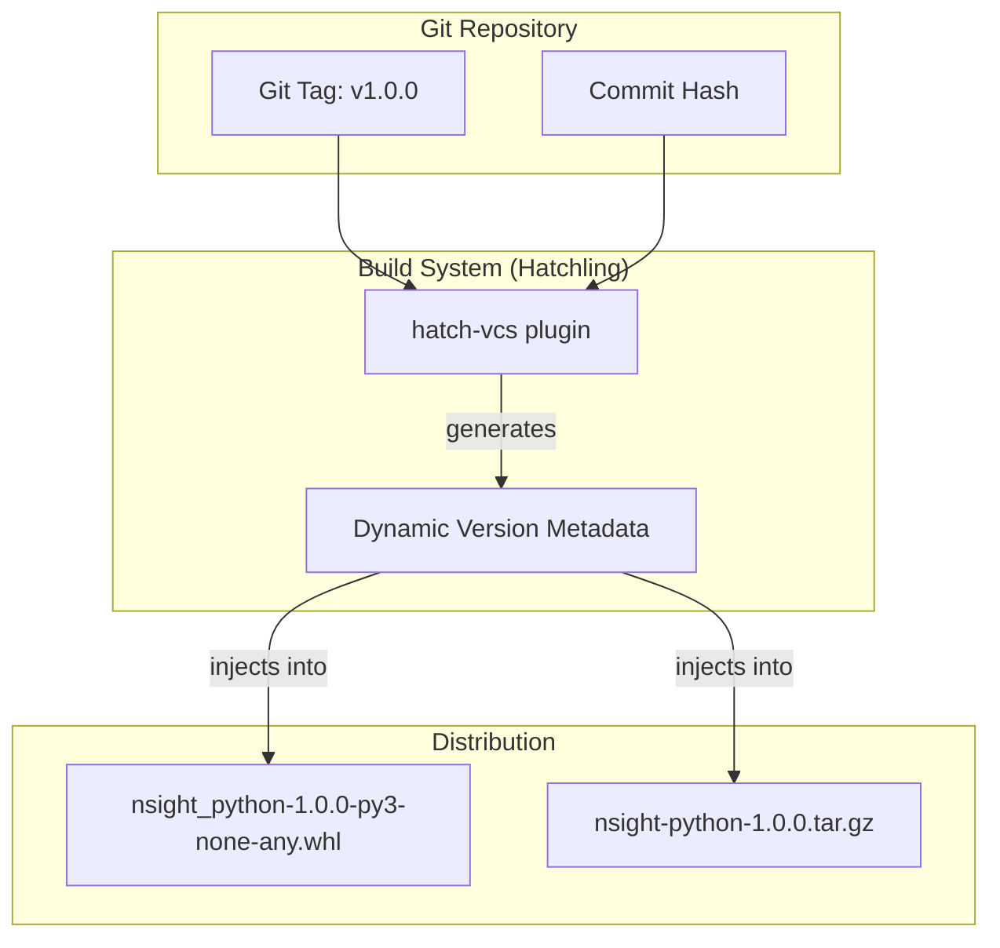
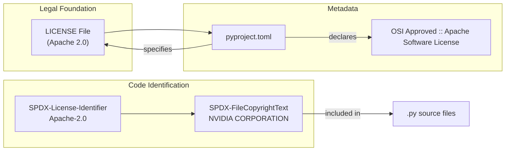

<!-- source: DeepWiki mcp.deepwiki.com · repo NVIDIA/nsight-python · page 11.1 Version and License · fetched 2026-10-26 -->

# Version and License

Relevant source files

The following files were used as context for generating this wiki page:

- [LICENSE](LICENSE)
- [docs/source/_static/switcher.json](docs/source/_static/switcher.json)
- [docs/source/release_notes/release_notes.rst](docs/source/release_notes/release_notes.rst)
- [nsight/thermovision.py](nsight/thermovision.py)
- [pyproject.toml](pyproject.toml)

## Purpose and Scope

This document specifies the versioning strategy, current release information, and licensing terms for `nsight-python`. It details the transition to the 1.0.0 release, the adoption of `hatch-vcs` for version management, and the legal framework under the Apache 2.0 license.

---

## Current Version

`nsight-python` is currently at version **1.0.0**.

Unlike previous versions where the version was hardcoded in `nsight/__init__.py`, version 1.0.0 uses dynamic versioning [pyproject.toml:10](). The build system leverages Version Control System (VCS) tags to determine the version string at build time [pyproject.toml:60-61]().

**Sources**: [pyproject.toml:9-10](), [pyproject.toml:60-61]()

---

## Versioning Scheme

### VCS-Based Versioning

The project has transitioned to `hatch-vcs` for version management [pyproject.toml:5](). This ensures that the version metadata in the distributed package always matches the Git tags in the repository.

**Diagram**: Dynamic Versioning Flow via `hatch-vcs`

### Version History

The following table tracks the progression of `nsight-python` leading up to the 1.0.0 milestone:

| Version | Key Changes |
|:---|:---|
| **1.0.0** | Major release: Injection-based attach (no script relaunch), Jupyter/Colab support, `Unit` column in results, keyword-only parameters, `thermal_device` pinning. |
| **0.9.6** | Support for multiple derived metrics, adaptive `thermovision` cooling thresholds. |
| **0.9.5** | Support for multiple raw metrics, scalar configuration inputs. |
| **0.9.4** | Initial beta release series. |

**Sources**: [docs/source/_static/switcher.json:1-22](), [docs/source/release_notes/release_notes.rst:10-13]()

---

## License Information

### License Type

`nsight-python` is licensed under the **Apache License 2.0**, a permissive license that allows for broad use, modification, and distribution.

### License Implementation

The license is applied through several mechanisms in the codebase:

1.  **Project Metadata**: The license is explicitly referenced in the project definition [pyproject.toml:14]() and categorized via PyPI classifiers [pyproject.toml:30]().
2.  **File Headers**: Every source file contains a standard SPDX header [nsight/thermovision.py:1-2]().
3.  **Legal Text**: The full license text is included in the `LICENSE` file at the repository root [LICENSE:1-132]().

**Diagram**: License Association with Code Entities

**Sources**: [pyproject.toml:1-2](), [pyproject.toml:14](), [pyproject.toml:30](), [nsight/thermovision.py:1-2](), [LICENSE:1-132]()

---

## Python and Environment Support

### Supported Python Versions

The project targets modern Python environments, requiring version 3.10 or higher [pyproject.toml:13]().

| Environment | Support Status |
|:---|:---|
| **Python 3.10** | Supported [pyproject.toml:34]() |
| **Python 3.11** | Supported [pyproject.toml:35]() |
| **Python 3.12** | Supported [pyproject.toml:36]() |
| **Python 3.13** | Supported [pyproject.toml:37]() |

### Core Dependencies

As of version 1.0.0, the dependency on `cuda-core` is mandatory to support the new injection-based profiling and thermal management features [pyproject.toml:25]().

*   **CUDA Bindings**: `cuda-bindings>=12.9.6` [pyproject.toml:26]()
*   **Thermal Monitoring**: Requires `cuda.core` (part of `cuda-core`) for NVML access [nsight/thermovision.py:21-26]()
*   **Data Analysis**: `pandas`, `numpy` [pyproject.toml:20-21]()
*   **Reporting**: `ncu-report>=2026.2.0` [pyproject.toml:23]()

**Sources**: [pyproject.toml:13-27](), [nsight/thermovision.py:21-26]()

---

## Build System Integration

The project uses `hatchling` as the build backend [pyproject.toml:6](). It defines several specialized environments for development and testing:

*   **docs**: For building Sphinx documentation [pyproject.toml:70-77]().
*   **lint**: For code quality checks (black, isort, mypy) [pyproject.toml:84-89]().
*   **test_cu12 / test_cu13**: Specialized test environments for different CUDA versions [pyproject.toml:114-120]().

**Sources**: [pyproject.toml:4-6](), [pyproject.toml:70-120]()

---

