<!-- source: DeepWiki mcp.deepwiki.com · repo NVIDIA/nsight-python · page 11.2 Release Notes · fetched 2026-10-26 -->

# Release Notes

Relevant source files

The following files were used as context for generating this wiki page:

- [docs/source/_static/switcher.json](docs/source/_static/switcher.json)
- [docs/source/release_notes/release_notes.rst](docs/source/release_notes/release_notes.rst)
- [docs/source/release_notes/topics/updates-in-nsight-python-1.0.0.rst](docs/source/release_notes/topics/updates-in-nsight-python-1.0.0.rst)
- [nsight/annotation.py](nsight/annotation.py)

This page summarizes the key changes, enhancements, and bug fixes across the release history of `nsight-python`. It provides technical details on how new features are implemented and how the API has evolved from early beta versions to the current stable release.

## Purpose and Scope

The release notes serve as a technical record of the project's evolution. They document:
- **Major Architectural Shifts**: Such as the move from script relaunching to injection-based attaching.
- **API Changes**: Transitions in parameter names, types, and supported function signatures.
- **Data Model Updates**: Changes to the `ProfileResults` structure, including the addition of units and normalization.
- **New Integrations**: Support for new kernel types (e.g., Triton, cuTile) and environments (e.g., Jupyter, Colab).

## Version 1.0.0

Version 1.0.0 represents a major milestone, transitioning the project from a relaunch-based tool to a dynamic injection-based profiler.

### Injection-Based Attach (No Script Relaunch)
The most significant change in v1.0.0 is the elimination of per-decorator Python script relaunches. Previously, `nsight-python` would relaunch the entire script for every configuration to allow `ncu` to wrap the process.

**Implementation Detail:**
- `nsight-python` now dynamically loads the Nsight Compute CUDA injection library at import time using `try_init_injection()` [nsight/collection/ncu.py:28-63]().
- The profiler uses `ncu --mode attach` to connect to the already running Python process [docs/source/release_notes/topics/updates-in-nsight-python-1.0.0.rst:10-18]().
- This enables support for interactive environments like **Jupyter Notebook** and **Google Colab** [docs/source/release_notes/topics/updates-in-nsight-python-1.0.0.rst:17-18]().

### Metric Units Support
The `ProfileResults` DataFrame now includes a dedicated `Unit` column [docs/source/release_notes/topics/updates-in-nsight-python-1.0.0.rst:20-27]().
- **NCU Metrics**: Units are parsed directly from the `.ncu-rep` files.
- **Derived Metrics**: The `derive_metric` function signature now supports returning a `(value, unit)` tuple.

### Parameter Handling Improvements
- **Keyword-Only Parameters**: Config values are now correctly mapped to function parameters defined after a `*` in the signature [docs/source/release_notes/topics/updates-in-nsight-python-1.0.0.rst:31-33]().
- **Default Values**: Config tuples can now omit trailing parameters if the function signature provides defaults; `nsight-python` fills these in automatically [docs/source/release_notes/topics/updates-in-nsight-python-1.0.0.rst:34-35]().
- **Variadic Arguments**: `*args` and `**kwargs` are now ignored during parameter counting and validation [docs/source/release_notes/topics/updates-in-nsight-python-1.0.0.rst:36-37]().

### API Changes
- **Thermal Device Selection**: Added `thermal_device` to `@nsight.analyze.kernel` to pin monitoring to a specific GPU ordinal [docs/source/release_notes/topics/updates-in-nsight-python-1.0.0.rst:46-55]().
- **Verbosity Parameter**: The `output` string parameter was replaced by the `verbosity` parameter using the `VerbosityLevel` enum (`SILENT`, `INFO`, `DEBUG`) [docs/source/release_notes/topics/updates-in-nsight-python-1.0.0.rst:57-67]().

**Sources:** [docs/source/release_notes/topics/updates-in-nsight-python-1.0.0.rst:1-87](), [nsight/collection/ncu.py:28-63]()

## Version 0.9.6

Version 0.9.6 focused on expanding the flexibility of derived metrics and improving the robustness of the thermal management system.

### Multiple Derived Metrics
- Support was added for `derive_metric` to return a dictionary, allowing a single post-processing function to generate multiple metrics (e.g., both "GFLOPS" and "Arithmetic Intensity") from the same raw data.

### Adaptive Thermovision
- The `ThermalController` was updated to handle adaptive wait times, ensuring the GPU returns to a stable idle temperature before the next profiling run, even if the ambient temperature or cooling performance fluctuates.

**Sources:** [docs/source/release_notes/release_notes.rst:11](), [docs/source/release_notes/topics/updates-in-nsight-python-0.9.6.rst]() *(implied by structure)*

## Version 0.9.5

Version 0.9.5 introduced core features for comparing different performance metrics and simplifying configuration definitions.

### Multiple Metrics Collection
- Support for passing a list of metrics to the `metric` parameter in `@analyze.kernel`.
- The extraction logic was updated to handle multi-metric CSV exports from Nsight Compute.

### Scalar Configurations
- Introduced support for "scalar configs," allowing users to pass a simple list of values (e.g., `configs=[128, 256, 512]`) when the profiled function only takes a single argument, rather than requiring a list of 1-element tuples.

**Sources:** [docs/source/release_notes/release_notes.rst:12](), [docs/source/release_notes/topics/updates-in-nsight-python-0.9.5.rst]() *(implied by structure)*

## Data Flow Evolution

The following diagram illustrates how the profiling workflow changed between v0.9.4 and v1.0.0.

### Workflow Comparison: Relaunch vs. Injection

```mermaid
graph TD
    subgraph "v0.9.4 (Legacy Relaunch)"
        A1["Execute Python Script"] --> B1["Hit @analyze.kernel"]
        B1 --> C1["Subprocess: ncu python script.py"]
        C1 --> D1["Entire Script Reruns"]
        D1 --> E1["Data Collected"]
    end

    subgraph "v1.0.0 (Current Injection)"
        A2["Execute Python Script / Jupyter Cell"] --> B2["import nsight"]
        B2 --> C2["try_init_injection() loads NCU lib"]
        C2 --> D2["Hit @analyze.kernel"]
        D2 --> E2["ncu --mode attach"]
        E2 --> F2["Profiling in same process"]
        F2 --> G2["Data Collected"]
    end
```

**Diagram:** Transition from the heavy subprocess relaunch model to the lightweight injection-based attach model.

**Sources:** [docs/source/release_notes/topics/updates-in-nsight-python-1.0.0.rst:10-18](), [nsight/collection/ncu.py:28-63]()

## Summary of Key API Transitions

| Feature | v0.9.4 (Beta) | v1.0.0 (Stable) |
| :--- | :--- | :--- |
| **Execution** | Script Relaunch | Process Injection / Attach |
| **Environments** | CLI Only | CLI, Jupyter, Google Colab |
| **Output Control** | `output="verbose"` | `verbosity=VerbosityLevel.DEBUG` |
| **Result Data** | Values only | Values + `Unit` column |
| **Function Params** | Positional only | Positional + Keyword-only |
| **Thermal Pinning** | Physical GPU 0 only | `thermal_device` ordinal |

**Sources:** [docs/source/release_notes/topics/updates-in-nsight-python-1.0.0.rst:1-87](), [nsight/annotation.py:139-148]()

---

