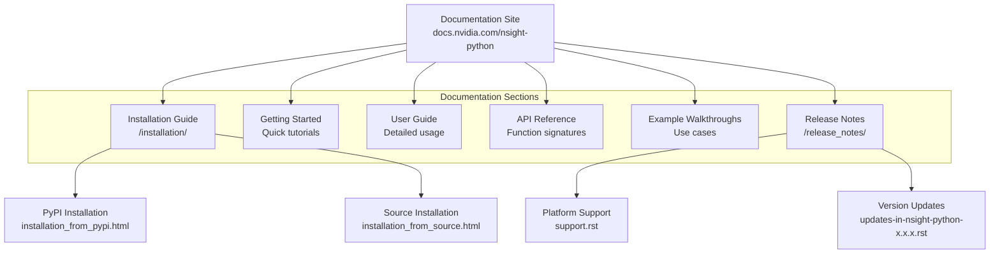
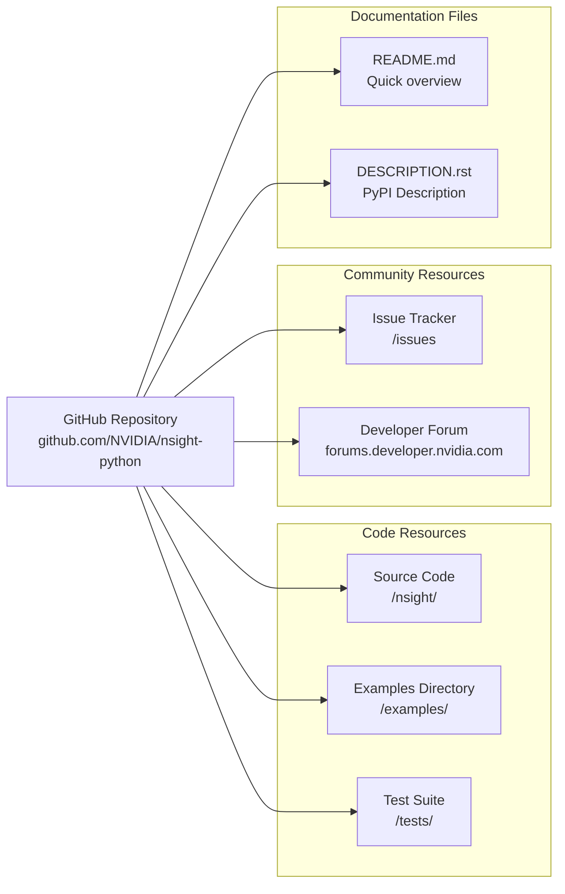
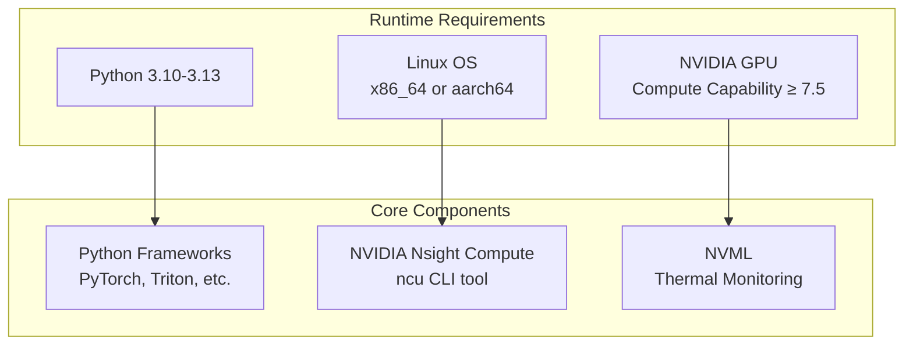

<!-- source: DeepWiki mcp.deepwiki.com · repo NVIDIA/nsight-python · page 11.3 Support and Resources · fetched 2026-10-26 -->

# Support and Resources

Relevant source files

The following files were used as context for generating this wiki page:

- [DESCRIPTION.rst](DESCRIPTION.rst)
- [docs/source/_templates/version.html](docs/source/_templates/version.html)
- [docs/source/feedback.rst](docs/source/feedback.rst)
- [docs/source/overview/introduction.rst](docs/source/overview/introduction.rst)
- [docs/source/release_notes/support.rst](docs/source/release_notes/support.rst)
- [docs/source/release_notes/topics/updates-in-nsight-python-0.9.5.rst](docs/source/release_notes/topics/updates-in-nsight-python-0.9.5.rst)

This page provides information about support channels, documentation resources, and community feedback mechanisms for Nsight Python. Users can find help through official documentation, GitHub resources, and specialized developer forums.

## Official Documentation

The primary documentation site is hosted at `https://docs.nvidia.com/nsight-python/`, providing comprehensive guides and API references.

### Documentation Site

**Sources**: [DESCRIPTION.rst:10-22](), [docs/source/release_notes/support.rst:1-22](), [docs/source/release_notes/topics/updates-in-nsight-python-0.9.5.rst:1-5]()

### Documentation Build System

The documentation is generated using Sphinx from reStructuredText and Markdown sources. The current version of the documentation is managed through a template system.

| Component | Location | Purpose |
|-----------|----------|---------|
| Sphinx Configuration | `docs/source/conf.py` | Build settings, theme, extensions |
| RST Sources | `docs/source/` | Primary documentation content |
| Version Template | `docs/source/_templates/version.html` | Displays the current release version |
| Theme | `nvidia_sphinx_theme` | NVIDIA branding and styling |

**Sources**: [DESCRIPTION.rst:10](), [docs/source/release_notes/support.rst:1-5](), [docs/source/_templates/version.html:1]()

## GitHub Repository

The project is hosted on GitHub at `https://github.com/NVIDIA/nsight-python`, providing access to source code, examples, and issue tracking.

### Repository Resources

**Sources**: [DESCRIPTION.rst:11-12](), [docs/source/feedback.rst:7]()

### Examples Directory

The repository includes practical examples demonstrating various features like `nsight.analyze.kernel` and `nsight.annotate`. These examples are located at `/examples/` in the repository.

| Example Type | Description | Location |
|--------------|-------------|----------|
| Basic Usage | Minimal profiling setup | `examples/` directory |
| Parameter Sweeps | Configuration comparison | `examples/` directory |
| Custom Metrics | Derived metric definitions | `examples/` directory |

**Sources**: [DESCRIPTION.rst:11](), [docs/source/release_notes/topics/updates-in-nsight-python-0.9.5.rst:20-21]()

## Supported Platforms and Requirements

### Platform Support

Nsight Python supports modern Python environments and NVIDIA GPU architectures.

| Category | Supported Versions/Architectures |
|----------|----------------------------------|
| **Python Versions** | 3.10, 3.11, 3.12, 3.13 |
| **Operating Systems** | Linux (x86_64), Linux (aarch64) |
| **GPU Architectures** | Turing and later (compute capability ≥ 7.5) |

**Sources**: [docs/source/release_notes/support.rst:7-21]()

### System Requirements Diagram

**Sources**: [docs/source/release_notes/support.rst:7-21](), [docs/source/overview/introduction.rst:23-27]()

## Feedback and Support Channels

### Nsight Python Developer Forum

For questions, suggestions, or general discussion, users are encouraged to use the official NVIDIA Developer Forum.

* **URL**: `https://forums.developer.nvidia.com/c/developer-tools/nsight-python/749`

**Sources**: [docs/source/feedback.rst:7]()

### Issue Tracking and Bug Reports

Users should report bugs or request features through the GitHub issue tracker. Recent updates have addressed community-reported issues such as:

* **Issue #2**: Function argument requirements.
* **Issue #4**: Scalar configuration support for single-argument functions.
* **Issue #8**: Support for collecting multiple metrics.

**Sources**: [docs/source/release_notes/topics/updates-in-nsight-python-0.9.5.rst:10-21]()

### Support Channels by Use Case

| Use Case | Recommended Channel |
|----------|---------------------|
| Bug Reports | GitHub Issues |
| Feature Requests | GitHub Issues |
| General Questions | Nsight Python Developer Forum |
| Documentation Clarification | Developer Forum or GitHub Issues |

**Sources**: [docs/source/feedback.rst:7](), [docs/source/release_notes/topics/updates-in-nsight-python-0.9.5.rst:10-21]()

## Related NVIDIA Resources

Nsight Python orchestrates several NVIDIA technologies to provide a high-level profiling interface.

| Tool/Library | Role in Nsight Python |
|--------------|-----------------------|
| **NVIDIA Nsight Compute** | Backend engine for metric collection |
| **NVTX** | Used via `nsight.annotate` for region marking |
| **NVML** | Used for real-time temperature monitoring to prevent throttling |

**Sources**: [docs/source/overview/introduction.rst:6-8](), [docs/source/overview/introduction.rst:27]()

## Quick Reference Links

### Essential URLs

| Resource | URL |
|----------|-----|
| **Documentation** | `https://docs.nvidia.com/nsight-python/` |
| **GitHub Repository** | `https://github.com/NVIDIA/nsight-python` |
| **Developer Forum** | `https://forums.developer.nvidia.com/c/developer-tools/nsight-python/749` |
| **PyPI Package** | `https://pypi.org/project/nsight-python/` |

**Sources**: [DESCRIPTION.rst:8-11](), [docs/source/feedback.rst:7]()

---

