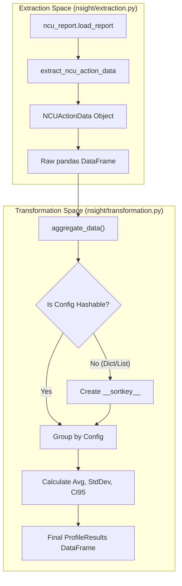
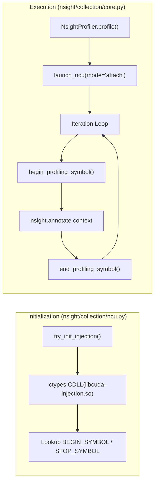

<!-- source: DeepWiki mcp.deepwiki.com · repo NVIDIA/nsight-python · page 12 Glossary · fetched 2026-10-26 -->

# Glossary

Relevant source files

The following files were used as context for generating this wiki page:

- [docs/source/release_notes/topics/updates-in-nsight-python-1.0.0.rst](docs/source/release_notes/topics/updates-in-nsight-python-1.0.0.rst)
- [nsight/annotation.py](nsight/annotation.py)
- [nsight/collection/ncu.py](nsight/collection/ncu.py)
- [nsight/extraction.py](nsight/extraction.py)
- [nsight/thermovision.py](nsight/thermovision.py)
- [nsight/transformation.py](nsight/transformation.py)
- [nsight/utils.py](nsight/utils.py)
- [pyproject.toml](pyproject.toml)
- [tests/test_transformation.py](tests/test_transformation.py)

This page provides definitions and technical details for codebase-specific terms, jargon, and abbreviations used in `nsight-python`.

## Core Components and Tools

### NCU (Nsight Compute)
The NVIDIA Nsight Compute command-line interface (`ncu`) used for profiling CUDA kernels. The codebase interacts with it via `subprocess` to collect hardware metrics [nsight/collection/ncu.py:178-185](). It requires a minimum version of 2026.2.1.0 [nsight/collection/ncu.py:30-30]().

### NVTX (NVIDIA Tools Extension)
A C-based API for annotating events, code ranges, and resources in applications. `nsight-python` uses the `nvtx` Python package to create ranges that `ncu` uses to filter profiling data [nsight/annotation.py:124-126]().

### Injection Library
A shared library (`libcuda-injection.so`) provided by Nsight Compute. `nsight-python` dynamically loads this library at import time to enable "attach mode" profiling without restarting the Python script [nsight/collection/ncu.py:144-153]().

### NVML (NVIDIA Management Library)
Used via `cuda.core.system` to monitor GPU health, specifically temperature and thermal limits (`T.Limit`), for thermal management [nsight/thermovision.py:11-17]().

---

## Profiling Concepts

### Annotation
A named code region marked using the `nsight.annotate` context manager or decorator. It maps to an NVTX range under the `nsight-python` domain [nsight/annotation.py:91-110]().
*   **Implementation**: Inherits from `nvtx.annotate` [nsight/annotation.py:91-91]().
*   **Restriction**: Nested annotations are not supported [nsight/annotation.py:152-156]().

### Config (Configuration)
A set of parameters passed to the kernel function being profiled. Configurations can be scalars, tuples, or dictionaries [nsight/transformation.py:101-104]().

### Metric
A hardware counter or performance indicator collected by NCU (e.g., `gpu__time_duration.sum`). Default metrics are often used if none are specified [nsight/extraction.py:44-54]().

### Derived Metric
A user-defined metric calculated from raw NCU metrics and configuration parameters. 
*   **Implementation**: A `Callable` that should return a `(value, unit)` tuple [nsight/extraction.py:32-41]().

### Replay Mode
Determines how NCU handles multiple passes for metric collection.
*   **Kernel Replay**: Replays individual kernels.
*   **Range Replay**: Replays the entire NVTX range. Note that some NCU APIs restrict the use of `range` mode [nsight/collection/ncu.py:183-183]().

---

## Data Structures and Classes

### NsightProfiler
The high-level orchestrator that manages the profiling lifecycle, including thermal checks and data collection [nsight/collection/core.py:125-140]().

### NCUCollector
The component responsible for the low-level interaction with the `ncu` binary and the injection library [nsight/collection/ncu.py:133-176]().

### ProfileSettings
A dataclass containing the configuration for a profiling run, such as metrics to collect, iterations, and hardware control settings [nsight/collection/core.py:15-35]().

### ProfileResults
A container for the raw data collected during profiling, which can be converted into a pandas `DataFrame` [nsight/collection/core.py:58-85]().

### NCUActionData
A dataclass used during the extraction phase to store metrics, clock rates, and GPU metadata for a specific kernel execution [nsight/utils.py:141-149]().

### VerbosityLevel
An `IntEnum` defining the output detail: `SILENT` (0), `INFO` (3), and `DEBUG` (4) [nsight/utils.py:42-51]().

---

## Thermal Management (Thermovision)

### Thermovision
The internal name for the `ThermalController` subsystem that prevents thermal throttling [nsight/thermovision.py:44-49]().

### T.Limit (Thermal Limit)
The temperature at which the GPU will begin to throttle performance. `nsight-python` monitors the "headroom" (distance from this limit) [nsight/thermovision.py:14-16]().

### Thermal Headroom
The difference between the current GPU temperature and its `T.Limit`. 
*   **thermal_wait**: The headroom threshold (in °C) that triggers a cooling pause [nsight/thermovision.py:68-70]().
*   **thermal_cont**: The headroom threshold required to resume execution after cooling [nsight/thermovision.py:71-73]().

### Adaptive Mode
In `auto` mode, the `ThermalController` adjusts `thermal_cont` based on how quickly the GPU heats up during iterations [nsight/thermovision.py:63-67]().

---

## Statistical and Transformation Terms

### StableMeasurement
A boolean flag in the output DataFrame indicating if the `RelativeStdDevPct` is less than 2.0% [nsight/transformation.py:150-151]().

### CI95
The 95% Confidence Interval (Lower and Upper) calculated for the `AvgValue` of a metric [nsight/transformation.py:138-143]().

### Geomean (Geometric Mean)
Calculated for `AvgValue` across groups to provide a central tendency less sensitive to outliers [nsight/transformation.py:191-193]().

### Sortkey
Internal stringified version of unhashable config parameters (like dicts or lists) used to allow pandas `groupby` operations while preserving the original object type in the final output [nsight/transformation.py:114-128]().

---

## Logic and Flow Diagrams

### Data Extraction and Aggregation Flow
This diagram shows how raw NCU data is transformed into the final results.

**Sources:** [nsight/extraction.py:113-134](), [nsight/transformation.py:21-72](), [nsight/transformation.py:105-135]()

### Injection and Profiling Lifecycle
This diagram bridges the natural language "Attach Mode" to the code entities that implement it.

**Sources:** [nsight/collection/ncu.py:127-162](), [nsight/collection/core.py:125-140](), [nsight/collection/ncu.py:178-185]()

## Miscellaneous

### Dummy Kernel
A minimal CUDA kernel (`dummy_kernel_failure`) launched when `ignore_failures=True` and a user kernel fails. This ensures NCU still finds an "action" in the report to maintain alignment with expected iterations [nsight/utils.py:86-105]().

### combine_kernel_metrics
A user-provided function used when an annotation contains multiple kernel launches. It defines how to aggregate metrics (e.g., `sum` or `max`) across those kernels [nsight/extraction.py:88-88]().

### normalize_against
The name of an annotation used as a baseline. All other annotation results are divided by this baseline's values to compute speedup [nsight/transformation.py:163-189]().