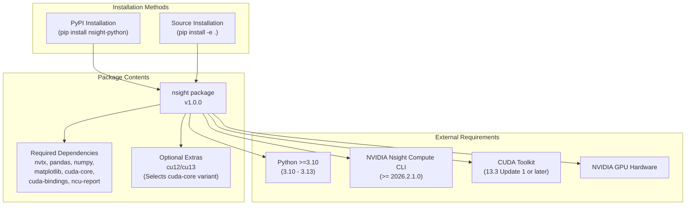
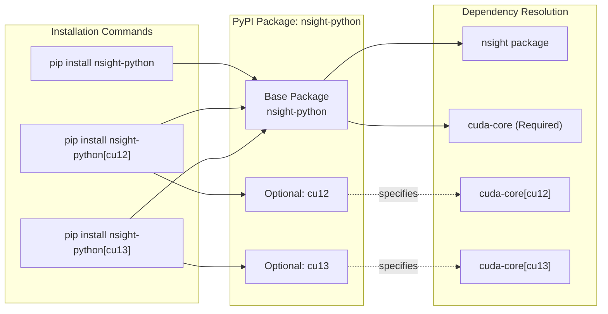

<!-- source: DeepWiki mcp.deepwiki.com · repo NVIDIA/nsight-python · page 2 Installation · fetched 2026-10-26 -->

# Installation

<details>
<summary>Relevant source files</summary>

The following files were used as context for generating this wiki page:

- [README.md](README.md)
- [docs/source/index.rst](docs/source/index.rst)
- [docs/source/installation/runtime_requirements.rst](docs/source/installation/runtime_requirements.rst)
- [nsight/thermovision.py](nsight/thermovision.py)
- [pyproject.toml](pyproject.toml)

</details>


This page documents the installation methods for `nsight-python`, including PyPI installation, source installation, and dependency requirements. As of version 1.0.0, the installation process has been updated to reflect that `cuda-core` is now a required dependency rather than an optional one. For getting started with your first profiling workflow after installation, see [Getting Started](#3).

## Installation Overview

The `nsight-python` package is distributed via PyPI and can be installed using `pip`. The package requires Python ≥3.10 and has mandatory runtime dependencies. The `cu12` and `cu13` optional extras are now used to select specific versions of the required `cuda-core` dependency.



**Sources:** [pyproject.toml:8-42](), [README.md:10-20](), [docs/source/installation/runtime_requirements.rst:7-8]()

## Installing from PyPI

### Basic Installation

Install the latest stable version from PyPI:

```bash
pip install nsight-python
```

This installs the `nsight` package with all required dependencies listed in [pyproject.toml:18-27]():
- `nvtx`: NVTX Python bindings for annotating code regions.
- `pandas`: DataFrame operations for structured profiling results.
- `numpy`: Numerical operations for metric calculations.
- `matplotlib`: Plotting and visualization.
- `cuda-core`: (Required) Core CUDA functionality, including NVML for thermal monitoring in `nsight.thermovision.ThermalController`.
- `cuda-bindings`: (Required) Bindings for CUDA driver and runtime APIs.
- `ncu-report`: (Required) Parser for Nsight Compute report files.
- `deepdiff`: Used for internal configuration comparisons.

### Installation with Specific CUDA Support

While `cuda-core` is now required, you can specify the CUDA version variant using optional extras. This ensures compatibility with your installed CUDA Toolkit.

**For CUDA 12.x systems:**
```bash
pip install nsight-python[cu12]
```
This selects the `cuda-core[cu12]` variant as defined in [pyproject.toml:41]().

**For CUDA 13.x systems:**
```bash
pip install nsight-python[cu13]
```
This selects the `cuda-core[cu13]` variant as defined in [pyproject.toml:42]().



**Sources:** [pyproject.toml:18-42](), [nsight/thermovision.py:21-29]()

## Installing from Source

### Developer Installation

Clone the repository and install in editable mode for development:

```bash
git clone https://github.com/NVIDIA/nsight-python.git
cd nsight-python
pip install -e .
```

The `-e` flag creates an editable installation where changes to the source code in the `nsight/` directory are immediately reflected. For development, you may also want to install the `cu12` or `cu13` extras: `pip install -e .[cu12]`.

### Installation Without Dependencies

To manage dependencies manually (useful for containerized or highly controlled environments), use the `--no-deps` flag:

```bash
pip install -e . --no-deps
```

**Sources:** [README.md:14-23]()

## Dependencies and Requirements

### Python Version Requirements

The package requires Python ≥3.10 as specified in [pyproject.toml:13](). Supported versions include 3.10, 3.11, 3.12, and 3.13 [pyproject.toml:34-37]().

### Mandatory Runtime Dependencies

| Package | Minimum Version | Purpose |
| :--- | :--- | :--- |
| `cuda-core` | `1.0.1` | **Required.** NVML monitoring and CUDA system interaction [nsight/thermovision.py:21-22](). |
| `cuda-bindings` | `12.9.6` | **Required.** Bindings for CUDA driver/runtime. |
| `ncu-report` | `2026.2.0` | **Required.** Parsing Nsight Compute report files. |
| `nvtx` | - | Instrumentation of code regions [nsight/thermovision.py:18-19](). |
| `pandas` | - | Data analysis and DataFrame output. |
| `numpy` | - | Numerical computations. |
| `matplotlib` | - | Visualization and plotting. |

**Sources:** [pyproject.toml:18-27]()

### External Requirements

| Requirement | Version | Details |
| :--- | :--- | :--- |
| **NVIDIA Nsight Compute** | `2026.2.1.0+` | Must be in `PATH`. Provides the `ncu` CLI tool used for collection [docs/source/installation/runtime_requirements.rst:7-8](). |
| **CUDA Toolkit** | `13.3 Update 1+` | Required for the latest profiling features and `ncu` compatibility. |
| **NVIDIA GPU** | Pascal+ | Compute Capability 6.0 or higher is required for Nsight Compute. |

### Important: Import Ordering

`import nsight` must occur **before** CUDA initialization (e.g., `torch.cuda.init()`) or any NVTX API calls. This allows the tool to correctly set `NVTX_INJECTION64_PATH` and prepare for the injection-based attach mode.

**Sources:** [docs/source/installation/runtime_requirements.rst:9-19]()

## Build System

The package uses `hatchling` as its build backend [pyproject.toml:4-6](). Development environments are managed via `hatch`, including specific test environments for different CUDA versions.

| Environment | Command | Purpose |
| :--- | :--- | :--- |
| `docs` | `hatch run docs:build` | Build Sphinx documentation [pyproject.toml:79-82](). |
| `lint` | `hatch run lint:check` | Run Black, Isort, and Mypy [pyproject.toml:91-96](). |
| `test_cu12` | `hatch run test_cu12:run` | Run tests with CUDA 12 dependencies [pyproject.toml:114-116](). |
| `test_cu13` | `hatch run test_cu13:run` | Run tests with CUDA 13 dependencies [pyproject.toml:118-120](). |

**Sources:** [pyproject.toml:4-6, 70-121]()

## Verification

Verify the installation by checking the version and ensuring the `cuda.core` (provided by `cuda-core`) is available:

```python
import nsight
from cuda import core
print(f"Nsight Python version: {nsight.__version__}")
print(f"CUDA Core available: {nsight.thermovision.CUDA_CORE_AVAILABLE}")
```

**Sources:** [nsight/thermovision.py:20-26](), [pyproject.toml:10]()

---

