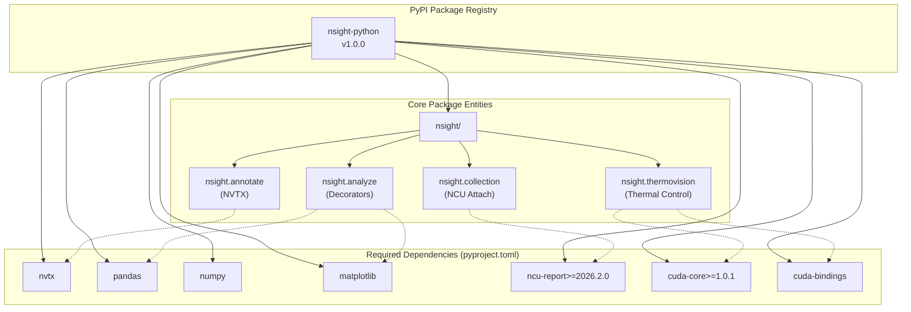
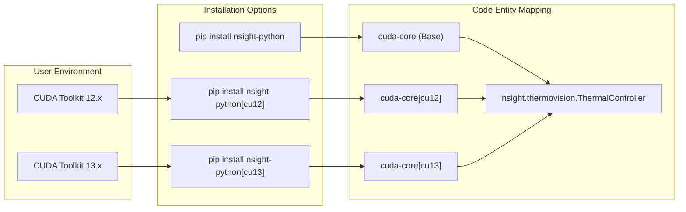

<!-- source: DeepWiki mcp.deepwiki.com · repo NVIDIA/nsight-python · page 2.1 Installing from PyPI · fetched 2026-10-26 -->

# Installing from PyPI

<details>
<summary>Relevant source files</summary>

The following files were used as context for generating this wiki page:

- [docs/source/installation/installation_from_pypi.rst](docs/source/installation/installation_from_pypi.rst)
- [nsight/thermovision.py](nsight/thermovision.py)
- [pyproject.toml](pyproject.toml)

</details>


## Purpose and Scope

This page documents how to install `nsight-python` from the Python Package Index (PyPI). As of version 1.0.0, the installation process has been updated to include `cuda-core` as a required dependency to support enhanced thermal management and error handling. This page covers the basic installation command, the use of CUDA-version-specific extras, and the package structure. For source-based installation, see [Installing from Source](#2.2). For detailed runtime requirements, see [Dependencies and Requirements](#2.3).

## Basic Installation

The `nsight-python` package is distributed via PyPI. The basic installation command installs the core package along with all mandatory dependencies, including the base `cuda-core` package.

```bash
pip install nsight-python
```

In version 1.0.0, `cuda-core` is no longer optional [pyproject.toml:25](). This change ensures that features like `nsight.thermovision` can reliably monitor GPU temperatures and T.limit using NVML [nsight/thermovision.py:11-17]().

**Sources:** [pyproject.toml:9-27](), [docs/source/installation/installation_from_pypi.rst:9-18]()

## Package Structure and Dependencies

The installation provides the `nsight` package and its required runtime ecosystem. The build process uses `hatchling` and `hatch-vcs` for dynamic versioning [pyproject.toml:4-10]().



**Diagram: Package Installation Structure**

The mandatory dependencies in `v1.0.0` serve the following roles:

| Dependency | Purpose | Implementation Reference |
|------------|---------|-------------------------|
| `nvtx` | Instrumentation for profiling ranges | `nsight.annotate` |
| `pandas` | Results representation and CSV export | `nsight.analyze` |
| `numpy` | Array operations for metrics | `nsight.extraction` |
| `matplotlib` | Generation of performance plots | `nsight.visualization` |
| `ncu-report` | Parsing of `.ncu-rep` files | `nsight.collection.ncu` |
| `cuda-core` | NVML access for thermal monitoring | `nsight.thermovision` |
| `cuda-bindings` | Python bindings for CUDA/NVML | `nsight.thermovision` |
| `deepdiff` | Configuration comparison | Internal utilities |

**Sources:** [pyproject.toml:18-27](), [nsight/thermovision.py:20-26]()

## CUDA Version Specific Extras

While `cuda-core` is required, users should use "extras" to install the variant of `cuda-core` that matches their installed CUDA Toolkit version. This ensures binary compatibility for thermal monitoring and error handling.

### CUDA Toolkit 12 Support
To install with CUDA 12 optimized core components:
```bash
pip install nsight-python[cu12]
```
This selects the `cuda-core[cu12]` variant [pyproject.toml:41]().

### CUDA Toolkit 13 Support
To install with CUDA 13 optimized core components:
```bash
pip install nsight-python[cu13]
```
This selects the `cuda-core[cu13]` variant [pyproject.toml:42]().



**Diagram: Mapping CUDA Environments to Installation Extras**

**Sources:** [pyproject.toml:40-42](), [nsight/thermovision.py:111-129]()

## Python Version Requirements

`nsight-python` requires Python 3.10 or later [pyproject.toml:13](). Supported versions include:
*   Python 3.10
*   Python 3.11
*   Python 3.12
*   Python 3.13

**Sources:** [pyproject.toml:34-37]()

## Build System and Metadata

The package utilizes `hatchling` with the `vcs` versioning source, meaning the version is derived from Git tags during the build process [pyproject.toml:60-61](). The wheel target is configured to only include the `nsight` source directory [pyproject.toml:48-49]().

| Metadata Field | Value |
|----------------|-------|
| Name | `nsight-python` |
| License | Apache-2.0 |
| Repository | `https://github.com/NVIDIA/nsight-python` |
| Build Backend | `hatchling.build` |

**Sources:** [pyproject.toml:4-14](), [pyproject.toml:44-46]()

## Installation Verification

To verify the installation and the availability of the now-required `cuda-core` components:

```python
import nsight
from nsight.thermovision import ThermalController

# Check version (dynamic from VCS)
print(f"Version: {nsight.__version__}")

# Verify ThermalController can initialize (requires cuda-core)
tc = ThermalController(thermal_mode="off")
if tc.init():
    print("cuda-core initialized successfully for thermal monitoring.")
else:
    print("Thermal monitoring limited (check cuda-core installation).")
```

**Sources:** [nsight/thermovision.py:44-59](), [nsight/thermovision.py:111-120]()

## Next Steps

- **Dependencies:** Review the full list of system requirements in [Dependencies and Requirements](#2.3).
- **First Profile:** Follow the [Quick Start Tutorial](#3.1) to run your first profile using the new injection-based attach mode.
- **Thermal Setup:** Learn how to use the required thermal features in [Thermal Management](#6.1).

---

